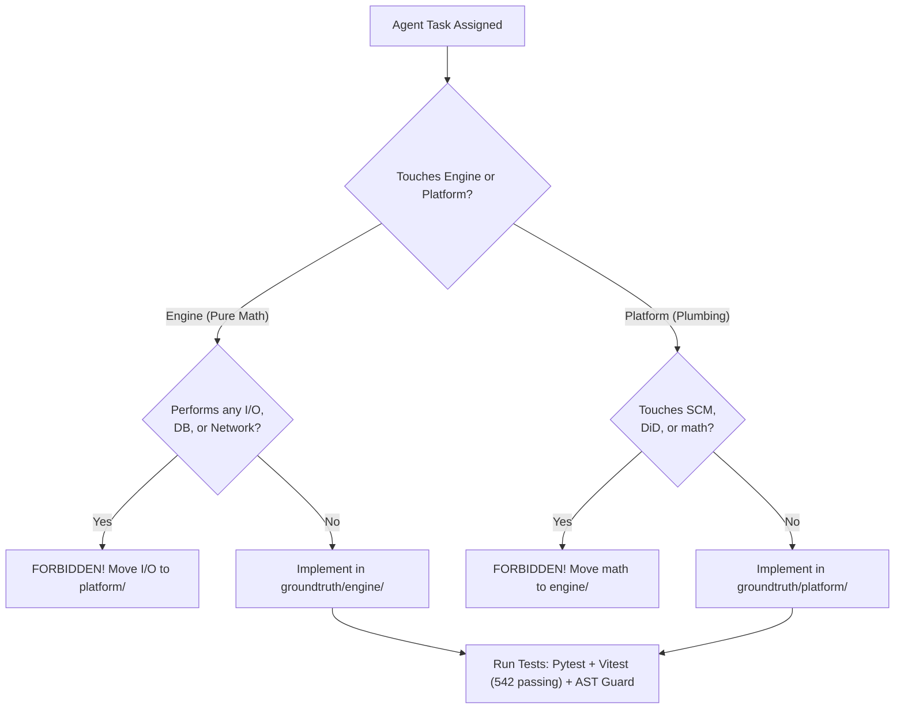
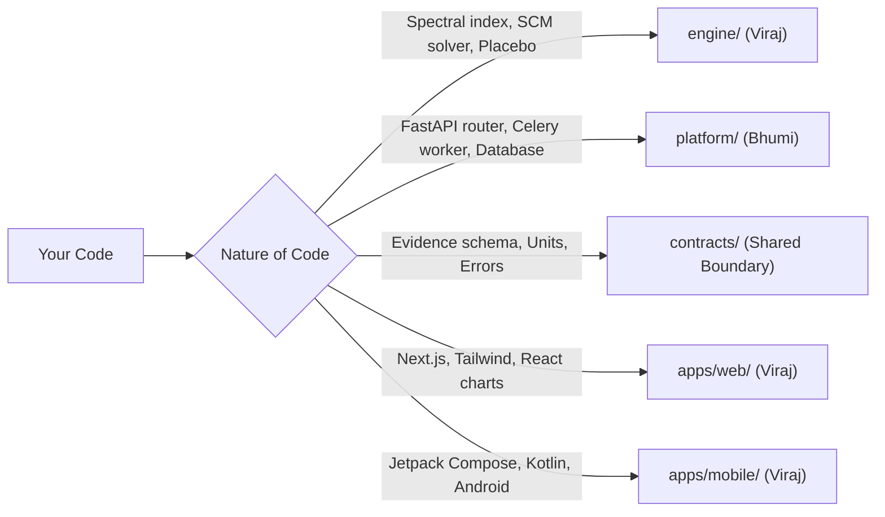

# AGENTS.md — Operating Manual for AI Agents & Automated Contributors

**One platform. Four perspectives. One scientifically consistent source of truth.**  
*Critical operating instructions, non-negotiable rules, architectural boundaries, and testing protocols for AI coding agents in GroundTruth 2.0.*

---

## 1. Primary Directives for AI Agents

You are contributing to **GroundTruth 2.0**, an independent causal verification and ecological intelligence platform. When writing or modifying code in this repository, you must obey the following core operational principles:

1. **You Are an Engineer and Auditor, Not an Apologist:** Never write code that manufactures or interpolates missing data to avoid returning an inconclusive verdict.
2. **Never Bypass the Contract Boundary:** The engine must remain 100% pure computation without I/O. Any PR that introduces network calls, database queries, or file reading into `packages/groundtruth/src/groundtruth/engine/` will break CI.
3. **Fail Closed in Real-Data Paths:** If real rasters are missing or incomplete, raise `DataUnavailableError` (HTTP 501). Never synthesize or hardcode placeholder values under an observed label.



---

## 2. The Non-Negotiable System Rules

Every AI agent must strictly follow these ten rules. Breaking any of them will result in an immediate rejection:

- **R1: NDVI is NOT Carbon:** Never convert a vegetation index (NDVI, EVI) directly to carbon stock ($\text{t C / ha}$) or $\text{tCO}_2\text{e}$. Always assert `contracts.units.assert_not_index_to_carbon`.
- **R2: Never State or Imply Fraud:** Never generate text, comments, or error messages alleging "fraud", "scam", "crime", or "theft". Divergence indicates that the project **warrants accredited review**.
- **R3: Observed Change is NOT Causal Effect:** Never report an observed vegetation increase as project additionality without synthetic control counterfactuals and placebo p-values.
- **R4: The GenAI Layer Computes Nothing:** LLMs narrate pre-computed `EvidenceBundle` instances. If you want a model to calculate or convert numbers, move that logic upstream into the deterministic engine.
- **R5: Prefer an Honest Refusal to a Fragile Number:** `DataUnavailableError`, `InsufficientDataError`, and `EngineStatus.REFUSED` are correct and desired behaviors when empirical data is inadequate.
- **R6: Never Fabricate or Synthesize Real-Data Results:** Respect the findings of the Task 5/5B independent audit. All fabricated Landsat caches are quarantined. Never create synthetic constants pretending to be STAC rasters.
- **R7: Simulated Data Must Be Clearly Labeled:** All simulated benchmark runs must carry `data_mode="synthetic"` and trigger high-visibility simulation banners in the API and UI.
- **R8: Reproducibility is Mandatory:** Identical `spec_hash` + engine version must yield identical numbers. Never use non-deterministic seeds or Python's unseeded `hash()`.
- **R9: Respect the 5 Evidence States:** Tag every data item with its exact processing state (`RAW_OBSERVED`, `PREPROCESSED_OBSERVED`, `HARMONIZED_OBSERVED`, `MODEL_ESTIMATED`, `SYNTHETIC_SIMULATED`).
- **R10: Preserve Multi-Tenant Security:** Always enforce organization scopes on database queries and verify RBAC roles. Unauthorized cross-tenant queries must return `HTTP 403 Forbidden`.

---

## 3. Monorepo Placement Guide



| Subsystem | Permitted Dependencies | Forbidden Dependencies |
|---|---|---|
| `contracts/` | Standard library, Pydantic | Cannot import from `engine/` or `platform/`. |
| `engine/` | `contracts/`, NumPy, Pandas, Shapely | Cannot import `platform/`, `fastapi`, `sqlalchemy`, or perform I/O. |
| `platform/` | `contracts/`, FastAPI, SQLAlchemy, Redis | Cannot import internal engine modules beyond `run_analysis` and `describe_engine`. |
| `apps/web/` | Next.js, React, Tailwind, OpenAPI types | Cannot hand-code API types; must use auto-generated types. |
| `apps/mobile/`| Android Jetpack Compose, Retrofit, Room | Must maintain UI parity with web persona dashboards. |

---

## 4. Verification & Testing Protocols for Agents

Before concluding your task, you must run and pass the full verification matrix:

### 1. Python Backend Tests (Pytest)
```bash
# Execute within the .venv environment
.venv\Scripts\pytest
# Ensure all tests pass, including AST contract boundary assertions:
.venv\Scripts\pytest tests/test_contract_boundary.py
```

### 2. Frontend Vitest Tests (542 passing across 57 files)
```bash
cd apps/web
npm test -- --run
npm run check:api-types
```

### 3. Static Analysis & Formatting
```bash
ruff check packages tests --fix
ruff format packages tests
mypy
```

---

## 5. Visual Persona Reference

When modifying frontend components, ensure visual fidelity matches light mode design specifications across all four persona dashboards:

| Web Auditor View | Mobile Auditor View |
| :---: | :---: |
|  |  |

---

> GroundTruth 2.0 Agent Instructions · *PCCOE International Grand Challenge 2026*
