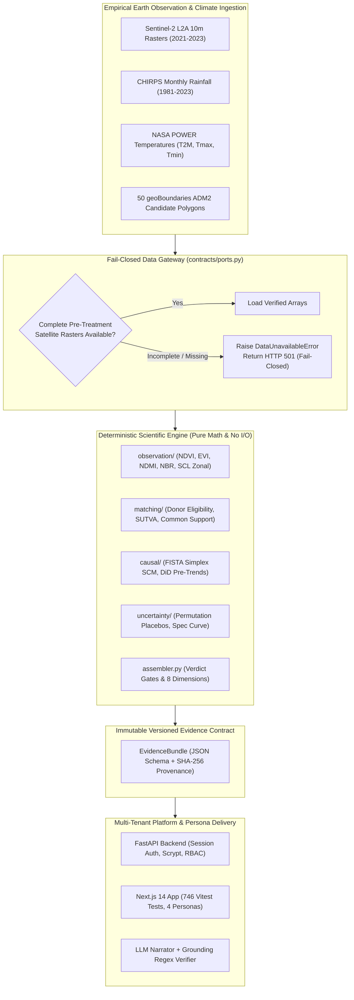
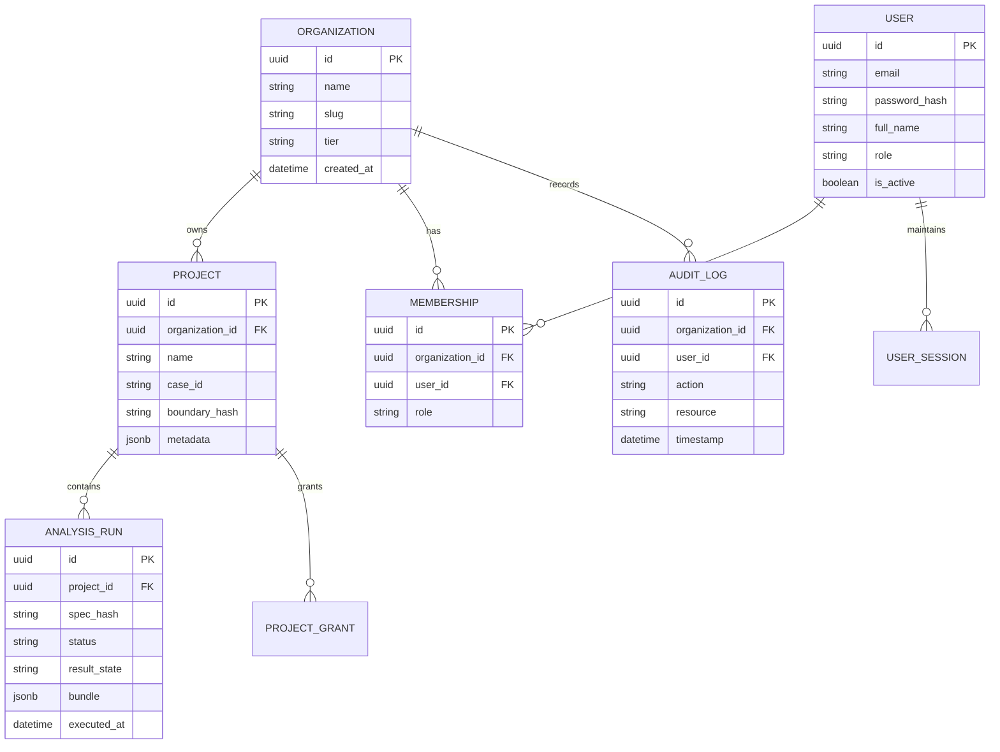
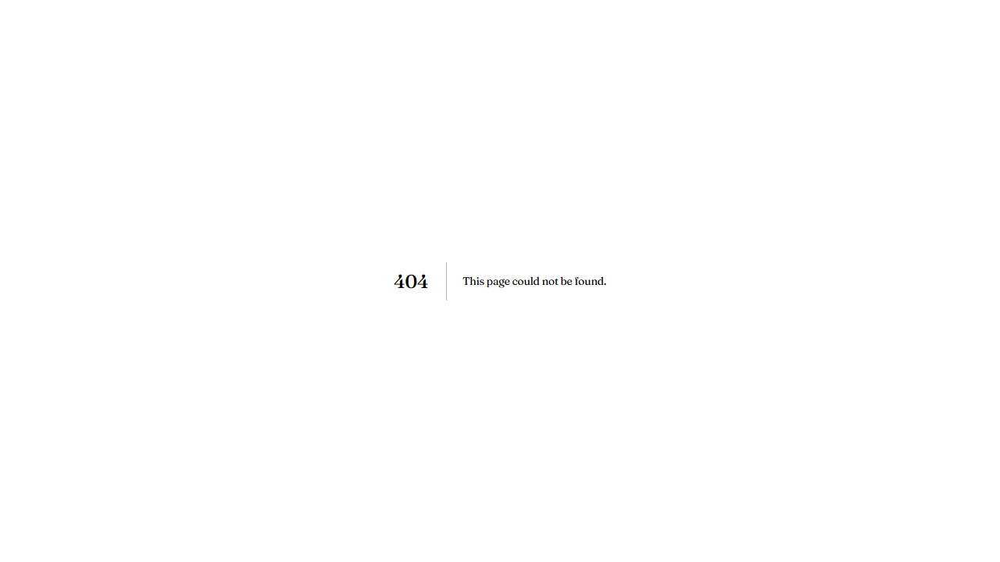
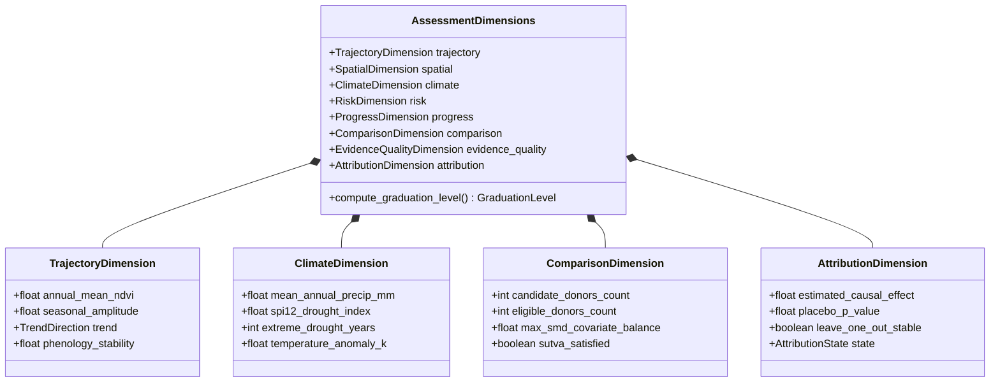
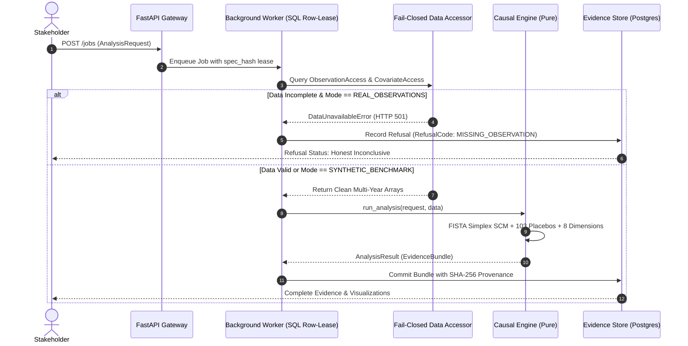
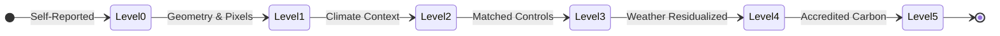
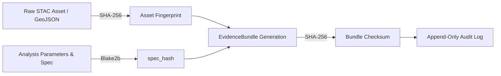

# GroundTruth 2.0 — System Architecture

**One platform. Four perspectives. One scientifically consistent source of truth.**  
*Comprehensive architectural specification of the GroundTruth 2.0 causal verification and ecological intelligence engine.*

---

## 1. Architectural Philosophy & The Load-Bearing Contract Boundary

GroundTruth 2.0 is designed around a fundamental separation of concerns: **the analytical and causal methodology must be strictly insulated from execution plumbing, I/O side effects, and language model interpretation.**



### The Inviolable Contract Rule
1. **The Engine Performs Zero I/O:** The analytical engine (`groundtruth.engine`) contains no database calls, no network sockets, no file reading, and no cloud credential handling. It receives pure memory structures (`AnalysisRequest` and `DataAccess` ports) and returns an immutable `AnalysisResult`.
2. **The Platform Never Performs Methodology:** The platform (`groundtruth.platform`, `apps/api`, `apps/worker`) manages databases, jobs, retries, caching, user sessions, and STAC API clients, but never computes an index, a counterfactual, or an uncertainty interval.
3. **AST Boundary Enforcement in CI:** The contract boundary is asserted mechanically on every commit. `tests/test_contract_boundary.py` parses the Abstract Syntax Tree (AST) of the entire codebase and fails the build if `engine/` imports `platform/`, if `contracts/` imports either side, or if `platform/` imports unauthorized engine internals.

---

## 2. Multi-Tenant Architecture & Persona-Based Role Access Control (RBAC)

GroundTruth 2.0 supports enterprise multi-tenancy. Organizations manage projects, users, and cryptographic audit ledgers. Each stakeholder interacts through a persona view tailored to their operational responsibilities:



### The Four Personas in Architecture

| Persona | Primary Needs & Actions | UI / API Surface | Enforced Permissions |
|---|---|---|---|
| **Restoration NGO / Developer** | Boundary registration, seasonal index tracking (NDVI/EVI), project documents & claims, climate baseline defense. | `/app/{org}/projects/{id}`, `/app/{org}/projects/new`. | `contributor`: Read/write to own projects, register parcels. |
| **CSR / Impact Funder** | Portfolio additionality screening, due diligence reports, accredited review flags, ESG risk metrics. | `/dashboard/funder`, portfolio summary tables, risk radar. | `viewer`: Read-only access across approved project portfolios. |
| **Auditor / MRV Specialist** | STAC scene audit, sensor cross-calibration verification, cryptographic dossier download, fail-closed inspection. | `/dashboard/auditor`, `/cases/{id}/audit`, raw CSV/JSON export. | `auditor`: Cryptographic evidence verification and export. |
| **Government / Regulator** | Territorial conservation tracking, administrative district leakage, SPI-12 drought emergency monitoring. | `/dashboard/government`, district choropleth maps, compliance view. | `regulator`: Cross-project regional jurisdiction oversight. |

### Security Boundary Enforcement
Cross-tenant access is strictly blocked at the database query and middleware levels. Unauthorized attempts to query another organization's project immediately trigger an append-only `AuditLog` entry and return `HTTP 403 Forbidden`:



---

## 3. The 8-Dimension Assessment Engine

The GroundTruth engine computes an 8-dimensional evidence matrix for every project evaluation:



### Assessment Pipeline Sequence


---

## 4. Graduation Levels: 0 through 5

To enforce scientific integrity and eliminate premature additionality claims, GroundTruth 2.0 structures verification as a discrete progression:



```
Level 0: Unverified Claim
  ├── Boundary GeoJSON registered
  └── Developer claimed credits logged (Validation target only)

Level 1: Empirical Observation
  ├── Verified Sentinel-2 / Landsat L2 rasters
  ├── Clear pixel fraction > 65% across AOI
  └── Trajectory and Spatial dimensions computed

Level 2: Contextual Intelligence  <-- [Current Kariba REDD+ Status]
  ├── 43-Year CHIRPS Precipitation (514/516 months)
  ├── NASA POWER Temperatures (T2M, Tmax, Tmin)
  └── SPI-12 Meteorological Drought Diagnostics

Level 3: Donor Counterfactual
  ├── 50 geoBoundaries ADM2 candidates screened
  ├── SUTVA exclusion: Host districts and 10 km leakage belt removed
  └── Common support verified (SMD < 0.25 on elevation, slope, rain)

Level 4: Weather-Residualized Causal Attribution
  ├── Synthetic Control (FISTA) fitted on weather-residualized vegetation
  ├── Permutation placebos in space (p-value add-one floor computed)
  └── Leave-one-out sign stability confirmed

Level 5: Accredited Carbon Verification
  ├── Validated ecozone biomass allometry (t C / ha)
  └── Verified net additionality with wide uncertainty envelopes
```

---

## 5. The Fail-Closed Scientific Gateway & Task 5/5B Audit Remediation

The Task 5 and 5B independent audits identified that historical multi-tile Landsat caches (2001–2022) generated in early tasks were fabricated from hand-typed constants with synthetic scene IDs and placeholder hashes.

### The Remediation Implementation
GroundTruth 2.0 addresses this through **fail-closed architectural gates**:

1. **Quarantining of Fabricated Caches:** All synthetic caches masquerading as real STAC data were quarantined. They cannot be loaded by the platform in any live path.
2. **Explicit Data Mode Routing:** The system operates in two strictly isolated modes:
   - `SYNTHETIC_BENCHMARK`: Runs the fast, deterministic 3-factor latent simulator for UI evaluation, algorithm validation, and integration tests. Clearly badged across API and UI with a high-visibility banner: `"SIMULATED DATA RUN"`.
   - `REAL_OBSERVATIONS`: Connects only to verified empirical sources:
     - Real **Sentinel-2 L2A (2021–2023)** surface reflectance.
     - Real **CHIRPS (1981–2023)** precipitation series.
     - Real **NASA POWER** temperature records.
     - Real **geoBoundaries ADM2** district polygons.
3. **Fail-Closed Gate in Code:** If an analysis is requested with `data_mode="observed"`, and pre-treatment satellite rasters are incomplete, `groundtruth.platform.datasets.access.earth_engine_access()` refuses to substitute or guess:
   ```python
   # Fail-closed guard: raises rather than guessing
   if not is_spatially_complete or missing_pre_treatment_panels:
       raise DataUnavailableError(
           "Earth Engine real pre-treatment panel incomplete for whole AOI. "
           "Refusing to manufacture synthetic values under REAL label."
       )
   ```
4. **Honest Inconclusive Reporting:** The Kariba REDD+ case currently resolves to **Level 2 (Contextual Intelligence)** with an attribution state of **`INCONCLUSIVE (Not Estimable from Real Data Alone)`**, demonstrating that the platform refuses to manufacture numbers to please a user.

---

## 6. Responsive Mobile Web Support

Field auditors and community stakeholders access all multi-tenant dashboards and evidence panels through the responsive Next.js web application (`apps/web`), verified across 375 px mobile browser viewports via Playwright visual regression tests (`apps/web/e2e/visual.spec.ts`). No separate native mobile application is shipped in this repository.

---

## 7. Storage, Cryptographic Provenance, and Immutability

GroundTruth 2.0 guarantees auditability through cryptographic hashing:



- **`spec_hash`:** A deterministic Blake2b hash of all analytical parameters (indicator, baseline years, donor pool filters, masking thresholds). Two identical requests produce identical hashes and reuse verified cached executions.
- **`EvidenceBundle` Immutability:** Generated evidence bundles are assigned a permanent cryptographic checksum and stored in PostgreSQL with write-once semantics. No run result can be modified after generation.
- **Verifiable Dossier Export:** Auditors can download the complete evidence bundle alongside raw CSV time series and PDF verification dossiers for regulatory filings.

---

## 8. Frontend Engineering & Test Architecture

The web application (`apps/web`) is built on **Next.js 14.2**, **TypeScript 5.7**, and **CSS Modules + semantic design tokens**, featuring **746 passing automated tests in Vitest across 75 test files**:

- **Automated OpenAPI Type Generation:** `openapi-typescript` generates exact TypeScript types directly from FastAPI's `/openapi.json`. The frontend never hand-writes an API contract.
- **Fail-Safe UI Gating:** Components automatically switch between simulation alerts, refusal states, and empirical evidence views based on the `EvidenceBundle` state and `data_mode`.
- **Interactive Visualizations:** Pure Canvas/SVG rendering and MapLibre GL vector maps for synthetic control trajectory curves, donor weight distributions, specification multiverse curves, and SPI-12 drought timelines.

```bash
# Frontend test verification
cd apps/web
npm test -- --run
# Output: Test Files 75 passed (75) | Tests 746 passed (746)
```

---

## 9. Technology Stack Matrix

| Layer | Technologies | Key Architectural Attributes |
|---|---|---|
| **Engine** | Python 3.11+, NumPy, Shapely, PyProj | Zero I/O, FISTA convex optimizer, no CVXPY/SciPy overhead. |
| **Platform** | FastAPI, Worker (`apps/worker`), SQLAlchemy 2.0, Alembic (`0001`–`0012`) | SQL row-lease async jobs, optional `redis`/`arq` & `temporalio`, Scrypt password security. |
| **Database** | PostgreSQL 15+ (production) / SQLite (local/test), Redis (optional) | Append-only audit logs, Merkle hash-chained reports, row-level tenant scoping, job leases. |
| **Frontend** | Next.js 14 (App Router), TypeScript 5.7, CSS Modules, MapLibre GL | 746 Vitest tests across 75 files, auto-synced OpenAPI types, 4 persona views. |
| **AI / Narration** | LLM REST (`httpx` for Gemini, OpenAI, Anthropic, NuGen, Groq), Regex Verifier | Zero AI computation, strict numeric grounding and deterministic fallback. |

---

> GroundTruth 2.0 Architecture · *PCCOE International Grand Challenge 2026*
