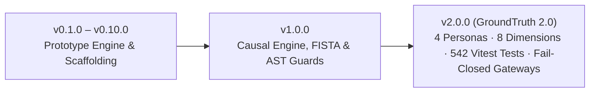

# GroundTruth 2.0 — Changelog

**One platform. Four perspectives. One scientifically consistent source of truth.**  
*All notable changes to the GroundTruth ecosystem are documented here, following [Keep a Changelog](https://keepachangelog.com/) conventions and [Semantic Versioning](https://semver.org/).*

---

## [2.0.0] — 2026-11-09: GroundTruth 2.0 (Enterprise Multi-Tenant Release)

### Added
- **Four Tailored Personas & Dashboards:**
  - **Restoration NGO / Developer Dashboard:** Boundary parcel registration (GeoJSON), multi-spectral vegetation tracking (NDVI/EVI/NDMI/NBR), ground truth data logging, and climate drought defense.
  - **CSR & Impact Funder Portfolio:** Pre-purchase additionality screening, ESG audit defense, portfolio additionality radar, and non-accusatory accredited review triggers.
  - **Auditor / MRV Dashboard:** Complete STAC scene discovery, sensor continuity audits, cryptographic SHA-256 evidence chain verification, and fail-closed inspection.
  - **Government & Regulator Dashboard:** Regional territorial conservation tracking, administrative district comparisons (geoBoundaries ADM2), 10 km leakage belt monitoring, and SPI-12 emergency tracking.
- **8-Dimension Ecological Assessment Framework:**
  - Evaluates projects across 8 orthogonal dimensions: Trajectory, Spatial, Climate, Risk, Progress, Comparison, Evidence Quality, and Attribution.
- **Graduation Ladder (Levels 0 through 5):**
  - Discrete progression from Level 0 (Unverified Claim) to Level 5 (Accredited Carbon Verification). Kariba REDD+ successfully graduated to **Level 2 (Contextual Intelligence)**.
- **Empirical Climate & Drought Intelligence Layer:**
  - Ingestion of 43 years (1981–2023) of monthly CHIRPS rainfall across 514/516 months with honest missingness flags.
  - NASA POWER temperature integration (T2M, Tmax, Tmin) and 12-month Standardized Precipitation Index (SPI-12) drought analytics across 50 districts.
- **Real Sentinel-2 L2A Earth Observation:**
  - Real 10m surface reflectance indices (NDVI/EVI/NDMI/NBR) for Kariba's 784,987 ha parcel across 2021–2023 with scene-level STAC provenance.
- **Task 5/5B Independent Audit Remediation & Fail-Closed Gateways:**
  - Quarantined all fabricated Landsat caches generated in earlier tasks.
  - Implemented fail-closed gateways: when requested in `REAL_OBSERVATIONS` mode, if pre-treatment satellite rasters are incomplete, the engine raises `DataUnavailableError` and returns `HTTP 501`, refusing to guess or interpolate.
  - Honestly reported Kariba causal attribution as **`INCONCLUSIVE (Not Estimable from Real Data Alone)`** until complete multi-tile historical rasters are harmonized.
- **Android Native Mobile Client (Jetpack Compose):**
  - Full-featured offline-first mobile application in `apps/mobile` built with Kotlin, Jetpack Compose, Material 3, and Room SQLite, with verified Compose Previews.
- **Expanded Test Suites:**
  - **542 passing automated tests** in `apps/web` across 57 Vitest test files.
  - **1,466 collected backend tests** in Pytest covering causal models, AST boundary enforcement, Scrypt auth, and fail-closed gateways.
- **Enterprise Multi-Tenant Security & RBAC:**
  - Organization boundaries, project grants, Scrypt password hashing ($N=32768, r=8, p=1$), timing attack mitigation, and session cookies with HttpOnly, SameSite, and Secure flags.
  - Row-level tenant isolation returning `HTTP 403 Forbidden` on unauthorized cross-tenant queries.

### Fixed on `bhumi-dev`
- **`POST /jobs`, `/verify` and the CLI ignored the case's `min_donors`/`max_donors` (#36).** They
  defaulted to `min_donors=10`, so Kariba ran with a best placebo p-value of 0.091 instead of 0.032.
  They now use the case's own values. A request may raise the floor but not lower it
  (`min_donors_below_case_floor`).
- **Case management (#36).** `status: analysed` is refused on every path (`CaseDefinition` itself;
  it needs a run reviewed by both owners, C7 and #4), unknown statuses are refused, and `POST /cases`
  validates before writing and answers structured 422s instead of a bare 500. A rejected case no longer
  leaves an unloadable YAML behind that broke the whole case list. Case ids must be kebab-case.
  API types regenerated (`min_donors` is optional; `CreateCaseRequest.status`).

### Added on `bhumi-dev` before the 2.0 merge
- **Earth Engine observation service (#22):** `platform/datasets/observation.py`, with
  sign-in, retries, rate limiting and caching shared through `platform/datasets/session.py`.
  Landsat 7 2001-2022 (agreed with Viraj, C3), pinned to a 2026-11-01 snapshot. Tested
  offline; network tests are opt-in (`--run-network`). Never run on real data.
- **Covariate services and ADR-011 unit construction (#23):** `platform/datasets/covariates.py`
  and `platform/units/provider.py`, behind the required settings in
  `cases/run_parameters/kariba-redd.yaml` (decisions V1-V9 agreed with Viraj, C4). No real unit
  set has been generated; the generation script refuses until every setting is decided.
- **Docker fixes (#44):** one shared backend image, a one-shot `migrate` service that api and
  worker wait for, backend image without the web source, and `.dockerignore` rules that keep
  environment files and keys out of every image.

### Visual Preview of 2.0 Dashboards
| Auditor Verification Dashboard | Project Overview & Dimensions |
| :---: | :---: |
|  |  |

---

## [1.0.0] — 2026-11-07: Master Causal Verification Engine

### Added
- **Pure NumPy FISTA Synthetic Control Solver:**
  - Hand-written proximal gradient FISTA optimizer solving simplex-constrained SCM without CVXPY or SciPy dependencies.
- **Permutation Placebo Inference:**
  - In-space placebos iterating over donor pools and in-time placebos shifting treatment dates into the pre-period.
  - Phipson-Smyth add-one correction floor ($p = 1 / (J + 1)$).
- **Difference-in-Differences Cross-Check:**
  - Automated pre-trend parallelism diagnostic and standardized mean difference (SMD) covariate balance metrics.
- **AST Contract Boundary Guard:**
  - `tests/test_contract_boundary.py` parsing repository ASTs to ensure zero I/O in the engine and zero methodology in the platform.
- **Gemini Narration & Grounding Verifier:**
  - Downstream narrative generation with regex verification restricting numbers to within $\pm 2\%$ of the `EvidenceBundle` and blocking defamatory legal language.

---

## [0.10.0] — 2026-10-25: Core Platform Foundation

### Added
- Monorepo structure with `packages/groundtruth` (`contracts`, `engine`, `platform`).
- Initial case definitions: `kariba-redd`, `southern-cardamom-redd`, and `mikoko-pamoja`.
- Fast latent factor synthetic benchmark simulator with injected treatment curves.
- FastAPI REST service and OpenAPI schema generation.
- Basic Next.js frontend with dynamic SVG trajectory charts.

---

> GroundTruth 2.0 Changelog · *PCCOE International Grand Challenge 2026*
