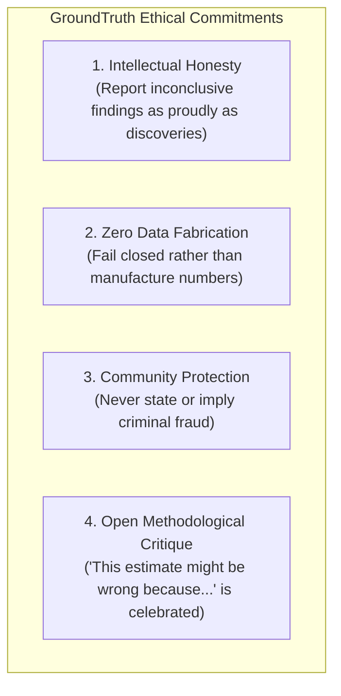

# GroundTruth 2.0 — Scientific Code of Conduct & Ethical Research Charter

**One platform. Four perspectives. One scientifically consistent source of truth.**  
*Standards of intellectual honesty, remote-sensing ethics, and community protection for GroundTruth 2.0.*

---

## 1. Our Charter: Science in the Service of Real Ecosystems

GroundTruth 2.0 generates evidence that directly influences climate finance, community land rights, and corporate conservation investments. A flawed finding, a careless accusation, or an over-optimistic estimate harms real people, rural livelihoods, and fragile ecosystems.

This reality establishes strict ethical obligations for all contributors:

---

## 2. Standards of Conduct

### Toward the Subject Matter & Rural Communities
1. **Never Allege Criminal Fraud:** A statistical divergence between an independent causal estimate and a project developer's claimed baseline indicates that the claim **warrants accredited review**. Satellite data cannot determine human intent, corporate malice, or administrative error. 
2. **Respect Local Livelihoods:** Deforestation in communal buffer lands often reflects subsistence agricultural needs during extreme droughts (such as southern Africa's 2019 drought). Remote-sensing verifiers must never characterize subsistence farming as criminal activity.
3. **Accredited Review, Not Unilateral Condemnation:** GroundTruth produces decision-support intelligence to triage where expensive on-ground audits should be deployed. It is never a unilateral basis for canceling or invalidating a project.

### Toward the Scientific Community & Contributors
1. **Report Inconclusive Results Transparently:** In GroundTruth, returning `INCONCLUSIVE` due to data missingness is a successful scientific execution. Attempting to force an unsupportable number through the pipeline violates our core principles.
2. **Zero Tolerance for Data Fabrication:** Any commit that hardcodes simulated values under real-data labels, synthesizes fake STAC scene IDs, or fabricates regression coefficients will result in immediate removal from the project.
3. **Continuous Peer Review:** We welcome methodology challenges from anyone, at any time, on any merged code. The phrase *"This estimate might be wrong because..."* is the highest form of contribution to this repository.

---

## 3. Unacceptable Behavior

- **Data Fabrication or Manipulation:** Fabricating satellite observations, tuning donor pools to reach a desired p-value, or cherry-picking baseline years.
- **Defamatory Accusations:** Using words such as "fraud", "scam", "hoax", or "grift" in commit messages, documentation, code comments, or public presentations.
- **Suppression of Negative Results:** Concealing failed placebo tests, hideously wide confidence intervals, or high covariate imbalances.
- **Interpersonal Harassment:** Demeaning, discriminatory, or disrespectful language directed at peers or project maintainers.

---

## 4. Enforcement & Reporting

Violations of this Code of Conduct should be reported directly to the maintainers:
- **Viraj Jadhao:** `viraj.jadhao28@gmail.com`
- **Bhumi Sirvi:** `bhumisirvi2735@gmail.com`

All reports will be reviewed promptly and handled with strict confidentiality. Violations will result in immediate reversion of offending pull requests and suspension of repository access.

---

> GroundTruth 2.0 Code of Conduct · *PCCOE International Grand Challenge 2026*
