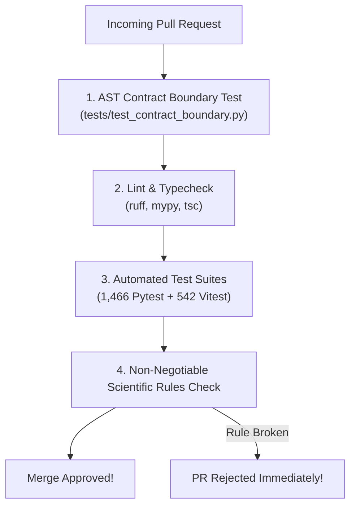
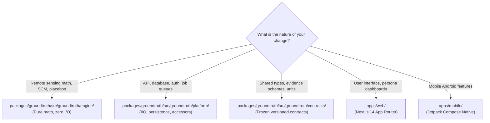

# Contributing to GroundTruth 2.0

**One platform. Four perspectives. One scientifically consistent source of truth.**  
*Guidelines for scientific researchers, remote-sensing specialists, and software engineers contributing to GroundTruth 2.0.*

---

## 1. The Core Standard: Scientific Integrity Over Easy Answers

GroundTruth 2.0 exists to provide defensible, empirical ground truth for carbon markets and ecosystem restoration. We welcome contributions from economists, remote-sensing scientists, and full-stack developers. 

However, unlike typical software projects where functionality is valued above all, **in GroundTruth, methodological validity and refusal to fabricate take absolute precedence over producing convenient numbers.**



---

## 2. The Non-Negotiable Scientific Principles

These are unbreakable rules enforced by automated tests, AST boundary parsers, and code review:

### Rule 1: Never Convert a Spectral Index Directly into Carbon
$$\text{NDVI} \quad \not\equiv \quad \text{Carbon Stock } (\text{t C / ha})$$
A spectral index is a unitless reflectance ratio; carbon is physical mass. Any conversion requires site-specific, destructive harvest biomass allometry with explicit uncertainty envelopes. `groundtruth.contracts.units.assert_not_index_to_carbon` raises an exception on implicit conversions. Do not bypass or mock this guard.

### Rule 2: Never State or Imply Fraud
A divergence between an independent causal estimate and a project developer's claimed baseline indicates that the claim **warrants accredited review**. Satellite data cannot determine human intent. No code path, commit message, or generated narrative may use accusatory language ("fraud", "scam", "crime", "ponzi").

### Rule 3: Observed Change is Not Causal Effect
A project area that greens over time does not prove additionality. Estimates must condition on an uncontaminated donor pool, test for parallel pre-trends, and pass in-space and in-time permutation placebos.

### Rule 4: The GenAI Layer May Not Compute Anything
Language models are strictly isolated downstream of the analytical engine. Gemini explains the completed `EvidenceBundle`; it never calculates, annualizes, or imputes numbers.

### Rule 5: Prefer an Honest Refusal to a Fragile Number
`InsufficientDataError`, `DataUnavailableError`, and the `INCONCLUSIVE` verdict are foundational features. A due-diligence team is protected by an honest "We cannot tell," whereas a fragile, low-donor point estimate creates severe financial risk.

### Rule 6: Never Fabricate or Synthesize Real-Data Values
Following the Task 5/5B independent audit, all fabricated Landsat caches were quarantined. Any real-data accessor encountering missing pre-treatment rasters must raise `DataUnavailableError` and return `HTTP 501`. Never hardcode plausible numbers or substitute synthetic series under a real label.

### Rule 7: Respect the 5 Evidence States
Every data point must carry its correct state: `RAW_OBSERVED`, `PREPROCESSED_OBSERVED`, `HARMONIZED_OBSERVED`, `MODEL_ESTIMATED`, or `SYNTHETIC_SIMULATED`.

---

## 3. Local Development & Pre-Commit Verification

Before opening a pull request, run the complete local verification pipeline. Set up the
pre-commit hook once (`git config core.hooksPath scripts/hooks`, see
[DEVELOPMENT.md, section 9](DEVELOPMENT.md#9-pre-commit-hook)) and it catches formatting and
lint problems at commit time, in about a second.

```bash
# 1. Format and lint Python codebase
ruff format packages tests
ruff check packages tests --fix

# 2. Static type checking
mypy

# 3. Backend test suite (1,466 tests)
pytest

# 4. AST architectural boundary enforcement
pytest tests/test_contract_boundary.py

# 5. Frontend test suite (542 tests)
cd apps/web
npm test -- --run
npm run check:api-types
```

---

## 4. Where Code Belongs in the Monorepo



| Domain | Target Path | Governance |
|---|---|---|
| **Causal & Geospatial Math** | `packages/groundtruth/src/groundtruth/engine/` | Pure computation. No database, no network, no disk reads. |
| **Data Ingestion & Jobs** | `packages/groundtruth/src/groundtruth/platform/` | Database access, Celery jobs, fail-closed accessors. |
| **Shared Contracts** | `packages/groundtruth/src/groundtruth/contracts/` | Schema changes require mutual maintainer approval. |
| **Web Frontend** | `apps/web/` | TypeScript, Tailwind, 542 Vitest tests. |
| **Android Mobile** | `apps/mobile/` | Kotlin, Jetpack Compose, Material 3. |

---

## 5. Adding New Cases

New conservation projects are defined as YAML records in `cases/`:
1. Provide valid GeoJSON boundary geometry in `cases/boundaries/{case_id}.geojson`.
2. Do not set `status: analysed` unless a real-data analysis run has been formally reviewed and committed.
3. Include published third-party audit findings in the `known_reference` block for post-hoc validation only—the pipeline is forbidden from reading this block during estimation.

---

## 6. Commit Message Standards

We follow the **Conventional Commits** specification:
- `feat(engine): introduce weather residualization in synthetic control`
- `fix(gateway): fail-closed when pre-treatment rasters are missing`
- `test(web): add persona switcher integration tests`
- `docs(audit): publish Task 5B remediation findings`

---

> GroundTruth 2.0 Contribution Guide · *PCCOE International Grand Challenge 2026*
