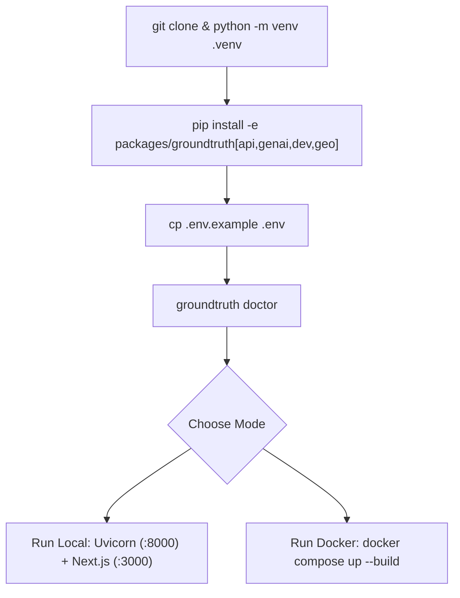
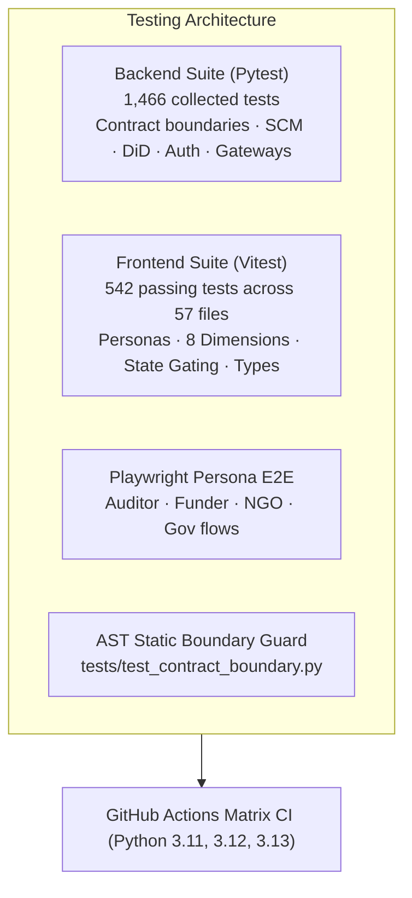
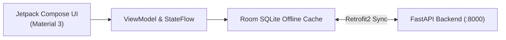

# GroundTruth 2.0 — Developer & Contributor Guide

**One platform. Four perspectives. One scientifically consistent source of truth.**  
*Comprehensive developer guide for setting up, running, testing, and hardening the GroundTruth 2.0 platform.*

---

## 1. Quickstart: One-Command Execution

GroundTruth provides unified startup scripts for Windows, macOS, and Linux:

```powershell
# Windows (PowerShell)
.\run.ps1            # Starts Python venv, FastAPI API (:8000), and Next.js Web (:3000)
.\run.ps1 docker     # Starts full Docker stack: Postgres, Redis, API, Worker, Web
.\run.ps1 test       # Runs full Python pytest suite
```

```bash
# macOS / Linux (Bash)
./run.sh local       # Starts API and Next.js locally
./run.sh docker      # Boots Docker Compose environment
./run.sh test        # Executes all test suites
```

---

## 2. Local Environment Setup

### Prerequisites
- **Python:** 3.11 or higher (Python 3.11, 3.12, 3.13 supported)
- **Node.js:** v18.0.0 or higher (v20+ LTS recommended)
- **Git:** 2.40+
- **Docker & Docker Compose:** (Optional, for containerized multi-service deployment)
- **Android Studio / Android SDK:** (Optional, for `apps/mobile` Jetpack Compose development)

### Step-by-Step Installation

```bash
# 1. Clone repository
git clone https://github.com/Viraj281105/GroundTruth.git
cd GroundTruth

# 2. Configure Python Virtual Environment
python -m venv .venv

# Activate on Windows (PowerShell):
.venv\Scripts\Activate.ps1
# Activate on macOS / Linux:
source .venv/bin/activate

# 3. Install GroundTruth package with development extras
pip install -e "packages/groundtruth[api,genai,dev,geo]"

# 4. Copy Environment Template
cp .env.example .env

# 5. Verify system readiness with doctor
groundtruth doctor
```

`groundtruth doctor` performs an honest audit of installed dependencies, cloud credentials, and real data assets. It explicitly notes which capabilities are active and which are fail-closed.



---

## 3. Package Structure & Optional Extras

GroundTruth uses a modular dependency architecture. The core causal engine depends only on NumPy, Pandas, and Pydantic—heavy geospatial and cloud dependencies are isolated behind optional extras:

| Extra | Included Dependencies | Purpose |
|---|---|---|
| `core` | `numpy`, `pandas`, `pydantic>=2.0` | Pure deterministic causal engine and FISTA solver. Runs anywhere offline. |
| `api` | `fastapi`, `uvicorn`, `httpx` | REST API, OpenAPI schema generation, and HTTP routing. |
| `genai` | `google-genai` | Downstream Gemini narrative generation (strictly grounding-verified). |
| `geo` | `geopandas`, `shapely`, `rasterio`, `pyproj` | STAC zonal statistics, polygon intersection, and coordinate projections. |
| `dev` | `pytest`, `ruff`, `mypy`, `hypothesis` | Complete testing, linting, and static analysis toolchain. |

---

## 4. Running the Development Services

### A. FastAPI Backend Service
```bash
# Run API with live reloading on port 8000
uvicorn apps.api.main:app --reload --port 8000
# OpenAPI documentation available at: http://localhost:8000/docs
```

### B. Next.js 14 Web Frontend
The frontend features four tailored persona views (NGO, Funder, Auditor, Government) and comprehensive 8-dimension visualizations:

```bash
cd apps/web
npm install
npm run dev
# Web application available at: http://localhost:3000
```

### C. Background Worker (Celery & Database Queue)
```bash
# Execute background analysis jobs with heartbeat and lease management
python -m apps.worker.main
```

### D. Full Docker Compose Stack
Boot the production-grade multi-tenant stack with PostgreSQL and Redis:

```bash
docker compose up --build
```
Services instantiated:
- `postgres`: PostgreSQL 15 database storing tenants, projects, users, sessions, and `EvidenceBundle` records.
- `redis`: Redis 7 instance managing asynchronous job queues.
- `api`: FastAPI ASGI container (Port 8000).
- `worker`: Background analysis worker processing causal inference jobs.
- `web`: Next.js production build (Port 3000).

---

## 5. Comprehensive Test Execution

GroundTruth maintains an exhaustive, multi-layered automated testing regime:



### Running Backend Tests (Pytest)
```bash
# Run the entire backend test suite
pytest

# Run specific functional test categories
pytest tests/auth/                        # Auth, Scrypt, session, and RBAC tests
pytest tests/engine/                      # FISTA solver, DiD, allometry, placebos
pytest tests/claims/                      # Adversarial grounding & defamation blocks
pytest tests/test_contract_boundary.py    # AST contract boundary enforcement
```

### Running Frontend Tests (Vitest)
The web application features **542 passing automated tests across 57 test files**:

```bash
cd apps/web
npm test -- --run
```
Output:
```
 Test Files  57 passed (57)
      Tests  542 passed (542)
   Duration  4.00s
```

### Checking Contract Boundaries and API Types
GroundTruth prevents schema drift between the Python backend and TypeScript frontend using automated OpenAPI synchronization:

```bash
# Verify TypeScript API types match the backend schema
cd apps/web
npm run check:api-types

# Regenerate TypeScript types from backend OpenAPI JSON
make api-types
```

---

## 6. Native Mobile Development (Jetpack Compose)

Field auditors and project managers capture evidence and review dashboards on mobile via `apps/mobile`:



### Mobile Views
The native client provides full parity with the web interface for offline inspection:

| Native Auditor Screen | Native NGO Screen |
| :---: | :---: |
|  |  |

To run the mobile test suite or previews:
```bash
cd apps/mobile
./gradlew test
./gradlew assembleDebug
```

---

## 7. Daily Development Commands

| Command | Action |
|---|---|
| `ruff check packages tests` | Fast Python linting and code style inspection. |
| `ruff format packages tests` | Automated code formatting adhering to PEP 8 standards. |
| `mypy` | Strict static type checking across engine and platform. |
| `cd apps/web && npm run lint` | ESLint static analysis for Next.js components. |
| `groundtruth verify kariba-redd --synthetic` | Execute complete CLI verification run on Kariba synthetic benchmark. |

---

## 8. Fail-Closed Scientific Testing

A critical component of GroundTruth 2.0 is testing that the platform **fails closed** when empirical rasters are missing, preventing the accidental presentation of synthetic data under a real label:

```python
# tests/test_fail_closed.py
def test_real_observations_mode_raises_when_rasters_missing():
    """Verify that REAL mode refuses to guess when data is incomplete."""
    request = AnalysisRequest(
        case_id="kariba-redd",
        data_mode=DataMode.REAL_OBSERVATIONS,
    )
    with pytest.raises(DataUnavailableError) as exc_info:
        run_analysis(request, data_access=live_data_access)
    
    assert "pre-treatment panel incomplete" in str(exc_info.value)
```

This fail-closed architecture guarantees that no fabricated or synthetic values can ever be silently served to auditors or the public.

## 9. Pre-Commit Hook

A hook that stops a commit CI would reject for formatting or lint (#21). It checks only the
files you staged, and only with CI's own commands:

| Staged files | Check | Same as CI |
|---|---|---|
| Python in `packages/` and `tests/` | `ruff format --check` and `ruff check` | the `Lint` and `Check formatting` steps, with the same pinned ruff (`ruff==0.17.3` in the dev extra) |
| `.ts`, `.tsx`, `.js`, `.mjs` in `apps/web/` | ESLint | `npm run lint` |
| the staged diff | `gitleaks`, if installed | (not a CI step: a last chance to catch a key before it is pushed) |

It never runs mypy or the tests (a slow hook gets bypassed) and never edits a file: it reports
and prints the command that fixes the problem.

**Measured on Windows 11, warm, all checks running at once:** about **0.3 s** for a Python-only
change and **1.3 s** when web files are staged (ESLint's Node start-up is most of that).

### Set it up once per clone

The hook runs the Python of your activated environment, else the repository's `.venv`, so
install the dev extra first (section 2): that is what gives it CI's exact ruff.

```powershell
# Windows (PowerShell)
git config core.hooksPath scripts/hooks
winget install --id Gitleaks.Gitleaks   # optional: secret scanning; skipped with a note if absent
```

```bash
# macOS / Linux
git config core.hooksPath scripts/hooks
chmod +x scripts/hooks/pre-commit       # git ignores a hook that is not executable
brew install gitleaks                   # optional (or your package manager)
```

Git for Windows runs the hook through its bundled `sh`, so nothing else is needed on Windows.

### Using it

```bash
git commit                                   # runs the hook on what you staged
python scripts/hooks/pre_commit.py FILE...   # check particular files by hand
ruff format packages tests                   # fix what the hook reported
ruff check --fix packages tests
```

If the hook says ruff's version differs from CI's, reinstall the dev extra:
`pip install -e "packages/groundtruth[dev]"`. Bypass it only in an emergency
(`git commit --no-verify`); CI will still check.

It checks the working-tree copy of each staged file, so stage what you mean to commit.

### Optional: the pre-commit framework

`.pre-commit-config.yaml` runs the same ruff checks plus gitleaks through the `pre-commit`
framework (`pip install pre-commit && pre-commit install`). It is kept for anyone who prefers it,
but measured warm on Windows it takes about **3 s**, most of it the framework's own start-up, so
the script above is the supported hook. mypy is in its manual stage only:

```bash
pre-commit run mypy --hook-stage manual --all-files
```

---

> GroundTruth 2.0 Development Guide · *PCCOE International Grand Challenge 2026*
