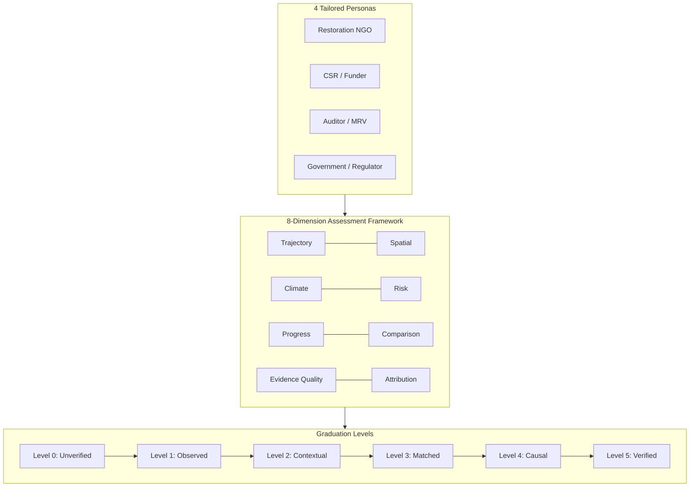
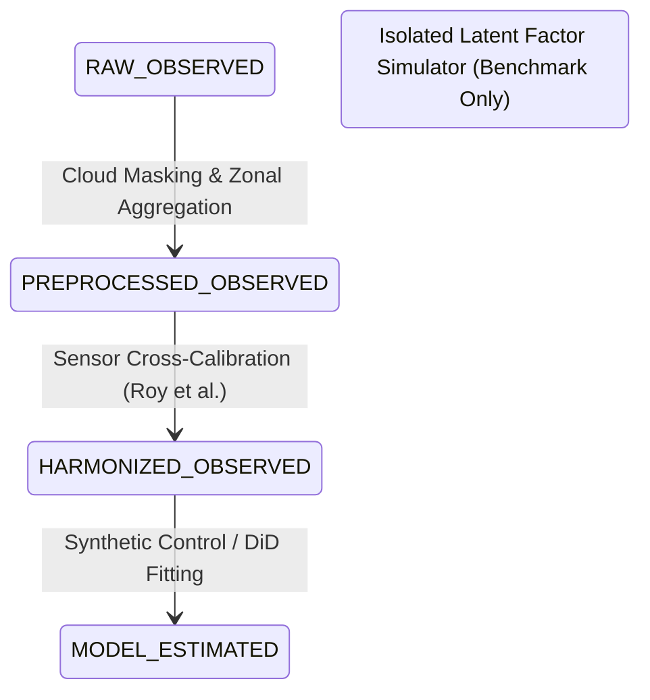

# GroundTruth 2.0 — Scientific & Technical Glossary

**One platform. Four perspectives. One scientifically consistent source of truth.**  
*Definitive glossary of domain, econometric, remote-sensing, and architectural terms used across GroundTruth 2.0.*

---

## 1. Domain Ontology & System Concepts

---

## 2. The Four Personas

**Restoration NGO / Developer** — The on-ground conservation or reforestation project operator responsible for establishing project boundaries, executing management activities, and registering crediting claims. GroundTruth equips NGOs with transparent baselines, seasonal vegetation tracking, and meteorological drought evidence to defend real ecological gains.

**CSR & Impact Funder** — Corporate sustainability officers, institutional ESG allocators, and carbon-credit buyers who finance restoration projects or purchase carbon credits. GroundTruth provides pre-purchase additionality screening, portfolio risk oversight, and non-accusatory accredited review triggers.

**Auditor / MRV Specialist** — Measurement, Reporting, and Verification (MRV) consultants and accredited third-party certification auditors. GroundTruth provides auditors with cryptographic SHA-256 evidence dossiers, raw STAC scene metadata, sensor cross-calibration verification, and fail-closed inspection tools.

**Government & Territorial Regulator** — Environmental ministries, national park authorities, and regional territorial planners. GroundTruth provides regional jurisdictional oversight, administrative district comparison, 10 km leakage belt monitoring, and SPI-12 drought emergency coordination.

---

## 3. The 8 Assessment Dimensions

**1. Trajectory Dimension** — Decadal multi-sensor spectral trend analysis (NDVI, EVI, NDMI, NBR) across annual dry-season composites. Evaluates whether vegetative canopy is recovering, stable, or degrading while controlling for seasonal phenology.

**2. Spatial Dimension** — Pixel-level spatial distribution and zonal canopy variance across the project boundary. Requires $>65\%$ valid clear-pixel coverage after cloud and shadow masking to validate spatial completeness.

**3. Climate Dimension** — Integration of 43-year continuous monthly rainfall (CHIRPS) and 2m ambient temperatures (NASA POWER). Evaluates historical droughts and separates weather-induced fluctuations from human-induced degradation.

**4. Risk Dimension** — Monitoring of a 10 km peripheral buffer (leakage belt) surrounding the project boundary alongside active fire alerts to detect displacement of deforestation into adjoining communities.

**5. Progress Dimension** — Empirical comparison between the developer's claimed credit issuance schedule and the observed biomass trajectory over the crediting timeline.

**6. Comparison Dimension** — Screening of a 50 ADM2 candidate donor pool (geoBoundaries) to establish an uncontaminated control group, enforcing SUTVA by excluding host districts and leakage belts.

**7. Evidence Quality Dimension** — Comprehensive audit of STAC scene availability, cloud masking flags, sensor transitions (Landsat 5/7/8/Sentinel-2), and data completeness.

**8. Attribution Dimension** — The isolated causal treatment effect determined by synthetic control and difference-in-differences estimators, gated by permutation placebo testing and leave-one-out stability.

---

## 4. Graduation Levels (0 to 5)

**Level 0 (Unverified Claim)** — Initial registration of project metadata and developer-reported crediting assertions. Contains no empirical satellite validation.

**Level 1 (Empirical Observation)** — Spatial project boundary (GeoJSON) validated and multi-year high-resolution satellite imagery (Sentinel-2 / Landsat) successfully ingested with spatial coverage $>65\%$.

**Level 2 (Contextual Intelligence)** — Long-term 43-year historical climate patterns, baseline weather anomalies, and Standardized Precipitation Index (SPI-12) droughts evaluated. *(Current status of Kariba REDD+ in GroundTruth 2.0).*

**Level 3 (Donor Counterfactual)** — Spatially eligible, uncontaminated donor pool established outside the project's leakage belt with proven common support on baseline elevation, slope, and rainfall.

**Level 4 (Weather-Residualized Causal Model)** — Synthetic control estimator fitted on weather-residualized vegetation series, passing in-space placebos, in-time placebos, and leave-one-out sign stability tests.

**Level 5 (Accredited Carbon Verification)** — Verified canopy structural gains converted to net metric tonnes of $\text{CO}_2\text{e}$ additionality using site-validated destructive biomass allometry with propagated uncertainty envelopes.

---

## 5. The Five Evidence States

Every empirical value inside an `EvidenceBundle` carries an explicit **Evidence State** reflecting its processing depth:

- **`RAW_OBSERVED`:** Unprocessed satellite digital numbers (DN) or surface reflectance rasters fetched directly from provider STAC assets.
- **`PREPROCESSED_OBSERVED`:** Pixel values after QA cloud masking, nodata filtering, and geometric zonal aggregation over project polygons.
- **`HARMONIZED_OBSERVED`:** Spectral values transformed across sensor transitions (e.g., Landsat 7 ETM+ to Landsat 8 OLI) using verified cross-calibration functions.
- **`MODEL_ESTIMATED`:** Counterfactual estimates and causal treatment effects produced by econometric estimators (SCM, DiD).
- **`SYNTHETIC_SIMULATED`:** Artificially generated values produced by the latent factor simulator for testing or demonstration. Always accompanied by explicit simulation warnings.

---

## 6. Causal Inference & Econometrics

**Additionality** — The climate or ecological benefit that exists *because* a conservation intervention occurred, which would not have occurred otherwise. Counterfactual by definition, requiring mathematical estimation rather than direct physical measurement.

**Counterfactual** — The unobserved state that the project area would have exhibited absent the project. GroundTruth estimates this using an optimal weighted combination of comparable untreated donor regions.

**Synthetic Control Method (SCM)** — Econometric estimator that determines a vector of non-negative weights $\mathbf{w}$ over untreated donor units minimizing pre-treatment discrepancy between treated and synthetic units:
$$\min_{\mathbf{w}} \|\mathbf{Y}_{1,\text{pre}} - \mathbf{Y}_{0,\text{pre}}\mathbf{w}\|_2^2 \quad \text{s.t.} \quad w_j \ge 0, \; \sum w_j = 1$$

**Unit Simplex Constraint** — The mathematical restriction $w_j \ge 0$ and $\sum w_j = 1$. Prevents spatial extrapolation outside the convex hull of real observed donors.

**FISTA (Fast Iterative Shrinkage-Thresholding Algorithm)** — An accelerated first-order proximal gradient optimization method used by GroundTruth to solve the simplex-constrained synthetic control problem efficiently in pure NumPy.

**SUTVA (Stable Unit Treatment Value Assumption)** — Fundamental causal assumption that the intervention on the treated unit does not affect the potential outcomes of untreated control units. Violated if donor districts include project host districts or regions within the 10 km leakage belt.

**Difference-in-Differences (DiD)** — A secondary transparent causal estimator comparing pre-to-post changes between treated and control groups. Requires the **Parallel Trends Assumption**, which GroundTruth validates using a formal pre-trend test.

**In-Space Placebo Inference** — Permutation testing procedure where each untreated donor district is iteratively reassigned as a "fake" treated unit. Generates a non-parametric null distribution of post/pre RMSPE ratios to compute empirical p-values.

**Phipson-Smyth Add-One Correction** — Formula for exact permutation p-values:
$$p = \frac{1 + \sum_{j=1}^J \mathbb{I}(R_j \ge R_1)}{1 + J}$$
Ensures a p-value is never falsely reported as zero. For a pool of 50 donors, the theoretical minimum p-value is $1/51 \approx 0.0196$.

**Standardized Mean Difference (SMD)** — Diagnostic metric assessing covariate balance between the treated unit and synthetic control:
$$\text{SMD} = \frac{|\bar{X}_{\text{treated}} - \bar{X}_{\text{synthetic}}|}{\sigma_{\text{donor pool}}}$$
Values $< 0.10$ indicate excellent balance; values $> 0.25$ indicate severe imbalance and trigger an inconclusive verdict.

**Weather Residualization** — Regressing vegetation index series on continuous monthly rainfall and temperature covariates prior to SCM optimization, ensuring that residual series isolate human conservation impact from climate cycles.

---

## 7. Remote Sensing & Climate Science

**NDVI (Normalized Difference Vegetation Index)** — $(\text{NIR} - \text{Red}) / (\text{NIR} + \text{Red})$. Unitless reflectance ratio measuring photosynthetic greenness. **Not carbon.**

**EVI (Enhanced Vegetation Index)** — Modified vegetation index incorporating blue reflectance to minimize atmospheric aerosols and reduce canopy saturation over dense tropical rainforests.

**NDMI (Normalized Difference Moisture Index)** — $(\text{NIR} - \text{SWIR1}) / (\text{NIR} + \text{SWIR1})$. Measures canopy water content and drought-induced foliar dehydration.

**NBR (Normalized Burn Ratio)** — $(\text{NIR} - \text{SWIR2}) / (\text{NIR} + \text{SWIR2})$. Used to detect fire scar severity and post-fire ecological regeneration.

**STAC (SpatioTemporal Asset Catalog)** — Open specification for structuring and querying geospatial metadata across satellite imagery archives (USGS, Copernicus, Planetary Computer).

**Sentinel-2 L2A** — Bottom-of-Atmosphere (BOA) surface reflectance imagery captured by the European Space Agency's twin Sentinel-2 satellites at 10m to 20m spatial resolution.

**Landsat Collection 2 Level 2** — Surface reflectance products from Landsat 5 TM, Landsat 7 ETM+, Landsat 8 OLI, and Landsat 9 OLI-2, distributed by the USGS with consistent radiometric calibration.

**SLC-off (Scan Line Corrector Failure)** — Mechanical failure of the Scan Line Corrector on Landsat 7 in May 2003, resulting in ~22% data loss per scene in diagonal striping patterns outside the central ground track.

**CHIRPS** — Climate Hazards Group InfraRed Precipitation with Stations. High-resolution ($0.05^\circ$) quasi-global rainfall dataset spanning 1981 to present.

**NASA POWER** — Prediction of Worldwide Energy Resources. Satellite-derived surface meteorology (temperature, relative humidity, solar irradiance) on a $0.5^\circ \times 0.625^\circ$ global grid.

**SPI-12 (Standardized Precipitation Index, 12-Month)** — Standard meteorological drought index fitting a gamma distribution to 12-month accumulated precipitation against a 30-year baseline. Values $\le -1.5$ indicate severe drought; values $\le -2.0$ indicate extreme drought.

---

## 8. Platform Architecture & Security

**Fail-Closed Scientific Guard** — System policy where analytical pipelines raise an explicit exception (`DataUnavailableError`) and return `HTTP 501` when required empirical data is incomplete, rather than silently substituting synthetic approximations.

**`spec_hash`** — A deterministic cryptographic Blake2b hash computed over all analysis parameters. Serves as a persistent cache key and deduplication identifier for identical requests.

**`EvidenceBundle`** — An immutable, versioned JSON data structure encapsulating the full empirical results, dimensional scores, sensor provenance, and verdict gates of an analysis.

**Scrypt Password Hashing** — Memory-hard key derivation function ($N=32768, r=8, p=1$) protecting user credentials against GPU-accelerated brute-force attacks, augmented with timing attack mitigation.

**Role-Based Access Control (RBAC)** — Tenant authorization model enforcing least-privilege access across `viewer`, `contributor`, `auditor`, and `admin` roles, preventing unauthorized cross-organization data leakage.

---

> GroundTruth 2.0 Glossary · *PCCOE International Grand Challenge 2026*
