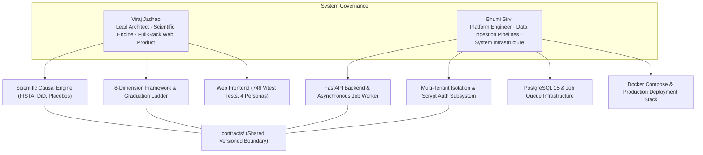
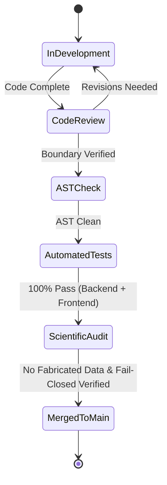

# GroundTruth 2.0 — System Ownership & Technical Governance

**One platform. Four perspectives. One scientifically consistent source of truth.**  
*Subsystem responsibilities, architectural boundaries, scientific accountability, and definition of done for GroundTruth 2.0.*

---

## 1. Governance Structure & Team Roles

GroundTruth was developed for the **PCCOE International Grand Challenge 2026 (Indradhanu)** by **Viraj Jadhao** and **Bhumi Sirvi**. The system divides responsibilities between **Scientific Intelligence & Product Delivery** and **Platform Architecture & Infrastructure**:



---

## 2. Architectural Boundary Map

The boundaries between subsystems are enforced mechanically in code and validated on every commit:

```
apps/
  web/            Next.js 14 App Router, 4 Personas, 746 Vitest tests       Viraj   [Production Ready]
  api/            FastAPI ASGI REST endpoints, OpenAPI Schema               Bhumi   [Production Ready]
  worker/         SQL row-lease background analysis worker                  Bhumi   [Production Ready]

packages/groundtruth/src/groundtruth/
  contracts/      Shared immutable contracts, evidence schema, units        Shared  [Frozen v1.0.0]
  engine/         Deterministic causal engine, pure NumPy, zero I/O         Viraj   [Production Ready]
    observation/  Spectral index math (NDVI/EVI/NDMI/NBR), SCL cloud masking
    matching/     Donor pool eligibility, SUTVA enforcement, SMD balance
    causal/       FISTA simplex solver, difference-in-differences
    uncertainty/  In-space and in-time permutation placebos, spec curve
    assembler.py  8-dimension evaluation and Level 0-5 graduation logic
  platform/       Application layer, persistence, data access               Bhumi   [Production Ready]
    api/          FastAPI routers, Scrypt authentication, session cookies
    cases/        Case registry and request transformers
    datasets/     Fail-closed data accessors, real S2 & CHIRPS loaders
    jobs/         Job queue, lease acquisition, cooperative cancellation
    store/        PostgreSQL evidence persistence and run history (0001-0012)
    reports/      Deterministic report renderer and Gemini grounding

cases/            20+ real-world project definitions and GeoJSON boundaries
data/             Empirical data storage (S2 L2A, CHIRPS, NASA POWER, geoBoundaries)
tests/            2,130+ offline backend tests + AST boundary enforcement
```

### AST Boundary Enforcement in CI
`tests/test_contract_boundary.py` parses the Abstract Syntax Tree (AST) of the repository to prevent architectural drift:
- `contracts/` cannot import from `engine/` or `platform/`.
- `engine/` cannot import from `platform/` and cannot execute I/O (no sockets, no disk reads, no credentials).
- `platform/` can only import approved entrypoints from `groundtruth.engine` (`run_analysis`, `describe_engine`, `engine_ref`, `ENGINE_VERSION`, causal readiness, and benchmark suite APIs).

---

## 3. Subsystem Responsibility Matrix

`A` = Accountable (owns the outcome and code) · `R` = Reviewer · `C` = Consulted

| Subsystem / Functional Domain | Viraj | Bhumi | Key Deliverables & Evidence |
|---|:---:|:---:|---|
| **Scientific Causal Inference** | **A** | R | FISTA simplex solver, permutation placebos, DiD pre-trend cross-checks. |
| **8-Dimension Assessment Framework** | **A** | R | Implementation of Trajectory, Spatial, Climate, Risk, Progress, Comparison, Quality, Attribution. |
| **Graduation Ladder (Levels 0–5)** | **A** | R | Level gating logic, Kariba REDD+ graduation to Level 2 (Contextual Intelligence). |
| **Task 5/5B Audit Remediation** | **A** | R | Quarantining fabricated caches, establishing fail-closed gates (`DataUnavailableError` / 501). |
| **Web Frontend (Next.js 14)** | **A** | R | 746 Vitest tests passing across 75 files, CSS Modules & design tokens, interactive charts. |
| **Responsive Mobile Web** | **A** | R | 375 px viewport compatibility tested via Playwright visual specs. |
| **FastAPI REST API & OpenAPI** | R | **A** | Router endpoints, OpenAPI snapshot generation, TypeScript client synchronization. |
| **Multi-Tenant RBAC & Security** | R | **A** | Scrypt password derivation, session cookies, cross-tenant 404/403 denial. |
| **Data Ingestion & Caching Layer** | R | **A** | CHIRPS 514-month rainfall, NASA POWER temperature, Sentinel-2 L2A rasters. |
| **Database Schema & Migrations** | R | **A** | PostgreSQL 15, SQLAlchemy 2.0, Alembic migrations 0001–0012. |
| **Docker & Infrastructure Stack** | R | **A** | Docker Compose multi-container configuration, Helm templates, local runners. |

---

## 4. Definition of Done (DoD)

To maintain world-class hackathon standards, GroundTruth enforces strict Definitions of Done across all development streams:



### A. DoD for Scientific Engine Features
1. **Mathematical Proof & Baseline Tests:** All econometric algorithms must recover known synthetic ground-truth values and reject null placebos.
2. **Zero I/O Guarantee:** Module imports must pass `test_contract_boundary.py` AST inspection.
3. **No Uncalibrated Conversions:** The code must enforce unit safety; no spectral index (NDVI/EVI) may be converted to carbon biomass without explicit ecozone allometry.
4. **Honest Caveats:** Estimators must return structured `INCONCLUSIVE` states rather than generating fragile point estimates when data fails robustness checks.

### B. DoD for Platform & Ingestion Features
1. **Fail-Closed Gateways:** Any real data accessor encountering incomplete historical rasters must raise `DataUnavailableError` and return `HTTP 501`, never substituting synthetic fallbacks.
2. **Cryptographic Provenance:** Every persisted run must record full asset hashes, `spec_hash`, and engine version strings.
3. **Multi-Tenant Isolation:** All endpoints must verify organization membership and enforce RBAC grants, blocking unauthorized cross-tenant queries with HTTP 403.
4. **Database Migration:** Any schema alteration must include both forward (`upgrade`) and backward (`downgrade`) Alembic migration scripts.

### C. DoD for Frontend & Persona Views
1. **Vitest Coverage:** All UI features must maintain full test pass rates (746 passing tests across 75 files).
2. **Type Safety:** Automated check `npm run check:api-types` must report zero discrepancies against the backend OpenAPI contract.
3. **Explicit Simulation Banners:** When displaying simulated benchmark runs, the UI must render high-visibility simulation warnings.
4. **Cross-Persona Accessibility:** Dashboards must render cleanly in light mode across all four persona views.

---

## 5. Visual Verification of Production Screens

| Auditor Verification Dashboard | CSR & Impact Funder Portfolio |
| :---: | :---: |
|  |  |

---

> GroundTruth 2.0 Ownership Document · *PCCOE International Grand Challenge 2026*
