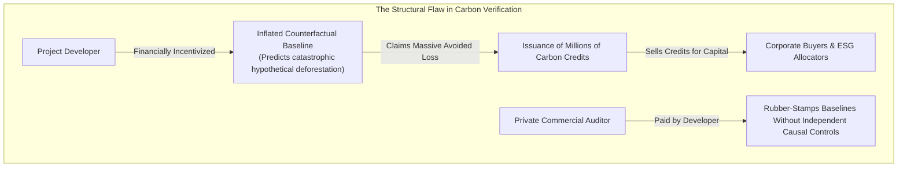
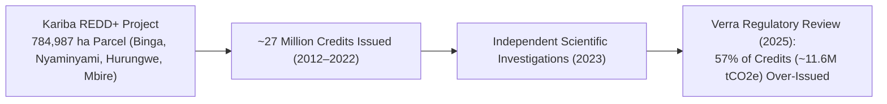
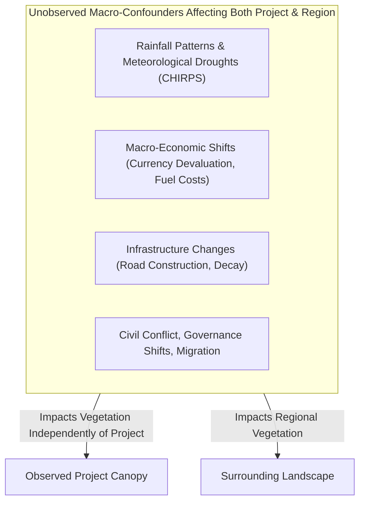
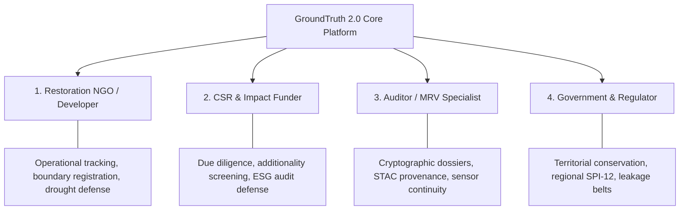
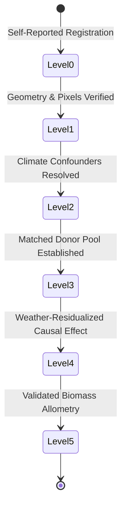

# GroundTruth 2.0 — Project Context & Scientific Foundations

**One platform. Four perspectives. One scientifically consistent source of truth.**  
*The domain rationale, economic incentives, scientific principles, and architectural necessities behind GroundTruth 2.0.*

---

## 1. The Carbon Market Dilemma: Additionality & Baseline Gaming

The voluntary carbon market (VCM) and corporate ESG restoration pledges are founded on a single economic commodity: **additionality**. 

$$\text{Additionality} = Y_{\text{project}} - Y_{\text{counterfactual}}$$

Where:
- $Y_{\text{project}}$ is the observed carbon storage or forest canopy within the project boundary.
- $Y_{\text{counterfactual}}$ is the state of that same ecosystem had the conservation intervention never occurred.

Because the counterfactual world never materialized, **additionality is fundamentally unobservable**. It cannot be measured with a physical sensor; it must be mathematically inferred.

### The Adverse Selection Trap
In the existing ecosystem:
1. **Developers** select the baseline scenario with the steepest projected deforestation slope to maximize credit issuance.
2. **Auditors** are hired and compensated directly by the developers they audit, introducing structural conflicts of interest.
3. **Buyers** (corporations seeking net-zero claims) lack the remote-sensing and econometric infrastructure to audit project claims independently.
4. **Legitimate NGOs** who perform rigorous, conservative restoration are economically penalized, as their realistic baselines yield far fewer credits than inflated claims from predatory developers.

The consequence is catastrophic market failure: corporate net-zero claims funded by credits that represent zero actual atmosphere benefit, while high-integrity projects struggle for financing.

---

## 2. The Empirical Benchmark: Kariba REDD+ (Zimbabwe)

GroundTruth uses the **Kariba REDD+ project (VCS Project 902)** as its primary empirical validation anchor.

### Why Kariba Matters
Kariba is not a hypothetical case. It is one of the largest REDD+ projects on Earth and one of the very few where a major carbon registry (Verra) officially published an over-issuance finding following extensive third-party review. 

The developer's original baseline claimed that absent the project, deforestation in northwestern Zimbabwe would accelerate catastrophically across nearly the entire project area. In reality, regional deforestation rates in surrounding un-intervened communal lands were far lower than projected. 

Kariba serves as GroundTruth's gold standard benchmark because **any credible causal verification platform must be capable of recovering this divergence from empirical satellite and climate data alone.**

---

## 3. The Core Scientific Insight: Before-and-After is Not Verification

Traditional remote-sensing verification relies on a naive temporal comparison:

$$\Delta_{\text{naive}} = \text{Canopy}_{\text{post}} - \text{Canopy}_{\text{pre}}$$

This naive approach is scientifically invalid because it fails to separate treatment effect from regional confounders:

If regional rainfall is abnormally high, vegetation greenness ($\text{NDVI}$) increases everywhere. A naive before-and-after audit credits the project developer for nature's rainfall. Conversely, during an extreme El Niño drought (such as the 2019 southern African drought), vegetation brown-down will cause a naive audit to penalize a developer for drought damage outside their control.

### The GroundTruth Solution: Econometric Synthetic Control
GroundTruth builds a mathematical counterfactual:

$$\hat{Y}_{1t}^{\text{synthetic}} = \sum_{j=2}^{J+1} w_j Y_{jt}$$

Where donors $j \in \{2, \dots, J+1\}$ are un-intervened administrative districts matched on elevation, slope, rainfall, and pre-intervention vegetation trajectories. The donor weights $w_j$ are constrained to the unit simplex:

$$w_j \ge 0 \quad \text{and} \quad \sum_{j} w_j = 1$$

This ensures the counterfactual never extrapolates beyond the observed convex hull of real places on Earth.

---

## 4. One Platform. Four Perspectives.

A core innovation of GroundTruth 2.0 is delivering **four tailored persona perspectives** from one single, mathematically unified source of truth:

### Perspective 1: The Restoration NGO / Project Developer
Project developers on the ground need transparent, non-hostile tools to prove their real achievements:
- **Baseline Registration:** Register GeoJSON boundary parcels and document claim specifics.
- **Seasonal Vegetation Tracking:** Monitor real Sentinel-2 10m NDVI, EVI, NDMI, and NBR dynamics.
- **Climate Context Defense:** When extreme droughts occur, the platform provides verified 43-year CHIRPS SPI-12 evidence proving that vegetation stress was meteorological, protecting the developer from false claims of failure.

### Perspective 2: The CSR & Impact Funder
Corporate sustainability officers and carbon-credit funds need fast, uncompromised due diligence:
- **Pre-Purchase Screening:** Screen carbon-credit issuances before deploying millions of dollars in capital.
- **Portfolio Additionality Tracking:** Monitor ongoing projects across Africa, Asia, and the Americas on a unified additionality index.
- **Accredited Review Triggers:** Receive clear, objective signals when a project's empirical trajectory diverges from its claimed baseline, enabling prompt engagement with project developers before reputational damage occurs.

### Perspective 3: The Auditor / MRV Specialist
Independent verifiers require verifiable data provenance, not black-box machine learning predictions:
- **STAC Scene Inspection:** Audit exact satellite scene acquisition timestamps, sun azimuths, cloud covers, and USGS/Copernicus asset URIs.
- **Sensor Cross-Calibration:** Verify whether sensor transitions (e.g., Landsat 7 ETM+ to Landsat 8 OLI in 2013) were mathematically harmonized or if sensor steps were mistaken for canopy change.
- **Cryptographic Dossiers:** Export digitally signed evidence bundles with SHA-256 asset checksums for court filings or regulatory submissions.

### Perspective 4: The Government & Territorial Regulator
Environmental ministries, national parks authorities, and regional bodies require macro-territorial oversight:
- **Administrative Unit Performance:** Compare conservation performance across administrative districts (e.g., Binga, Hurungwe, Nyaminyami, Kariba).
- **Leakage Belt Monitoring:** Inspect 10 km peripheral buffer zones to detect displacement of deforestation across jurisdictional lines.
- **Drought Emergency Forecasting:** Track regional SPI-12 drought indices to coordinate humanitarian and ecological relief.

---

## 5. The 8-Dimension Assessment Framework

Every project evaluated by GroundTruth 2.0 is assessed across eight orthogonal scientific dimensions:

| Dimension | Core Question | Data Assets Evaluated |
|---|---|---|
| **1. Trajectory** | Is the project area's vegetative canopy trending upward, stable, or degrading over decadal timescales? | Sentinel-2 L2A & Landsat multi-spectral surface reflectance (NDVI/EVI/NDMI/NBR). |
| **2. Spatial** | Is canopy health distributed evenly across parcels or concentrated in un-threatened interior zones? | Zonal pixel-level histograms, clear-pixel coverage ratios, boundary perimeter-to-area ratios. |
| **3. Climate** | How much of the observed canopy variation is driven by meteorological droughts or rainfall anomalies? | 43-year monthly CHIRPS precipitation (514/516 months), NASA POWER temperature, SPI-12 index. |
| **4. Risk** | Has deforestation been displaced into peripheral community buffers or adjoining districts? | 10 km leakage belt monitoring, historical fire alerts, road proximity buffers. |
| **5. Progress** | Does the observed empirical vegetation trend match the volume of carbon credits claimed? | Claimed credit volume vs observed biomass trajectory. |
| **6. Comparison** | How does the project compare to untreated, ecologically identical donor districts? | 50 geoBoundaries ADM2 candidate districts with SUTVA contamination filters. |
| **7. Evidence Quality** | Are the underlying satellite rasters continuous, harmonized, and cryptographically verified? | STAC scene availability, QA cloud masks, Roy et al. sensor harmonization. |
| **8. Attribution** | What is the isolated causal effect attributable solely to the conservation intervention? | Synthetic Control (FISTA) & DiD cross-checks with in-space/in-time permutation placebos. |

---

## 6. Graduation Levels (0 through 5): Earning Trust Through Rigor

Rather than forcing every project into a single binary "Pass/Fail" verdict, GroundTruth assigns a discrete **Graduation Level** reflecting data completeness and methodological depth:

- **Level 0 (Unverified Claim):** Project registered with unverified textual assertions and claimed credits.
- **Level 1 (Empirical Observation):** Verified satellite time series ingested with clean boundary geometries.
- **Level 2 (Contextual Intelligence):** 43-year historical climate patterns, meteorological droughts (SPI-12), and regional weather trends evaluated. *(Current status of Kariba REDD+)*
- **Level 3 (Donor Counterfactual):** Uncontaminated donor candidates identified outside the project's leakage belt with common covariate support.
- **Level 4 (Weather-Residualized Causal Model):** Causal synthetic control fitted on weather-adjusted vegetation series passing placebo and leave-one-out tests.
- **Level 5 (Accredited Carbon Verification):** Validated ecozone-specific biomass allometry converting verified structural gains into net carbon credit additionality.

---

## 7. The Honest Scientific Reality: Task 5/5B Audit Remediation

Scientific integrity requires complete transparency regarding platform limitations. During the Task 5 and Task 5B independent audits, critical vulnerabilities were discovered in early prototype data assets:

1. **Quarantine of Fabricated Multi-Tile Landsat Caches:** An early script (`build_multitile_cache.py`) synthesized 2001–2022 Landsat indices from hand-typed numbers with synthetic scene IDs and placeholder hashes. GroundTruth 2.0 **quarantined this cache entirely**. It is strictly blocked from all production and demo routes.
2. **Fail-Closed Gateways:** When requested in `REAL_OBSERVATIONS` mode, the system refuses to interpolate or synthesize missing satellite rasters. If pre-treatment panels are incomplete, it raises `DataUnavailableError` and returns `HTTP 501`.
3. **What is Real in Kariba Today:**
   - Real **Sentinel-2 L2A (2021–2023)** 10m surface reflectance.
   - Real **CHIRPS (1981–2023)** monthly rainfall across 514/516 months with explicit missingness badges.
   - Real **NASA POWER** 2m temperature records.
   - Real **50 geoBoundaries ADM2** candidate district polygons.
4. **Current Attribution Status:** Because complete pre-treatment satellite rasters for the 1,072,638 ha Kariba parcel and donor districts are not yet fully harmonized across Landsat sensors without gap-filling artifacts, Kariba is honestly classified as **Level 2 (Contextual Intelligence)** with attribution reported as **`INCONCLUSIVE (Not Estimable from Real Data Alone)`**.

---

## 8. Non-Negotiable Scientific Principles

GroundTruth enforces three core principles that cannot be overridden by configuration, prompts, or user overrides:

### Principle 1: NDVI is NOT Carbon
$$\text{NDVI} = \frac{\text{NIR} - \text{Red}}{\text{NIR} + \text{Red}} \quad \not\equiv \quad \text{Biomass } (\text{t C / ha})$$
A spectral reflectance ratio has no direct mass equivalence. Converting NDVI to carbon requires ecozone-specific destructive harvest allometry with documented 20–30% error budgets. `groundtruth.contracts.units` raises an immediate exception on any direct conversion.

### Principle 2: Observed Change is NOT Causal Effect
A greening forest is not necessarily an additional forest. Without counterfactual controls from comparable untreated regions, seasonal weather and regional economic trends cannot be separated from project impact.

### Principle 3: Model Divergence is NOT Fraud
A gap between an independent estimate and a developer's claimed baseline indicates that the claim **warrants accredited review**. Model divergence can stem from localized drought, unmodeled leakage, or sensor drift. GroundTruth never alleges criminal fraud or intent.

---

> GroundTruth 2.0 Project Context · *PCCOE International Grand Challenge 2026*
