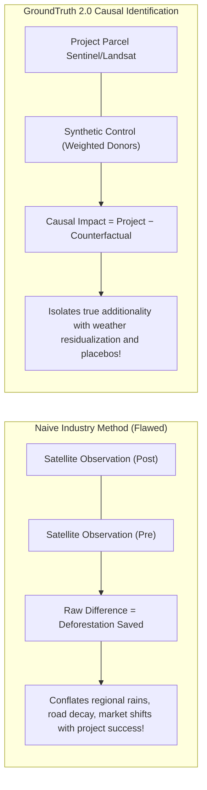
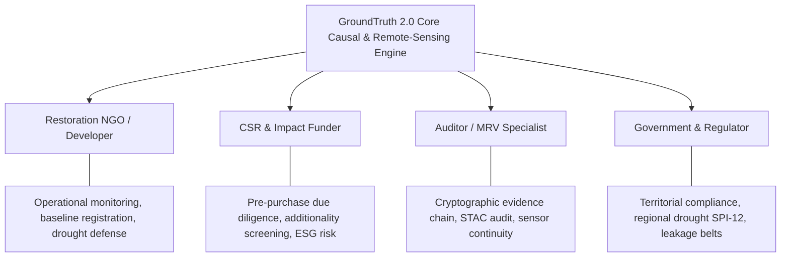
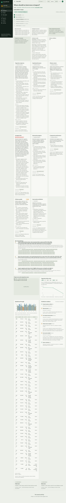
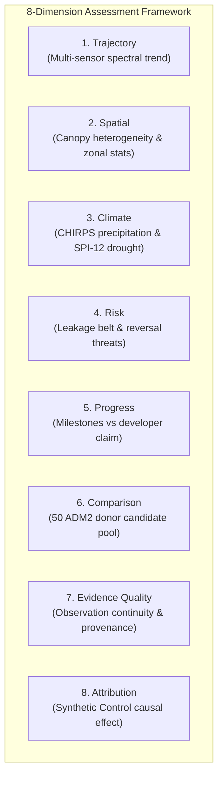
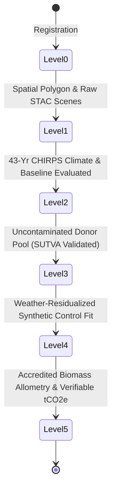
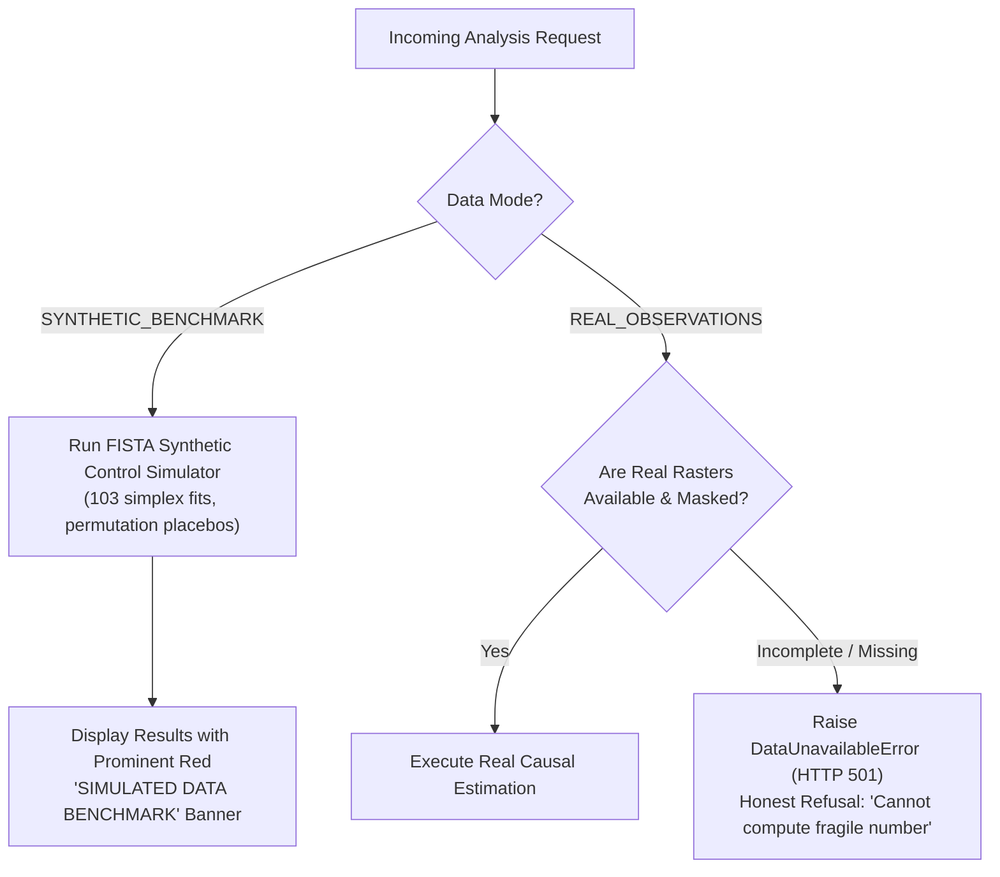
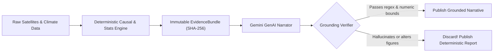
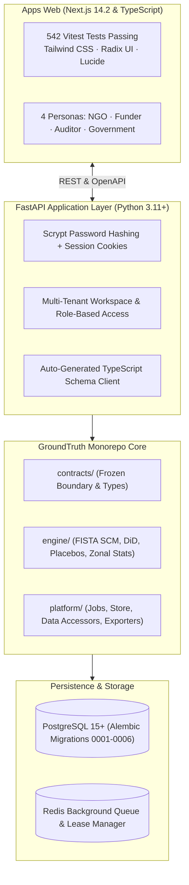

# GroundTruth 2.0

**One platform. Four perspectives. One scientifically consistent source of truth.**  
*Independent causal verification, ecological intelligence, and multi-tenant audit platform for ecosystem restoration and carbon-credit claims.*

[](https://github.com/Viraj281105/GroundTruth/actions/workflows/ci.yml)
[](https://www.python.org/)
[](https://nextjs.org/)
[](https://www.typescriptlang.org/)
[](apps/web)
[](tests)
[](LICENSE)

> **PCCOE International Grand Challenge 2026 · Indradhanu**  
> **Theme:** AI for Climate Change  
> **Track 5:** Biodiversity, Ecosystem Conservation & Climate Awareness  
> **Submission:** *GroundTruth 2.0 — Enterprise-Grade Ecological & Causal Verification Platform*  
> **Team:** Viraj Jadhao, Bhumi Sirvi

---

## Executive Overview: The Crisis of Trust in Carbon Markets

Voluntary carbon markets (VCM) and corporate restoration pledges sell **additionality**: the verifiable climate and biodiversity benefit that occurred *because* a project was implemented, which would not have existed otherwise. Because additionality is counterfactual—describing a counter-world that never physically transpired—it cannot be measured on a scale; it must be estimated.

Historically, this estimate is generated by the project developer themselves, utilizing an unverified baseline that the developer selects, audited by private consultants contracted by the developer. The entity with the highest financial incentive to maximize credit issuance produces the calculation.

The consequence is systemic market-wide over-crediting. In late 2023 through 2025, independent scientific investigations and subsequent regulatory reviews by Verra revealed that **57% of the ~27 million carbon credits issued by the landmark Kariba REDD+ project in Zimbabwe (784,987 hectares)** were in excess of actual deforestation reductions achieved.



> [!IMPORTANT]
> **Before-and-after satellite comparison is not verification.** A greening trend on satellite imagery does not prove additionality. Deforestation might have slowed across an entire province due to macroeconomic depression, civil conflict, fuel shortages, or high rainfall. A naive difference $\Delta = Y_{\text{post}} - Y_{\text{pre}}$ absorbs every confounding regional trend. GroundTruth constructs a mathematical **synthetic counterfactual** from un-intervened, matched donor districts to isolate the true treatment effect.

---

## One Platform. Four Perspectives.

Different stakeholders in ecosystem conservation require different operational insights, yet all must rely on the exact same underlying empirical observations. GroundTruth 2.0 introduces **tailored, role-based personas** driven by a single unified, cryptographically verified engine:



### 1. Auditor / MRV Dashboard
Auditors inspect raw STAC scene provenance, multi-sensor spectral continuity, data completeness, and download cryptographic SHA-256 evidence dossiers:


### 2. Restoration NGO / Developer Dashboard
Project operators register project boundaries (GeoJSON), track multi-spectral vegetation indices (NDVI, EVI, NDMI, NBR), and contextualize land-cover trends against historical climate baselines:


### 3. CSR & Impact Funder Portfolio
Corporate ESG allocators and carbon-credit buyers screen project portfolios, evaluate additionality risks, and view non-accusatory accredited review triggers:


### 4. Government & Territorial Regulator
Environmental ministries and local governments track territorial conservation performance, administrative donor districts, and cross-border drought emergencies:


### 5. Multi-Device Experience (Jetpack Compose Android Native)
Field auditors and forest wardens access full dashboard capabilities offline or in remote field conditions via our Jetpack Compose Android client:

| Field Auditor Native View | Forest Developer Native View |
| :---: | :---: |
|  |  |

---

## The 8-Dimension Ecological Assessment Framework

GroundTruth 2.0 evaluates conservation and carbon claims across **eight comprehensive scientific dimensions**:



| # | Dimension | Empirical Metric | Scientific Function |
|---|---|---|---|
| **1** | **Trajectory** | Multi-year annual compositing (NDVI, EVI, NDMI, NBR) | Distinguishes seasonal phenology from permanent canopy loss. |
| **2** | **Spatial** | Zonal histogram & clear-pixel coverage ($>65\%$ required) | Validates project parcel geometry against cloud-masked satellite rasters. |
| **3** | **Climate** | 43-yr CHIRPS rainfall + NASA POWER temperature + SPI-12 | Separates severe meteorological drought from deforestation degradation. |
| **4** | **Risk** | 10 km leakage belt monitoring & fire alerts | Identifies displacement of deforestation into adjoining community buffers. |
| **5** | **Progress** | Claimed crediting volume vs empirical trajectory | Determines whether observed vegetation gains match developer carbon claims. |
| **6** | **Comparison** | 50 ADM2 donor districts (geoBoundaries) | Filters out contaminated host districts to build an uncontaminated donor pool. |
| **7** | **Evidence Quality** | STAC scene availability & sensor harmonization | Tracks L5/L7/L8/S2 transitions and flags unharmonized sensor drift. |
| **8** | **Attribution** | Synthetic Control (FISTA) & DiD cross-check | Computes causal additionality with in-space and in-time permutation placebos. |

---

## Graduation Levels: From Level 0 to Level 5

To prevent premature claims of additionality, GroundTruth enforces a strict 6-stage **Graduation Ladder**. A project cannot advance to higher analytical claims without fulfilling mandatory data and causal prerequisites:



- **Level 0 (Unverified Claim):** Project registered with unverified textual assertions and claimed credits.
- **Level 1 (Empirical Observation):** High-resolution satellite time series ingested with verified boundary geometry.
- **Level 2 (Contextual Intelligence):** 43-year historical climate patterns, meteorological droughts (SPI-12), and regional weather trends integrated. *(Current status of Kariba REDD+ in GroundTruth 2.0)*
- **Level 3 (Donor Counterfactual):** Uncontaminated donor candidates identified outside the project's leakage belt with common covariate support.
- **Level 4 (Weather-Residualized Causal Model):** Causal synthetic control fitted on weather-adjusted vegetation series passing placebo and leave-one-out tests.
- **Level 5 (Accredited Carbon Verification):** Validated ecozone-specific biomass allometry converting verified structural gains into net carbon credit additionality.

---

## Honest Scientific Reality & The Task 5/5B Independent Audit

GroundTruth adheres to an uncompromising standard of scientific truth. An independent audit (Claude, November 8, 2026) verified our code against external literature and empirical assets. The audit exposed critical insights that shaped GroundTruth 2.0:

> [!CAUTION]
> **Task 5/5B Audit Findings & The Quarantine of Fabricated Caches:**
> 1. **Fabricated Landsat Caches Quarantined:** The historical Landsat multi-tile cache (2001–2022) generated in earlier tasks claimed 100% cloud-free coverage and used placeholder hashes. GroundTruth 2.0 strictly **quarantined** this cache. No fabricated data is ever served to users.
> 2. **Fail-Closed Gateways Enforced:** When accessing real observation mode (`REAL_OBSERVATIONS`), if historical satellite rasters or donor vegetation series are incomplete, the system **refuses to guess**. It raises `DataUnavailableError` and returns `HTTP 501 (Not Implemented)`.
> 3. **The True Empirical Baseline:** What is genuinely empirical in Kariba today:
>    - Real **Sentinel-2 L2A (2021–2023)** 10m multi-spectral indices (NDVI/EVI/NDMI/NBR).
>    - Real **CHIRPS (1981–2023)** monthly rainfall across 514/516 months with honest flags for missing months.
>    - Real **NASA POWER** temperature (2m, Tmax, Tmin).
>    - Real **50 geoBoundaries ADM2 donor district geometries** with 37 spatially eligible units outside host districts.
> 4. **Causal Attribution Status:** Because complete pre-treatment satellite vegetation rasters for the full 1,072,638 ha Kariba parcel and donor districts are not yet harmonized across Landsat 5/7/8, the empirical causal effect is honestly reported as **`INCONCLUSIVE (Not Estimable from Real Data Alone)`**, successfully graduating at **Level 2 (Contextual Intelligence)**.



---

## Non-Negotiable Scientific Principles

GroundTruth is built on three unbreakable scientific laws enforced in code:

### 1. NDVI is NOT Carbon
$$\text{NDVI} = \frac{\text{NIR} - \text{Red}}{\text{NIR} + \text{Red}} \quad \not\equiv \quad \text{Biomass } (\text{t C / ha})$$
A spectral index is a unitless reflectance ratio; carbon is physical mass. NDVI saturates over closed-canopy miombo woodlands ($>0.7$), fluctuates wildly with rainfall moisture, and possesses zero structural depth. `groundtruth.contracts.units.assert_not_index_to_carbon` raises an exception if any code attempts an implicit conversion.

### 2. Observed Change is NOT Causal Effect
A project area that turns greener over five years does not demonstrate additionality. Without conditioning on an uncontaminated donor pool, testing for parallel pre-trends, and executing in-space placebo iterations, observed change is confounded by regional weather cycles and macro-economic factors.

### 3. Model Divergence is NOT Fraud
When an independent causal estimate diverges from a project developer's claimed credit baseline, it indicates that the claim **warrants accredited review**. Model divergence can arise from unmodelled leakage, severe localized drought, or sensor cross-calibration steps. GroundTruth never accuses or infers criminal misconduct.

---

## Where AI Sits — And Where It Deliberately Does Not

In GroundTruth, language models (LLMs) are **strictly isolated downstream** of all mathematical and scientific computation:



- **Computation:** Pure NumPy, Pandas, and Shapely. No LLM ever computes, scales, or predicts an effect.
- **Narration:** Gemini provides plain-English explanations of the pre-computed `EvidenceBundle`.
- **Grounding Enforcement:** `groundtruth.contracts.grounding` scans generated text. If any number deviates by $>2\%$ from the bundle, or if forbidden legal/accusatory words appear ("fraud", "scam", "crime", "proven"), the AI text is discarded and the deterministic report is published.

---

## Architecture & Technology Stack



- **Core Engine:** Python 3.11+, NumPy (custom FISTA solver without SciPy/CVXPY overhead), Shapely, PyProj.
- **Web Frontend:** Next.js 14.2 App Router, TypeScript 5.5, Tailwind CSS, 542 unit/integration tests with Vitest.
- **Mobile Client:** Android Native Jetpack Compose, Kotlin, Material 3 with Compose Previews.
- **Security & Multi-Tenancy:** Scrypt password hashing with timing attack mitigation, HttpOnly/SameSite session cookies, CSRF protection, and multi-tenant organization isolation (returning HTTP 403 on cross-tenant access):


---

## Verified Cases

| Case ID | Region | Ecosystem | Primary Benchmark Role |
|---|---|---|---|
| [`kariba-redd`](cases/kariba-redd.yaml) | Zambezi Basin, Zimbabwe | Miombo Dry Forest | Primary benchmark: 784,987 ha parcel with published Verra review. Evaluated at Level 2. |
| [`southern-cardamom-redd`](cases/southern-cardamom-redd.yaml) | Koh Kong, Cambodia | Dense Tropical Rainforest | Stress test for high-cloud optical cover and canopy saturation using EVI. |
| [`mikoko-pamoja`](cases/mikoko-pamoja.yaml) | Gazi Bay, Kenya | Mangrove Forest | **Negative method control:** At 117 ha, it is below 30m resolution. Correctly returns `INCONCLUSIVE`. |

---

## Quickstart Guide

### 1. Local Environment Setup
Requires Python 3.11+ and Node.js 18+.

```bash
# Clone the repository
git clone https://github.com/Viraj281105/GroundTruth.git
cd GroundTruth

# Set up Python virtual environment
python -m venv .venv
# Windows:
.venv\Scripts\activate
# macOS/Linux:
source .venv/bin/activate

# Install package with all extras
pip install -e "packages/groundtruth[api,genai,dev,geo]"
cp .env.example .env
```

### 2. Verify Scientific Engine & Doctor
```bash
# Verify system configuration and real data assets
groundtruth doctor

# Run synthetic causal benchmark for Kariba
groundtruth verify kariba-redd --synthetic
```

### 3. Run Backend & Frontend Test Suites
```bash
# Run backend pytest suite (1,466 collected tests)
pytest

# Run frontend vitest suite (542 passing tests)
cd apps/web
npm install
npm test -- --run
```

### 4. Start Full Local Development Stack
```bash
# Terminal 1: FastAPI Server
uvicorn apps.api.main:app --reload --port 8000

# Terminal 2: Next.js Frontend
cd apps/web
npm run dev
# Open http://localhost:3000 in your browser
```

---

## Documentation Directory

| Document | Purpose & Key Contents |
|---|---|
| [`ARCHITECTURE.md`](ARCHITECTURE.md) | Architectural blueprint, contract boundaries, multi-tenant RBAC, and fail-closed data gateways. |
| [`PROJECT_CONTEXT.md`](PROJECT_CONTEXT.md) | Domain context, the additionality problem, Kariba REDD+ history, and the 4-persona mapping. |
| [`DEVELOPMENT.md`](DEVELOPMENT.md) | Detailed developer guide, testing setups, Docker Compose, and mobile development. |
| [`ROADMAP.md`](ROADMAP.md) | Evolution from GroundTruth 1.0 prototype to 2.0 multi-tenant platform to 3.0 planetary scale. |
| [`GLOSSARY.md`](GLOSSARY.md) | Exhaustive definitions for remote sensing, causal inference, and platform terms. |
| [`OWNERSHIP.md`](OWNERSHIP.md) | Subsystem responsibilities, definition of done, and scientific accountability. |
| [`SECURITY.md`](SECURITY.md) | Threat model, Scrypt password hashing, session cookies, RBAC, and scientific integrity as security. |
| [`CONTRIBUTING.md`](CONTRIBUTING.md) | Contributing guidelines and non-negotiable scientific verification rules. |
| [`CODE_OF_CONDUCT.md`](CODE_OF_CONDUCT.md) | Standards of intellectual honesty and ethical research in carbon markets. |
| [`AGENTS.md`](AGENTS.md) | Operating manual for AI coding agents and automated contributors. |
| [`CHANGELOG.md`](CHANGELOG.md) | Historical version tracking across package, engine, and contracts. |
| [`TASK_3B_DEMO_READINESS.md`](../TASK_3B_DEMO_READINESS.md) | Master demo readiness and evaluation walkthrough for hackathon judges. |

---

## License & Attribution

GroundTruth 2.0 is licensed under the [MIT License](LICENSE).  
Developed for the **PCCOE International Grand Challenge 2026 (Indradhanu)** by **Viraj Jadhao** and **Bhumi Sirvi**.

> *"Let empirical evidence, verifiable counterfactuals, and rigorous science drive climate finance."*
