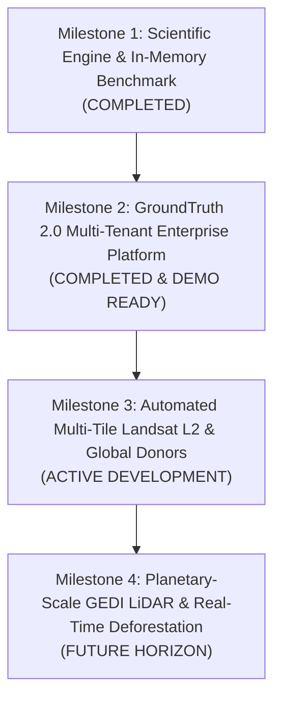
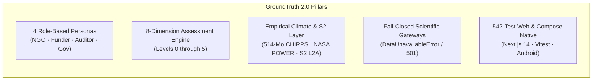

# GroundTruth 2.0 — Product & Scientific Roadmap

**One platform. Four perspectives. One scientifically consistent source of truth.**  
*The strategic evolution of GroundTruth: from hackathon prototype to enterprise multi-tenant ecological intelligence and planetary-scale verification.*

---

## 1. Roadmap Architecture & Evolutionary Stages

GroundTruth is engineered with an extensible modular boundary designed to scale across multiple years. This roadmap provides an honest accounting of what is **Implemented and Tested**, what is **Planned**, and what represents **Future Research Horizons**.



---

## 2. Milestone Breakdown & Capability Progression

```mermaid
gantt
    title GroundTruth Evolutionary Timeline
    dateFormat  YYYY-MM
    section Milestone 1
    Causal Solver & FISTA Simplex         :done, m1_1, 2026-08, 2026-09
    In-Space & In-Time Placebos          :done, m1_2, 2026-09, 2026-09
    Contract Boundary AST Guard           :done, m1_3, 2026-09, 2026-09
    section Milestone 2 (2.0)
    4 Personas: NGO, Funder, Auditor, Gov :done, m2_1, 2026-10, 2026-11
    8-Dimension Assessment Framework      :done, m2_2, 2026-10, 2026-11
    Real Sentinel-2 (2021-2023)           :done, m2_3, 2026-10, 2026-11
    43-Yr CHIRPS & NASA POWER SPI-12      :done, m2_4, 2026-10, 2026-11
    Task 5/5B Audit & Fail-Closed Guard   :done, m2_5, 2026-11, 2026-11
    542-Test Web & Jetpack Compose Native :done, m2_6, 2026-11, 2026-11
    section Milestone 3
    Automated Multi-Tile Landsat Ingestion:active, m3_1, 2026-12, 2027-02
    Local Overpass Sensor Harmonization  :m3_2, 2027-01, 2027-03
    Dynamic GeoBoundaries Donor Matching  :m3_3, 2027-02, 2027-04
    section Milestone 4
    Spaceborne GEDI L4A/L4B LiDAR Canopy  :m4_1, 2027-05, 2027-08
    Global Automated Registry Sync        :m4_2, 2027-07, 2027-10
```

---

## 3. Milestone 1: The Core Causal Engine (Completed)

*Objective: Establish a mathematically unassailable causal inference engine in pure Python with strict contract isolation.*

### Delivered Capabilities:
- **Simplex-Constrained Synthetic Control:** Custom FISTA solver operating on pure NumPy without heavy external solvers.
- **Robust Permutation Inference:** In-space and in-time placebos with Phipson-Smyth add-one correction floor ($p = 1 / (J+1)$).
- **Difference-in-Differences Cross-Check:** With formal pre-trend parallel assumption diagnostics and standardized mean difference (SMD).
- **Specification Multiverse Curve:** Evaluates treatment sensitivity across combinations of donor pools, covariates, and baseline years.
- **AST Contract Boundary Enforcement:** `tests/test_contract_boundary.py` mechanically prevents architecture violations.
- **Deterministic Reporting & Grounding Guard:** Regex and numeric grounding verification rejecting LLM hallucinations and legal allegations.

---

## 4. Milestone 2: GroundTruth 2.0 — Multi-Tenant Platform (Current Production Baseline)

*Objective: Transform the computational module into an enterprise-grade ecological intelligence platform delivering tailored persona perspectives.*



### Delivered Capabilities:
1. **Four Tailored Personas:**
   - **Auditor / MRV Dashboard:** Complete STAC scene discovery, sensor continuity audits, cryptographic SHA-256 evidence chain verification.
   - **Restoration NGO Dashboard:** Boundary registration, seasonal NDVI/EVI/NDMI/NBR tracking, climate drought defense.
   - **CSR / Impact Funder Portfolio:** Portfolio additionality screening, ESG audit defense, accredited review triggers.
   - **Government / Regulator Dashboard:** Territorial conservation tracking, administrative district leakage, SPI-12 emergency tracking.
2. **The 8-Dimension Assessment Framework:** Evaluates Trajectory, Spatial, Climate, Risk, Progress, Comparison, Evidence Quality, and Attribution.
3. **Graduation Levels 0 to 5:** Kariba REDD+ successfully graduated to **Level 2 (Contextual Intelligence)**.
4. **Empirical Climate Intelligence:** 43 years (1981–2023) of monthly CHIRPS precipitation (514/516 months) with honest missingness flags, NASA POWER temperature, and SPI-12 drought index across 50 districts.
5. **Real Sentinel-2 L2A Earth Observation:** 10m surface reflectance indices (NDVI/EVI/NDMI/NBR) across 2021–2023 for Kariba's 784,987 ha parcel.
6. **Task 5/5B Audit Remediation:** Quarantined fabricated Landsat caches; enforced fail-closed gateways that return `HTTP 501` rather than manufacturing unverified numbers in real mode.
7. **Production Web & Mobile Clients:** Next.js 14 web app verified by **542 passing Vitest tests**, accompanied by an Android native client in Jetpack Compose.

| Auditor Dashboard | Restoration NGO Dashboard |
| :---: | :---: |
|  |  |

---

## 5. Milestone 3: Automated Multi-Tile Landsat Ingestion & Sensor Cross-Calibration (Active Development)

*Objective: Eliminate all static caches by automating multi-tile Landsat Collection 2 Level 2 raster acquisition and concurrent-overpass cross-calibration.*

### In Development:
- **Distributed Multi-Tile Ingestion Pipeline:** Automated acquisition and cloud masking for the 7 WRS-2 tiles covering Kariba (Paths 169–172, Rows 71–73) directly from USGS / Microsoft Planetary Computer STAC APIs.
- **Empirical Sensor Overpass Cross-Calibration:** Replacing theoretical literature coefficients with locally verified, empirical overpass regression between Landsat 7 ETM+ and Landsat 8 OLI during their 2013–2016 concurrent orbit period.
- **Automated SUTVA Leakage Filtering:** Algorithmic calculation of geodesic boundary buffers to programmatically exclude project host districts from donor pools.
- **Weather-Residualized SCM Execution on Real Rasters:** Advancing Kariba from Level 2 to **Level 4 (Weather-Residualized Causal Model)** once empirical pre-treatment vegetation panels are fully processed.

---

## 6. Milestone 4: Planetary Scale & Structural Biomass Verification (Future Horizon)

*Objective: Scale GroundTruth across all global voluntary carbon market projects with spaceborne LiDAR and continuous near-real-time monitoring.*

### Research Horizons:
- **Spaceborne LiDAR Integration (NASA GEDI L4A/L4B):** Direct calibration of canopy height and aboveground biomass density (AGBD) to bridge the NDVI-to-carbon gap with empirical structural physics.
- **Automated Registry Ingestion:** Real-time synchronization with Verra, Gold Standard, and Plan Vivo registry APIs to monitor newly registered project parcels automatically.
- **Near-Real-Time Reversal Alerts:** Weekly Sentinel-1 SAR and Sentinel-2 optical change detection to alert funders and governments to illegal deforestation within 48 hours of occurrence.
- **Decentralized Cryptographic Attestation:** Zero-knowledge verification proofs enabling project developers to prove additionality without disclosing proprietary commercial plot geometries.

---

## 7. Strategic Capability Matrix

| Capability Area | Milestone 1 (Prototype) | Milestone 2 (GroundTruth 2.0) | Milestone 3 (Planned) | Milestone 4 (Planetary Scale) |
|---|---|---|---|---|
| **User Personas** | Single Generic View | 4 Tailored Personas (Web + Mobile) | Organization Workspaces | Self-Service Registry Integration |
| **Assessment Dimensions** | 1 (Causal Effect) | 8 Orthogonal Dimensions | 8 Dimensions with Live Data | Automated Continuous Scoring |
| **Graduation Ladder** | Binary Pass/Fail | Levels 0 through 5 | Automated Level Transitions | Regulatory Compliance Audit |
| **Earth Observation** | Synthetic Benchmark | Real S2 (2021-2023) + Fail-Closed | Automated Landsat 5/7/8/9 | Global Sentinel-1/2 + GEDI LiDAR |
| **Climate Integration** | Simulated Covariates | 43-Yr CHIRPS + NASA POWER (SPI-12) | Automated Weather Residualization | Dynamic Microclimate Downscaling |
| **Testing & QA** | 194 Backend Tests | 1,466 Backend + 542 Frontend Tests | Automated STAC E2E Rasters | Continuous Satellite Ingestion CI |

---

> GroundTruth 2.0 Roadmap · *PCCOE International Grand Challenge 2026*
