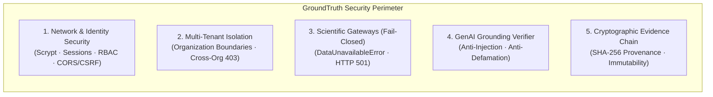
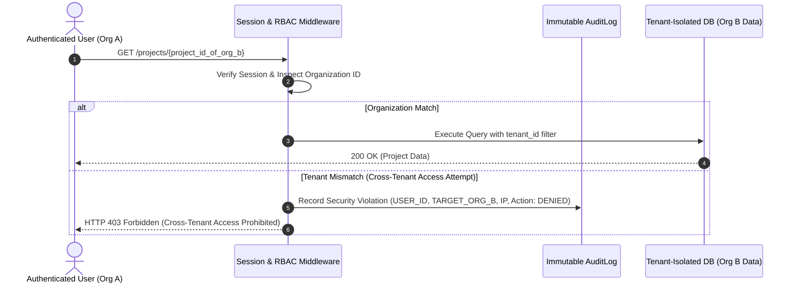
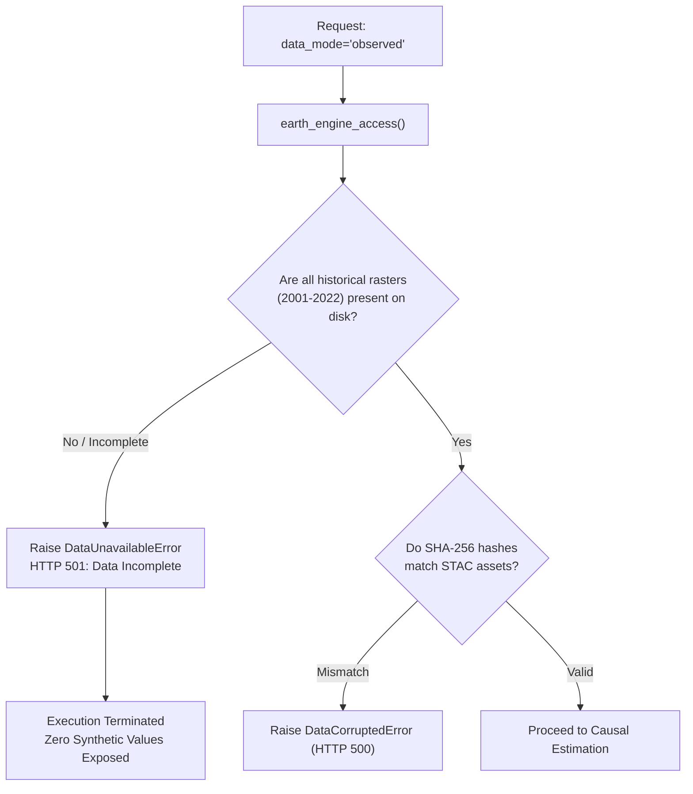
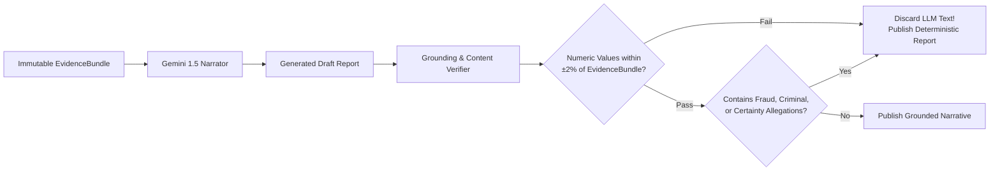

# GroundTruth 2.0 — Security & Scientific Integrity Architecture

**One platform. Four perspectives. One scientifically consistent source of truth.**  
*Comprehensive security policy, multi-tenant threat model, cryptographic provenance, and scientific integrity controls for GroundTruth 2.0.*

---

## 1. Security Philosophy: Scientific Integrity as a Core Security Primitive

In conventional software platforms, security is confined to authentication, authorization, and data encryption. For GroundTruth 2.0, **scientific integrity is an active security property**:



A vulnerability that allows an actor to inject fabricated satellite data, claim unearned carbon additionality, or disguise simulated benchmark results as empirical observations represents an existential failure of the platform. GroundTruth's security architecture treats scientific misrepresentation with the same severity as arbitrary code execution.

---

## 2. Threat Modeling & Risk Mitigation Matrix

| Asset / Boundary | Threat Vector | Architectural Mitigation | Status |
|---|---|---|---|
| **User Credentials** | Credential stuffing, brute-force attacks, timing attacks | Scrypt key derivation ($N=32768, r=8, p=1$), constant-time password comparison, rate limiting (5 failed sign-ins per email and client IP in 15 minutes). | **Enforced & Tested** |
| **Session Security** | Session hijacking, replay, XSS token extraction | Server-side cryptographic sessions, HttpOnly, SameSite=Lax, Secure cookies, instant revocation on logout/password reset. | **Enforced & Tested** |
| **Tenant Boundaries** | Unauthorized cross-tenant project querying or modification | Row-level tenant filtering on all queries; returns `HTTP 403 Forbidden` with immutable audit logging. | **Enforced & Tested** |
| **Scientific Data Integrity** | Serving fabricated or hand-typed satellite rasters | Task 5/5B audit quarantined all synthetic Landsat caches; fail-closed gateway raises `DataUnavailableError` (HTTP 501). | **Enforced & Tested** |
| **Causal Estimates** | SUTVA contamination (admitting project host districts into donor pool) | Programmatic exclusion of host districts and 10 km leakage belt; SMD balance tests gate the verdict. | **Enforced & Tested** |
| **GenAI Narration** | Prompt injection, hallucinated numbers, defamatory fraud allegations | Regex numeric grounding verifier restricts values to $\pm 2\%$ of `EvidenceBundle`; blocks fraud/criminal allegations; fallback to deterministic renderer. | **Enforced & Tested** |
| **Cryptographic Provenance** | Post-hoc tampering with analysis results | `spec_hash` Blake2b fingerprinting and SHA-256 evidence bundle checksums stored with write-once semantics. | **Enforced & Tested** |

---

## 3. Multi-Tenant Authorization & RBAC Architecture

GroundTruth 2.0 enforces strict tenant isolation across organizations. All incoming requests are authenticated and authorized before reaching business logic:



### Visual Proof of Boundary Enforcement
When an authenticated user attempts to inspect project parcels belonging to an external organization, the application immediately blocks access and renders the security denial state:


---

## 4. Authentication, Password Hashing & Session Lifecycle

GroundTruth rejects lightweight hashing algorithms (such as plain MD5 or SHA-256) in favor of memory-hard cryptography:

### A. Scrypt Password Hashing (`groundtruth/platform/auth/passwords.py`)
- **Parameters:** $N = 32768$ (CPU/memory cost), $r = 8$ (block size), $p = 1$ (parallelization), producing a 64-byte key.
- **Salt Generation:** 16 cryptographically secure random bytes via `secrets.token_bytes(16)`.
- **Timing Attack Mitigation:** Constant-time hash verification via `hmac.compare_digest`.
- **Rehash Migration:** Passwords hashed with outdated work parameters are automatically re-hashed upon successful login.

### B. Session Lifecycle & Cookie Security
- **Cookie Flags:** `HttpOnly = True` (blocks JavaScript access via XSS), `SameSite = "lax"`, `Secure = True` (in production).
- **Session Revocation:** Changing a password or calling `POST /auth/logout` revokes all active session tokens immediately in PostgreSQL.
- **Rate Limiting:** 5 failed sign-ins for the same email from the same client IP within 15 minutes block further attempts from that pair until the window passes (`429 too_many_attempts` with `Retry-After`). A successful sign-in resets the count. Counts are per API process (section 8.2, A4).

---

## 5. Fail-Closed Scientific Gateways & Audit Remediation

The Task 5/5B independent audits demonstrated that permissive data accessors can lead to the silent presentation of fabricated data. GroundTruth 2.0 addresses this with **fail-closed gateways**:



```python
# contracts/ports.py & platform/datasets/access.py
if not is_spatially_complete or missing_pre_treatment_panels:
    raise DataUnavailableError(
        "Earth Engine real pre-treatment panel incomplete for whole AOI. "
        "Refusing to manufacture synthetic values under REAL label."
    )
```

By failing closed, GroundTruth guarantees that an incomplete dataset produces an **honest refusal (HTTP 501)** rather than a fabricated calculation.

---

## 6. Generative AI Defense & Grounding Verification

GroundTruth isolates the Gemini LLM downstream of the analytical engine. Generated text is treated as untrusted input and subjected to rigorous grounding verification:



### Prohibited Vocabulary Enforcement
`groundtruth.contracts.grounding` scans drafts and immediately rejects text containing defamatory or ungrounded accusations:
- **Fraud/Scam Synonyms:** "fraud", "scam", "hoax", "grift", "swindle", "ponzi", "sham".
- **Criminal Accusations:** "embezzlement", "bribery", "corruption", "theft", "kickback", "laundering".
- **Unearned Certainty:** "conclusively proved", "undeniable", "absolute certainty".

---

## 7. Vulnerability Disclosure & Bug Bounty

If you discover a security vulnerability or scientific integrity bypass in GroundTruth 2.0, please contact the maintainers directly:

- **Viraj Jadhao:** `viraj.jadhao28@gmail.com`
- **Bhumi Sirvi:** `bhumisirvi2735@gmail.com`

We will acknowledge receipt within 48 hours and provide a coordinated disclosure plan.

---

## 8. Production Hardening: Every Gap Closed or Accepted (#51)

Issue #51 asked that "the service is not exposed publicly" stop being the only protection.
Each item below is either **closed**, with the test that proves it, or **accepted** with a
reason, an owner and a review date. Nothing is left implicit.

### 8.1 Closed

| Item | What is in place | Proved by |
|---|---|---|
| Sign-in on write endpoints | With `AUTH_REQUIRED=true` (every shipped profile: Compose, Helm, `.env.example`) all 15 non-sign-in write routes answer an anonymous caller 401. The API **refuses to start** when `APP_ENV=production` and `AUTH_REQUIRED=false`. `POST /cases` requires sign-in even with auth off, because it writes files. | `tests/test_production_hardening.py::TestWritesRequireSignIn`, `TestProductionFailsClosed` |
| Rate limit on analysis submission | 20 submissions per user per 10 minutes (`ANALYSIS_RATE_LIMIT`, `ANALYSIS_RATE_WINDOW_SECONDS`), one budget shared by `POST /jobs` and `POST /cases/{id}/verify`; answers from the cache count. Over it: `429 too_many_submissions` with `Retry-After`, audited as a denied `run.start`, counted in `gt_submissions_rate_limited_total`. Reuses the login limiter's sliding window. | `TestSubmissionBudget` |
| Security headers | API: `nosniff`, `X-Frame-Options: DENY`, `Referrer-Policy: no-referrer`, `Cross-Origin-Opener-Policy`, `Permissions-Policy`, and `Content-Security-Policy: default-src 'none'; frame-ancestors 'none'` (the `/docs` pages get a policy allowing only their CDN); HSTS when `APP_ENV=production`. Web: the same set, with a CSP listing exactly what the pages load (self, the API origin, the OpenFreeMap basemap, `blob:` map workers); HSTS on an HTTPS site. | `TestApiSecurityHeaders`; `apps/web/tests/security-headers.test.ts`; `apps/web/e2e/csp.spec.ts` loads every page from a production build and fails on any CSP violation |
| Dependency scanning in CI | pip-audit, npm audit and Trivy run on every pull request and weekly; their findings go to the run's summary page and to warning annotations, each npm advisory labelled *accepted* or **NEW**. | `.github/workflows/security.yml`, `scripts/ci/npm_audit_summary.mjs` |
| Audit log of who requested which analysis | `run.start` with the user, the case and the project on both analysis paths, recorded before the engine runs so a refused analysis is recorded too; a refused submission is a denied `run.start`; `case.create` records who created a case. (Sign-in, organization, sharing and export events were already audited.) | `TestAuditTrail`, `TestSubmissionBudget::test_a_refused_submission_is_audited_as_denied` |

### 8.2 Accepted, with the reason

| # | Gap | Reason | Owner | Review |
|---|---|---|---|---|
| A1 | **Dependency scans are advisory, not blocking.** | A newly published advisory could turn CI red during demo week, and the fix for the known findings is a Next.js major upgrade. The findings are not hidden: every run lists them on its summary page and in annotations. | Bhumi (CI), Viraj (fixes) | After the PCCOE International Grand Challenge 2026 |
| A2 | **4 vulnerable npm packages** (31 advisories) in the web app's production dependencies, recorded 2026-11-10 in `scripts/ci/accepted-npm-advisories.json`: `next` (critical, 25 advisories) and `postcss` (high, 4, through `next`): fix is `next@16`, a major upgrade; `maplibre-gl` (critical, 1): fix is `maplibre-gl@6.17`, a major upgrade; `source-map-js` (high, 1): a minor `npm audit fix`. Python dependencies have no known vulnerabilities. | Major upgrades of the frontend framework and map library are not safe to make during demo week. Any advisory not in the file is labelled **NEW** in CI. | Viraj | After the competition |
| A3 | **The web CSP allows `'unsafe-inline'` scripts.** | The Next.js App Router writes inline scripts to hydrate every page, and the layout sets the theme with one before first paint. A per-request nonce would force every page to render dynamically. Everything else in the policy is strict: no objects, no framing, `base-uri 'self'`, `form-action 'self'`, a fixed list of origins. | Viraj (web) | With the Next.js upgrade (A2) |
| A4 | **Per-process rate limiting when Redis is unconfigured.** By default, rate limiters keep their counts in one process's memory (evicting oldest keys at `max_keys=10,000`). Setting `REDIS_URL` enables the shared `RedisRateLimitBackend` sliding window across API replicas. Client IP extraction ignores `X-Forwarded-For` unless `TRUST_PROXY_HEADERS=true`. | Single-process API is default in Compose/local profiles; distributed Redis rate limiting is ready via `REDIS_URL`. | Bhumi | When scaling out API replicas |
| A5 | **With `AUTH_REQUIRED=false`, the claims workbench (`/claims/analyze`, `/claims/extract-pdf`) is open.** | A development convenience: the routes write nothing, and production cannot run with auth off (8.1). A test pins the behaviour so a change is noticed. `/claims/extract-pdf` enforces upload byte limits (HTTP 413), `%PDF-` header validation (HTTP 422), and fails closed with HTTP 501 if `pypdf` is absent. | Bhumi | — |

### 8.3 Resolved & Remaining Findings

* **Closed — Helm `APP_ENV` configuration:** `infrastructure/helm/groundtruth/values.yaml` now sets `APP_ENV: "production"` under `config:`, ensuring production guards (refusing startup when `AUTH_REQUIRED=false`, HSTS, and cookie posture checks) are active on Helm deployments.
* **Partially Remediated — `POST /cases` runtime writes:** Removed unsafe global monkey-patching, fake hashes, web-fixture rewriting, and silent initial-run exception swallowing in `platform/cases/creator.py`. `POST /cases` still writes validated YAML and boundary GeoJSON files under `CASES_DIR` (`AUTH_REQUIRED` + audit enforced).

---

> GroundTruth 2.0 Security Specification · *PCCOE International Grand Challenge 2026*
