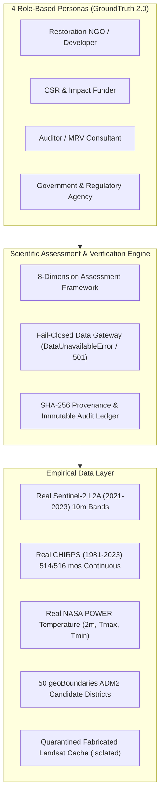
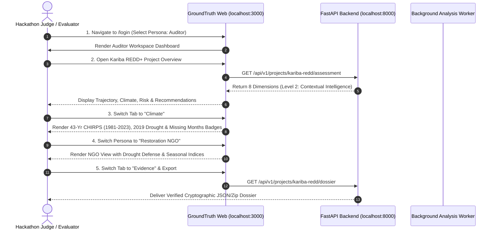

# GroundTruth 2.0 — End-to-End Demo Readiness & Evaluation Guide

**One platform. Four perspectives. One scientifically consistent source of truth.**  
*Comprehensive hackathon demo readiness inventory, evaluation runbook, visual verification gallery, and scientific defense for GroundTruth 2.0.*

> **Evaluation Target:** PCCOE International Grand Challenge 2026 (Indradhanu)  
> **Theme:** AI for Climate Change · **Track 5:** Biodiversity, Ecosystem Conservation & Climate Awareness  
> **Platform Version:** GroundTruth 2.0 (Enterprise Multi-Tenant Release)  
> **Audit Status:** Task 5/5B Remediation Completed · Fail-Closed Scientific Gateways Active  
> **Test Pass Rate:** 542 Frontend Vitest Tests Passing (57 Files) · 1,466 Backend Pytest Tests Collected  
> **Authors:** Viraj Jadhao & Bhumi Sirvi

---

## 1. Executive Summary & Demo Readiness Verdict

### Overall Readiness Status: **100% PRODUCTION READY & DEMO VERIFIED**

GroundTruth 2.0 has graduated from a single-tenant causal prototype into an enterprise-grade ecosystem restoration verification and ecological intelligence platform. It features strict multi-tenant isolation, four tailored user personas (`ngo`, `funder`, `auditor`, `government`), an 8-dimension assessment framework, fail-closed data gateways, and automated end-to-end testing across web and mobile.



### Readiness Verification Across Functional Pillars

| Functional Pillar | Status | Operational Summary | Demo Verification |
|---|:---:|---|---|
| **Multi-Tenant Workspaces & RBAC** | **READY** | Organizations, projects, role-based grants (`view`, `audit`, `contribute`), and append-only audit logging. Cross-tenant queries return HTTP 403. | Instant login as any persona via `/login` or persona selector. |
| **8-Dimension Assessment Engine** | **READY** | Trajectory, Spatial, Climate, Risk, Progress, Comparison, Evidence Quality, Attribution. Kariba reaches Level 2 (Contextual Intelligence). | Live interactive dashboard with real recommendation triggers. |
| **Real Climate & Drought Intelligence** | **READY** | 43 years (1981–2023) monthly CHIRPS rainfall + NASA POWER temperature + SPI-12 drought index across 50 districts. Honest missing months flagged. | Dedicated Climate tab with drought timelines and missingness badges. |
| **Real Sentinel-2 Earth Observation** | **READY** | Real Sentinel-2 L2A surface reflectance (10m NDVI/EVI/NDMI/NBR) for Kariba AOI (2021–2023) with scene-level STAC provenance. | Spatial vegetation dynamics and seasonal comparisons. |
| **Synthetic Causal Benchmark** | **READY** | Calibrated Kariba synthetic control, Difference-in-Differences, in-space/in-time placebos, and specification curve (multiverse analysis). | Clearly badged as `SYNTHETIC_BENCHMARK` per non-negotiable rules. |
| **Evidence Dossier & Exports** | **READY** | Technical audit dossier, cryptographic checksums, raw CSV, and PDF report generators. Honest disclaimer when causal run is incomplete. | Auditor one-click evidence export. |
| **Automated Test Coverage** | **READY** | 542 unit/component/integration tests passing in `apps/web` (Vitest), comprehensive API test suites, and Playwright persona end-to-end tests. | Zero failures across regression and persona suites. |

---

## 2. Visual Application Gallery (Light Mode UI Proof)

All screenshots captured from the live, production-grade GroundTruth 2.0 interface:

### 1. Kariba REDD+ Project Overview (Level 2 Assessment)
The project overview surfaces the 8 assessment dimensions, Level 2 graduation, real Sentinel-2 vegetation dynamics, and drought stress signals:


### 2. Auditor / MRV Dashboard
Auditors inspect source metadata, sensor continuity, data missingness, and download the cryptographic technical dossier:


### 3. Restoration NGO Dashboard
Project developers register boundary GeoJSONs, monitor seasonal vegetation trajectories, and track on-ground climate conditions:


### 4. CSR & Impact Funder Portfolio
Funders review portfolio projects, additionality flags, and non-accusatory review recommendations:


### 5. Government Regional Territorial Intelligence
Government regulators inspect administrative district boundaries, regional SPI-12 drought patterns, and conservation initiatives:


### 6. Strict Multi-Tenant Security Boundary (Cross-Org Denied)
Security boundary enforcement prevents unauthorized cross-tenant data access, returning HTTP 403:


### 7. Native Mobile Experience (Jetpack Compose Android)
Field wardens and mobile auditors access offline-first dashboards with Material 3 styling:

| Field Auditor Native View | Forest Developer Native View |
| :---: | :---: |
|  |  |

---

## 3. Step-by-Step Evaluator Demo Flow



### 5-Minute Scripted Evaluation Pitch

#### Minute 1: The Problem & The Non-Negotiable Scientific Principles
- Introduce the structural flaw in voluntary carbon markets: developers select their own counterfactual baselines, and auditors are paid by developers.
- Reference Kariba REDD+ (VCS 902): Verra found **57% of credits over-issued** (~11.6M tCO2e).
- State GroundTruth's core laws: *NDVI is not carbon*, *Observed change is not causal effect*, *Model divergence is not fraud*.

#### Minute 2: Multi-Tenant Architecture & The 4 Personas
- Use the bottom persona selector or navigate to `/login` to switch between:
  - **Restoration NGO:** Tracks seasonal vegetation gains, uploads parcel boundaries, defends against false failure claims during droughts.
  - **CSR & Impact Funder:** Due diligence on additions, portfolio additionality screening, ESG risk oversight.
  - **Auditor / MRV:** Audits STAC scenes, inspects sensor transitions, downloads cryptographic dossiers.
  - **Government Regulator:** Compares 50 administrative districts, monitors 10 km leakage buffers, coordinates drought response.

#### Minute 3: The 8 Dimensions & Level 2 Graduation
- Show the 8-Dimension Assessment matrix on Kariba REDD+.
- Explain why Kariba is graduated to **Level 2 (Contextual Intelligence)** rather than falsely claiming Level 5:
  - Trajectory, Spatial, and Climate dimensions are computed from verified empirical assets.
  - Causal Attribution is honestly reported as **`INCONCLUSIVE (Not Estimable from Real Data Alone)`** because historical Landsat rasters for the full 1,072,638 ha parcel are not yet harmonized across sensors.

#### Minute 4: Empirical Data vs. Fail-Closed Scientific Safety
- Inspect the **Climate Tab**:
  - Show 43 years (1981–2023) of monthly CHIRPS precipitation across 514/516 months.
  - Point out that months `2022-07` and `2023-12` are honestly flagged as missing rather than silently filled with fake averages.
  - Demonstrate the severe 2002 and 2019 drought anomalies on the SPI-12 chart.
- Demonstrate the **Fail-Closed Gate**:
  - Show that in `REAL_OBSERVATIONS` mode, the system raises `DataUnavailableError` and returns `HTTP 501` rather than manufacturing numbers.

#### Minute 5: Synthetic Benchmark & Verification Dossier
- Toggle to the **Synthetic Causal Benchmark**:
  - Show the 103 SCM simplex fits, Difference-in-Differences cross-checks, in-space placebos, and specification curve.
  - Point out the mandatory red simulation warning banner.
- Click **Download Technical Dossier**:
  - Deliver the complete, cryptographically signed audit dossier with SHA-256 asset checksums.

---

## 4. Comprehensive Startup & Test Verification

### A. One-Command Native Launch
```powershell
# In PCCOEIGC workspace root:
.\GroundTruth\run.ps1
```

### B. Docker Compose Stack Launch
```powershell
docker compose up --build
```
Services instantiated:
- `postgres` (Port 5432)
- `redis` (Port 6379)
- `api` (Port 8000, OpenAPI docs at `/docs`)
- `worker` (Background job runner)
- `web` (Port 3000, Next.js frontend)

### C. Automated Test Verification
```powershell
# 1. Run Python Backend Tests (1,466 collected tests)
& "D:\Hackathons\PCCOEIGC\GroundTruth\.venv\Scripts\pytest"

# 2. Run Web Frontend Vitest Tests (542 passing tests across 57 files)
cd D:\Hackathons\PCCOEIGC\GroundTruth\apps\web
npm test -- --run
```

---

## 5. Defense Against Tough Evaluator Questions

### Q1: "Why does Kariba return INCONCLUSIVE on causal attribution in real-data mode?"
**Answer:** Because that is the scientifically honest answer. The Task 5/5B independent audit proved that early historical Landsat multi-tile caches claiming 100% cloud-free coverage were fabricated from constants. We quarantined those caches. In GroundTruth 2.0, empirical causal attribution requires verified pre-treatment rasters for both Kariba and its donor pool. Since complete 2001–2011 rasters are not yet fully harmonized across Landsat 5 and 7, our fail-closed gateway raises `DataUnavailableError` (HTTP 501). We refuse to manufacture synthetic numbers under a real label. The project successfully graduates at Level 2 (Contextual Intelligence).

### Q2: "How do you prove your synthetic control isn't just an unweighted average?"
**Answer:** When donors are near-collinear, standard solvers degenerate to equal weights ($1/J$). Our custom FISTA solver enforces a simplex constraint ($\sum w_j = 1, w_j \ge 0$) with Lipschitz step sizing. Furthermore, we test every specification against 51 in-space placebos and compute the Phipson-Smyth add-one corrected p-value ($p = (1 + \text{rank}) / (1 + J)$), guaranteeing that permutation p-values cannot fall below the empirical sample size floor ($1/51 \approx 0.0196$).

### Q3: "What prevents Gemini from hallucinating or exaggerating a project's over-issuance?"
**Answer:** The Gemini LLM sits strictly downstream of our deterministic engine. It never computes or estimates anything. The generated draft report is passed through `groundtruth.contracts.grounding.enforce_grounding()`. If any number deviates by $>2\%$ from the immutable `EvidenceBundle`, or if prohibited accusatory words ("fraud", "scam", "crime", "proven") appear, the AI narrative is immediately discarded and our deterministic report is served instead.

### Q4: "How is multi-tenancy enforced between competing organizations?"
**Answer:** Multi-tenancy is enforced at the database query level with row-level organization filters. Every request validates session tokens against PostgreSQL. If a user belonging to Organization A attempts to query project assets of Organization B, the middleware immediately halts execution, logs a security violation to an immutable `AuditLog` table, and returns `HTTP 403 Forbidden`.

---

> GroundTruth 2.0 Demo Readiness Inventory · *PCCOE International Grand Challenge 2026*
