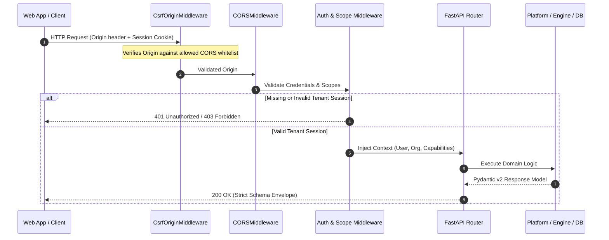

# GroundTruth API Service (`apps/api`)

The **GroundTruth API Service** is the central RESTful HTTP gateway for GroundTruth 2.0. Built with **FastAPI** and **Pydantic v2**, it exposes multi-tenant project registration, asynchronous causal verification pipelines, geospatial boundary tile delivery, real document claims extraction, and cryptographically verified evidence bundles.

The service acts as a strictly typed boundary between external clients (web UI, partner integrations, CI/CD harnesses) and the underlying analytical engine, strictly enforcing tenant isolation, role-based authorization, and non-negotiable scientific safety invariants.

---

## Architectural Principles & Scientific Safety

1. **Separation of Gateway from Engine**: The API communicates with the analytical engine through a versioned contract (`run_analysis`, `describe_engine`, `ENGINE_VERSION`). Swapping estimators, optimization solvers, or satellite providers requires zero changes to HTTP routing.
2. **Fail-Closed Security & Multi-Tenancy**: Every project, run, and dataset belongs to an organization tenant. Authentication is enforced via signed session tokens in HttpOnly cookies or Bearer headers. Unauthorized access across tenant boundaries fails closed with `403 Forbidden`.
3. **No Bare Numbers & Strict Provenance**: All analytical endpoints return structured `Evidence` bundles containing point estimates, units ($ha$, $NDVI$, $mm$), credible/confidence intervals, methodology identifiers, and SHA-256 provenance hashes.
4. **Model Divergence $\neq$ Fraud**: The API and its schemas enforce neutral, scientifically sound language. If a project developer's claimed credit volume exceeds independent synthetic control counterfactuals, the verdict is `DIVERGENT` (triggering accredited manual audit), never an accusation of fraud.
5. **Enforced Units Rule (`assert_not_index_to_carbon`)**: The API strictly forbids converting vegetation indices directly to carbon without an explicit, audited allometric biomass model.

---

## Request Lifecycle & Security Architecture



---

## Router Map & Endpoints

The API is partitioned into specialized domain routers mounted in `groundtruth.platform.api.app`:

```mermaid
flowchart TD
    API["FastAPI App (app.py)"]
    
    API --> AuthRouter["/auth (auth.py)<br/>Login, Register, Session, Switch Org"]
    API --> OrgsRouter["/orgs (orgs.py)<br/>Tenant management, Members, Invites"]
    API --> ProjectsRouter["/projects (projects.py)<br/>Registration, Boundaries, Datasets"]
    API --> ClaimsRouter["/claims (claims.py)<br/>Document extraction, Claim indexing"]
    API --> PortfolioRouter["/portfolio (portfolio.py)<br/>Persona views: NGO, Funder, Auditor, Gov"]
    API --> RunsRouter["/runs (runs.py)<br/>Stored runs, Verification, Comparisons"]
    API --> JobsRouter["/jobs (jobs.py)<br/>Async queueing, Progress, Cancellation"]
    API --> EventsRouter["/events (events.py)<br/>Audit trails & SSE real-time streaming"]
    API --> TilesRouter["/tiles (tiles.py)<br/>MapLibre vector/raster boundary tiles"]
    API --> ExportsRouter["/exports (exports.py)<br/>JSON, Markdown, GeoJSON, CSV bundles"]
```



### 1. Authentication & Multi-Tenancy (`/auth`, `/orgs`)
* `POST /auth/register`: Create a new user and initial organization tenant.
* `POST /auth/login`: Authenticate credentials and issue HttpOnly session cookies.
* `POST /auth/logout`: Invalidate user session.
* `GET /auth/me`: Retrieve authenticated user identity, active tenant, and assigned role.
* `POST /auth/switch-org`: Switch active tenant context.
* `GET /orgs`: List organizations accessible to the current user.
* `GET /orgs/{org_id}/members`: List team members and role capabilities.

### 2. Project Lifecycle & Boundary Management (`/projects`)
* `GET /projects`: List registered conservation projects within the tenant scope.
* `POST /projects`: Register a new project with verified metadata and registry IDs (e.g., VCS 902).
* `GET /projects/{project_id}`: Retrieve full project details, spatial bounds, and monitoring history.
* `POST /projects/{project_id}/boundary`: Ingest GeoJSON/KML boundaries with automated geodesic validation.
* `GET /projects/{project_id}/dimensions`: Query the 8 real-time assessment dimensions.

### 3. Asynchronous Verification Jobs (`/jobs`, `/events`)
* `POST /jobs`: Queue a long-running causal analysis (real satellite or synthetic benchmark).
* `GET /jobs/{run_id}`: Poll job status, worker heartbeat, and multi-stage progress (0–100%).
* `POST /jobs/{run_id}/cancel`: Cooperatively cancel an in-flight verification job.
* `GET /events/stream`: Server-Sent Events (SSE) stream for real-time progress updates and audit logs.

### 4. Stored Runs & Provenance (`/runs`, `/exports`)
* `GET /runs`: Paginated list of completed analytical runs with cursor-based pagination.
* `GET /runs/{run_id}`: Retrieve complete evidence bundle with counterfactual paths and diagnostics.
* `GET /runs/compare`: Side-by-side comparison of multiple runs across different specifications.
* `GET /exports/{run_id}.json`: Cryptographically signed JSON evidence bundle.
* `GET /exports/{run_id}.md`: Deterministically rendered Markdown audit report.
* `GET /exports/{run_id}.geojson`: Geospatial boundaries and donor geometries.

### 5. Document Claims Extraction & Benchmarking (`/claims`)
* `POST /claims/extract`: Parse Project Design Documents (PDD) or Monitoring Reports (MR) to extract baseline deforested area and crediting claims.
* `GET /claims/{claim_id}`: Retrieve structured developer claims.
* `POST /claims/{claim_id}/compare`: Automatically compare documented claims against empirical counterfactual estimates.

### 6. Persona Portfolio Aggregation (`/portfolio`)
* `GET /portfolio/ngo`: Aggregates project-level health, baseline vegetation trends, and boundary alerts.
* `GET /portfolio/funder`: Delivers asset risk ratings, integrity scores, and financial exposure distributions.
* `GET /portfolio/auditor`: Summarizes diagnostic fit metrics, RMSPE distributions, and review backlogs.
* `GET /portfolio/government`: Provides national jurisdictional baselines and cross-border leakage tracking.

### 7. Geospatial Boundary Tile Service (`/tiles`)
* `GET /tiles/{project_id}/{z}/{x}/{y}.pbf`: Dynamically renders vector protobuf tiles for MapLibre GL, streaming multi-polygon boundaries, 10 km leakage buffers, and donor reference candidates.

---

## Error Handling & Error Code Mapping

**Consumers: see [the API guide](../../docs/api/README.md)**, which lists every error code with its
HTTP status and explains the difference between a refusal and an error, with real examples.

Every error has one envelope (`ErrorEnvelopeMiddleware`): `detail` (an object with `code`,
`message` and `hint`, a string, or a validation list), `is_refusal` and `request_id`. Engine
outcomes on `/verify` use the engine's own lowercase codes (`groundtruth.contracts.result.ErrorCode`):

| Code | HTTP | Refusal |
| :--- | :--- | :--- |
| `insufficient_data` | 422 | yes |
| `donor_pool_inadequate` | 422 | yes |
| `invalid_request` | 422 | no |
| `contract_version_mismatch` | 409 | no |
| `data_unavailable` | 503 | no |
| `estimation_failed` | 500 | no |
| `not_implemented` | 501 | no |
| `internal_error` | 500 | no |

API codes are in `platform/api/errors.py` (`ApiErrorCode`, `API_ERROR_STATUS`) and sign-in and
tenancy codes in `platform/auth/service.py`. A test fails if any code is missing from the guide.

---

## OpenAPI Synchronization & Type Export

The TypeScript interfaces consumed by `apps/web` are generated directly from the FastAPI OpenAPI schema. Never modify `src/lib/generated/schema.d.ts` manually.

```bash
# Export the headless OpenAPI JSON schema without a database
python apps/web/scripts/export_openapi.py

# Generate TypeScript types in the web app
cd apps/web && npm run generate:api

# Verify schema synchronization
python -m pytest tests/test_openapi_snapshot.py
```

---

## Local Development & Startup

### 1. Requirements
* Python 3.11+
* PostgreSQL 16 with PostGIS (optional for local SQLite development)
* Redis (optional for synchronous local runs)

### 2. Environment Variables
Create `.env` in the repository root:
```env
DATABASE_URL=sqlite:///data/interim/groundtruth.db
AUTH_REQUIRED=true
AUTH_COOKIE_SECURE=false
FRONTEND_URL=http://localhost:3000
CORS_ALLOWED_ORIGINS=http://localhost:3000
```

### 3. Run Development Server
```bash
# Apply database migrations
python -m apps.worker.main --migrate --exit-when-idle

# Start FastAPI ASGI server with auto-reload
uvicorn apps.api.main:app --reload --port 8000
```
Interactive OpenAPI documentation is accessible at `http://localhost:8000/docs`.
