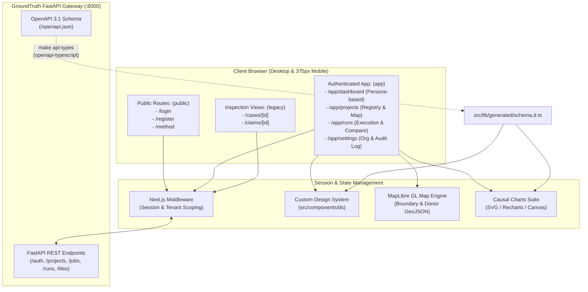
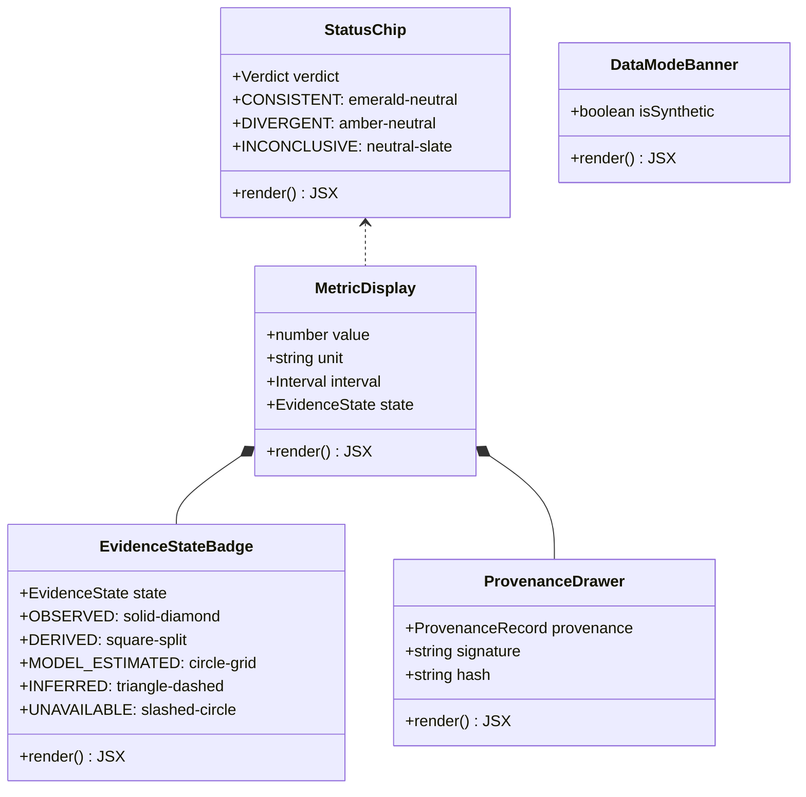
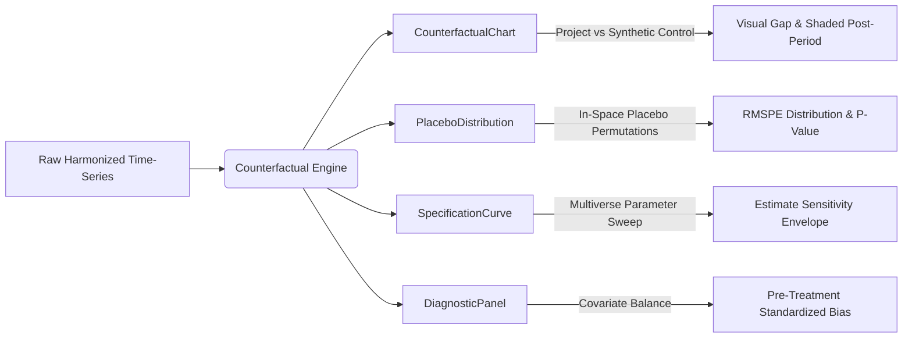

# GroundTruth Web Application (`apps/web`)

The **GroundTruth Web Application** is a production-grade, multi-tenant monitoring, reporting, and verification (MRV) platform built with **Next.js 14 (App Router)**, **TypeScript**, **Tailwind CSS**, and **MapLibre GL**. It is engineered to deliver mathematically rigorous, causal satellite evaluations of nature-based carbon and ecological restoration projects to four distinct market personas.

Every metric, chart, and status badge displayed in the interface enforces the core scientific principles of GroundTruth 2.0:
1. **NDVI is not carbon**: Vegetation indices measure greenness reflection, not tons of stored carbon ($t\text{CO}_2e$). No index is converted to carbon credits without an audited, peer-reviewed allometric biomass model.
2. **Observed change is not causal effect**: Project greening may be driven by regional rainfall, climate variations, or macroeconomic shifts. Only comparison against a rigorously constructed synthetic control counterfactual reveals true intervention impact.
3. **Model divergence is not fraud**: Methodological divergences highlight baseline over-crediting or measurement uncertainty, serving as an evidence-based trigger for accredited re-audit rather than accusations of misconduct.
4. **Fail-closed verification**: If boundary integrity, sensor calibration, or donor overlap checks fail, the engine refuses to guess and yields a neutral `INCONCLUSIVE` verdict.

---

## Visual Tour: Multi-Tenant Persona Dashboards

GroundTruth dynamically tailors its analytical surface according to the authenticated tenant's role and operational mandate:

### 1. Auditor Dashboard
Methodology reviewers and certification auditors receive complete transparency into counterfactual fit diagnostics, donor pool balance, placebo test significance, and leave-one-out sensitivity curves.


*Figure 1: Full-width Auditor Dashboard displaying synthetic control trajectories, donor weighting breakdown, and fit diagnostics.*


*Figure 2: Responsive Auditor Dashboard inspection pane showing detailed assessment dimensions and metric cards.*

### 2. NGO / Project Developer Dashboard
Project developers inspect their registered conservation boundaries, historical baseline trajectories, real-time vegetation indices, and regional reference benchmarks.


*Figure 3: NGO Project Developer Dashboard highlighting active conservation parcels, boundary sanity checks, and baseline trends.*


*Figure 4: Composite NGO project view displaying regional vegetation monitoring and empirical health indicators.*

### 3. Funder / Carbon Buyer Dashboard
Institutional investors and carbon portfolio managers track real-time portfolio risk ratings, integrity distributions, and leakage-adjusted impact across multiple jurisdictional assets.


*Figure 5: Funder Dashboard showing asset risk profiles, portfolio-wide causal integrity scores, and capital exposure.*

### 4. Government / National Registry Dashboard
Host country regulators and sovereign registry administrators monitor national jurisdictional baselines, cross-boundary leakage risks, and Article 6 corresponding adjustment integrity.


*Figure 6: National Government Registry Dashboard displaying jurisdictional project boundaries, leakage buffers, and aggregate carbon accounting.*

### 5. Multi-Tenant Access Control & Mobile Interface
Strict fail-closed tenant boundary guards ensure that cross-organization access attempts return HTTP 403 Forbidden with clear diagnostic logs, while the entire UI remains fully responsive down to 375px mobile viewports.

| Fail-Closed Cross-Tenant Denial | Responsive Mobile Sign-In |
| :---: | :---: |
|  |  |
| *Figure 7: Deterministic 403 access rejection when crossing tenant boundaries.* | *Figure 8: Mobile viewport (375px) sign-in and tenant switching.* |

---

## Architectural Overview

The frontend architecture separates public promotional/methodological pages from the authenticated multi-tenant dashboard, communicating with the FastAPI backend through fully typed, generated OpenAPI client wrappers.



---

## Directory Structure

```text
apps/web/
├── e2e/                             # Playwright E2E persona journey & a11y test suites
│   ├── a11y.spec.ts                 # Axe-core automated accessibility gate
│   ├── personas.spec.ts             # Complete multi-role user journeys & 403 checks
│   ├── stack.ts                     # Test harness spin-up (ephemeral SQLite + API + Web)
│   └── seed.ts                      # Demo seed injection for test tenant isolation
├── public/                          # Static brand assets and GeoJSON boundary caches
├── scripts/                         # Code generation and OpenAPI synchronisation scripts
│   ├── export_openapi.py            # Headless OpenAPI JSON schema exporter
│   └── generate_fixtures.py         # Deterministic fixture generator from engine outputs
├── src/
│   ├── app/                         # Next.js 14 App Router hierarchy
│   │   ├── (app)/                   # Authenticated multi-tenant workspace
│   │   │   └── app/                 # Main portal (dashboard, projects, settings)
│   │   ├── (legacy)/                # Backward-compatible case & claim inspection views
│   │   ├── (public)/                # Unauthenticated landing, login, and registration
│   │   ├── layout.tsx               # Root HTML structure, themes, and global font injection
│   │   └── middleware.ts            # Route guards, tenant token validation, redirect logic
│   ├── components/
│   │   ├── charts/                  # Scientific causal visualization primitives
│   │   │   ├── BinnedHistogram.tsx  # Placebo distribution histogram
│   │   │   ├── Charts.tsx           # High-performance SVG line and area chart engine
│   │   │   ├── SignedBars.tsx       # Divergence and covariate balance bars
│   │   │   └── SpecDots.tsx         # Specification curve point distribution
│   │   ├── ds/                      # GroundTruth Atomic Design System
│   │   │   ├── Badge.tsx            # Contextual label indicator
│   │   │   ├── Button.tsx           # High-contrast action button
│   │   │   ├── Card.tsx             # Surface container with elevation tokens
│   │   │   ├── DataModeBanner.tsx     # Persistent, non-dismissible synthetic data warning
│   │   │   ├── EvidenceStateBadge.tsx# 5-state evidence marker (Observed, Derived, Model, etc.)
│   │   │   ├── MetricDisplay.tsx    # Strict value + unit + uncertainty interval display
│   │   │   ├── Overlay.tsx          # Accessible modal dialog layer
│   │   │   ├── ProvenanceDrawer.tsx # Cryptographic 2-click source provenance inspector
│   │   │   ├── RefusalDetails.tsx   # Fail-closed refusal explanation panel
│   │   │   ├── StatusChip.tsx       # Verdict chip (Consistent, Divergent, Inconclusive)
│   │   │   └── UnavailablePanel.tsx # Honest missing-evidence boundary placeholder
│   │   └── map/                     # Interactive geospatial boundary viewer
│   │       ├── geo.ts               # Geodesic area calculation & polygon simplification
│   │       ├── ProjectMap.tsx       # MapLibre GL wrapper with donor/project layers
│   │       └── ProjectMap.module.css# Hardware-accelerated map viewport styling
│   ├── features/                    # Domain-driven feature modules
│   │   ├── auth/                    # Tenant login, registration, session management
│   │   ├── dashboards/              # Persona-specific views (NGO, Funder, Auditor, Gov)
│   │   ├── projects/                # Project portfolio, boundary uploads, run triggers
│   │   ├── run/                     # Run execution state machine, SSE progress polling
│   │   └── settings/                # Tenant administration, team members, audit logs
│   ├── lib/
│   │   ├── api-client.ts            # Typed fetch client using openapi-fetch
│   │   ├── jobs.ts                  # Long-running job lifecycle (submit, poll, cancel)
│   │   ├── types.ts                 # Domain type aliases derived from OpenAPI schema
│   │   └── generated/               # Generated schema and OpenAPI contract
│   │       ├── openapi.json         # Committed backend OpenAPI 3.1 specification
│   │       └── schema.d.ts          # Strongly typed TypeScript interfaces
│   └── styles/                      # Tokenized CSS variables and light-mode themes
└── package.json                     # Node.js dependencies, scripts, and build targets
```

---

## Custom Design System (`src/components/ds/`)

The GroundTruth Design System provides a cohesive, accessible, and mathematically honest UI toolkit. It guarantees that uncertainty, missing data, and provenance are first-class visual elements.



### 1. Evidence States (`EvidenceStateBadge`)
Every empirical number shown on screen is stamped with one of five standardized evidence states:
* `OBSERVED`: Measured directly from satellite or weather instruments (e.g., Sentinel-2 Level-2A BOA reflectance, CHIRPS rainfall).
* `DERIVED`: Computed deterministically without statistical fitting (e.g., NDVI formula $(NIR - Red) / (NIR + Red)$, geodesic polygon area).
* `MODEL_ESTIMATED`: Produced by an optimization or estimation algorithm with explicit assumptions (e.g., Synthetic Control donor weights $W^*$, ridge regression).
* `INFERRED`: A reasoned qualitative or semi-quantitative conclusion (e.g., ecological risk category).
* `UNAVAILABLE`: Data is absent or fails quality assurance. Missing data is never interpolated or hidden.

### 2. Metric Display (`MetricDisplay`)
Enforces the repository rule: **No bare numbers**. Displays the point estimate, measurement unit ($ha$, $NDVI$, $mm$), confidence/credible interval, and interval kind (`bayesian`, `bootstrap`, `permutation`). Clicking any metric immediately opens the cryptographic provenance drawer.

### 3. Verdict Neutrality (`StatusChip`)
* `CONSISTENT`: Displayed in subdued green, indicating the project's reported gains match synthetic control counterfactuals within confidence intervals.
* `DIVERGENT`: Styled in amber, never alarming red. It denotes a statistically significant divergence in trajectory without alleging intent or fraud.
* `INCONCLUSIVE`: Displayed in neutral slate. Treated as an honest, fully expected scientific outcome when statistical power is insufficient or cloud cover is excessive.

### 4. Non-Dismissible Synthetic Data Banner (`DataModeBanner`)
When operating against simulated fixtures or demo test data, a persistent, high-contrast banner is affixed across the top of the viewport. It cannot be closed or hidden, eliminating accidental confusion with production verification runs.

---

## Geospatial Inspection: MapLibre GL Integration

GroundTruth integrates **MapLibre GL** (`src/components/map/ProjectMap.tsx`) for interactive, vector-based geospatial inspection:

* **Geodesic Accuracy**: Renders multi-polygon project conservation boundaries and excluded buffer zones using WGS84 coordinates.
* **Leakage Buffer Rings**: Visualizes the pre-registered 10 km leakage belt around project perimeters to detect displaced deforestation.
* **Donor Pool Candidate Overlay**: Displays eligible reference areas across regional biomes (e.g., Southern African Miombo woodlands) color-coded by donor weight $W^*$.
* **Hardware Acceleration**: Canvas-based vector rendering supports pan, zoom, and layer toggles across complex multi-thousand-vertex polygons without browser thread blocking.


*Figure 9: Kariba REDD+ (VCS 902) project boundary overlaid with regional donor units and Hansen forest baseline masks.*

---

## Scientific Visualization Suite (`src/components/charts/`)

The charting library provides domain-specific scientific plots developed with precision SVG rendering:



1. **CounterfactualChart**: Shows observed project vegetation trajectory against the synthetic control counterfactual over time ($2001 - 2022$), clearly marking intervention launch ($T_0 = 2011$) and shading the cumulative treatment effect gap.
2. **PlaceboDistribution**: Binned histogram of in-space placebo root mean square prediction error (RMSPE) ratios across 50+ donor candidates, highlighting the treated project's percentile to establish exact permutation $p$-values.
3. **SpecificationCurve**: Multiverse analysis display showing point estimates across 40+ model variations (varying pre-period length, donor caps, ridge penalties, and covariates) to confirm that findings do not depend on a single arbitrary model specification.
4. **DiagnosticPanel & DonorPoolPanel**: Renders covariate balance tables (elevation, slope, precipitation, road distance) and explicit exclusion tables explaining why specific candidate donors were dropped (e.g., protected status, mining activity, or deforestation shocks).

---

## Test Suites & Quality Engineering

The frontend is protected by two comprehensive automated test suites:

### 1. Vitest Unit & Component Suite
* **Coverage**: 57 test files, **542 tests passing**.
* **Scope**: Component rendering, design system accessibility attributes, date and unit formatters, job polling state machines, URL query state synchronization, and formula calculation utilities.
* **Execution**:
  ```bash
  cd apps/web
  npm test
  ```

### 2. Playwright End-to-End Persona Suite
* **Coverage**: Multi-role authenticated user journeys, mobile viewports, and fail-closed security gates.
* **Scope**:
  * **NGO Journey**: Project boundary inspection, baseline trajectory review, empirical metrics overview.
  * **Funder Journey**: Asset risk evaluation, integrity distribution tracking, carbon volume verification.
  * **Auditor Journey**: Counterfactual model diagnostics, donor balance tables, specification curves, export downloads.
  * **Government Journey**: National jurisdictional baselines, buffer monitoring, cross-border leakage.
  * **Cross-Tenant Access Control**: Verifies that authenticated requests attempting to access another organization's project UUID fail closed with HTTP 403 Forbidden.
  * **Mobile Responsiveness**: Complete test run executed at 375x812 viewport simulating iPhone devices.
  * **Accessibility (a11y)**: Automated Axe-core scanning asserting zero serious or critical WCAG 2.1 AA violations.
* **Execution**:
  ```bash
  cd apps/web
  npm run test:e2e
  ```

---

## API Contract & Type Synchronization

The frontend maintains strict type safety with the FastAPI backend. No backend data shapes are hand-coded.

```bash
# 1. Export fresh OpenAPI 3.1 schema from the backend without requiring a live server
python apps/web/scripts/export_openapi.py

# 2. Regenerate TypeScript interfaces from the committed openapi.json
cd apps/web && npm run generate:api

# 3. Verify type synchronization in CI
npm run check:api-types
```

Both `src/lib/generated/openapi.json` and `src/lib/generated/schema.d.ts` are committed to version control. Pull requests that alter backend Pydantic models without regenerating TypeScript types are blocked by CI gates.

---

## Configuration & Environment Variables

Copy `.env.example` to `apps/web/.env.local`:

| Variable | Description | Default | Production Requirement |
| :--- | :--- | :--- | :--- |
| `NEXT_PUBLIC_API_URL` | Public base URL of the FastAPI HTTP service | `http://localhost:8000` | Must point to public HTTPS API gateway |
| `INTERNAL_API_URL` | Server-side internal API URL for SSR requests | `http://127.0.0.1:8000` | In Docker/K8s, points to internal DNS service |
| `SITE_URL` | Public origin of the Next.js web application | `http://localhost:3000` | Must match CORS allowed origin on the API |
| `NEXT_PUBLIC_DEMO_MODE` | Allows fixture fallback if API is unreachable | `false` | Must always be `false` in production |

---

## Development & Build Commands

```bash
# Install dependencies
npm install

# Start local Next.js development server on port 3000
npm run dev

# Run Vitest test suite in watch or single-run mode
npm test
npm run test:run

# Run Playwright end-to-end tests
npm run test:e2e

# Run linter and type-checking
npm run lint
npm run typecheck

# Build optimized production bundle
npm run build

# Start production server
npm start
```
