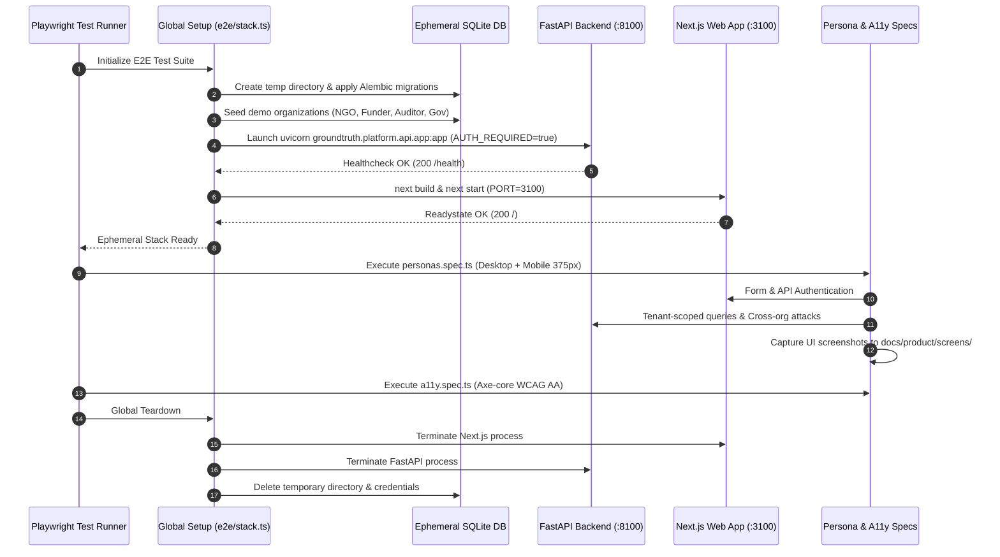
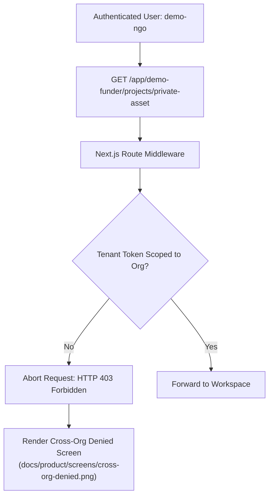

# Playwright End-to-End Test Suite (`apps/web/e2e`)

This directory houses the comprehensive **Playwright End-to-End (E2E)** integration and validation suite for GroundTruth 2.0. The test harness provisions a completely isolated, ephemeral stack (FastAPI backend + Next.js web application + dedicated SQLite database) to verify multi-tenant persona journeys, cross-organization security barriers, responsive mobile layouts, and automated WCAG 2.1 AA accessibility compliance.

---

## Test Architecture & Lifecycle

The E2E test stack (`e2e/stack.ts`) runs within Playwright's `globalSetup` and `globalTeardown` hooks, guaranteeing zero state pollution across test invocations:



---

## Persona Journey Coverage (`personas.spec.ts`)

The test suite validates realistic user workflows across the four core market personas:

### 1. NGO / Project Developer Journey
* **Authentication**: Signs in via interactive login form using tenant `demo-ngo`.
* **Contextual Intelligence**: Asserts Level 2 engine capabilities and validates that all 8 assessment dimensions render.
* **Recommendations**: Verifies actionable guidance (e.g., `acquire_reference_series`) including plain-language rationale.
* **Geospatial & Climate Auditing**: Navigates to `/projects/kariba-redd/climate`, asserting historic severe drought classifications (e.g., 2019) and verifying honest reporting of missing monthly telemetry (e.g., 2022-07 and 2023-12).
* **Report Integrity**: Asserts that projects without a completed causal run honestly state that monitoring reports are unavailable, preventing accidental dissemination of unverified claims.

### 2. Funder / Carbon Buyer Journey
* **Portfolio Risk Evaluation**: Verifies portfolio summary rows, asset risk categorization, and exposure indicators.
* **Attribution Transparency**: Validates that projects with insufficient reference overlap are clearly marked `INCONCLUSIVE` rather than masked with synthetic greening.
* **Neutral Language Enforcement**: Verifies that copy, tooltips, and status chips strictly adhere to scientific terminology, excluding accusations of fraud or misconduct.

### 3. Auditor / Methodology Reviewer Journey
* **Diagnostic Deep-Dive**: Reviews synthetic control counterfactual paths, donor weights ($W^*$), and pre-treatment covariate balance tables.
* **Placebo & Sensitivity Checks**: Validates in-space placebo distribution plots, RMSPE ratio cutoffs, and leave-one-out robustness curves.
* **Audit Exports**: Downloads certified evidence bundles in JSON, Markdown, and GeoJSON formats, asserting cryptographic SHA-256 provenance hashes.

### 4. Government / National Registry Journey
* **Jurisdictional Baselines**: Monitors national forest baseline trends and regional biome reference pools.
* **Leakage Belt Tracking**: Inspects 10 km peripheral buffer zones to evaluate displacement risks across sovereign borders.
* **Corresponding Adjustment Verification**: Audits sovereign project boundaries against national carbon accounting ledgers.

---

## Fail-Closed Security & Cross-Org Isolation

A critical requirement of GroundTruth 2.0 is tenant isolation. The E2E suite actively attempts unauthorized cross-tenant operations:



* **Tenant Boundary Assertion**: `personas.spec.ts` explicitly attempts cross-organization navigation (e.g., `demo-ngo` requesting `demo-funder` projects).
* **Deterministic 403 Forbidden**: Asserts that requests are immediately blocked by API and frontend middleware with an explicit access denial screen.
* **Audit Trail Generation**: Confirms that cross-organization access attempts trigger security events in the tenant audit log.

---

## Multi-Device Viewport Matrix

Tests run concurrently against two pre-configured browser profiles:

| Project | Viewport | Target Device Profile | Key Testing Assertions |
| :--- | :--- | :--- | :--- |
| `chromium` | 1280 × 720 | Standard Desktop Monitor | Multi-column layout, map controls, side-by-side diagnostic charts, expanded donor tables. |
| `phone` | 375 × 812 | Mobile (iPhone SE / iPhone 13 mini) | Responsive hamburger navigation, collapsible filter drawers, touch-friendly metric cards, single-column charts. |

---

## Automated Accessibility Gate (`a11y.spec.ts`)

GroundTruth enforces an automated accessibility gate powered by `@axe-core/playwright`:

* **Standards Evaluated**: WCAG 2.0 Level A/AA, WCAG 2.1 Level A/AA, and Section 508 best practices.
* **Fail-Closed Threshold**: Any `serious` or `critical` violation automatically fails the CI build.
* **Moderate Violation Whitelist**: Unresolved `moderate` issues are explicitly registered in `KNOWN_MODERATE` with architectural justification. Any unlisted moderate issue triggers an immediate test failure.

---

## Automated Documentation Screenshots

The test runner captures high-fidelity light-mode application screenshots during test execution and writes them directly to `docs/product/screens/`:

* `ngo-dashboard.png` & `ngo-dashboard-phone.png`: Project developer interface.
* `auditor-dashboard.png` & `auditor-dashboard-phone.png`: Methodology review interface.
* `funder-dashboard.png`: Investment portfolio interface.
* `government-dashboard.png`: Jurisdictional registry interface.
* `kariba-overview.png`: Detailed project boundary and climate overview.
* `cross-org-denied.png`: Fail-closed security boundary verification.
* `compose-login-phone.png`: Mobile authentication interface.

---

## Running the E2E Suite

### Prerequisites
Ensure backend Python virtual environment and web dependencies are installed:
```bash
# Repo root
pip install -e "packages/groundtruth[api,dev]"

# Web directory
cd apps/web
npm install
npx playwright install chromium
```

### Execution Commands
```bash
# Run full E2E suite with headless Chromium
npm run test:e2e

# Run tests using installed Microsoft Edge or Google Chrome (Windows optimized)
E2E_CHANNEL=msedge npm run test:e2e

# Run with interactive Playwright UI for step-by-step debugging
npx playwright test --ui

# Run only accessibility audit tests
npx playwright test e2e/a11y.spec.ts

# Run tests against an existing running stack (bypassing automated stack setup)
E2E_EXTERNAL_STACK=1 E2E_BASE_URL=http://localhost:3000 E2E_API_URL=http://localhost:8000 npm run test:e2e
```

### Environment Variables

| Variable | Description | Default |
| :--- | :--- | :--- |
| `E2E_BASE_URL` | Base URL for Next.js web application | `http://localhost:3000` (or `3100` during isolated stack) |
| `E2E_API_URL` | Base URL for FastAPI backend | `http://localhost:8000` (or `8100` during isolated stack) |
| `E2E_CHANNEL` | Browser channel override (`chrome`, `msedge`) | Bundled Chromium |
| `E2E_EXTERNAL_STACK`| Set to `1` to run against externally managed services | `0` (spawns isolated local stack) |
| `E2E_SKIP_BUILD` | Set to `1` to reuse existing Next.js build artifacts | `0` |
| `E2E_SCREENSHOTS_DIR`| Output directory for documentation screenshots | `docs/product/screens` |
