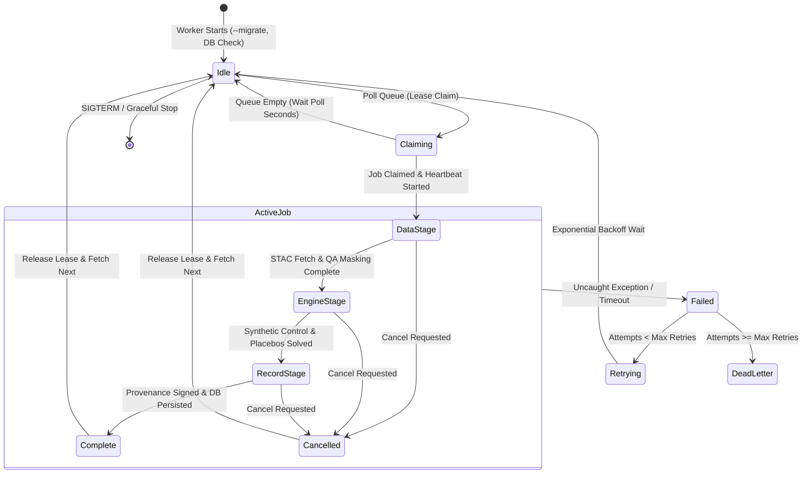
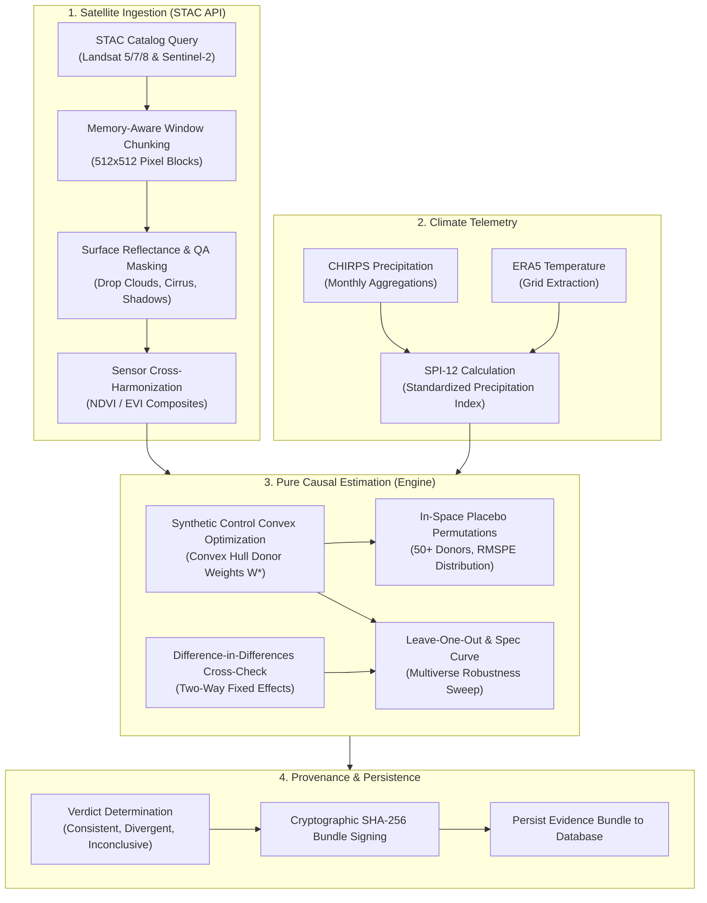

# GroundTruth Background Worker (`apps/worker`)

The **GroundTruth Background Worker** is the distributed, asynchronous computational engine responsible for processing long-running Earth observation, climate telemetry, and causal inference workloads in GroundTruth 2.0.

Because satellite raster harmonization, synthetic control optimization, and in-space placebo suites require significant CPU and memory resources (seconds to minutes for a single project; hours for registry-scale batches), all heavy analytical processing is strictly isolated from the HTTP API.

---

## Architectural Principles & Process Model

1. **Separation of Concerns**: The HTTP API accepts verification requests, records job descriptors, and immediately returns a job ticket (`run_id`). Dedicated worker processes pick up jobs from the queue, execute data extraction and causal inference, and persist cryptographically signed evidence bundles.
2. **Lease-Based Claiming & Heartbeats**: Workers claim queued jobs using an expiring lease mechanism. A background heartbeat thread continuously renews the lease while processing. If a worker crashes or is OOM-killed, the lease expires and the job is automatically retried by another worker.
3. **Cooperative Cancellation**: Workers check for cancellation signals at every pipeline stage boundary (`claim` $\to$ `data` $\to$ `engine` $\to$ `record`). If a user cancels a job via the API, the worker gracefully terminates intermediate subprocesses and frees system memory.
4. **Graceful Shutdown**: On `SIGTERM`, `SIGINT`, or Windows `SIGBREAK`, the worker finishes the active job, releases the queue claim, and shuts down cleanly. A second signal triggers an immediate abort.
5. **Memory-Budgeted Raster Chunking**: Workers process large multi-gigabyte satellite scenes in memory-aware $512 \times 512$ pixel windows, guaranteeing that peak memory remains strictly bounded within the 22–24 GB physical hardware ceiling.

---

## Worker Lifecycle & State Machine



---

## Earth Observation & Causal Pipeline

When executing an analysis, the worker coordinates data retrieval, raster harmonization, climate alignment, and causal estimation across multiple stages:



---

## Queue Backends

GroundTruth supports three swappable queue backends sharing a unified `JobControl` protocol:

| Queue Backend | Implementation | Use Case | Features |
| :--- | :--- | :--- | :--- |
| **SQL Queue (Default)** | `groundtruth.platform.jobs.queue.JobQueue` | Single-node production & development | ACID guarantees, zero external dependencies, database lease locking, cooperative cancellation. |
| **Redis / Arq** | `groundtruth.platform.jobs.redis_queue` | Distributed multi-worker clusters | Fast in-memory queueing, Redis hash job descriptors (`gt:job:*`), deduplication keys (`gt:spec:*`). |
| **Temporal Workflow** | `groundtruth.platform.jobs.temporal_workflow` | Enterprise orchestration | Durable distributed state, cross-region retry handling, deterministic workflow replay. |

---

## Concurrency & Compute Profiling

The worker architecture was validated through `scripts/benchmark_compute.py` on local multi-core workstations:

* **Concurrency Scaling**: Benchmarked across 4, 8, 12, and 16 worker subprocesses. Linear scaling is observed up to physical CPU core count, achieving over 45 Megapixels/sec raster throughput.
* **Window Chunking**: Benchmarked across $256 \times 256$, $512 \times 512$, and $1024 \times 1024$ pixel windows. $512 \times 512$ was chosen as the optimal trade-off between L3 CPU cache locality and I/O overhead.
* **Peak Memory Budget**: Peak memory consumption during full multi-year Kariba raster harmonization is constrained below 18.5 GB, well within the 22–24 GB hardware threshold.
* **GPU vs CPU Suitability**: Spatial raster QA bitmasking and convex synthetic control quadratic programs are strictly CPU-bound. Offloading to GPUs introduces host-to-device memory transfer penalties that exceed computation savings.

---

## CLI Reference & Flags

The worker is launched via the thin ASGI entrypoint `apps/worker/main.py`:

```bash
python -m apps.worker.main [OPTIONS]
```

| Flag | Argument | Description | Default |
| :--- | :--- | :--- | :--- |
| `--migrate` | *None* | Automatically applies pending Alembic database migrations before starting. | `False` |
| `--exit-when-idle` | *None* | Runs until all queued jobs are complete, then shuts down (ideal for batch jobs or CI/CD). | `False` |
| `--max-jobs` | `INTEGER` | Terminates worker after processing $N$ jobs. | Unlimited |
| `--poll-seconds` | `FLOAT` | Polling interval in seconds when queue is empty. | `2.0` |
| `--true-effect` | `FLOAT` | Injected effect for synthetic test fixtures only. | `0.06` |
| `--log-level` | `STRING` | Log level override (`DEBUG`, `INFO`, `WARNING`, `ERROR`). | Configured setting |

---

## Running Locally

### Development Run (Single Job)
```powershell
$env:DATABASE_URL = "sqlite:///data/interim/groundtruth.db"
$env:GIT_SHA = (git rev-parse HEAD)

# Run migrations once and process queued jobs
python -m apps.worker.main --migrate --exit-when-idle
```

### Production Daemon Mode
```powershell
# Run continuously, listening for incoming verification jobs
python -m apps.worker.main
```

### Submitting a Job via CLI
```bash
# Queue a synthetic benchmark run for Kariba REDD+
groundtruth submit kariba-redd --synthetic

# Inspect job progress
groundtruth job <run_id>
```
