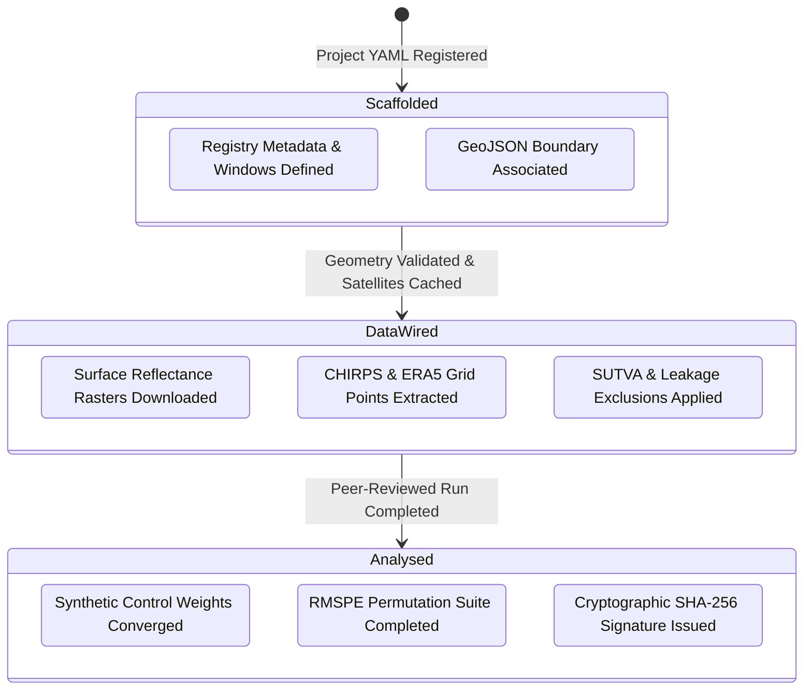
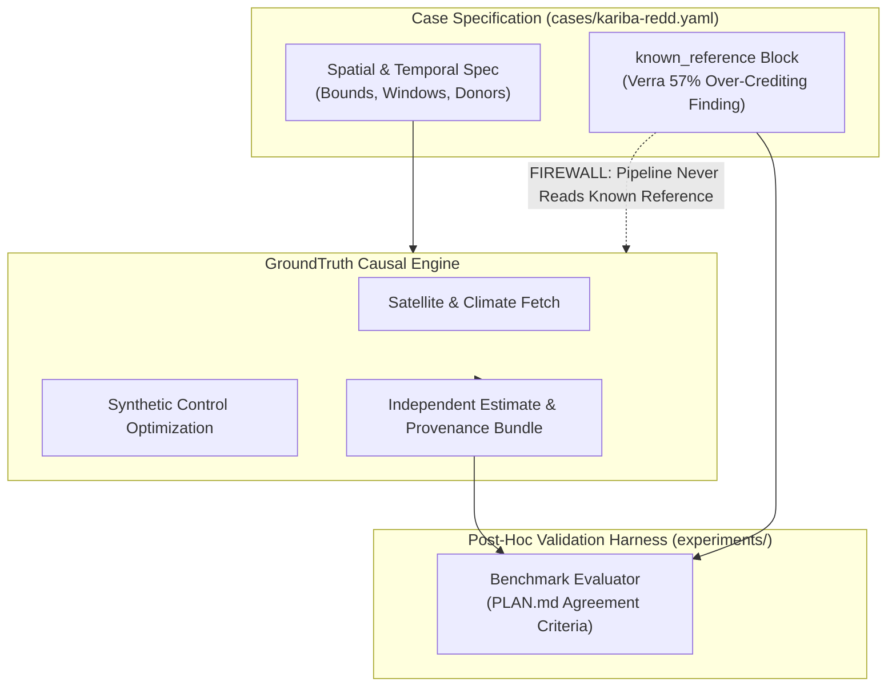

# Case Definitions Repository (`cases`)

This directory houses the formal, version-controlled YAML project specifications for nature-based carbon and ecological restoration projects screened by GroundTruth 2.0.

In GroundTruth, **cases are data, not code**. Onboarding a new conservation project, updating a crediting baseline, or adjusting donor search parameters is accomplished via a pull request against a single declarative YAML file.

---

## Case Catalog

GroundTruth maintains project specifications across diverse forest biomes, project categories, and standard registries:

| Case ID | Project Name | Jurisdiction & Ecosystem | Registry ID | Role & Validation Status |
| :--- | :--- | :--- | :--- | :--- |
| `kariba-redd` | Kariba REDD+ Project | Zimbabwe (Miombo Dry Forest) | Verra VCS 902 | **Primary Validation Benchmark**: Delineated geometry, donor pool wired, benchmarked against published 57% correction. |
| `southern-cardamom-redd` | Southern Cardamom REDD+ | Cambodia (Tropical Rainforest) | Verra VCS 1748 | **Stress Case**: Persistent cloud cover, rapid seasonal monsoon dynamics, canopy saturation. |
| `mikoko-pamoja` | Mikoko Pamoja Mangrove | Kenya (Coastal Mangrove) | Plan Vivo | **Negative Control**: Small spatial scale (<1,000 ha) testing sensor resolution limits. |
| `alto-mayo-redd` | Alto Mayo Protected Forest | Peru (Montane Cloud Forest) | Verra VCS 944 | Tropical montane deforestation frontier. |
| `anew-appalachian-hardwood`| Appalachian Hardwood IFM | USA (Temperate Hardwood) | CAR 1374 | Improved Forest Management (IFM) commercial timber baseline. |
| `chaco-paraguayan-conservation`| Chaco Deforestation Prevention | Paraguay (Gran Chaco Dry Forest) | Verra VCS 1566 | High-velocity agricultural expansion buffer. |
| `chico-mendes-redd` | Chico Mendes Extractive Reserve | Brazil (Acre Amazon) | Verra VCS 1686 | Community extractive reserve forest protection. |
| `cordillera-azul-redd` | Cordillera Azul National Park | Peru (Amazonian Andes) | Verra VCS 985 | Large-scale jurisdictional buffer park screening. |
| `envira-amazon-redd` | Envira Amazonia Project | Brazil (Amazon Basin) | Verra VCS 1382 | Tropical private conservation parcel. |
| `gola-rainforest-redd` | Gola Rainforest National Park | Sierra Leone (Upper Guinea) | Verra VCS 1201 | West African biodiversity hotspot preservation. |
| `kasigau-corridor-redd` | Kasigau Corridor Phase II | Kenya (Dryland Acacia-Commiphora)| Verra VCS 612 | Dryland wildlife corridor baseline verification. |
| `katingan-mentaya-peatland`| Katingan Peatland Restoration | Indonesia (Borneo Peat Swamp) | Verra VCS 1477 | Tropical ombrogenous peat dome conservation. |
| `rimba-raya-redd` | Rimba Raya Biodiversity Reserve | Indonesia (Borneo Lowland) | Verra VCS 674 | High-density peat swamp carbon conservation. |
| `tambopata-bahuaja-reserve`| Tambopata-Bahuaja REDD+ | Peru (Madre de Dios) | Verra VCS 1067 | Multi-part reserve boundary screening. |

---

## Anatomy of a Case Definition (`*.yaml`)

Each project definition is strictly validated by `groundtruth.platform.cases.registry.CaseDefinition`:

```yaml
case_id: kariba-redd
status: scaffolded

project:
  name: Kariba REDD+ Project
  country: Zimbabwe
  ecosystem: miombo woodland / dry forest
  standard: VCS
  registry_id: VCS 902
  area_ha: 784987                  # Official VCS baseline forest accounting area
  crediting_period_start: 2011-07-01
  crediting_period_end: 2041-06-30
  claimed_credits_tco2e: null       # Verified registry issuance records
  source_uri: https://registry.verra.org/app/projectDetail/VCS/902
  boundary_path: cases/boundaries/kariba-redd.geojson

analysis_window:
  pre_start: 2001                   # 10-year pre-intervention baseline
  pre_end: 2010
  post_start: 2011                  # Crediting start
  post_end: 2022

analysis:
  indicator: ndvi                   # Primary remote sensing indicator
  donor_search_region: Zimbabwe, Zambia and Mozambique miombo woodland outside protected areas
  donor_pool_size: 80
  donor_boundaries_path: cases/boundaries/kariba-donors.geojson
  donor_provenance_path: cases/boundaries/kariba-donors.provenance.json
  leakage_belt_km: 10.0             # Spatial exclusion buffer
  excluded_donor_ids:               # SUTVA and overlap exclusions
    - zw-hurungwe
    - zw-binga
    - zm-luangwa
  covariates:
    - rainfall_mm
    - elevation_m
    - slope_deg
    - road_distance_km
    - population_density

known_reference:                   # Strictly isolated post-hoc validation block
  description: Verra 2025 finding that 57% of credits were issued in excess of achieved reductions.
  reported_excess_share: 0.57
  reported_credits_issued_approx: 27000000
  source: Verra investigation findings
  source_date: 2025-09
```

---

## Status Lifecycle & Progression Gates

A case advances through three formal lifecycle states:



* **`scaffolded`**: The YAML file exists, conforms to the schema, and links to an official registry source. No real Earth observation rasters have been processed.
* **`data-wired`**: Boundary polygons are validated, spatial donor pools are filtered for SUTVA violations, and satellite/climate caches are assembled in `data/processed/`.
* **`analysed`**: A complete causal run has been computed by the engine, reviewed by accredited auditors, and cryptographically signed.

---

## The Evidentiary Isolation Firewall

To ensure scientific independence and prevent confirmation bias, GroundTruth enforces an architectural firewall around the `known_reference` block:



1. **Zero Engine Awareness**: The computational engine (`groundtruth.engine`) has zero code paths that read `known_reference`. It accepts only raw geospatial boundaries, climate grids, and satellite bands.
2. **Post-Hoc Comparison Only**: The validation harnesses in `experiments/` compare the engine's output against `known_reference` strictly *after* the run has completed and been signed.
3. **Integrity Guarantee**: This firewall ensures that GroundTruth estimates are genuine independent discoveries rather than circular curves tuned to match published headlines.

---

## Area Discrepancy Reconciliation Principles

When reconciling registry project areas against geospatial boundaries, GroundTruth enforces strict evidentiary rigor (as demonstrated in Kariba REDD+):
* **Boundary Parcel Area vs. Accounting Area**: Total parcel boundary geometry (e.g., Rural District Council boundaries covering $1,077,930\text{ ha}$) must never be conflated with the baseline forested accounting area (e.g., $784,987\text{ ha}$).
* **Unexplained Registry Metadata**: Registry web page figures that match no project documentation (e.g., Verra's $747,801\text{ ha}$ field) are documented as unexplained and discarded.
* **Independent Baseline Masking**: GroundTruth intersects the authoritative parcel boundary with Hansen Global Forest Change tree cover to derive an independent baseline forest area, providing an external check on developer claims.
