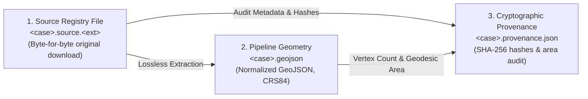
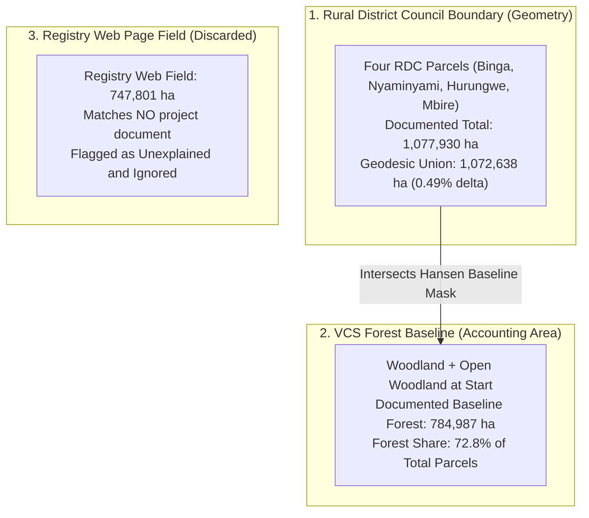
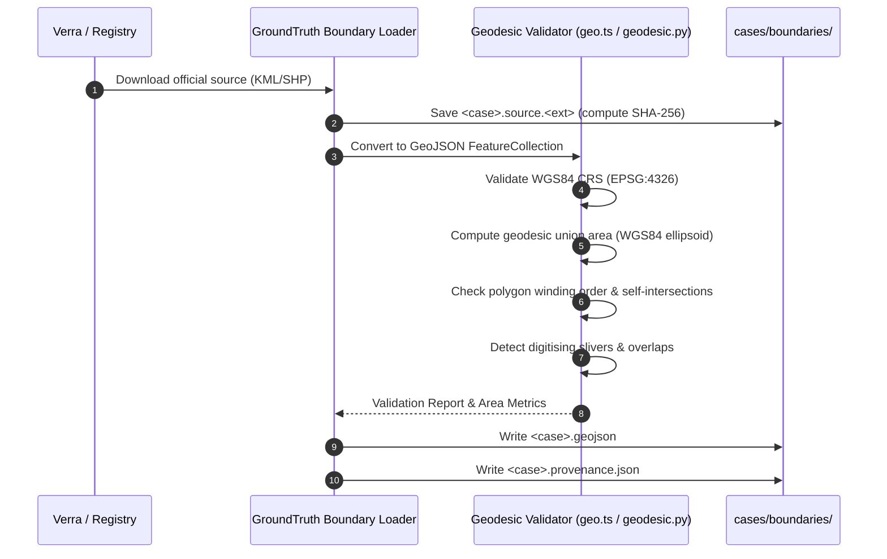

# Project Boundaries & Spatial Geometries (`cases/boundaries`)

This directory houses authoritative geospatial boundary geometry files (GeoJSON) and regional donor candidate polygons for projects screened by GroundTruth 2.0.

In GroundTruth, **a project boundary is never redrawn or manually approximated by hand**. Manual editing introduces researcher bias, alters pixel inclusion along forest edges, and breaks independent audit reproducibility. Every boundary geometry originates directly from an official registry document, cadastral title, or verified shapefile.

---

## The Three-File Provenance Chain

To guarantee complete evidentiary integrity, every boundary is maintained as an auditable triad:

1. **`<case>.source.<ext>`**: The authoritative registry document exactly as downloaded from the registry portal (e.g., Verra document manager API), preserving original bytes and recorded SHA-256 hash.
2. **`<case>.geojson`**: The normalized GeoJSON representation (`OGC:CRS84 / EPSG:4326`) consumed by the pipeline. The point set and polygon topology are preserved exactly; no vertices are smoothed or deleted.
3. **`<case>.provenance.json`**: An immutable audit ledger capturing retrieval timestamps, registry document IDs, endpoint URLs, SHA-256 hashes, vertex counts, geodesic union area, and discrepancies.

---

## Active Boundary Catalog

| Project / Boundary | Geometry File | Source Document | Geodesic Union Area | Status & Notes |
| :--- | :--- | :--- | :--- | :--- |
| **Kariba REDD+** (VCS 902) | `kariba-redd.geojson` | Verra approved `_KML_902.kml` (Doc ID 110200000383455) | 1,072,638 ha | Reconciled within 0.49% of the $1,077,930\text{ ha}$ RDC parcel description. 5 parts, 1,378 vertices. |
| **Kariba Donors Pool** | `kariba-donors.geojson` | geoBoundaries v6.0.0 (ZIMSTAT & GRID3 ADM2 units) | Regional Miombo extent | 80 candidate donor polygons with SUTVA and 10 km leakage exclusions. |
| **Tambopata-Bahuaja** | `tambopata-bahuaja-reserve.geojson` | Verra VCS 1067 project filing | Reserve boundary | Multi-parcel protected reserve geometry in Madre de Dios, Peru. |
| **Task 4A Benchmark** | `task4a-verify-project.geojson` | Independent verification harness | Verification polygon | Golden master test fixture for synthetic verification. |

---

## Kariba REDD+ (VCS 902): Complete Area Reconciliation

Historical public debate over Kariba REDD+ cited an apparent 43% discrepancy between project areas. A rigorous forensic audit of project documents resolves this discrepancy definitively:

### The Three Figures Explained

1. **$1,077,930\text{ ha}$ (Total Boundary Geometry)**:
   * Represents the four Rural District Council (RDC) administrative parcels delineated by the geometry: Binga, Nyaminyami, Hurungwe, and Mbire.
   * Project Description p. 98 explicitly confirms: *"the entire boundaries of the RDCs of 1'077'930 ha"*.
   * Our geodesic WGS84 ellipsoidal union calculation yields **$1,072,638\text{ ha}$**—a $0.49\%$ difference, exactly matching the expected variance between ellipsoidal and projected planar calculations.
2. **$784,987\text{ ha}$ (VCS Forest Accounting Baseline)**:
   * The actual forested area inside the RDC parcels at project inception in 2011 (woodland plus open woodland).
   * Verified across eleven documents: Project Description (p. 4, 7 Table 1), 2013 Validation Report, 2020 Verification Report, and 2022 Monitoring Report.
   * This is $72.8\%$ of the total parcel area ($1 - 784,987 / 1,077,930 = 27.2\%$ non-forest remainder, independently cited in the project description).
3. **$747,801\text{ ha}$ (Unexplained Registry Field)**:
   * Displayed on Verra's public web registry interface under "Acres/Hectares".
   * This number appears in **none** of the eleven audited project documents. GroundTruth documents it as an unexplained administrative field and excludes it from calculations.

### Known Geometry Defect: Digitising Sliver
Parts 1 and 5 of the Kariba geometry (the Binga and Nyaminyami parcels) share an administrative boundary and overlap by **$0.2886\text{ km}^2$ ($0.0027\%$ of the total area)**.
* **Forensic finding**: 29 vertices of Part 1 fall inside Part 5 due to manual digitizing slivers in the original registry KML.
* **Pipeline rule**: The engine computes zonal raster statistics strictly over the dissolved geodesic union, preventing double-counting of pixels within the sliver.

---

## Spatial Ingestion & Validation Pipeline

When boundary geometries are ingested, they pass through an automated geometric gate:

