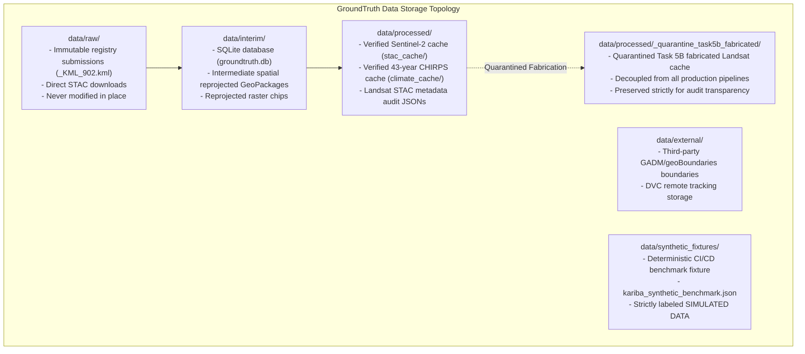
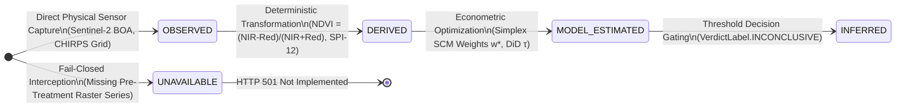

# GroundTruth 2.0 — Data Management Architecture & Storage Directory

> **Data Integrity Invariant**: *All empirical Earth observations, meteorological series, administrative geometries, and synthetic fixtures are managed under strict cryptographic provenance and reproducible lifecycle governance. Nothing is silently interpolated or overwritten.*

```
   ┌─────────────────────────────────────────────────────────────────────────────┐
   │                          DATA DIRECTORY TOPOLOGY                            │
   ├───────────────────────────────────┬─────────────────────────────────────────┤
   │  data/raw/                        │ Immutable original downloads & KMLs     │
   │  data/interim/                    │ Intermediate rasters, SQLite & staging  │
   │  data/processed/                  │ Verified STAC, climate caches & audits  │
   │  data/processed/_quarantine_.../  │ Quarantined Task 5B fabricated cache    │
   │  data/external/                   │ Third-party reference layers & DVC      │
   │  data/synthetic_fixtures/         │ Deterministic offline test fixtures     │
   └───────────────────────────────────┴─────────────────────────────────────────┘
```

---

## 1. Directory Structure & Lifecycle Governance

The `data/` directory is structured to isolate raw provider inputs from intermediate transformations and verified analytical caches:



---

## 2. Inventory of Current Data Assets

| Directory | Subfolder / File | Content Description | Provenance & Origin | Operational Status |
| :--- | :--- | :--- | :--- | :---: |
| `data/raw/` | `_KML_902.kml`, `w.kml` | Official Verra Registry submission boundaries for VCS 902. | Verra Project Document `110200000383455` | **`INTEGRATED`** (SHA-256 Pinned) |
| `data/raw/` | `FI-VL798LB80E6302132020094433.pdf` | Official VCS Project Description / Verification Report. | Verra Registry Public Document Archive | **`INTEGRATED`** (Reference Target) |
| `data/interim/` | `groundtruth.db` | Local SQLite database for job leases, runs, and audit logs. | Platform Job Orchestrator | **`OPERATIONAL`** (Local DB) |
| `data/processed/` | `stac_cache/kariba-redd__*.json` | Zonal-mean vegetation indices ($\text{NDVI}, \text{EVI}, \text{NDMI}, \text{NBR}$) from Sentinel-2 L2A (2021–2023). | ESA Copernicus via Planetary Computer STAC | **`INTEGRATED`** (Verified Real 10m) |
| `data/processed/` | `climate_cache/kariba_chirps_climate.json` | 43-year monthly precipitation from CHIRPS v2.0 (1981–2023, 514/516 mo) and NASA POWER temperature. | UCSB Climate Hazards Center & NASA POWER | **`INTEGRATED`** (Verified Real Met) |
| `data/processed/` | `kariba_landsat_coverage_audit.json` | STAC scene availability metadata across 2001–2022 over Kariba. | USGS Landsat Collection 2 via Planetary Computer | **`AUDITED`** (Metadata Only) |
| `data/processed/` | `donor_landsat_coverage_audit.json` | STAC scene availability metadata across 5 benchmark epochs for 37 donors. | USGS Landsat Collection 2 via Planetary Computer | **`AUDITED`** (Metadata Only) |
| `data/processed/` | `_quarantine_task5b_fabricated/` | Fabricated 2001–2022 Landsat cache generated by `build_multitile_cache.py`. | Task 5B Independent Audit P0-1 Finding | **`QUARANTINED`** (Do Not Use) |
| `data/synthetic_fixtures/` | `kariba_synthetic_benchmark.json` | 2000–2022 synthetic panel for deterministic regression testing. | `groundtruth.platform.datasets.synthetic` | **`TESTING ONLY`** (Simulated) |

---

## 3. Data Governance & Version Control Invariants

1. **Git Exclusion**: Content inside `data/` is excluded from git tracking via `.gitignore` (line 22). Large binary data, raster GeoTIFFs, and local SQLite databases are never committed directly to git repositories.
2. **DVC Integration**: Large datasets are tracked via Data Version Control (`dvc add data/external/...`), storing cryptographic `.dvc` sidecars in git.
3. **Atomic File Writes**: The storage abstraction (`groundtruth.storage.blob_store`) mandates atomic disk replacement via `os.replace` to prevent race conditions or corrupted cache reads during parallel multi-worker execution.
4. **Missing Data Policy**: Upstream missing observations (such as months `2022-07` and `2023-12` in CHIRPS) are preserved as `missing_months_after_upstream` and never silently imputed.

---

## 4. The 5-State Evidence Taxonomy in Data Storage

Every cached file and observation reflects an explicit evidence state:



For detailed specifications on each domain and product, refer to:
- [Data Sources Specification](../docs/data/sources.md)
- [Data Conventions & Quality Standards](../docs/data/conventions.md)
- [Authoritative Source Registry](../docs/data/SOURCE_REGISTRY.md)
- [Task 5B Independent Audit Ledger](../docs/audits/INDEPENDENT_TASK_5B_AUDIT.md)
