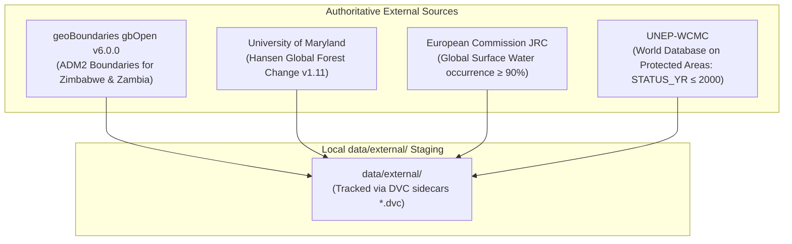

# GroundTruth 2.0 — External Datasets (`data/external/`)

> **Data Governance Policy**: *Third-party reference datasets, ecoregion boundaries, global baseline masks, and large geospatial assets are staged in `data/external/` and tracked via DVC. They are never committed directly to git version control.*

```
   ┌─────────────────────────────────────────────────────────────────────────────┐
   │                        EXTERNAL DATA DIRECTORY SCOPE                        │
   ├───────────────────────────────────┬─────────────────────────────────────────┤
   │  Administrative Boundaries        │ geoBoundaries gbOpen v6.0.0, GADM v4.1  │
   │  Forest & Canopy Masks            │ Hansen GFC 2000 (treecover2000)         │
   │  Surface Hydrology                │ JRC Global Surface Water (occurrence)   │
   │  Protected Area Inventories       │ UNEP-WCMC WDPA (pre-2000 designations)  │
   │  Ecoregion Stratification         │ RESOLVE Ecoregions 2017                 │
   │  Version Control Tracking         │ DVC (Data Version Control)              │
   └───────────────────────────────────┴─────────────────────────────────────────┘
```

---

## 1. Directory Purpose & Population Protocols

This directory holds unmodified, third-party reference layers used to define the unit of analysis (ADR-011) and pre-treatment baseline masks:



---

## 2. Ingestion & DVC Tracking Instructions

1. **Populate an external asset**:
   ```bash
   # Download the target dataset (e.g. geoBoundaries ADM2 for Zimbabwe)
   curl -O https://github.com/wmgeolab/geoBoundaries/raw/main/releaseData/gbOpen/ZWE/ADM2/geoBoundaries-ZWE-ADM2.geojson
   mv geoBoundaries-ZWE-ADM2.geojson data/external/
   ```

2. **Track with Data Version Control**:
   ```bash
   dvc add data/external/geoBoundaries-ZWE-ADM2.geojson
   git add data/external/geoBoundaries-ZWE-ADM2.geojson.dvc data/external/.gitignore
   git commit -m "chore(data): track ZWE ADM2 external boundaries via DVC"
   ```

3. **Configure local or remote storage**:
   ```bash
   # Configure a local storage directory (git-ignored)
   dvc remote add --local local_storage /path/to/local/dvc_cache
   dvc push
   ```

For technical specifications and URLs of all 105 cataloged datasets, refer to [Authoritative Environmental Data Source Registry](../../docs/data/SOURCE_REGISTRY.md).
