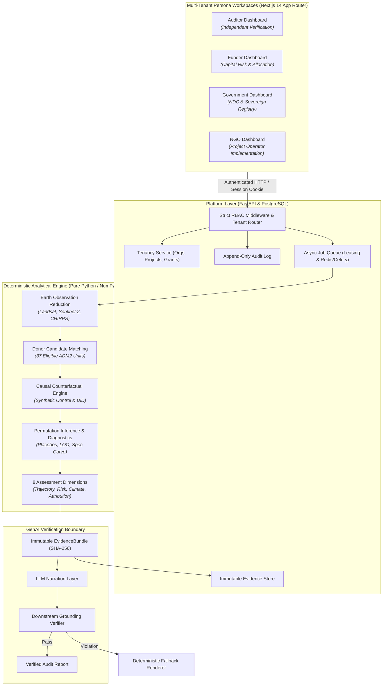
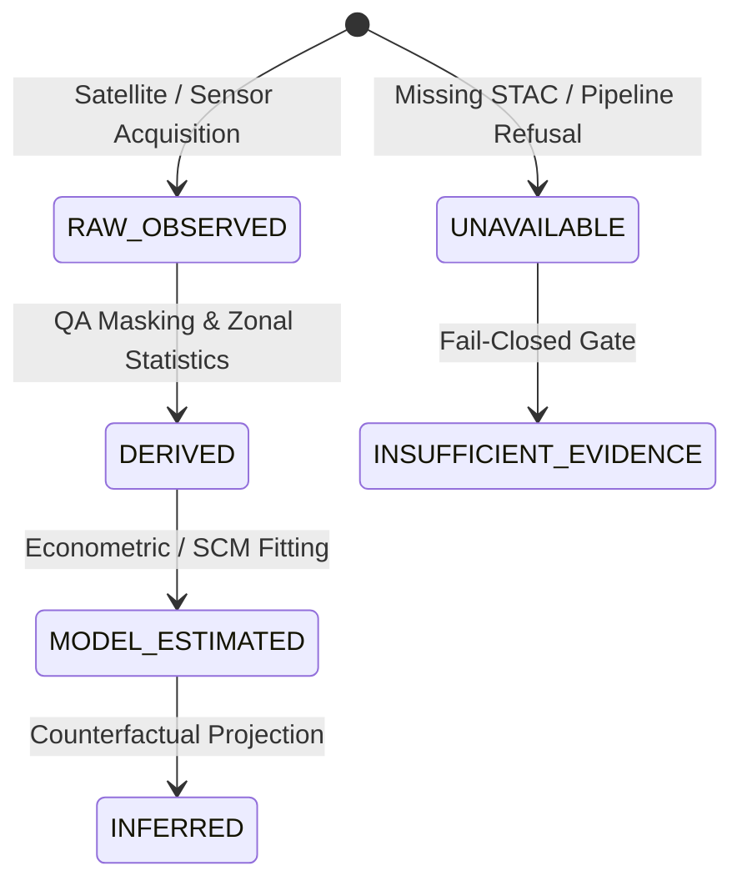

# GroundTruth 2.0 Documentation

GroundTruth 2.0 is an enterprise-grade, scientifically rigorous verification and continuous intelligence platform for ecosystem restoration and carbon offset interventions. It replaces self-reported spreadsheets, uncalibrated vegetation claims, and ungrounded AI hallucinations with deterministic remote sensing pipelines, causal econometric counterfactuals, multi-tenant role-based governance, and cryptographic provenance.

---

## The Non-Negotiable Scientific Principles

Every line of code and documentation in GroundTruth 2.0 adheres to four core scientific commitments:

1. **Observed change is not causal effect.** Vegetation greening or canopy loss inside an intervention boundary cannot be attributed to the project without establishing a rigorous, counterfactual comparison unit (Synthetic Control and Difference-in-Differences) that accounts for regional climate trends and macroeconomic spillovers.
2. **NDVI is not carbon.** Spectral vegetation indices (NDVI, EVI, NDMI, NBR) measure surface greenness and moisture absorption, not woody biomass or metric tonnes of $\text{CO}_2\text{e}$. Converting indices to carbon requires verified allometric biomass equations with explicit error budgets; the system refuses implicit conversions.
3. **Model divergence is not fraud.** A mathematical discrepancy between an issuer's claimed carbon credits and an independent causal estimate indicates that the baseline warrants accredited review. Remote sensing time series cannot establish legal intent.
4. **Fail-closed data integrity.** In `REAL_OBSERVATIONS` mode, when pre-treatment data is incomplete, sensor harmonization is unvalidated, or spatial coverage is compromised, the pipeline **refuses to fabricate or impute data**. It raises `DataUnavailableError` (HTTP 501) and issues an honest verdict of `INCONCLUSIVE (not estimable)`.

---

## 4 User Personas & Scoped Workspaces

GroundTruth 2.0 provides dedicated, role-tailored workspaces for four distinct ecosystem stakeholders:

| Persona | Primary Needs & Scopes | Primary View |
| :--- | :--- | :--- |
| **Auditor** | Rigorous counterfactual evaluation, placebo permutation tests, sensitivity analysis, leave-one-out robustness, raw data provenance verification (`audit` scope). | [Auditor Workspace](architecture/frontend.md#auditor-persona) |
| **Funder** | Portfolio-level capital risk assessment, ecological stability, delivery-vs-claim tracking, benchmark comparative performance (`view` scope). | [Funder Workspace](architecture/frontend.md#funder-persona) |
| **Government** | Sovereign carbon accounting, Article 6 alignment, national forest monitoring, regional leakage detection (`view`, `audit` scopes). | [Government Workspace](architecture/frontend.md#government-persona) |
| **NGO / Developer**| Intervention tracking, vegetation trajectory monitoring, drought stress indicators, ground-truth claim upload (`contribute` scope). | [NGO Workspace](architecture/frontend.md#ngo-persona) |

---

## 8 Assessment Dimensions

GroundTruth 2.0 evaluates projects across eight independent, standardized dimensions:

```mermaid
graph LR
    D1["1. Vegetation Trajectory<br/>(Theil-Sen, Mann-Kendall)"]
    D2["2. Spatial Performance<br/>(Spatial Gini, Variance)"]
    D3["3. Climate Context<br/>(CHIRPS SPI-12, POWER)"]
    D4["4. Ecological Risk<br/>(Canopy Loss, Vulnerability)"]
    D5["5. Restoration Progress<br/>(Target Attainment)"]
    D6["6. Comparative Performance<br/>(Regional ADM2 Donors)"]
    D7["7. Evidence Quality<br/>(QA Masking, STAC Coverage)"]
    D8["8. Intervention Attribution<br/>(SCM, Placebo DiD)"]

    D1 --- D2 --- D3 --- D4 --- D5 --- D6 --- D7 --- D8
```

1. **Vegetation Trajectory**: Non-parametric trend estimation (Theil-Sen slope and Mann-Kendall significance) across multi-spectral indices (NDVI, EVI, NDMI, NBR).
2. **Spatial Performance**: Internal spatial heterogeneity, canopy variance, and zonal stability across project sub-regions.
3. **Climate Context**: Integration of 43-year CHIRPS precipitation (SPI-12 standard precipitation index) and NASA POWER temperature to isolate drought shocks from management failures.
4. **Ecological Risk**: Detection of rapid degradation, drought vulnerability, and abrupt canopy collapse.
5. **Restoration Progress**: Tracking observed trajectory against baseline restoration targets.
6. **Comparative Performance**: Benchmarking project health against regional reference donor districts.
7. **Evidence Quality**: Explicit accounting of clear-pixel fractions, sensor harmonization uncertainty, and cloud/QA masking completeness.
8. **Intervention Attribution**: Econometric synthetic control counterfactual evaluation with in-space and in-time placebo tests, or an explicit `INCONCLUSIVE` verdict when data is inadequate.

---

## 5 Evidence States

Every numerical observation and intermediate result is tagged with an epistemological `EvidenceState`:

* **`RAW_OBSERVED`**: Direct, unaltered sensor telemetry (e.g., Level-2 surface reflectance DN).
* **`DERIVED`**: Deterministically processed indices (e.g., QA-masked cloud-free zonal mean NDVI).
* **`MODEL_ESTIMATED`**: Values fitted through mathematical optimization (e.g., SCM weights, synthetic counterfactual).
* **`INFERRED`**: Projections, confidence intervals, or permutation p-values derived under statistical models.
* **`UNAVAILABLE` / `INSUFFICIENT_EVIDENCE`**: Unobserved periods or refused estimates where data gaps prevent sound inference.

---

## Documentation Navigation

### 1. Architecture
* [System Architecture (`architecture/system.md`)](architecture/system.md) — System C4 architecture, container topology, package seams.
* [Engine/Platform Contract (`architecture/contract.md`)](architecture/contract.md) — The `AnalysisRequest` and `AnalysisResult` boundary.
* [Backend Platform (`architecture/backend.md`)](architecture/backend.md) — FastAPI surface, multi-tenancy, RBAC middleware, PostgreSQL store.
* [API Consumer Guide (`api/README.md`)](api/README.md) — Sign-in, running and reading analyses, refusals vs errors, every error code, with real examples.
* [Frontend Architecture (`architecture/frontend.md`)](architecture/frontend.md) — Next.js 14 App Router layout restructuring (`(app)` workspaces, `(public)` marketing), Design System (`ds/`), 542 unit/component/integration tests.
* [Worker & Job Execution (`architecture/worker.md`)](architecture/worker.md) — Asynchronous job lifecycle, PostgreSQL leases, Celery/Redis queue, Temporal durable execution.
* [Earth Observation (`architecture/earth-observation.md`)](architecture/earth-observation.md) — Ingestion chain, USGS Collection 2 L2 scaling, QA bit masking, Roy et al. sensor harmonization.
* [Causal Inference (`architecture/causal.md`)](architecture/causal.md) — Simplex-constrained FISTA synthetic control solver, DiD cross-check, placebo permutation tests.
* [Evidence & Provenance (`architecture/evidence.md`)](architecture/evidence.md) — Immutable `EvidenceBundle`, SHA-256 derivation chains, Sigstore signing.
* [GenAI Grounding Boundary (`architecture/genai.md`)](architecture/genai.md) — Deterministic downstream reporting, numeric grounding verification, prohibited assertion blocking.
* [Continuous Monitoring (`architecture/monitoring.md`)](architecture/monitoring.md) — Continuous spec re-execution, automated bundle diffing, alert triggers.

### 2. Engineering & Deployment
* [Deployment Compute Architecture (`engineering/DEPLOYMENT_COMPUTE_ARCHITECTURE.md`)](engineering/DEPLOYMENT_COMPUTE_ARCHITECTURE.md) — Tiered storage hierarchy, local workstation vs. production container topology.
* [Local Compute Benchmarks (`engineering/LOCAL_COMPUTE_BENCHMARK.md`)](engineering/LOCAL_COMPUTE_BENCHMARK.md) — Measured multi-process scaling, 512×512 chunking benchmarks, RTX 5070 GPU optionality.
* [Configuration Specification (`engineering/configuration.md`)](engineering/configuration.md) — Typed Pydantic settings, secrets isolation, environment overrides.
* [Testing Strategy (`engineering/testing.md`)](engineering/testing.md) — 1,120+ backend tests, 542 web tests, AST boundary enforcement, property testing.

### 3. Architecture Decisions (ADRs)
* [ADR Index (`decisions/README.md`)](decisions/README.md) — Complete registry of eleven binding architectural decision records.
* [ADR-001: Monorepo Structure](decisions/ADR-001-monorepo-structure.md)
* [ADR-002: Engine/Platform Boundary](decisions/ADR-002-engine-platform-boundary.md)
* [ADR-003: Analysis Contract](decisions/ADR-003-analysis-contract.md)
* [ADR-004: Evidence Object Model](decisions/ADR-004-evidence-object.md)
* [ADR-005: Provenance Model](decisions/ADR-005-provenance-model.md)
* [ADR-006: Reproducibility & Spec Hash](decisions/ADR-006-reproducibility.md)
* [ADR-007: GenAI Grounding Boundary](decisions/ADR-007-genai-boundary.md)
* [ADR-008: Analysis Job Lifecycle](decisions/ADR-008-analysis-jobs.md)
* [ADR-009: Data Management & Pinned Datasets](decisions/ADR-009-data-management.md)
* [ADR-010: Containerised Deployment](decisions/ADR-010-deployment.md)
* [ADR-011: Unit of Analysis & Masked Districts](decisions/ADR-011-unit-of-analysis.md)

### 4. Security & Governance
* [Security Architecture (`security/architecture.md`)](security/architecture.md) — Trust boundaries, credential isolation, output validation.
* [Authentication & RBAC (`security/auth.md`)](security/auth.md) — Multi-tenant organization grants, session cookies, CSRF protection, rate limits.

### 5. Operations & Research
* [Operations Manual (`operations/README.md`)](operations/README.md) — Container health probes, failure runbooks, Prometheus/Grafana metrics.
* [Scientific Research Notes (`research/README.md`)](research/README.md) — Econometric foundations, remote sensing literature, open research questions.
