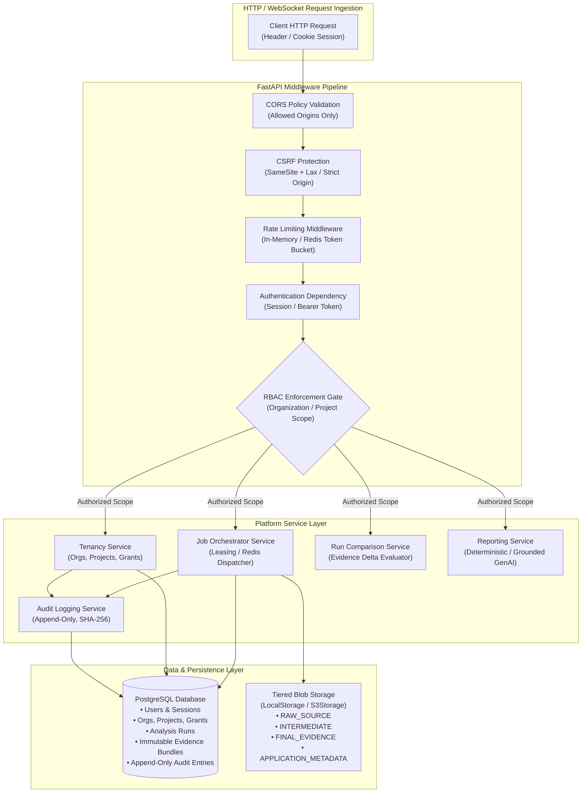
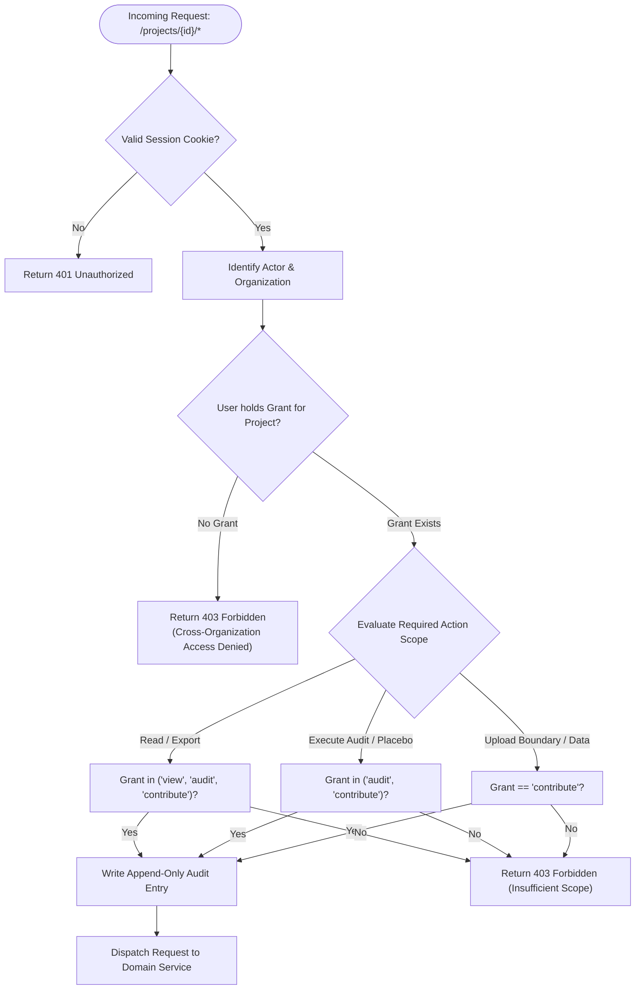
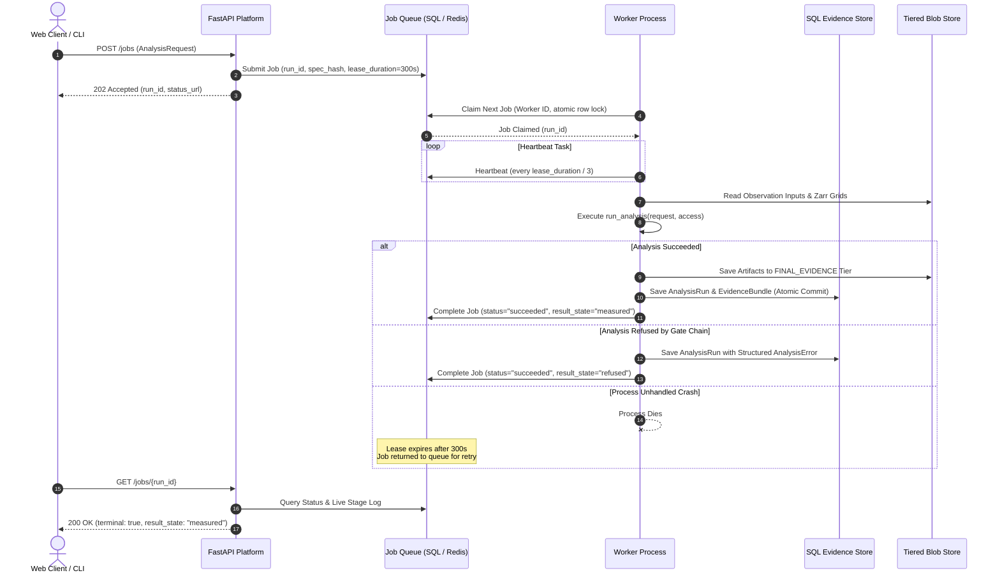
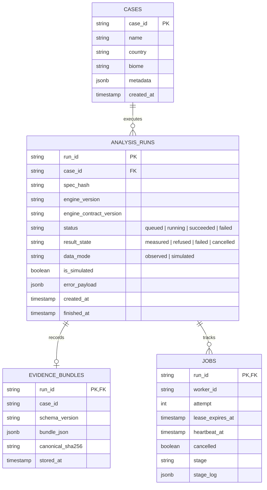

# Backend Architecture

**Platform Core**: `packages/groundtruth/src/groundtruth/platform/` & `apps/api/`  
**Runtime**: Python 3.12, FastAPI, Pydantic v2, SQLAlchemy 2.0, PostgreSQL 16 / SQLite, Redis, Celery.

The backend platform is the operational foundation of GroundTruth 2.0. It manages authentication, multi-tenant isolation, role-based access control, cryptographic audit logging, asynchronous compute scheduling, tiered blob persistence, and immutable evidence storage.




---

## 1. Platform Modules & Responsibilities

| Module | Location | Primary Responsibility | GroundTruth 2.0 Status |
| :--- | :--- | :--- | :--- |
| `api/` | `platform/api/` | FastAPI routers, OpenAPI schemas, error mapping, cursor pagination | Implemented & Snapshot Tested |
| `tenancy/` | `platform/tenancy/` | Organizations, Projects, User Memberships, Grant Scoping | Implemented |
| `auth/` | `platform/auth/` | Session management, password hashing (Argon2), CSRF guards, RBAC | Implemented |
| `audit/` | `platform/audit/` | Append-only audit logging with cryptographic SHA-256 verification | Implemented |
| `jobs/` | `platform/jobs/` | Job lifecycle: leasing queue, Redis/Celery queue, worker runner | Implemented |
| `store/` | `platform/store/` | Immutable SQL evidence store, run versioning, trigger protection | Implemented |
| `storage/`| `platform/storage/`| Tiered blob storage abstraction (`LocalStorageBackend`, `S3Storage`) | Implemented |
| `cases/` | `platform/cases/` | Case registry, YAML parsing, translation to `AnalysisRequest` | Implemented |
| `datasets/`| `platform/datasets/`| STAC observation access, CHIRPS/POWER climate access, pinning | Implemented |
| `compare/`| `platform/compare/`| Evidence diffing, non-comparability guards, parameter shift detection | Implemented |
| `reports/`| `platform/reports/`| Deterministic markdown renderer, GenAI narrator, grounding check | Implemented |
| `config.py`| `platform/config.py`| Environment-driven Pydantic `Settings`, secret masking | Implemented |

---

## 2. Multi-Tenant RBAC Enforcement & Data Isolation

GroundTruth 2.0 enforces strict multi-tenancy at the API gateway:




### 2.1 The Three Grant Scopes
1. **`view`**: Read-only privileges for funders and executive observers. Allows browsing projects, inspecting verified evidence bundles, and viewing generated reports.
2. **`audit`**: Full analytical verification privileges. Allows triggering sensitivity runs, inspecting raw satellite observation tiles, analyzing donor candidate exclusions, and viewing the complete provenance chain.
3. **`contribute`**: Administrative and developer privileges. Allows uploading intervention boundaries, registering new project baselines, submitting field ground-truth observations, and executing production analysis jobs.

---

## 3. Strict Boundary Invariant: Platform Consuming Engine

The platform interacts with the analytical engine through four strictly typed symbols defined in `groundtruth.contracts`:

```python
from groundtruth.contracts import (
    AnalysisRequest,
    AnalysisResult,
    EngineStatus,
    ErrorCode,
)
from groundtruth.engine import (
    run_analysis,
    describe_engine,
    engine_ref,
    ENGINE_VERSION,
)
```

No platform module may import from internal engine subpackages (`causal`, `observation`, `matching`, `uncertainty`, `assessment`). This invariant is enforced by `tests/test_contract_boundary.py`.

---

## 4. Asynchronous Job Lifecycle & Dual-Queue Architecture

Analytical verification tasks require high-dimensional matrix optimization, permutation tests across dozens of donor regions, and multi-temporal satellite raster processing. GroundTruth 2.0 provides a dual-queue architecture:

1. **PostgreSQL Leasing Queue (`platform.jobs.queue`)**: Default zero-dependency queue using database table row leases with atomic heartbeating.
2. **Redis + Celery Queue (`platform.jobs.redis_queue`)**: Production-scale distributed queue with asynchronous streaming and live progress updates.



---

## 5. Persistence & Immutable Evidence Store

The persistence layer is managed via SQLAlchemy 2.0 with Alembic migrations:



### 5.1 Storage Immutability Invariant
Evidence bundles are **strictly immutable**. Re-executing an analysis generates a fresh `run_id`. A PostgreSQL database trigger unconditionally aborts any `UPDATE` command executed against the `evidence_bundles` table:

```sql
CREATE OR REPLACE FUNCTION reject_bundle_update()
RETURNS TRIGGER AS $$
BEGIN
    RAISE EXCEPTION 'Evidence bundles are immutable and cannot be updated. Run ID: %', OLD.run_id;
END;
$$ LANGUAGE plpgsql;

CREATE TRIGGER trg_immutable_evidence_bundles
BEFORE UPDATE ON evidence_bundles
FOR EACH ROW EXECUTE FUNCTION reject_bundle_update();
```

---

## 6. Tiered Storage Abstraction (`blob_store.py`)

GroundTruth 2.0 partitions binary assets into four distinct storage tiers:

| Tier | Enum Member | Contents | Retention & Access |
| :--- | :--- | :--- | :--- |
| **Tier 1** | `RAW_SOURCE` | Raw Cloud-Optimized GeoTIFFs, Sentinel-2 tiles, CHIRPS NetCDFs | Read-only cache / cold archive |
| **Tier 2** | `INTERMEDIATE_ARTIFACT` | Intermediate raster chips, cloud masks, SVD matrices | Internal compute only, TTL auto-purge |
| **Tier 3** | `FINAL_EVIDENCE` | Final serialized `EvidenceBundle`, zonal reduction tables | Public verification, immutable |
| **Tier 4** | `APPLICATION_METADATA` | SHA-256 sidecar checksums (`.meta.json`), provenance manifests | Permanent audit trail |

Atomic writes are enforced on POSIX filesystems using unique temporary files and `os.replace` to prevent corrupted reads during power or process interruption.

---

## 7. API Schema as Frontend Contract & Snapshot Testing

The backend OpenAPI schema (`platform/api/openapi_schema.py`) is the source of truth for all frontend TypeScript types:
- API changes are committed alongside an updated snapshot: `apps/web/src/lib/generated/openapi.json`.
- TypeScript definitions are compiled directly via `make api-types` (`npm run generate:api-types`).
- CI runs `tests/test_openapi_snapshot.py` and `npm run check:api-types` on every pull request, failing if frontend definitions drift from backend Pydantic models.
