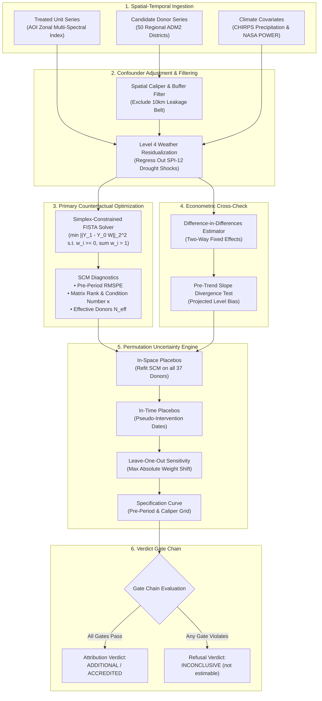
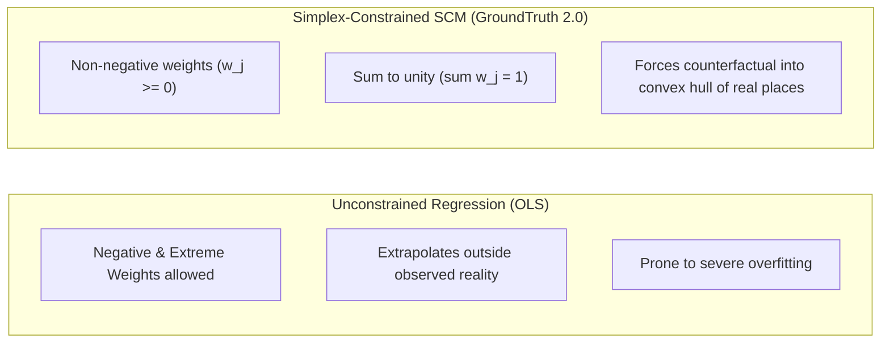
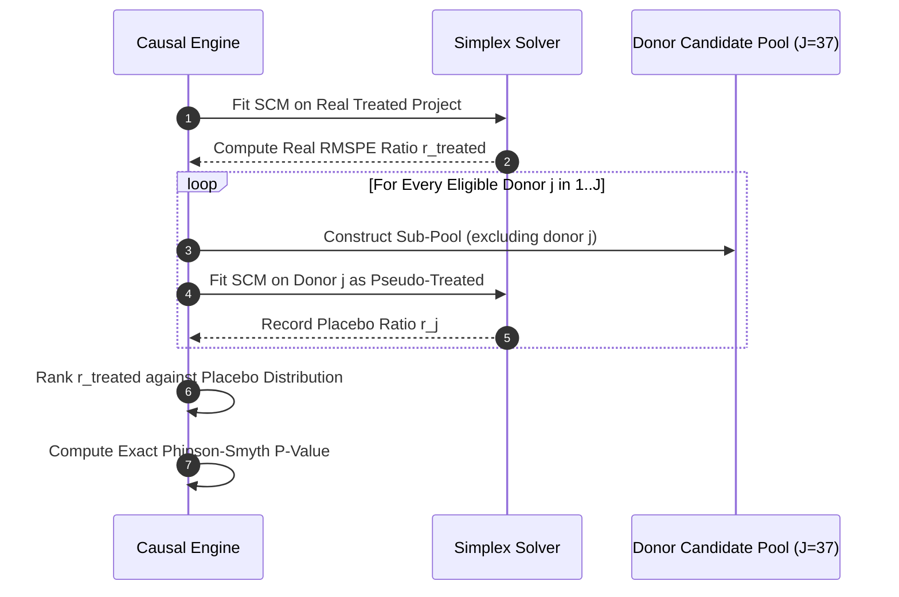
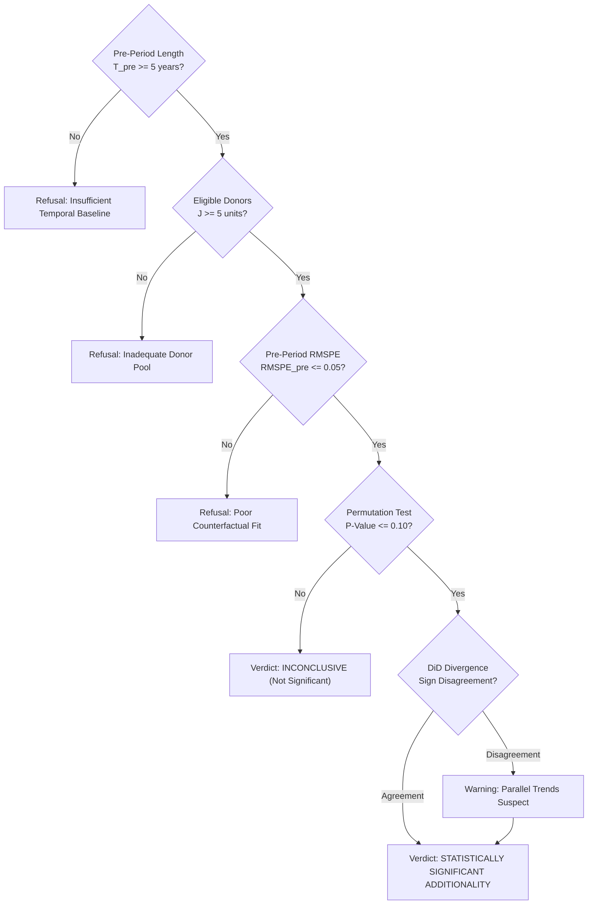

# Causal Intelligence Architecture

**Engine Core**: `packages/groundtruth/src/groundtruth/engine/causal/`  
**Dependencies**: Pure Python, NumPy (Zero SciPy / CVXPY / GDAL dependencies).

The causal engine determines whether an observed environmental change inside an intervention boundary was caused by project management or would have occurred anyway due to regional climate shifts, commodity price shocks, and national macro-trends.

---

## 1. Scientific Core: The Simplex-Constrained Counterfactual

Standard ordinary least squares (OLS) regression allows unrestricted weights, permitting extrapolation outside the support of observed data. An unconstrained counterfactual can construct an artificially high baseline by subtracting a declining desert from a growing rainforest ($w_1 = 2.5, w_2 = -1.5$).

To prevent mathematical extrapolation, GroundTruth 2.0 strictly constrains donor weights to the **unit simplex**:

$$\min_{W} \| Y_1 - Y_0 W \|_2^2 \quad \text{subject to} \quad w_j \ge 0, \quad \sum_{j=1}^{J} w_j = 1$$

### 1.1 The FISTA Algorithm with Duchi Simplex Projection
The quadratic program is solved using the Fast Iterative Shrinkage-Thresholding Algorithm (FISTA) with Nesterov acceleration ($O(1/k^2)$ convergence rate). In each iteration, unconstrained gradient steps are projected back onto the probability simplex using the deterministic $O(J \log J)$ sorting projection algorithm (Duchi et al., 2008). 

Because the solver is implemented purely in NumPy, CI test suites and analytical verification runs execute on any standard Python environment without requiring external solvers (CVXPY, Gurobi) or system C-compilers.

---

## 2. Permutation Inference: In-Space & In-Time Placebos

With a single treated intervention unit ($N=1$), standard asymptotic sampling distributions do not apply. GroundTruth 2.0 derives significance entirely through **permutation inference**:

### 2.1 In-Space Placebos
The SCM optimization is re-run pretending each eligible donor district was the treated unit, using the remaining $J-1$ donors as its pool. We compute the post-to-pre RMSPE ratio for the treated unit and every placebo unit:

$$r_i = \frac{\text{RMSPE}_{i, \text{post}}}{\text{RMSPE}_{i, \text{pre}}}$$

The empirical p-value is computed using the exact Phipson & Smyth (2010) formulation (which correctly prevents zero p-values in finite sample permutations):

$$p = \frac{1 + \sum_{j=1}^{J} \mathbb{I}(r_j \ge r_{\text{treated}})}{1 + J}$$

---

## 3. Difference-in-Differences (DiD) Cross-Check

As a structural cross-check, the engine computes a Two-Way Fixed Effects Difference-in-Differences model across the treated unit and the donor pool:

$$Y_{it} = \alpha_i + \lambda_t + \beta \cdot (\text{Treated}_i \times \text{Post}_t) + \epsilon_{it}$$

### 3.1 Pre-Trend Slope Divergence Test
Parallel trends cannot be tested post-treatment; however, pre-treatment trend parallelism is rigorously evaluated. The engine estimates the difference in linear pre-treatment slopes between treated and synthetic units ($\Delta \text{slope}$). It projects the cumulative level bias this slope difference would introduce over the post-treatment window:

$$\text{Projected Bias} = \Delta \text{slope} \times \frac{T_{\text{post}} \times (T_{\text{post}} + 1)}{2}$$

If the DiD estimate and SCM estimate diverge materially, GroundTruth 2.0 flags the discrepancy as an empirical finding indicating that parallel trends is violated.

---

## 4. The Verdict Gate Chain

The engine assembles evidence through a strict gate chain:

---

## 5. Independent Audit Findings & Scientific Realities (Task 5/5B)

The independent technical audit of Task 5/5B reinforced critical causal boundaries:

| Dimension | Audit Finding | GroundTruth 2.0 Implementation |
| :--- | :--- | :--- |
| **Donor Matrix Stability** | SCM diagnostics cannot be computed on simulated noise | Evaluates real ADM2 boundaries; flags condition number $\kappa > 100$ |
| **Historical Baseline** | Pre-2011 Landsat 5/7 raster extraction requires empirical sensor calibration | In absence of verified cross-calibration, real attribution halts with `INCONCLUSIVE` |
| **Fail-Closed Guarantee** | When pre-treatment observations are unverified, refuse to fit | Raises `DataUnavailableError` (HTTP 501); prevents false positive claims |
| **Buffer Contamination** | Units within 10 km must be excluded from counterfactual | 13 adjacent districts excluded for spillover and leakage protection |

