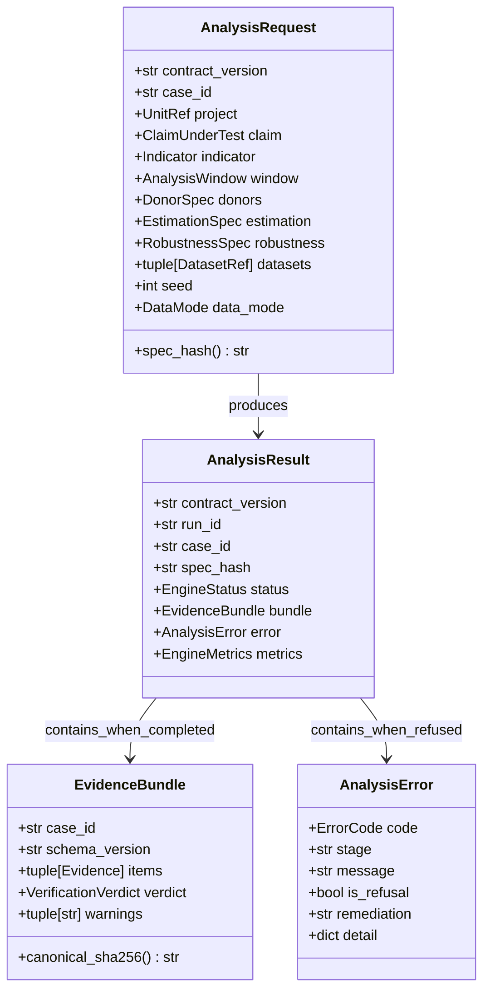
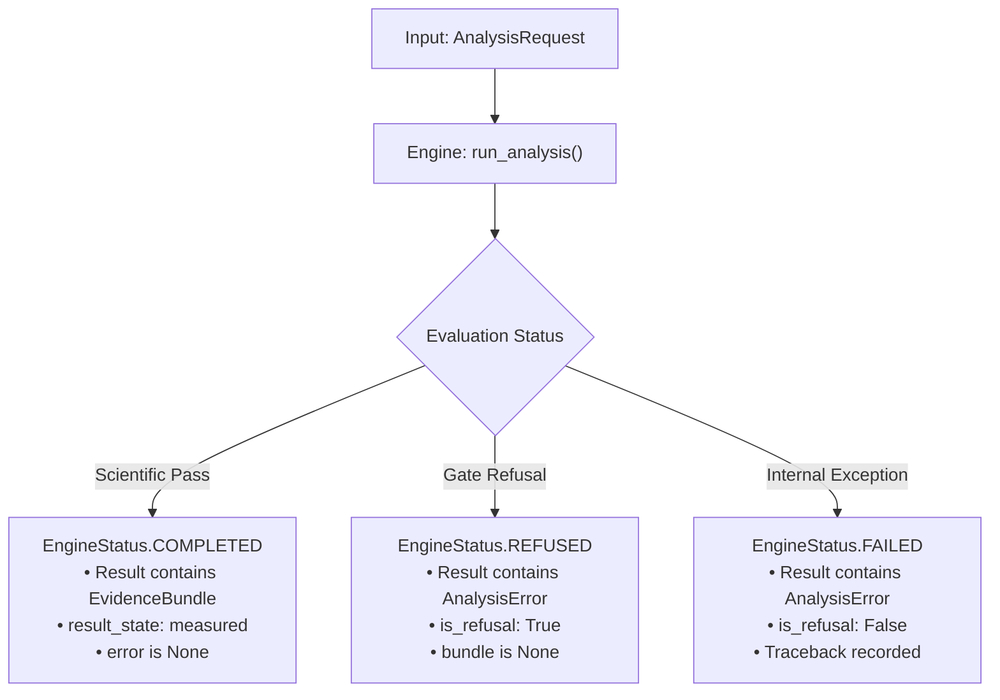

# The Engine / Platform Contract

**Package**: `packages/groundtruth/src/groundtruth/contracts/`  
**Status**: Strict SemVer, AST-enforced, Pydantic v2 validated.

The contract is the boundary separating pure scientific computation (the engine) from deployment infrastructure (the platform). It defines the only inputs the engine accepts and the only outputs it emits.




---

## 1. Input Schema: `AnalysisRequest`

The engine accepts a single, self-contained `AnalysisRequest`. It reads **nothing else**—no environment variables, no YAML files, no database rows, and no network sockets.

```python
class AnalysisRequest(BaseModel):
    model_config = ConfigDict(frozen=True)

    contract_version: str = "1.0.0"
    case_id: str
    project: UnitRef
    claim: ClaimUnderTest
    indicator: Indicator = Indicator.NDVI
    window: AnalysisWindow
    donors: DonorSpec
    estimation: EstimationSpec
    robustness: RobustnessSpec
    datasets: tuple[DatasetRef, ...]
    seed: int = 20260101
    data_mode: Literal["observed", "simulated"] = "simulated"
    requested_by: str | None = None
    notes: str = ""
```

### 1.1 Structural Invariants Enforced at Construction
- **Temporal Sequence**: Enforces `window.pre_start < window.pre_end < window.post_start <= window.post_end`.
- **Pre-Period Sufficiency**: Requires $T_{\text{pre}} \ge \text{estimation.min\_pre\_periods}$ (default $\ge 5$ years).
- **Donor Calibration**: Enforces `min_donors <= max_donors`.
- **Mode Isolation**: Setting `data_mode="observed"` alongside any synthetic dataset reference is rejected at construction.
- **Reference Independence**: The platform unconditionally strips `known_reference` (third-party published figures) before building `AnalysisRequest`, ensuring the engine produces an uncorrupted, independent evaluation.

---

## 2. Output Schema: `AnalysisResult`

```python
class AnalysisResult(BaseModel):
    model_config = ConfigDict(frozen=True)

    contract_version: str
    run_id: str
    case_id: str
    spec_hash: str
    status: EngineStatus  # COMPLETED | REFUSED | FAILED
    bundle: EvidenceBundle | None = None
    error: AnalysisError | None = None
    metrics: EngineMetrics = Field(default_factory=EngineMetrics)
```



---

## 3. The Structured Refusal Contract

When a project fails an empirical data quality gate (e.g., persistent cloud cover, insufficient donor candidates), the engine returns an `AnalysisError` with `is_refusal=True`:

```python
class AnalysisError(BaseModel):
    code: ErrorCode
    stage: str
    message: str
    is_refusal: bool = True
    remediation: str
    detail: dict[str, Any] = Field(default_factory=dict)
```

| Field | Purpose |
| :--- | :--- |
| `code` | Stable typed error code (e.g., `ErrorCode.DONOR_POOL_INADEQUATE`) |
| `stage` | Analytical phase where the failure was identified (`masking`, `matching`, `fitting`) |
| `is_refusal` | `True` when the engine declined to produce a fragile estimate; `False` on code bugs |
| `remediation` | Actionable instructions for the project developer or auditor |
| `detail` | Exact quantitative thresholds (e.g., `{"required_donors": 10, "found_donors": 3}`) |

---

## 4. AST Boundary Enforcement (`test_contract_boundary.py`)

The contract boundary is guarded by an automated AST parser executed on every pull request:
1. `contracts/` cannot import from `engine/` or `platform/`.
2. `engine/` cannot import from `platform/`, `os`, `pathlib`, `socket`, `requests`, `httpx`, or database libraries.
3. `platform/` can only import the declared four entrypoints: `run_analysis`, `describe_engine`, `engine_ref`, and `ENGINE_VERSION`.
