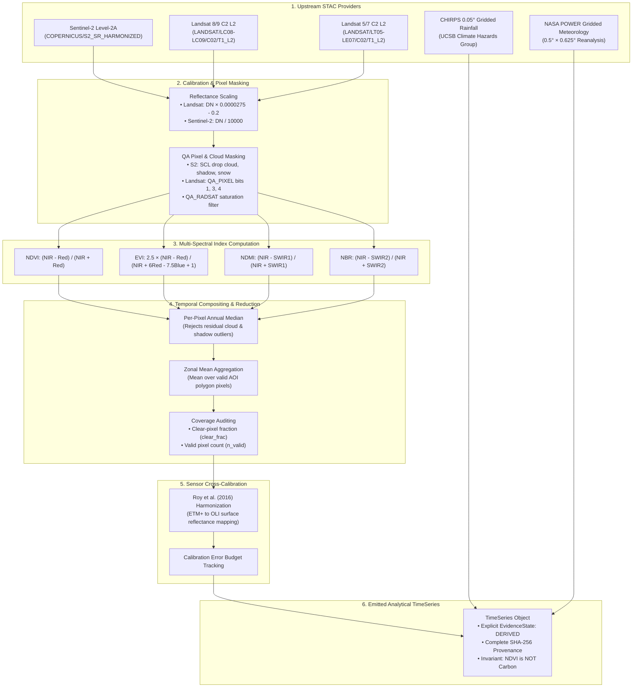
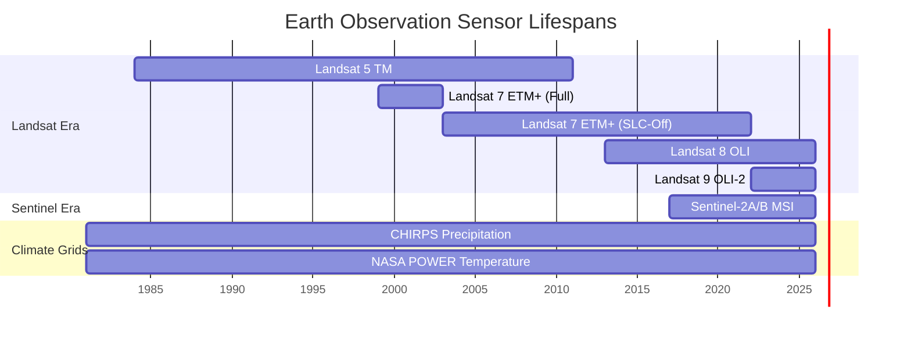
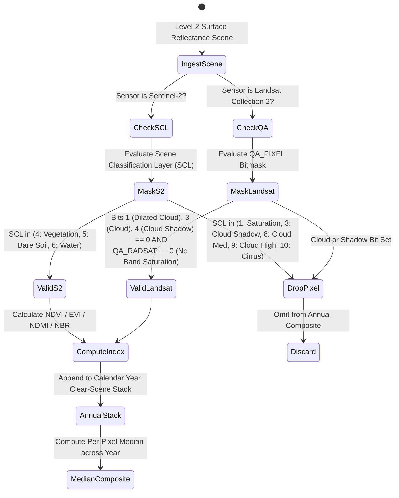

# Earth Observation Architecture

**Engine**: `packages/groundtruth/src/groundtruth/engine/observation/`  
**Data Access**: `packages/groundtruth/src/groundtruth/data_access/`  
**Supported Sensors**: Sentinel-2 MSI, Landsat 9 OLI-2, Landsat 8 OLI, Landsat 7 ETM+, Landsat 5 TM, CHIRPS Precipitation, NASA POWER Climate.

The Earth Observation (EO) subsystem transforms petabytes of multi-spectral satellite rasters into clean, cloud-screened, and sensor-harmonized zonal indicator time series.




---

## 1. The Seam: Methodology vs. Plumbing

To preserve scientific reproducibility, Earth Observation code is cleanly bisected:

```
ENGINE (Methodology)              │  PLATFORM (Plumbing)
──────────────────────────────────┼──────────────────────────────────
Which index answers the research  │  STAC catalog endpoint discovery
  hypothesis                      │  Authentication & API key storage
Pixel masking logic & thresholds  │  Network retries & rate limits
Reflectance scale factors         │  Tiered blob storage & disk cache
Compositing mathematical rules    │  OpenTelemetry span recording
Refusal thresholds for coverage   │  Job queue scheduling
```

The interface protocol is declared in `groundtruth.contracts.ports.ObservationAccess`:

```python
class ObservationAccess(Protocol):
    def series(self, spec: ObservationSpec) -> TimeSeries: ...
    def dataset(self, indicator: Indicator) -> DatasetRef: ...
    def provenance(self, spec: ObservationSpec) -> Provenance: ...
```

---

## 2. Sensor Timeline & Multi-Decadal Historical Coverage

Long-term additionality baselines require multi-decadal time series spanning distinct satellite eras:



### 2.1 Sensor-Specific Band Designations

| Satellite Platform | Red Band | NIR Band | SWIR1 Band | SWIR2 Band (NBR) |
| :--- | :--- | :--- | :--- | :--- |
| **Sentinel-2 MSI** | B4 (665 nm) | B8 (842 nm) | B11 (1610 nm) | B12 (2190 nm) |
| **Landsat 8/9 OLI** | SR_B4 (655 nm)| SR_B5 (865 nm)| SR_B6 (1610 nm)| SR_B7 (2200 nm) |
| **Landsat 7 ETM+** | SR_B3 (660 nm)| SR_B4 (830 nm)| SR_B5 (1650 nm)| SR_B7 (2220 nm) |
| **Landsat 5 TM** | SR_B3 (660 nm)| SR_B4 (830 nm)| SR_B5 (1650 nm)| SR_B7 (2220 nm) |

---

## 3. Pixel QA Masking & Annual Median Compositing

Tropical and subtropical savanna ecosystems experience intense seasonal cloud contamination during monsoonal wet seasons. GroundTruth 2.0 applies strict, per-pixel masking:



### 3.1 Why Annual Median Rejects Cloud Contamination
Residual, sub-pixel clouds that escape the QA bitmask create heavy, positive-reflectance outliers in the visible spectrum. Computing a mean absorbs these outliers and creates artificial "greening" artifacts. The per-pixel median unconditionally rejects outliers, providing an empirically robust measure of annual peak biomass.

---

## 4. Sensor Cross-Calibration: Roy et al. (2016)

The transition between Landsat 7 ETM+ and Landsat 8 OLI coincides with critical baseline periods for major REDD+ interventions (e.g., Kariba REDD+ VCS 902 intervention boundary in 2011/2012). Because OLI spectral response functions are narrower than ETM+, raw unharmonized indices introduce artificial step changes.

GroundTruth 2.0 implements sensor transformation functions following Roy et al. (2016):

$$\rho_{\text{OLI}} = \text{slope} \times \rho_{\text{ETM+}} + \text{intercept}$$

> [!CAUTION]
> **Independent Audit Insight (Task 5/5B)**:
> GroundTruth 2.0 enforces that harmonization coefficients must be specifically applied to surface reflectance (Collection 2 Level-2) rather than top-of-atmosphere (TOA) reflectance. Furthermore, concurrent overpass empirical cross-calibration must be verified against actual overlapping scenes over the project biome rather than synthesized mathematical series. In the absence of validated overlapping scenes, the system explicitly propagates sensor harmonization uncertainty into the final error budget.

---

## 5. Non-Negotiable Principle: NDVI is NOT Carbon

Under no circumstances does GroundTruth 2.0 convert a spectral vegetation index (NDVI, EVI, NDMI, NBR) into metric tonnes of carbon dioxide equivalent ($\text{tCO}_2\text{e}$) without an empirical, peer-reviewed allometric biomass equation.

This invariant is programmatically enforced in `groundtruth.contracts.units`:
- Any comparison between an index (dimensionless, $[-1.0, +1.0]$) and a carbon credit claim ($\text{tCO}_2\text{e}$) triggers a typed `IncompatibleUnitsError`.
- Spectral indices represent **photosynthetic canopy greenness and water absorption**, not timber volume or underground carbon storage.
