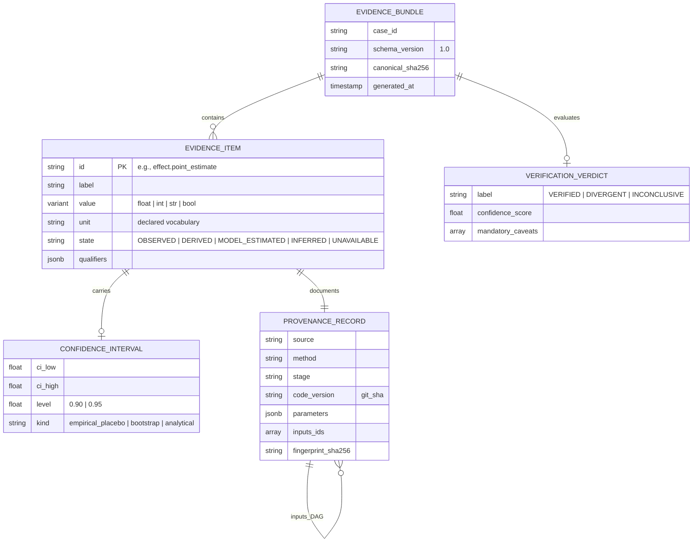
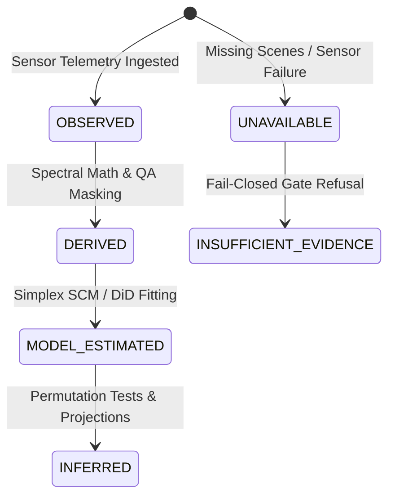
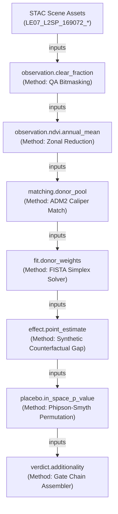
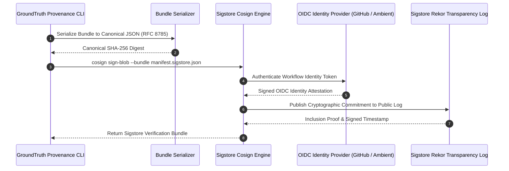

# Evidence and Provenance Architecture

**Package**: `packages/groundtruth/src/groundtruth/contracts/evidence.py` & `provenance/`  
**Guarantees**: Cryptographic Tamper-Evidence, Immutable Derivation Graphs, 5 Epistemological States, Sigstore Cosign Attestation.

The `EvidenceBundle` is the central artifact of GroundTruth 2.0. It is the only currency the reporting and presentation layer is permitted to consume. The deterministic analytical engine emits verified bundles; downstream consumers (APIs, UI dashboards, and generative narrators) may only present or narrate values contained within them.




---

## 1. The 5 Epistemological Evidence States

Every numerical value carries an explicit `EvidenceState` declared in `contracts/evidence.py`:



1. **`OBSERVED`**: Direct, calibrated physical sensor measurements without statistical modeling (e.g., surface reflectance DN).
2. **`DERIVED`**: Deterministic transformations of observed data (e.g., annual median NDVI zonal averages, rainfall totals).
3. **`MODEL_ESTIMATED`**: Quantities estimated via numerical optimization or econometric fitting (e.g., SCM donor weights, synthetic counterfactual trajectory).
4. **`INFERRED`**: Statistical conclusions, confidence bounds, and permutation p-values derived under formal distributional assumptions.
5. **`UNAVAILABLE` / `INSUFFICIENT_EVIDENCE`**: Unobserved periods or refused estimates where data gaps prevent sound inference.

---

## 2. Evidence Item Structure & Structured Namespaces

An `Evidence` item is a frozen, immutable Pydantic v2 model:

```python
class Evidence(BaseModel):
    model_config = ConfigDict(frozen=True)

    id: str = Field(description="Stable dotted slug, e.g. 'effect.ndvi.point_estimate'")
    label: str = Field(description="Human-readable description")
    value: float | int | str | bool
    unit: str = Field(default="", description="Declared vocabulary unit, e.g. 'dimensionless'")
    confidence: Confidence | None = None
    provenance: Provenance
    state: EvidenceState = EvidenceState.DERIVED
    qualifiers: dict[str, Any] = Field(default_factory=dict)
```

### 2.1 Standardized Namespaces
Evidence identifiers follow structured dotted namespaces, allowing user interfaces and downstream verification engines to pinpoint specific metrics:

| Namespace | Category | Example Identifiers |
| :--- | :--- | :--- |
| `claim.*` | Developer Self-Reported Figures | `claim.tco2e_issued`, `claim.baseline_deforestation_rate` |
| `matching.*` | Donor Pool Construction | `matching.n_candidates`, `matching.n_admitted`, `matching.caliper_km` |
| `effect.*` | Econometric Effect Estimates | `effect.point_estimate`, `effect.cumulative_avoided_deforestation` |
| `fit.*` | Optimization Diagnostics | `fit.pre_rmspe`, `fit.post_rmspe`, `fit.rmspe_ratio`, `fit.condition_number` |
| `placebo.*` | Permutation Inference | `placebo.in_space_p_value`, `placebo.n_placebos_valid` |
| `robustness.*` | Sensitivity Analysis | `robustness.max_loo_shift`, `robustness.sign_stable` |
| `crosscheck.*`| Alternative Estimators | `crosscheck.did_estimate`, `crosscheck.parallel_trends_bias` |
| `assessment.*`| 8 Assessment Dimensions | `assessment.vegetation_trajectory`, `assessment.ecological_risk` |

---

## 3. The Provenance Derivation Graph (DAG)

The `inputs` field on each `Provenance` record references preceding evidence identifiers, forming a directed acyclic graph (DAG) spanning the entire analytical lifecycle:



### 3.1 Fingerprint Computation
Each `Provenance` record computes a stable SHA-256 fingerprint:
- Includes: `source`, `method`, `stage`, `parameters`, `inputs`, `code_version`.
- Excludes: Retrieval timestamp (`retrieved_at`).
This ensures that two identical runs of the same scientific code across identical inputs produce the exact same cryptographic fingerprint, regardless of execution time.

---

## 4. Cryptographic Attestation with Sigstore Cosign

GroundTruth 2.0 supports keyless, OIDC-backed digital signatures via Sigstore Cosign (`groundtruth.provenance.sign`):



An independent auditor verifies the authenticity of any published report using standard Sigstore tooling:

```bash
python -m groundtruth.provenance verify-sig manifest.json \
    --bundle manifest.sigstore.json \
    --identity-regexp 'https://github.com/GroundTruth/.*'
```
