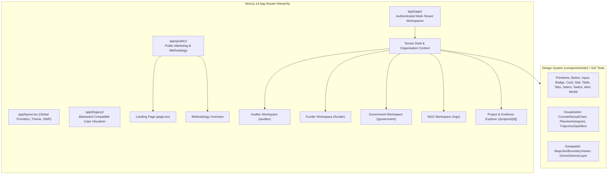
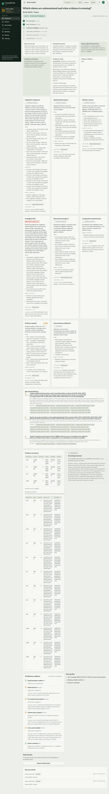
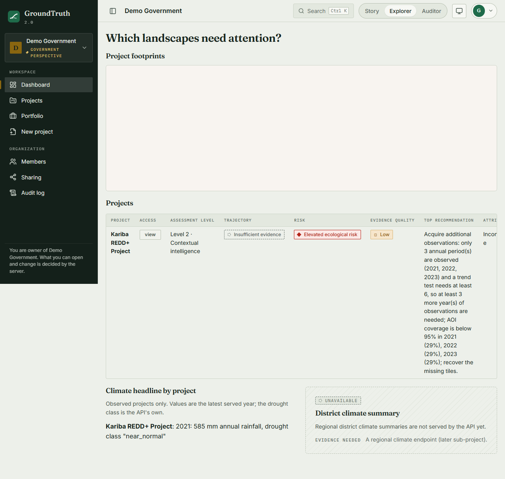
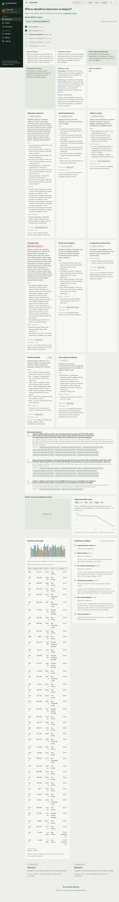
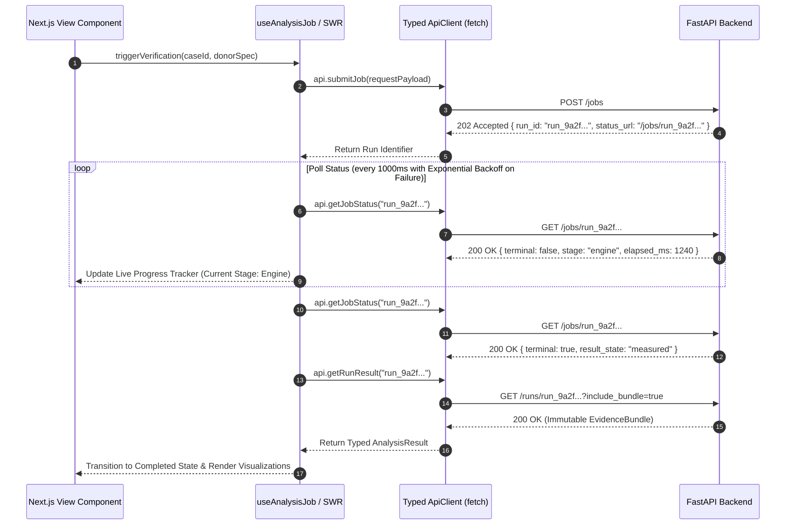

# Frontend Architecture

**Owner**: Frontend Engineering (`apps/web/`)  
**Stack**: Next.js 14 (App Router), TypeScript 5.4, TailwindCSS, Recharts, MapLibre GL, SWR, Headless UI.  
**Test Suite**: 542 unit, component, and integration tests (`vitest` / React Testing Library), Playwright E2E.

The GroundTruth 2.0 frontend is an enterprise web application designed for due-diligence professionals, portfolio managers, sovereign authorities, and ecosystem operators. It renders high-dimensional econometric counterfactuals, multi-temporal geospatial observations, and cryptographic evidence provenance with zero client-side data fabrication.

---

## 1. App Router Restructuring: Public vs. Multi-Tenant Workspaces

GroundTruth 2.0 restructures the application into route groups to provide clear isolation between public documentation and multi-tenant authenticated operations:

### 1.1 `(public)` Route Group
* **Scope**: Public-facing marketing, mission statement, scientific methodology, and team accreditation.
* **Layout**: Lightweight public header, unauthenticated navigation, zero database dependency.
* **Security**: No cookies or tenant session headers required.

### 1.2 `(app)` Route Group
* **Scope**: Authenticated multi-tenant workspace supporting role-based dashboards and case verification.
* **Layout**: Includes the Global Navigation Shell, Organization Tenant Switcher, Persona Role Badge, and Scoped Grant Guards.
* **Security**: Enforces active session validation, cross-organization boundary checks, and CSRF token transmission.

---

## 2. The 4 Stakeholder Personas & Tailored Workspaces

GroundTruth 2.0 provides dedicated, optimized views for each key stakeholder:

### 2.1 Auditor Persona (`/auditor`)
* **Primary Objective**: Independent forensic audit of carbon additionality and baseline credibility.
* **Key Visuals**: Simplex synthetic control counterfactual trajectory, pre-treatment RMSPE fit curves, leave-one-out sensitivity bounds, in-space placebo distribution p-value ranking, and complete evidence provenance traces.
* **Required Scope**: `audit` or `contribute`.

### 2.2 Funder Persona (`/funder`)
* **Primary Objective**: Portfolio-level capital allocation risk, credit over-issuance exposure, and delivery tracking.
* **Key Visuals**: Aggregate risk heatmaps, claimed vs. observed biomass delta, portfolio carbon additionality scores, and fund allocation timelines.
* **Required Scope**: `view`, `audit`, or `contribute`.

### 2.3 Government Persona (`/government`)
* **Primary Objective**: Sovereign forest accounting, NDC reporting, and national leakage belt monitoring.
* **Key Visuals**: Regional administrative district forest cover, cross-border leakage belts, national carbon registry integration, and Article 6 adjustment flags.
* **Required Scope**: `view` or `audit`.

### 2.4 NGO / Project Developer Persona (`/ngo`)
* **Primary Objective**: Intervention tracking, ground-truth field data submission, and multi-spectral vegetation health monitoring.
* **Key Visuals**: High-resolution Sentinel-2 vegetation trajectory (NDVI/EVI/NDMI/NBR), seasonal rainfall anomaly overlays (CHIRPS SPI-12), and ground-truth survey upload interfaces.
* **Required Scope**: `contribute`.

---

## 3. GroundTruth Design System (`components/ds/`)

The design system provides a comprehensive, accessible, and mathematically precise library of components, backed by **542 automated unit and component tests**:

```mermaid
graph LR
    subgraph UIPrimitives["Atomic UI Primitives"]
        Btn["Button (ds/button)"]
        Badge["Badge (ds/badge)"]
        Card["Card (ds/card)"]
        Stat["Stat Display (ds/stat)"]
        Table["Data Table (ds/table)"]
        Tabs["Tabs (ds/tabs)"]
        Modal["Dialog Modal (ds/modal)"]
        Alert["Callout Alert (ds/alert)"]
    end

    subgraph ScientificComponents["Scientific Visualizers"]
        CFChart["CounterfactualChart<br/>• Observed vs. SCM<br/>• Shaded Crediting Gap<br/>• Intervention Marker"]
        PlaceboPlot["PlaceboDistributionPlot<br/>• Permutation Histogram<br/>• Ranked Phipson-Smyth P-Value"]
        ProvDrill["ProvenanceExplorer<br/>• Two-Click Derivation Tree<br/>• SHA-256 Fingerprint Inspector"]
        EvidenceTable["EvidenceMatrix<br/>• Value + Unit + Confidence Kind<br/>• EvidenceState Epistemology"]
    end

    UIPrimitives --> ScientificComponents
```

### 3.1 Component Highlights
* **`ds/stat`**: Formats numerical values strictly with units and confidence intervals (e.g., `+0.042 NDVI (90% CI: +0.012 to +0.071, SCM In-Space Placebo)`).
* **`ds/badge`**: Epistemological state tags (`RAW_OBSERVED`, `DERIVED`, `MODEL_ESTIMATED`, `INFERRED`, `INSUFFICIENT_EVIDENCE`).
* **`ds/alert`**: Contextual scientific callouts for non-negotiable caveats.
* **`ds/table`**: Paginated, sortable donor candidate comparison matrix displaying weights, geographic distances, and covariate balance.

---

## 4. Scientific Commitments in the User Interface

GroundTruth 2.0 enforces non-negotiable scientific presentation rules directly in code:

1. **Persistent Simulated Data Banner**: Any view rendering data where `result.is_simulated == true` displays a non-dismissible amber header banner:
   > *"SIMULATED DATA BENCHMARK: No real-world satellite raster observations were used in this estimate. Numerical outputs are generated from synthetic baseline fixtures."*
2. **No Bare Numbers**: Every measurement rendered on screen must be paired with its declared unit and its uncertainty interval *with the interval's mathematical kind* (e.g., empirical placebo permutation vs. bootstrap). Rendering a sensitivity envelope as a standard confidence interval is rejected.
3. **Provenance in Two Clicks**: Clicking any numerical figure anywhere in the UI opens the Provenance Drawer, displaying the originating sensor collection, processing algorithm, pipeline code commit, parameters, and input data hashes.
4. **Uncompromised Caveat Visibility**: Caveats are displayed alongside verdicts in primary viewports, never concealed behind accordion dropdowns or secondary disclosure tabs.
5. **Neutral Styling for Inconclusive**: An `INCONCLUSIVE` attribution verdict is styled in balanced, neutral slate tones. Inconclusive is a valid scientific finding—often the most valuable outcome in carbon due diligence—and must never be rendered as a software failure or error state.
6. **Divergent from Claim is Amber, Never Red**: If independent causal analysis diverges from a developer's claimed credits, the indicator is rendered in amber with the text *"Warrants Accredited Review"*. Red styling and accusatory language (e.g., "fraud", "scam") are strictly prohibited.
7. **Refusals as Designed States**: When a dataset is insufficient, the system presents a structured Refusal Panel detailing the exact missing criteria (e.g., *Insufficient clear-pixel fraction in pre-treatment baseline*) along with explicit remediation steps.

---

## 5. Client Data Flow & Asynchronous Job Streaming

The web application never hand-writes API schemas. All data structures are generated directly from the backend OpenAPI 3.1 specification:

### 5.1 Connection Loss & Resumption
If network contact with the backend API is interrupted during job execution, the client polling mechanism enters an exponential backoff schedule ($1\text{s}, 2\text{s}, 4\text{s}, 8\text{s}, 10\text{s}$). The run identifier is stored in the browser URL query parameter (`?run=<run_id>`), allowing users to refresh or share the page without losing execution tracking.
