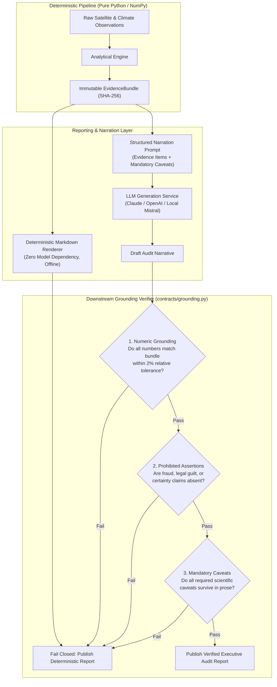
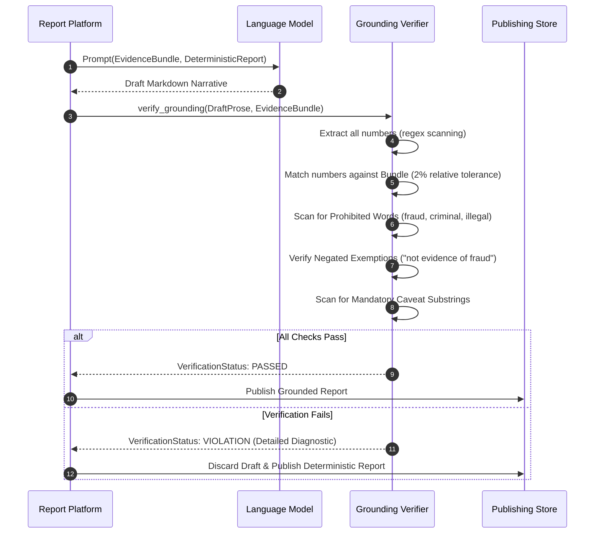

# GenAI Grounding Architecture

**Package**: `packages/groundtruth/src/groundtruth/contracts/grounding.py` & `reports/`  
**Guarantees**: Deterministic Fallback, Zero Autonomous Calculation, 2% Numeric Grounding Gate, Prohibited Accusation Filtering.

GroundTruth 2.0 uses Large Language Models (LLMs) strictly as downstream narrators of verified evidence. The model is forbidden from computing statistics, estimating counterfactuals, or reaching legal conclusions.

---

## 1. Why Grounding is Architecture, Not Prompting

Instructing a language model in a system prompt to "never hallucinate" reduces error frequency, but provides **zero architectural guarantees**. In carbon verification, a single fluent but invented number—such as claiming an intervention produced "142,500 tCO2e of additionality" when the engine calculated no such figure—discredits the entire platform.

GroundTruth 2.0 enforces verification **downstream of the model**:
1. The model receives only the verified `EvidenceBundle` and the deterministic baseline report. It has no access to raw satellite imagery or uncalibrated spreadsheets.
2. The generated output is parsed as untrusted text and subjected to strict algorithmic verification.
3. If the model violates any rule, the output is discarded and the system falls back to the deterministic report.

> The platform degrades to **correct and dry**, never to **fluent and wrong**.

---

## 2. The Deterministic Fallback Renderer

`groundtruth.platform.reports.render_deterministic` produces a comprehensive, publication-ready Markdown audit report:
- Executive attribution verdict with confidence levels.
- Full evidence table with measured values, declared units, and uncertainty bounds.
- All mandatory scientific caveats.
- Complete cryptographic provenance tables with SHA-256 fingerprints.

The deterministic renderer runs completely offline with zero API keys and zero network calls. A unit test asserts that the deterministic renderer passes its own grounding verification suite, guaranteeing that the fallback is never inferior in scientific validity.

---

## 3. The Three Verification Checks

### 3.1 Check 1: Numeric Grounding (2% Tolerance)
Every number appearing in the generated narrative must correspond to a verified item in the `EvidenceBundle`:
- Tolerates minor percentage formatting (e.g., `0.042` rendered as `4.2%`).
- Numbers within a 2% relative tolerance are accepted to account for conversational rounding.
- Exemptions: Calendar years (e.g., `2011`, `2022`), small integer list markers (`1` through `10`), and backticked SHA-256 fingerprints.

### 3.2 Check 2: Prohibited Assertions & Negation Handling
GroundTruth 2.0 is an environmental verification tool, not a judicial court. The grounding filter immediately rejects text containing:
- Accusations of misconduct: `fraud`, `scam`, `lied`, `cheat`, `deception`.
- Legal conclusions: `criminal`, `illegal`, `guilty`, `unlawful`.
- Absolute certainty: `proves conclusively`, `indisputable`, `definitive proof`.
- Implicit carbon conversion: *"NDVI of 0.4 equals 50 tonnes of carbon"*.

**Negated Exemption Handling**:
The mandatory caveat explicitly requires the sentence *"Model divergence is not evidence of fraud"*. If the filter naively banned the word "fraud", the system would reject its own required disclaimer. The verifier in `contracts/grounding.py` applies regex patterns that detect and exempt recognized negated constructions.

### 3.3 Check 3: Mandatory Caveat Enforcement
The engine compiles a set of mandatory caveat strings required for the specific verdict (e.g., *parallel trends assumption cannot be directly tested post-treatment*). The verifier validates that distinct semantic fragments of each required caveat are preserved in the published prose.
