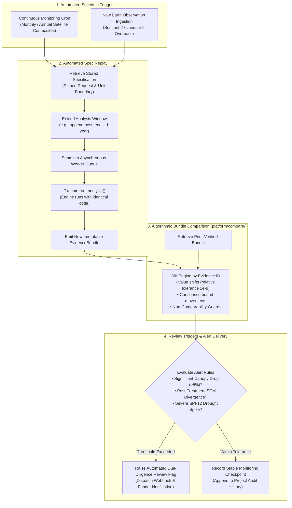
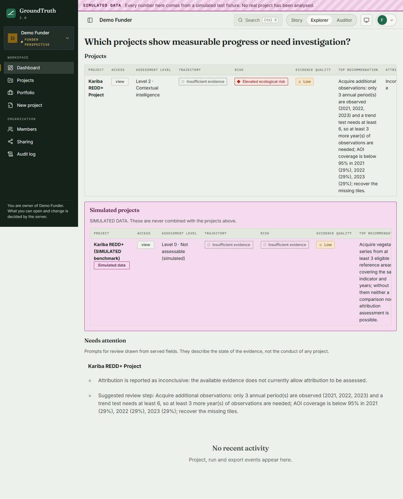
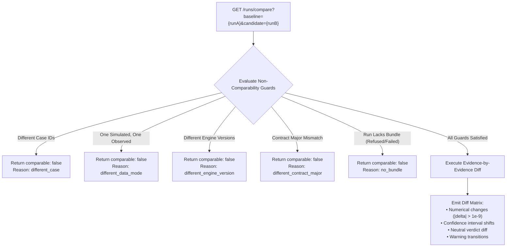
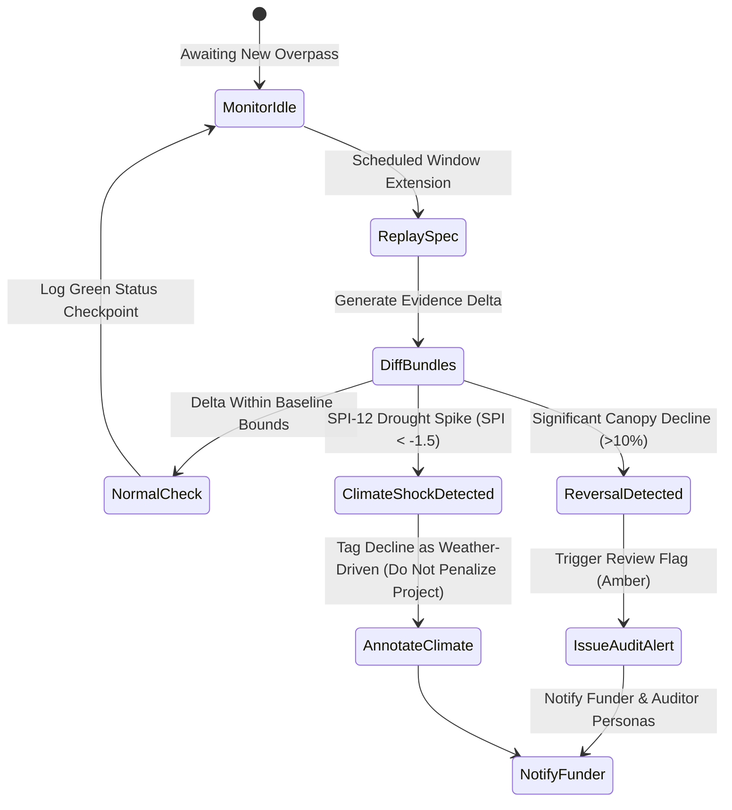

# Continuous Monitoring Architecture

**Platform**: `packages/groundtruth/src/groundtruth/platform/compare/` & `jobs/`  
**Core Concept**: Shift from static snapshot verification to perpetual, automated observation.

A project verified in 2022 can suffer illegal logging, canopy dieback, or severe drought in 2024. Continuous monitoring enables GroundTruth 2.0 to re-evaluate interventions automatically as new satellite overpasses and climate grids arrive, detecting reversals before credits are traded.

---

## 1. Why GroundTruth 2.0 Makes Monitoring Seamless

Continuous monitoring is architecturally trivial in GroundTruth 2.0 because of foundational design choices:

| Architectural Primitive | Foundation | Role in Continuous Monitoring |
| :--- | :--- | :--- |
| **`spec_hash`** | ADR-006 | Guarantees that re-running an analysis with an extended window executes the exact same mathematical model without manual parameter re-entry. |
| **Pinned `DatasetRef`** | ADR-009 | Ensures any measured delta is caused by real ecological changes on the ground, not silent upstream archive reprocessing. |
| **Immutable `EvidenceBundle`** | ADR-004 | Prior and current states can be diffed element-by-element across stable dotted IDs. |
| **Decoupled Jobs** | ADR-008 | Scheduled re-runs execute on existing background workers without consuming API gateway resources. |

---

## 2. Algorithmic Run Comparison (`platform/compare/`)

The comparison service evaluates differences across two verified runs, categorizing evidence identifiers as `added`, `removed`, `changed`, or `unchanged`.

### 2.1 The Non-Negotiable Non-Comparability Guards
A measurement change between two runs could stem from methodology revisions rather than ecological reality. To protect due-diligence teams from measurement artifacts, the engine strictly refuses to generate a diff if:
- `different_engine_version`: The runs were executed on different versions of the analytical engine.
- `different_data_mode`: Comparing a simulated benchmark run against a real observation run.
- `different_case`: The runs evaluate different geographic projects.

---

## 3. Alert Triggers & Reversal Detection

When new observations are processed, threshold rules detect environmental reversal events:

* **Canopy Loss Alert**: Detects sharp negative shifts in `effect.point_estimate` or `assessment.vegetation_trajectory`.
* **Climate Attribution Isolator**: Checks whether vegetation decline coincides with severe regional drought ($\text{SPI-12} < -1.5$). If the regional synthetic control also declines, the reversal is attributed to drought stress rather than project failure.
