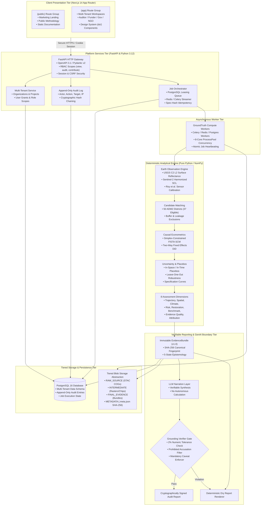
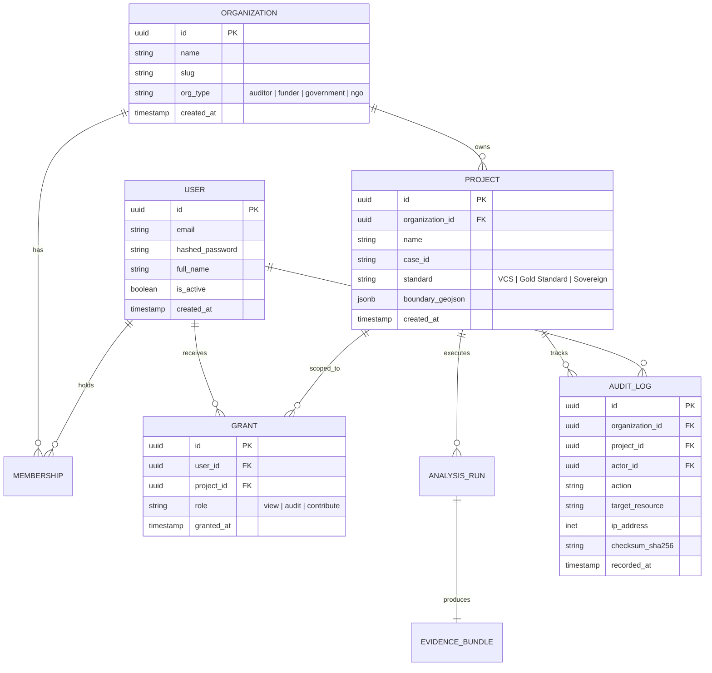
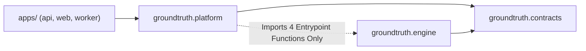
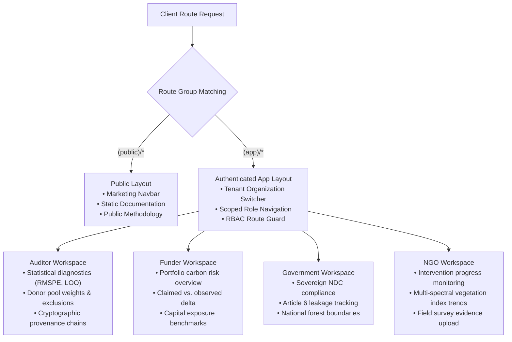
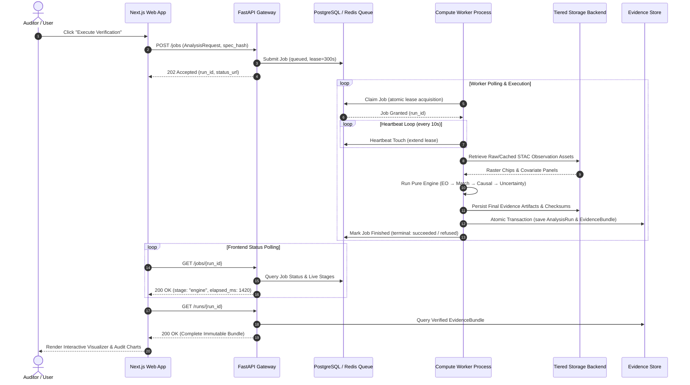
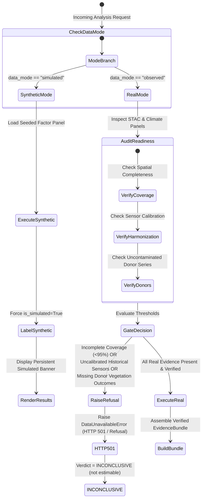

# GroundTruth 2.0 System Architecture

GroundTruth 2.0 is an enterprise-grade platform for independent environmental verification and continuous ecological intelligence. It replaces unverifiable claims with deterministic remote sensing pipelines, causal econometric counterfactuals, multi-tenant role-based governance, and cryptographic provenance.




---

## 1. The Core Architectural Boundary: Determinism vs. Narration

The foundational design invariant of GroundTruth 2.0 is an unbreachable separation between numerical computation and language generation:

```
┌──────────────────────── DETERMINISTIC ENGINE ────────────────────────┐
│                                                                      │
│  ingestion → masking → matching → causal → uncertainty → assessment  │
│                                                                      │
│  Pure NumPy / Python. No LLMs. No Network Sockets. No Credentials.   │
│  Every value carries explicit Provenance and EvidenceState.          │
└───────────────────────────────────┬──────────────────────────────────┘
                                    │
                                    ▼
                         EvidenceBundle (Immutable, SHA-256)
                                    │
┌──────────────────────── REPORTING & GENAI TIER ──────────────────────┐
│                                                                      │
│  Deterministic Renderer  ──or──  LLM Narration → Grounding Check     │
│                                                       │              │
│                                                 fails ┴► Fallback    │
└──────────────────────────────────────────────────────────────────────┘
```

A generative model handed multi-temporal satellite rasters or spreadsheets and asked "did this project over-credit?" produces ungrounded hallucinations. Conversely, an LLM handed an immutable, verified `EvidenceBundle` containing pre-computed statistics and asked "explain these findings in auditor language" operates strictly within its verified capability.

If any generated report hallucinates a figure outside a 2% numeric tolerance, asserts fraud, or drops mandatory scientific caveats, the system fails closed and publishes the deterministic report.

---

## 2. Multi-Tenant Architecture & Data Layer

GroundTruth 2.0 implements a multi-tenant, role-governed data model supporting cross-organizational collaboration with rigorous isolation:



### 2.1 Organizations, Projects, and Scoped Grants
- **Organizations**: Legal entities operating in the system (e.g., Audit Firms, Carbon Funds, Environmental Ministries, Project Developers).
- **Projects**: Registered intervention units carrying geospatial boundaries, baseline crediting periods, and reference data.
- **Grants**: Granular access tokens binding users to projects under three distinct roles:
  - `view`: Read-only access to published evidence bundles, summaries, and executive dashboards.
  - `audit`: Full inspection privileges, access to raw satellite observation chips, donor matching diagnostics, and sensitivity runs.
  - `contribute`: Authority to upload project polygons, boundary amendments, ground truth surveys, and register analysis runs.
- **Append-Only Audit Log**: Every user action, state change, and analysis run is recorded with client IP, timestamp, actor identity, and SHA-256 checksums to ensure tamper-evident governance.


---

## 3. Package and Repository Topology

GroundTruth 2.0 is organized as a high-discipline monorepo separating presentation applications, platform infrastructure, and pure analytical computation:

```
GroundTruth/
├── apps/
│   ├── api/                   Thin ASGI FastAPI entrypoint (apps.api.main:app)
│   ├── web/                   Next.js 14 App Router application
│   │   └── src/
│   │       ├── app/
│   │       │   ├── (app)/     Multi-tenant authenticated workspaces (Auditor, Funder, etc.)
│   │       │   ├── (public)/  Public marketing, landing, methodology pages
│   │       │   └── (legacy)/  Backward-compatible case views
│   │       ├── components/ds/ GroundTruth Design System components (542 tests)
│   │       └── lib/           Typed API client & generated OpenAPI types
│   └── worker/                Background job consumer entrypoint (apps.worker.main)
├── packages/
│   └── groundtruth/
│       ├── src/groundtruth/
│       │   ├── contracts/     Shared, immutable Pydantic v2 schemas and protocols
│       │   ├── engine/        Pure scientific computation (NumPy only, no I/O)
│       │   │   ├── observation/   Index computation, QA masking, zonal reductions
│       │   │   ├── matching/      Donor candidate pool filtering & balance
│       │   │   ├── causal/        Simplex FISTA SCM & DiD estimators
│       │   │   ├── uncertainty/   In-space/in-time permutation inference
│       │   │   └── assessment/    8 assessment dimensions & rule evaluator
│       │   ├── platform/      FastAPI routes, tenancy, auth, jobs, storage, store
│       │   │   ├── api/       Routers, OpenAPI snapshot generator, middleware
│       │   │   ├── tenancy/   Organization, project, and grant service
│       │   │   ├── auth/      Session, RBAC, CSRF, rate-limiting services
│       │   │   ├── audit/     Append-only cryptographic audit logging
│       │   │   ├── jobs/      PostgreSQL leasing & Redis/Celery queue backends
│       │   │   └── storage/   Tiered blob storage (LocalStorage, S3Storage)
│       │   ├── provenance/    SHA-256 bundle verification and Sigstore cosign signing
│       │   └── observability/ OpenTelemetry spans, metrics, and trace telemetry
└── tests/                     1,120+ backend tests and scientific property suites
```

### 3.1 Unidirectional Dependency Invariant
Dependencies flow strictly inward toward `contracts`:



The platform imports exactly four entrypoint symbols from the engine: `run_analysis`, `describe_engine`, `engine_ref`, and `ENGINE_VERSION`. The engine is strictly forbidden from importing platform code, database drivers, network sockets, or filesystem routines. This invariant is enforced on every commit by `tests/test_contract_boundary.py`, which parses the Python AST across all modules.

---

## 4. Frontend Workspace Architecture: 4 Personas

The Next.js 14 frontend is restructured under App Router route groups:
- `(public)`: Public documentation, case methodology, and marketing.
- `(app)`: Role-gated workspaces tailored to specific industry personas:




---

## 5. Asynchronous Job & Worker Execution

Heavy causal calculations and satellite raster processing are decoupled from HTTP request loops:



---

## 6. Scientific Integrity & The Fail-Closed Data Gateway

### 6.1 Epistemological Evidence States
Every measurement or statistic is tagged with an `EvidenceState`:
- `RAW_OBSERVED`: Uncalibrated, direct sensor measurements.
- `DERIVED`: Cloud-masked, harmonized spectral indices.
- `MODEL_ESTIMATED`: Econometrically fitted counterfactuals and weights.
- `INFERRED`: Confidence intervals, permutation p-values.
- `UNAVAILABLE` / `INSUFFICIENT_EVIDENCE`: Missing observations.

### 6.2 Fail-Closed Principle & Audit Findings
Following independent audits (Task 5/5B), GroundTruth 2.0 enforces a **fail-closed data gateway**:



> [!IMPORTANT]
> **Independent Audit Posture (Kariba REDD+ VCS 902)**:
> In `REAL_OBSERVATIONS` mode, GroundTruth 2.0 refuses to extrapolate or invent historical pre-treatment vegetation series. Real Sentinel-2 post-treatment data (2021–2023), real CHIRPS precipitation (514/516 months), real NASA POWER temperature, and 37 spatially eligible ADM2 donor districts are rigorously integrated. However, because cross-sensor Landsat 5/7/8 surface reflectance harmonization across 2001–2010 requires coincident empirical cross-calibration and whole-AOI multi-tile raster extraction that is pending execution, the system issues a clear, honest verdict:
>
> **ATTRIBUTION VERDICT: INCONCLUSIVE (not estimable from available real data).**
>
> GroundTruth 2.0 never falls back silently to simulation and never serves unverified numbers under a real-data label.

---

## 7. System Architecture Verification Matrix

| Architectural Invariant | Mechanism of Enforcement | Verification Test |
| :--- | :--- | :--- |
| **Engine Isolation** | Engine imports no I/O, DB, network, or platform code | `tests/test_contract_boundary.py` |
| **Spectral Guard** | Refusal to convert NDVI to carbon without allometry | `tests/test_units.py` |
| **GenAI Grounding** | 2% numeric tolerance, caveat check, prohibited words | `tests/test_grounding.py` |
| **Multi-Tenant RBAC** | Strict middleware, organization scopes (`view`, `audit`, `contribute`) | `tests/test_tenancy.py` |
| **Reproducibility** | `spec_hash` and declared PRNG seeds produce identical bits | `tests/test_golden_reproducibility.py` |
| **Immutable Evidence** | Database trigger blocks `UPDATE` on `evidence_bundles` | `tests/test_evidence_store.py` |
| **Fail-Closed Gate** | Real mode raises 501 `DataUnavailableError` on incomplete data | `tests/test_real_observations.py` |
| **OpenAPI Typing** | Generated TypeScript types match FastAPI schemas | `tests/test_openapi_snapshot.py` |
