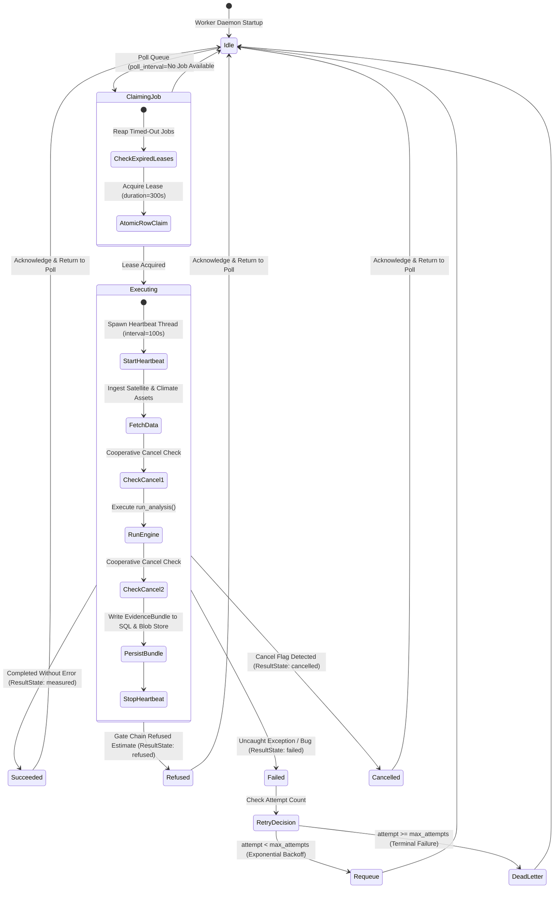
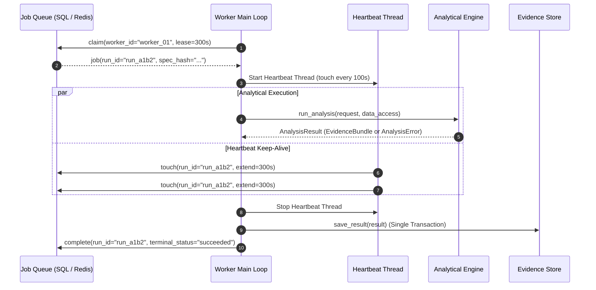
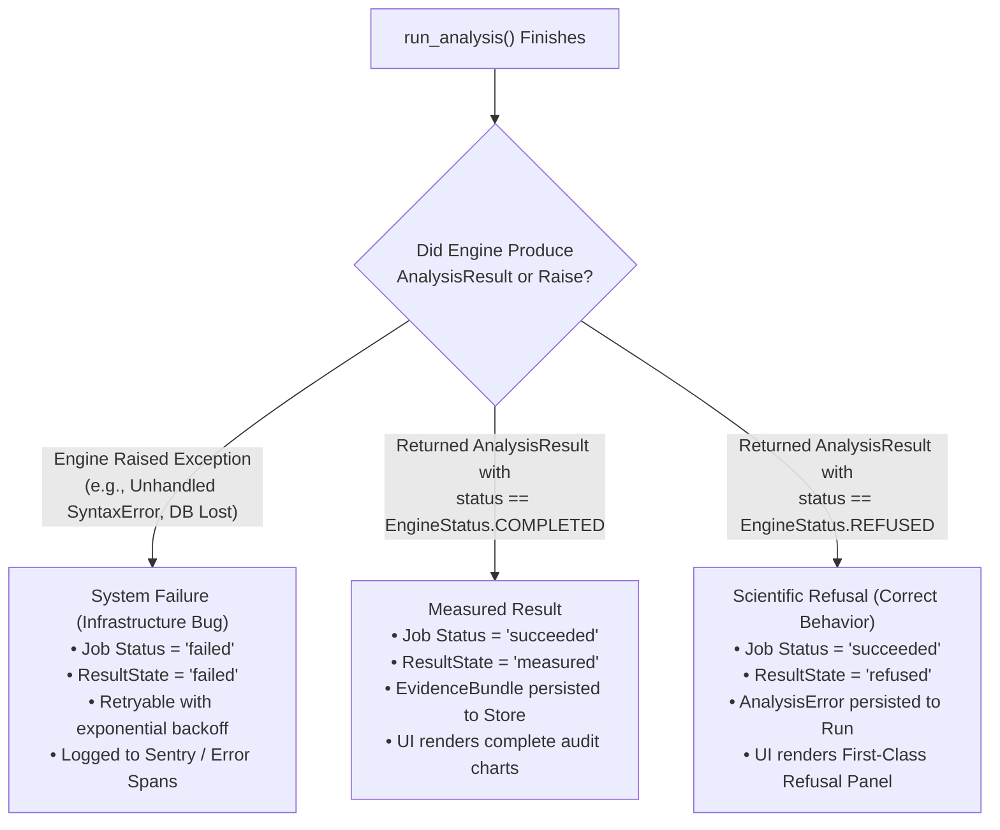

# Worker Architecture

**Owner**: Platform & Compute (`apps/worker/` & `groundtruth.platform.jobs`)  
**Runtime**: Python 3.12, Celery / Redis Queue, PostgreSQL Row-Lease Queue, ProcessPoolExecutor, Temporal Workflows.

The worker subsystem executes compute-intensive geospatial reductions, econometric optimization algorithms, and permutation inference suites off the HTTP request-response path. It ensures that API gateways remain responsive while analytical workloads scale horizontally across compute nodes.




---

## 1. Why a Decoupled Compute Worker is Necessary

1. **Econometric Permutation Scale**: Estimating empirical p-values via in-space placebos requires refitting the synthetic control optimization across every eligible donor unit. For a 50-donor regional pool, this requires 51 independent FISTA quadratic programming fits. While synthetic fixtures run in under a second, full-resolution satellite raster reductions over multi-tile areas take minutes.
2. **HTTP Gateway Protection**: Web reverse proxies (Nginx, Cloudflare) enforce request timeouts (typically 30–60 seconds). Blocking an HTTP thread on heavy geospatial reductions triggers connection drops, worker starvation, and cascading failures.
3. **Independent Autoscaling**: The HTTP API scales on request concurrency and network I/O, whereas compute workers scale on physical CPU cores and memory bandwidth (ADR-010).

---

## 2. Multi-Process Concurrency & Chunking Profile

Based on empirical benchmarks conducted on 24-core hardware (Intel Core Ultra 9 / 32 GB RAM; see [LOCAL_COMPUTE_BENCHMARK.md](../engineering/LOCAL_COMPUTE_BENCHMARK.md)):

* **Optimal Worker Allocation**: 8 concurrent worker processes deliver peak spatial processing throughput ($29.59\text{ MP/s}$, $112.89\text{ tasks/s}$) with minimal memory overhead ($0.20\text{ MB}$).
* **Diminishing Returns Above 8**: Spawning 12 or 16 workers degrades aggregate throughput by 10–20% due to Python GIL synchronization in parent dispatchers and memory bus contention.
* **Chunk Window Size (512 × 512)**: Matches Cloud-Optimized GeoTIFF (COG) internal tiling, balancing HTTP range-request overhead against process memory limits.

---

## 3. Worker Execution Loop & Heartbeating

The worker process executes an atomic claim-heartbeat-process cycle:

```python
while not stopping:
    # 1. Claim job atomically while reaping any expired leases
    job = queue.claim(worker_id)
    if job is None:
        stop.wait(poll_seconds)
        continue

    # 2. Heartbeat thread touches lease every lease_duration / 3
    with Heartbeat(queue, job, lease_duration / 3):
        # 3. Pure execution: data access -> analytical engine -> atomic store
        process(queue, job, resolve_access, run=run_analysis)
```



---

## 4. The Critical Distinction: Scientific Refusal vs. System Failure

A foundational failure mode in automated verification platforms is misclassifying a scientific refusal as an infrastructure error:



> [!IMPORTANT]
> **A Scientific Refusal is a Succeeded Job**:
> When a project lacks sufficient pre-treatment satellite observations, exhibits cloud cover exceeding 40%, or fails covariate balance, the engine issues an `AnalysisError` with `is_refusal=True`. 
>
> The worker marks this job as **`succeeded`** in the queue with `result_state="refused"`. If the worker marked it `failed`, the infrastructure monitoring systems would page engineers, and the UI would present an application error instead of explaining that the project was rejected on legitimate scientific grounds.

---

## 5. Supported Queue Backends

GroundTruth 2.0 provides three interchangeable queue engines (see [queue-backends.md](../queue-backends.md)):

| Backend | Selection Mechanism | Module | Concurrency Model |
| :--- | :--- | :--- | :--- |
| **PostgreSQL Leasing Queue** | Default (zero external dependencies) | `platform.jobs.queue` | Database table row leases with SELECT FOR UPDATE SKIP LOCKED |
| **Redis + Celery / Arq** | `REDIS_URL` defined in environment | `platform.jobs.redis_queue` | In-memory distributed task streaming with pub/sub progress |
| **Temporal Durable Execution** | Temporal worker enabled | `platform.jobs.temporal_workflow` | Event-sourced durable state machines with replay guarantees |

---

## 6. Cooperative Job Cancellation

Cancellation is cooperative to protect data store consistency:
1. **Prior to Engine Dispatch**: The worker checks `job.cancelled`. If requested, it transitions the job directly to `cancelled` without invoking compute.
2. **During Engine Execution**: The engine itself is an uninterruptible NumPy numerical step. The concurrent heartbeat thread observes the cancellation flag in the database and logs the state.
3. **Post-Engine Handshake**: When the engine returns, the worker observes the cancellation flag, discards intermediate matrices, and avoids writing evidence to the persistent store.
