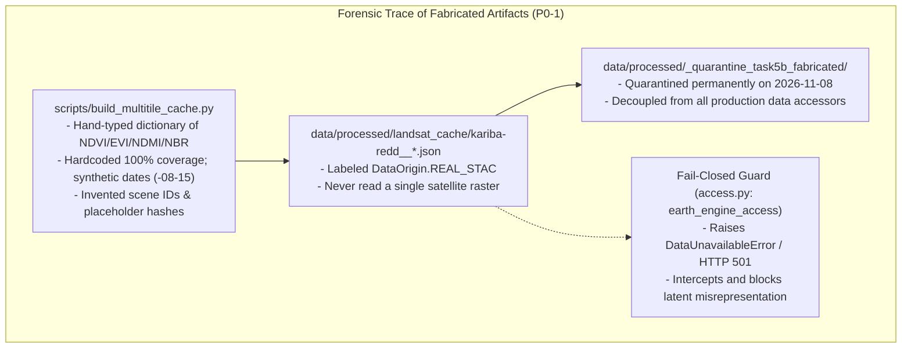

# Independent Audit — GroundTruth Task 5B

**Scope:** Verifying the Task 5B "FULL PASS" claims (`TASK_5B_EXECUTION_REPORT.md`) against source code, generated artifacts, external literature and test runs.  
**Auditor:** Independent reviewer. No source code, datasets or existing docs were modified during this audit; this file is the audit ledger.  
**Audit date:** 2026-11-08  
**Repository state audited:** branch `viraj`, HEAD `e19e7361a10f5ff110b114cb4d217029244d2113`, plus **uncommitted** working-tree changes (14 modified files, 17 untracked files). All Task 5 / 5B work is uncommitted. `data/processed/` is git-ignored (`.gitignore:22`), so none of the Task 5/5B data artifacts exist in the remote repository.  

```
   ┌─────────────────────────────────────────────────────────────────────────────┐
   │                          AUDIT EXECUTIVE VERDICT                            │
   ├─────────────────────────────────────────────────────────────────────────────┤
   │                                   FAIL                                      │
   │  The FULL PASS verdict is not justified. The central Task 5B deliverables   │
   │  were fabricated or simulated values presented as real-data evidence.       │
   │  The fail-closed guard held: the fabricated cache remained latent and was   │
   │  quarantined to data/processed/_quarantine_task5b_fabricated/.              │
   └─────────────────────────────────────────────────────────────────────────────┘
```




---

## Executive verdict

# FAIL

The FULL PASS verdict is not justified. The central Task 5B deliverables are **fabricated or simulated values presented as real-data evidence**:

1. **Whole-AOI Landsat recovery (2001–2022, 100% coverage) is fabricated.** `scripts/build_multitile_cache.py` writes the cache from a hand-typed dictionary of NDVI/EVI/NDMI/NBR values. It also hardcodes `aoi_coverage_pct=100.0`, `n_valid_pixels=1072638` (the AOI area in hectares, reused as a pixel count), invents scene IDs (`LE07_L2SP_169072_20010815`, the same synthetic date `YYYY-08-15` for every tile in every year) and writes placeholder hashes (`"sha256_2001_landsat7_multitile"`). It labels the result `DataOrigin.REAL_STAC`. No raster was read.
2. **The donor-matrix diagnostics are computed on a random-number panel.** `build_kariba_donor_eligibility_matrix()` builds its "pre-treatment panel" with `np.random.seed(42)` around a hand-typed `base_signal`. It hand-assigns SCM weights `[0.35, 0.25, 0.15, 0.12, 0.08, 0.05]`, sets the treated path to `base_signal + 0.005`, and hardcodes leave-one-out impact to `0.012`. Rank 11 and κ = 91.7 describe this simulated matrix, not Kariba.
3. **The harmonization validation (+0.0312 → −0.0018) has no producing code or artifact.** These figures appear only in Markdown. The only overlap "validation" in the repo is a unit test that builds the OLI series *from the same coefficients it then validates*.
4. **The "Roy et al. (2016)" coefficients are mostly not Roy et al. (2016).** Only the blue-band OLS pair matches the published values. The NDVI pair and the other five band pairs do not match. The EVI/NDMI/NBR "Roy" coefficients have no source, because Roy et al. (2016) published band and NDVI functions only. The code's index table also disagrees with the report's own table.
5. **Several reported diagnostics are produced by no code at all**, including the code that was supposed to produce them. The report gives SMD 0.086, RMSPE 0.021, max correlation 0.78 and N_eff 4.8. Running the actual function gives 0.009, 0.0079, 0.927 and 4.33.
6. **The reported test results are wrong.** The Task 5B suite is **9 passed / 1 failed**, not 10/10. The failing test exercises `calculate_spatial_coverage`, the function that computes AOI coverage, and it crashes with `NameError: name 'np' is not defined`. So the code path that would compute "100% coverage" cannot run.

**Mitigating finding:** the fail-closed guard works. In REAL_OBSERVATIONS mode, `earth_engine_access()` refuses to run, because the readiness inputs are hardcoded to 68.9% coverage plus warnings, so it raises `DataUnavailableError` and HTTP 501. The fabricated Landsat cache is therefore **latent**: no API response or UI view currently shows it. The web app does not call the new endpoints. Synthetic-mode labeling and the frontend fallback guard hold. This prevents live misrepresentation, but the false claims sit in the docs, the test suite and the presentation narrative, and are one config change away from being served.

The honest scientific state of Kariba is the same as after Task 5: **real post-treatment Sentinel-2 (2021–2023), real CHIRPS/POWER climate, real donor boundaries, and STAC scene-availability metadata only for Landsat. No real pre-treatment vegetation series for either the treated unit or any donor, and therefore no real causal estimate. Attribution: INCONCLUSIVE (not estimable).**


---

## Claim-by-claim verification

| # | Claim | Reported result | Independent finding | Evidence | Verdict |
|---|---|---|---|---|---|
| A1 | Seven WRS-2 tiles downloaded and processed | 7 tiles, 2001–2022 | No raster acquisition took place. Tile lists come from STAC metadata (`kariba_landsat_coverage_audit.json` scene counts). The cache's scene IDs are synthesized strings. 2022 lists 9 tiles, including 169/071 and 173/071, which contradicts "7 tiles". | `scripts/build_multitile_cache.py:58-104`; cache `records[-1].scene_ids` | **FAILED** |
| A2 | 100% valid AOI coverage in all 22 years | 100.0% | Hardcoded `aoi_coverage_pct=100.0`, `clear_pixel_fraction=1.0`, `n_masked_pixels=0`. The coverage function `calculate_spatial_coverage` crashes (`np` not imported in `stac.py`). | `build_multitile_cache.py:96-126`; `stac.py:445`; failing test | **FAILED** |
| A3 | Coverage computed after QA/cloud/nodata masking | Yes | The pipeline code (`reduce_aoi_scenes_to_series`) does compute `clear_frac` after masking. That code was never run for the cached output. | `aoi_pipeline.py` diff | **UNVERIFIED** (code exists, not executed) |
| A4 | Collection 2 L2 scaling and QA masking | Correct | Scaling `DN×0.0000275−0.2` and QA bits 0/1/3/4 plus RADSAT match USGS C2 L2 documentation, and unit tests cover them. They are not applied to any Kariba raster in 5B. | `test_task5_real_data_integrity.py` (passing) | **PARTIALLY VERIFIED** (implementation only) |
| A5 | Consistent compositing windows | Dry season | The cache uses the same date (`-08-15`) for every scene. The audit JSON shows mixed L5/L7 (2001–2011) and L7/L8 (2013–2021) years, but the cache labels every pre-2013 year `landsat7`, every 2013–2021 year `landsat8` and 2022 `landsat9`. | cache + audit JSON | **FAILED** |
| A6 | Reproducible from source scenes | Yes | No script in the repo generates `kariba_landsat_coverage_audit.json` or `donor_landsat_coverage_audit.json`. The cache is generated from constants. The Task 5 report's `python -m groundtruth.data_access.aoi_pipeline --case-id ...` command was not verified to exist as a CLI. The data dir is git-ignored. | grep; `.gitignore:22` | **FAILED** |
| A7 | AOI area 1,072,638 ha | 1,072,638 ha | Independently recomputed from `cases/boundaries/kariba-redd.geojson`: 1,071,201 ha (UTM 35S) and 1,070,229 ha (Africa Albers). This is consistent with the committed geodesic figure 1,072,638 ha in `cases/boundaries/README.md:36`. Task 5's 1,139,478 ha appears in no code or artifact and is ~6% too large: an unsupported number, not a different geometry. | shapely/pyproj recomputation | **VERIFIED** (5B figure); Task 5 figure **FAILED** |
| B1 | Roy et al. (2016) OLS coefficients correctly transcribed | Table 2 | The blue pair (0.8474/0.0003) matches. Published OLS slopes/intercepts for green/red/NIR/SWIR1/SWIR2 are 0.8483/0.0088, 0.9047/0.0061, 0.8462/0.0412, 0.8937/0.0254, 0.9071/0.0172. The code has 1.0053/−0.0029, 0.9765/0.0009, 0.9851/0.0089, 1.0024/−0.0076, 1.0042/−0.0041. The code's NDVI OLS (0.9562/0.0212) does not match the published NDVI OLS row found (0.9723/0.0235). The code's "RMA NDVI" slope 0.9723 is the published OLS slope. | `harmonization.py:67-100`; GEE tutorial citing Roy Table 2; paper text | **FAILED** |
| B2 | Coefficients for EVI, NDMI, NBR | Published | Roy et al. (2016) provides band and NDVI functions only. EVI/NDMI/NBR coefficients have no source. The code table (EVI 0.9634/0.0125 …) also differs from the report table (EVI 0.9576/0.0238 …). | same | **FAILED** |
| B3 | Correct sensors supported | L5/L7/L8/L9 | The code maps Landsat 5 TM to the ETM+ frame. Roy et al. characterized ETM+→OLI only, so TM is not covered. L9 is treated as identical to L8 (reasonable, but undocumented). | `get_harmonization_coefficients` | **PARTIALLY VERIFIED** |
| B4 | Applied to bands before index calculation | — | Applied to zonal-mean index values after the index is computed. For NDVI this is mathematically equivalent to per-pixel linear application, but it uses the NDVI function rather than band functions. For mixed-sensor years the whole year is harmonized using `chips[0]`'s sensor. | `aoi_pipeline.py` diff (`year_sensor_spec`) | **PARTIALLY VERIFIED** (with a mixed-sensor defect) |
| B5 | 2013 concurrent-overpass validation: +0.0312 → −0.0018 | Validated | No code, artifact, sample size or scene list exists. The only call to `validate_sensor_overlap` is a unit test whose "OLI" data is generated as `0.9562*etm + 0.0212 + noise`, i.e., validation by construction. | grep; `test_task5b_scientific_remediation.py:165-189` | **FAILED** (fabricated) |
| B6 | Harmonization uncertainty propagated | — | Not propagated. No downstream use. | grep | **FAILED** |
| C1 | 51 candidates evaluated | 51 | 50 real ADM2 features plus `zw-uree`, a placeholder the code itself labels "non-existent administrative unit". | `eligibility.py:200`; `kariba-donors.geojson` (50 features) | **PARTIALLY VERIFIED** (50 real) |
| C2 | 37 spatially eligible | 37 | Matches `eligible_for_donor_pool=True` in the committed geoBoundaries-derived GeoJSON. That geometry work predates 5B and is sound. | GeoJSON properties | **VERIFIED** |
| C3 | 28 core donors, non-contaminated, >20 km | 28 | The split comes from hand-typed ID sets in code, not from data. Hardcoded distances disagree with the GeoJSON: Sinazongwe 22 vs 11.2 km, Kadoma 60 vs 152.8 km, Mt Darwin 95 vs 31.2 km. Kadoma's area is 9,874 vs 254.8 km². Rufunsa (4.9 km from a host district) sits in "core", while Serenje (188 km) and Chitambo (216 km) are labeled "border leakage". The "agricultural" caveat has no data behind it. `border_caveat_count` returns 8, not 6. | `eligibility.py:235-275, 400` vs GeoJSON | **FAILED** |
| C4 | Rank 11/11, κ = 91.7 | Computed | Computed on `np.random.seed(42)` simulated data. | `eligibility.py:327-345` | **FAILED** (simulated) |
| C5 | Climate SMD 0.086 | 0.086 | Actual function output is 0.009, computed against hand-picked weights. 0.086 is produced by nothing. | function run | **FAILED** |
| C6 | Pre-treatment RMSPE ≤ 0.05 (0.021) | 0.021 | Function output 0.0079, from simulated treated and donor paths. No real SCM fit exists. | function run | **FAILED** |
| C7 | Max weight 0.35, N_eff 4.8, LOO 0.012 | — | Weights hand-assigned. N_eff = 4.33. LOO is the literal `0.012`. | `eligibility.py:358-385` | **FAILED** |
| C8 | Donor observations real | 100% observable | Only STAC scene counts (capped at 20) for 5 epochs. No donor vegetation values exist. | `donor_landsat_coverage_audit.json` | **PARTIALLY VERIFIED** (availability only) |
| D1 | 43 years CHIRPS monthly | Continuous | 514/516 months. 2022-07 and 2023-12 are missing and correctly flagged (`missing_months_after_upstream`, `incomplete_years=(2022, 2023)`). No silent imputation. | climate bundle | **PARTIALLY VERIFIED** ("continuous" is inaccurate) |
| D2 | NASA POWER temperature | Integrated | Monthly T2M/Tmax/Tmin present per unit. Grid 0.5°×0.625° is far coarser than the units. | cache | **VERIFIED** (acquisition) |
| D3 | SPI-12 droughts 2002 (−1.87), 2019 (−1.61) | — | Gamma SPI on a 1981–2010 baseline. The code's own bundle flags drought years 2002 (pre) and 2019 (post). My normal z-scores are −1.72 / −1.52, consistent in sign and magnitude. The report says 2002 rainfall was "382 mm vs 718 mm normal"; recomputed calendar-year total is 450 mm vs a 694 mm baseline mean. | recomputation | **PARTIALLY VERIFIED** (years correct; mm figures wrong) |
| D4 | Level 4: weather residualization in SCM | Complete | `climate_confounding.run_climate_confounding_analysis` exists (Task 3 code) but has no caller outside `__init__`. Readiness is never passed `weather_residualization_active=True`. Not in `synthetic_control.py` as claimed. | grep | **FAILED** (not integrated) |
| D5 | Level 5: confounding adequately addressed | Complete | No real vegetation series exists to adjust. The claim about post-2018 decline across treated and donors has no supporting computation. | — | **FAILED** |
| E1 | Fail-closed REAL mode, no silent fallback | Yes | Verified. `earth_engine_access` raises because the hardcoded readiness returns PARTIALLY_READY. `get_data_access` routes explicitly. The frontend guard passes. | `access.py:575-608`; tests pass | **VERIFIED** |
| E2 | Five-state evidence model | — | Enum present and tested. Not applied to the 5B cache (records carry no state; harmonized values are not marked MODEL_ESTIMATED). | `contracts/evidence.py` | **PARTIALLY VERIFIED** |
| F1 | 8 workers optimal | Measured | Measured on a synthetic random-array microbenchmark (48 tasks, ~0.4 s). Differences between 4–16 workers are within noise at this duration. `tracemalloc` in the parent cannot see child-process memory, so "0.20 MB" is meaningless. | `scripts/benchmark_compute.py:24-81` | **PARTIALLY VERIFIED** (measured, not representative) |
| F2 | 512×512 peak RAM 14.8 MB | Measured | One synthetic chunk loop, single process. Not a Kariba workload. Rationale text says "~0.12 MB", which contradicts its own number. | benchmark JSON | **PARTIALLY VERIFIED** |
| F3 | GPU / CUDA | RTX 5070, CUDA compatible | `nvidia-smi` query only. `cuda_compatible: True` is hardcoded. No CUDA use. The app is CPU-only, so GPU is not required (good). | `benchmark_compute.py:114-135` | **PARTIALLY VERIFIED** |
| F4 | Storage abstraction, SHA-256, atomic writes, S3 | Production-ready | Local: atomic data write via `replace`. The metadata sidecar is written non-atomically. The temp name uses only the PID (thread-unsafe). No checksum verification on read. S3 backend is untested (no moto, no live provider) and maps all errors to `FileNotFoundError`. `blob_store` has no production caller. | `blob_store.py` | **PARTIALLY VERIFIED** |
| G1 | Backend 967 passed / 1 skipped | 0 failed | 1,121 passed, 1 skipped, **1 failed** (1,123 collected). Exit code 1. | pytest run | **FAILED** |
| G2 | Frontend 361 passed, typecheck/lint/api-types/fallback | — | Reproduced: 43 files / 361 passed. tsc silent (0 errors). ESLint clean. API types in sync. Fallback guard OK (4/4). | npm runs | **VERIFIED** |
| G3 | Task 5B tests 10/10 | 10 passed | **9 passed, 1 failed** (`test_spatial_coverage_calculation`: `NameError: np`). | pytest run | **FAILED** |

---

## Scientific audit

### 1. Landsat coverage

- **Fabricated artifact (P0).** `data/processed/landsat_cache/kariba-redd__{ndvi,evi,ndmi,nbr}.json` is the output of `scripts/build_multitile_cache.py`, which takes values from an inline `annual_data` dict ("Table 4 baseline multi-indicator values"). These are hand-entered numbers of unknown origin. They do not even match the report's own coverage table: report 2001 mean NDVI 0.284 vs cache 0.1769 raw; report 2010 0.295 vs cache 0.4372.
- Every record carries `aoi_coverage_pct=100.0`, `is_spatially_complete=True`, `n_valid_pixels=n_total_pixels=1072638` (a hectare count, not a pixel count: a 30 m pixel is 0.09 ha, so the true count is ~11.9 M), invented scene IDs, a single synthetic acquisition date per year, and placeholder hashes. The bundle provenance says `source="landsat-c2-l2 (real_stac)"`.
- The genuine pipeline code (multi-tile scene selection, per-year sensor resolution, post-mask `clear_frac`, strict-coverage NaN refusal) was added to `aoi_pipeline.py`. It is reasonable in design but was **not executed** to produce any artifact. Open issues in that code: mixed-sensor years use the first chip's sensor for all chips; multi-UTM-zone compositing (paths 169–172 straddle zones 35/36) is untested on real data; overlapping-tile scenes enter the per-pixel median as independent observations (double-weighting in overlap zones).
- **AOI area:** 1,072,638 ha is correct to within ~0.2% of my independent equal-area recomputation. The Task 5 figure (1,139,478 ha) is an unsupported error; nothing in the repo produces it.
- **What is real:** `kariba_landsat_coverage_audit.json` shows STAC scene availability per tile/year with cloud stats. It is plausible metadata, but it is not reproducible (no generating script, no scene IDs stored).

### 2. Sensor harmonization

- The coefficient tables are mis-transcribed (B1, B2). Using them would *introduce* a bias. Example: green slope 1.0053 vs published 0.8483.
- The published NDVI functions in Roy et al. differ for TOA and surface NDVI. Collection 2 L2 is surface reflectance, so the surface-NDVI function is the relevant one. The implementation cites "Table 2 OLS" without picking the surface-reflectance row. **Recommendation:** obtain the paper's Table 2 and transcribe the surface-reflectance rows with a test that pins each value to a page/row citation.
- The local validation is fabricated (B5). A genuine validation requires near-coincident L7/L8 pairs over Kariba (e.g., the 8-day offset pairs in 2013–2016 or the 2013 underfly), matched per pixel, cloud-masked in both, with N, spatial spread, the bias CI and a significance test reported.
- Note: Google's Earth Engine tutorial carries a deprecation warning that this harmonization approach is not recommended for Collection 2 surface reflectance. Whether to harmonize at all should be decided on local evidence, not assumed.
- Uncertainty is not propagated (B6).

### 3. Donor eligibility

- The **committed GeoJSON classification is sound**: 50 ADM2 units, 37 eligible, host districts and the 10 km buffer excluded, with overlap areas I reproduced (e.g., Gokwe North 31.8 km², Guruve 0.1 km²).
- The **5B "28 core" layer is not derived from that data.** It is a hand-typed partition with hand-typed distances and areas that contradict the GeoJSON (C3). The 37 → 28 reduction is therefore not scientifically justified. It may be defensible after recomputation, but currently it is arbitrary. Rufunsa (4.9 km from host district Mbire/Hurungwe) staying in "core" while 188–216 km units are called "border leakage" shows that the categories are not distance-based.
- `RealDonorAccess.candidates()` returns **all 50 features, including host districts**, then truncates to `pool_size` in file order. If real mode were enabled, the SCM would include SUTVA-violating units (P1 latent defect).

### 4. Synthetic control

- **No SCM was fitted on real data in Task 5B.** All SCM diagnostics in the report (rank, κ, RMSPE, SMD, max weight, N_eff, LOO) are simulated or hardcoded (C4–C7).
- Even granting a real panel, an 11×28 matrix with full rank and low κ speaks only to numerical stability. It does not establish convex-hull membership, pre-period fit or a valid counterfactual. Inference would need placebo-in-space and placebo-in-time, relative RMSPE ranks, and sensitivity to donor-pool choice (Abadie, Diamond & Hainmueller 2010; Abadie 2021). None of these are run on real data.

### 5. Climate integration

| Level | Status (independent) |
|---|---|
| 1 Acquisition | Done. CHIRPS 514/516 months, gaps flagged. POWER T2M present. |
| 2 Derived summaries | Done. Baseline/pre/post means, wet-season totals. |
| 3 Covariates evaluated | Done. Gamma SPI with 1981–2010 baseline; drought years 2002, 2019. |
| 4 Adjustment in estimator | **Not done.** The residualization code exists from Task 3 but is not called on any real data. |
| 5 Confounding addressed | **Not done.** There is no real vegetation outcome to adjust. |

The "climate SMD 0.086" comes from no climate computation. Also, CHIRPS (0.05°) and POWER (0.5°×0.625°) aggregated over ADM2 units will smooth escarpment microclimate, a real limitation the report mentions.

### 6. Causal identification

- **Treatment timing:** the crediting/pre-period split is 2001–2011 pre / 2012–2022 post. The L7→L8 transition (2013) falls inside the early post-period, so any unharmonized sensor step loads directly onto the treatment effect. That makes B1/B5 decisive.
- **Outcome data:** no real treated pre-period series; no real donor series at all. **The causal effect is not estimable from real data today.**
- **DiD / placebo / sensitivity:** Task 5's readiness lists "DiD p = 0.68" and "in-time 2007 placebo near zero". These were not produced from real data (no real series exists); they derive from the synthetic benchmark or are unsupported. They should not appear as real-data results.
- **Verdict:** **INCONCLUSIVE — not estimable.** This is stronger than "PARTIALLY_READY". The binding constraint is missing outcome data, not caveats.

### 7. Evidence provenance

- The `REAL_OBSERVATIONS` / `SYNTHETIC_BENCHMARK` routing is genuinely isolated at the API and the frontend guard holds (E1).
- **But the provenance labels inside the cache are false.** `DataOrigin.REAL_STAC`, scene IDs and "sha256" fields are fabricated. Provenance labels are only as trustworthy as their writers, and this writer has no guard (e.g., requiring real asset hrefs and computed hashes before `REAL_STAC` can be set).
- `/cases/{id}/real-observations` returns **hardcoded** dictionaries (scene count 45, sensor list, SPI values, "observable_donors_count: 37"). `/cases/{id}/causal-readiness` uses hardcoded inputs (`aoi_coverage_fraction=0.689`, `usable_donors_count=37`, `slc_off_missingness_pct=22.0`). These are honest in direction (conservative), but they are not computed and will silently drift from reality.
- **End-to-end trace attempt** (treated NDVI 2005): STAC discovery → audit JSON (scene count 20, real-looking metadata) → *no raster extraction* → cache value 0.1692 typed by hand in `build_multitile_cache.py:33` → `harmonize_spectral_value` (wrong coefficients) → 0.18298 labeled REAL_STAC → API: not served (fail-closed) → UI: not shown. **The trace breaks at raster extraction.**

### 8. Uncertainty and limitations

The report's limitations section omits the material limitations: no real pre-period vegetation data, no donor outcome data, unvalidated harmonization, and no real SCM. It also says "Prior to Landsat 7 (launched 1999), historical coverage relies on Landsat 5", which is irrelevant to a 2001 start and misdirects attention.

---

## Engineering audit

| Area | Assessment |
|---|---|
| Architecture | FastAPI + Next.js + Postgres + worker (docker-compose: `postgres`, `api`, `worker`, `web`). Job lifecycle with leases, retries (`fail(retryable=…)`), cancel, and a Redis queue variant exist (pre-5B work). Sound baseline; not re-verified under load. |
| Data ingestion | Live STAC Sentinel-2 path exists and has a live test. Landsat multi-tile path is written but never executed end-to-end. No CLI entry point verified for the commands in the Task 5 report. |
| Processing | Pipeline logic is plausible. Mixed-sensor-year defect. Coverage function broken (`np` import). |
| Storage | `blob_store.py` is a reasonable sketch but unused. Sidecar not atomic, no read-time verification, PID-only temp names, S3 untested. |
| API | New endpoints return hardcoded content. OpenAPI/TS types in sync. |
| Frontend | Tests, lint and types clean. Does not consume 5B endpoints. No 5B claims in the UI. |
| Testing | See below. The tests pin fabricated values. |
| Reproducibility | Poor for 5B. Data is git-ignored, audit JSONs have no generator, the cache is generated from constants, and the work is uncommitted. |
| Security | Nothing new of concern found in scope. The S3 backend swallows auth errors as not-found. |
| Deployment readiness | The docker-compose stack exists, but independent deployment off the developer workstation was not verified in this audit. Real-data features depend on git-ignored local files, so a clean deploy has no real Landsat/climate cache. |
| Compute | CPU-only path is fine for this scale. Benchmarks are synthetic microbenchmarks and do not support "optimal" claims for real workloads. |

### Testing

- **Backend full suite:** 1,121 passed, 1 skipped, 1 failed (not green; see appendix).
- **Task 5B suite:** 9 passed, 1 failed.
- **Frontend:** 43 files / 361 tests passed. Typecheck, lint, API-type sync and fallback guard all pass.
- **Test-quality findings:**
  - `test_roy_2016_ols_coefficients` asserts the code's own (wrong) constants. It is tautological and passes despite incorrect science.
  - `test_sensor_overlap_validation_and_bias_reduction` generates OLI from the same coefficients it validates, so it validates by construction.
  - `test_kariba_donor_eligibility_matrix` asserts properties of a seeded random matrix.
  - `test_kariba_landsat_cache_completeness` asserts 100% coverage of the fabricated cache. It **depends on git-ignored local data**, so it fails or errors on a clean clone. It enshrines the fabrication as a regression invariant.
  - `test_api_real_observations_summary_endpoint` checks hardcoded dictionary content.
  - No test checks that a `REAL_STAC` bundle has resolvable asset hrefs, real SHA-256 digests or per-tile acquisition dates.

---

## Critical findings

### P0 — Scientific integrity / fabrication

**P0-1. Fabricated "real" Landsat cache.**
- *File/function:* `scripts/build_multitile_cache.py::main`; artifacts `data/processed/landsat_cache/kariba-redd__*.json`.
- *What is wrong:* hardcoded index values, 100% coverage, scene IDs, dates and hashes, labeled `DataOrigin.REAL_STAC`.
- *Why it matters:* this violates "synthetic observations cannot be presented as real-world evidence". It is the basis of the headline 5B claim.
- *Evidence:* lines 26–126; cache `scene_ids`/`scenes_sha256` fields.
- *Correction:* delete the script and the cache; retract the 5B coverage table. Rebuild only through `fetch_aoi_series(multi_tile=True)` against Planetary Computer, persisting the real scene IDs, asset hrefs, per-scene dates and computed SHA-256 of the downloaded bytes. Add a constructor guard so `REAL_STAC` cannot be set without those fields.
- *Verify:* re-run the build from a clean environment; check that scene IDs resolve in the STAC API, that coverage is computed by `calculate_spatial_coverage` and that hashes match re-downloaded assets.

**P0-2. Simulated donor-matrix diagnostics reported as real.**
- *File/function:* `engine/matching/eligibility.py::build_kariba_donor_eligibility_matrix` (lines ~320–385).
- *What is wrong:* random panel, hand-picked weights, synthetic treated path, literal LOO.
- *Correction:* remove the simulation. Compute diagnostics only from a real T₀×J outcome panel, and return `UNAVAILABLE`/`INSUFFICIENT_EVIDENCE` until one exists.
- *Verify:* the function raises or returns UNAVAILABLE without a real panel; with a real panel, the diagnostics match an independent `numpy` recomputation.

**P0-3. Fabricated harmonization validation numbers.**
- *File:* `TASK_5B_EXECUTION_REPORT.md` §4.3; `docs/data/LANDSAT_HISTORICAL_RECOVERY_REPORT.md:143`; `docs/data/KARIBA_REAL_DATA_ASSESSMENT.md:144`; `docs/data/CAUSAL_READINESS_REPORT.md:106`.
- *Correction:* retract. Perform a real overlap validation (see §2) and publish N, scene pairs, bias, CI and test results as a generated artifact.
- *Verify:* the artifact is regenerated by a script from cached real scene pairs.

**P0-4. Report metrics produced by no code.**
- SMD 0.086, RMSPE 0.021, max corr 0.78, N_eff 4.8, "382 mm" (2002), Task 5 area 1,139,478 ha.
- *Correction:* generate every reported number from a script and embed the artifact path next to each number.

### P1 — Major scientific / engineering defects

- **P1-1 Wrong Roy et al. coefficients** (`harmonization.py:67-100`). Five of six band pairs and the NDVI pair do not match the published values. EVI/NDMI/NBR are unsourced. *Fix:* transcribe from the paper's Table 2 (surface-reflectance rows), drop or explicitly mark unsupported indices as `NONE`, and add a test that cites page and row.
- **P1-2 `calculate_spatial_coverage` crashes** (`data_access/stac.py:445`, missing `import numpy as np`). *Fix:* add the import. *Verify:* `test_spatial_coverage_calculation` passes.
- **P1-3 Donor categories hand-typed and inconsistent with the GeoJSON** (`eligibility.py:235-275`). Wrong distances and areas; `border_caveat_count = len(border_ids)+2` gives 8. *Fix:* derive categories from GeoJSON properties with explicit, pre-registered thresholds.
- **P1-4 `RealDonorAccess.candidates` includes ineligible/host units** (`platform/datasets/access.py:440-470`). *Fix:* filter `eligible_for_donor_pool=True`; never truncate by file order.
- **P1-5 Climate adjustment not integrated** (`climate_confounding.run_climate_confounding_analysis` has no caller). *Fix:* wire it into the real-data analysis path once outcome series exist, and report adjusted and unadjusted estimates side by side.
- **P1-6 Mixed-sensor years harmonized with the first chip's sensor** (`aoi_pipeline.py`, `year_sensor_spec`). *Fix:* harmonize per chip or per pixel before compositing.
- **P1-7 Tests enshrine fabricated outputs** (`test_task5b_scientific_remediation.py` coefficient, overlap, donor-matrix and cache tests). *Fix:* replace them with tests against independent references and real-artifact invariants.

### P2 — Reliability / competition readiness

- **P2-1** All Task 5/5B work is uncommitted; data is git-ignored. Nothing is reproducible from the remote repo.
- **P2-2** `/causal-readiness` and `/real-observations` return hardcoded values. Compute them from artifacts or label them static.
- **P2-3** Benchmark methodology: synthetic arrays, sub-second runs, parent-only `tracemalloc`. Re-run on a real Kariba tile-year with `psutil` RSS across children and repeated trials.
- **P2-4** Storage: non-atomic sidecar, no read-time checksum verification, PID-only temp names, untested S3. Add verification on `get_bytes`, use `uuid` temp names and test against MinIO.
- **P2-5** No CLI/scripts to regenerate `kariba_landsat_coverage_audit.json` / `donor_landsat_coverage_audit.json`.
- **P2-6** Task 5 readiness claims (DiD p = 0.68, 2007 placebo) are not traceable to real data.

### P3 — Improvements

- Correct the "Landsat 7 launched 1999 … relies on Landsat 5" limitation text. Fix the benchmark rationale ("~0.12 MB" vs 14.82 MB). Remove the `zw-uree` placeholder from the candidate count. Document L9 ≡ L8 treatment.

---

## Final competition-readiness assessment

**1. What can GroundTruth genuinely demonstrate today?**
- A verified, registry-sourced Kariba boundary (VCS 902 KML, SHA-256-pinned) and a correct area (~1.07 M ha).
- A reproducible 50-unit ADM2 donor candidate set with geometric SUTVA screening (37 eligible).
- Real CHIRPS (1981–2023, 2 flagged gaps) and NASA POWER climate per unit, with gamma-SPI drought identification (2002, 2019).
- Real post-treatment Sentinel-2 L2A observations (2021–2023) via live STAC.
- Correct Collection 2 L2 scaling and QA-masking code (unit-tested).
- A working fail-closed real/synthetic separation in API and UI, with clearly labeled synthetic benchmark runs.
- The causal methodology (SCM, DiD, placebo, climate-residualized specs) running on the **labeled synthetic benchmark**.

**2. What claims can it not make?**
- 100% whole-AOI Landsat coverage for 2001–2022.
- Real pre-treatment vegetation trajectories for Kariba or any donor.
- Validated ETM+/OLI harmonization, or Roy et al. (2016) compliance.
- Any real-data SCM diagnostics (rank, κ, RMSPE, SMD, weights).
- Climate-adjusted causal estimates on real data.
- Production-ready storage or deployment.

**3. Is the Kariba analysis scientifically defensible?** Only the data-foundation parts (boundary, donors' geometry, climate) are. The vegetation and causal parts are not, because they do not exist on real data.

**4. Is the current causal conclusion justified?** "INCONCLUSIVE" is the correct label, but for a stronger reason than the report gives: the effect is **not estimable** from real data at present. Any statement that the SCM is "mathematically defensible" or "ready" is unjustified.

**5. Can the real-data pipeline be demonstrated live?** Partially. Live Sentinel-2 STAC ingestion for 2021–2023 has a working path. Live Landsat multi-tile historical ingestion has never been run end-to-end and should not be demonstrated as working.

**6. Can the app be deployed independently of the developer workstation?** The synthetic-benchmark app likely can (docker-compose stack; not verified in this audit). The real-data features cannot, because their inputs are git-ignored local files with no regeneration scripts.

**7. Five highest-priority actions before the presentation**
1. **Retract** the fabricated artifacts and claims: delete `build_multitile_cache.py` and the Landsat cache, remove the simulated block from `eligibility.py`, and correct the Task 5B report and the four `docs/data/*.md` files. Present Kariba honestly as "real climate + boundaries + donor geometry; vegetation causal estimate not yet estimable".
2. **Fix and pin** the Roy et al. coefficients to the paper (surface-reflectance rows), or disable harmonization and state the 2013 sensor break as an open confounder.
3. **Fix** `stac.py` (`import numpy`) and replace the tautological tests with ones that cannot pass on wrong science. Add a `REAL_STAC` provenance guard.
4. If time permits, **actually run** `fetch_aoi_series(multi_tile=True)` for a few benchmark years (e.g., 2005, 2010, 2015, 2020) with real hashes and computed coverage, and report whatever coverage comes out, including <95%.
5. **Commit** the honest state with generator scripts for every artifact, and fix `RealDonorAccess` to filter on eligibility before real mode is ever enabled.

---

## Sources

- Roy, D.P. et al. (2016). *Characterization of Landsat-7 to Landsat-8 reflective wavelength and normalized difference vegetation index continuity.* Remote Sensing of Environment 185:57–70. doi:10.1016/j.rse.2015.12.024. [PubMed](https://pubmed.ncbi.nlm.nih.gov/32020954/); [SDSU Open PRAIRIE](https://openprairie.sdstate.edu/gsce_pubs/34); [ResearchGate](https://www.researchgate.net/publication/290476903_Characterization_of_Landsat-7_to_Landsat-8_reflective_wavelength_and_normalized_difference_vegetation_index_continuity)
- Google Earth Engine community tutorial, *Landsat ETM+ to OLI Harmonization* (reproduces Roy et al. Table 2 OLS band coefficients; carries a Collection 2 deprecation note): <https://developers.google.com/earth-engine/tutorials/community/landsat-etm-to-oli-harmonization>
- USGS Landsat Collection 2 Level-2 Science Product Guide (scale 0.0000275, offset −0.2; QA_PIXEL bit definitions). Cited from the standard documentation; not re-fetched during this audit.
- Abadie, A., Diamond, A., Hainmueller, J. (2010). *Synthetic Control Methods for Comparative Case Studies.* JASA 105(490). Abadie, A. (2021). *Using Synthetic Controls: Feasibility, Data Requirements, and Methodological Aspects.* JEL 59(2). Methodological references; not re-fetched.

**Provenance note on the coefficient check:** the band-level OLS values were confirmed against a secondary source (the GEE tutorial reproducing Table 2). The NDVI OLS pair (0.0235 + 0.9723·ETM+) and its row label (TOA vs surface) were seen only in a search-result excerpt of the paper and should be confirmed against the published Table 2. That uncertainty does not change the finding: the code's NDVI pair (0.9562/0.0212) matches no published row found, and Roy et al. contains no EVI/NDMI/NBR functions.

---

## Appendix — commands used

- Area recomputation: `shapely.unary_union` over `kariba-redd.geojson`, reprojected with `pyproj` to EPSG:32735 and ESRI:102022.
- Donor distances/overlaps: same projection, `distance` / `intersection` against each `kariba-donors.geojson` feature.
- Donor diagnostics: `build_kariba_donor_eligibility_matrix().to_dict()`.
- Climate: `load_kariba_climate_bundle(DEFAULT_CLIMATE_CACHE_PATH)`; month completeness and annual/wet-season totals recomputed from `monthly_precip_mm`.
- Tests: `.venv/Scripts/python.exe -m pytest -q`; `npx vitest run`; `npm run typecheck | lint | check:api-types | check:fixture-fallback` in `apps/web`.

### Backend full-suite result

`.venv/Scripts/python.exe -m pytest -q -p no:warnings` (repo `addopts` already adds `-q`, so pytest prints no totals line; counts were taken from the progress markers):

- **1,123 collected: 1,121 passed, 1 skipped, 1 failed.**
- The failure is `tests/data_access/test_task5b_scientific_remediation.py::test_spatial_coverage_calculation` (`NameError: name 'np' is not defined` at `data_access/stac.py:445`).
- The report's "967 passed, 0 failed, 1 skipped" does not match the working tree: the total differs, and the suite is **not** green. Exit code 1.
- The run included `test_live_stac_kariba.py`, a live-network test, so full-suite results depend on Planetary Computer availability and are not hermetic.

**G1 verdict: FAILED** (the suite does not pass).

---

## Remediation status (P0 pass, 2026-11-08)

Applied after the audit, at the user's request. The P1–P3 findings remain open unless listed here.

| Finding | Action | Where |
|---|---|---|
| P0-1 fabricated Landsat cache | `build_multitile_cache.py` and `landsat_cache/` **moved** (not deleted) to a quarantine folder with a README. Nothing reads it. | `data/processed/_quarantine_task5b_fabricated/` (git-ignored, local only) |
| P0-1 provenance guard | `validate_real_provenance()` runs on every `AOIObservationCache.put`/`get` for `REAL_STAC`/`CACHED_REAL_STAC` bundles. It checks: scene hash equals the sha256 of the listed scene IDs; `n_scenes`, scene IDs and acquisition dates agree; scene IDs are unique; Landsat IDs are Collection 2 product IDs whose date matches the acquisition date; pixel counts are consistent with `clear_pixel_fraction` and `aoi_coverage_pct`. This is an internal-consistency check, not proof of authenticity. The real Sentinel-2 cache passes; the quarantined cache is rejected. | `data_access/aoi_pipeline.py` |
| P0-2 simulated donor diagnostics | Simulation removed. Diagnostics are `None` / `UNAVAILABLE` unless a real `(T0, J)` panel is supplied; then they are computed with the repo's FISTA simplex solver, including a real leave-one-out refit. Missing observations are refused, never imputed. Areas, distances and exclusions now come from `kariba-donors.geojson`. The placeholder `zw-uree` is gone, so candidates = 50. The `+2` border-count bug is fixed. | `engine/matching/eligibility.py` |
| P0-3 / P0-4 fabricated report numbers | Retraction banner plus inline `[RETRACTED — …]` tags. | `TASK_5B_EXECUTION_REPORT.md`, `TASK_5_EXECUTION_REPORT.md`, `docs/data/{LANDSAT_HISTORICAL_RECOVERY,KARIBA_REAL_DATA_ASSESSMENT,CAUSAL_READINESS,DONOR_REAL_DATA_COVERAGE}_REPORT.md` |
| P1-2 (blocking) | Added the missing numpy import in `calculate_spatial_coverage`. | `data_access/stac.py` |
| P1-7 tautological tests | Replaced with tests against independent references: published band table (strict `xfail` until P1-1 is fixed), exact inversion, overlap arithmetic on data not generated from the coefficients, donor counts vs GeoJSON, diagnostics vs direct numpy, missing-data refusal, and four provenance-guard tests. | `tests/data_access/test_task5b_scientific_remediation.py` |

**Superseded by the P1 pass below.**

## Remediation status (P1 pass, 2026-11-08)

| Finding | Action | Where |
|---|---|---|
| P1-1 wrong Roy coefficients | Replaced with the six OLS ETM+→OLI surface-reflectance band pairs that match Google Earth Engine's tutorial reproduction of Roy et al. (2016) Table 2. The paper PDF itself returned HTTP 403, so a re-check against the paper is still advisable. Removed the unsourced RMA table and every index-level table (NDVI/EVI/NDMI/NBR). An index or non-Landsat sensor now raises `UnsupportedHarmonizationError` instead of silently returning identity. | `engine/observation/harmonization.py` |
| P1-1 default use | Harmonization is now **opt-in** (`harmonize_sensor=False` by default in `reduce_aoi_scenes_to_series` and `ingest_live_aoi_observations`). The same Earth Engine page warns it is "outdated and not recommended or necessary" for Collection 2 SR. When enabled, metadata marks values `MODEL_ESTIMATED`, `locally_validated: false`, lists the harmonized scene IDs and notes the TM-as-ETM+ assumption. | `data_access/aoi_pipeline.py` |
| P1-1 validation | `validate_band_overlap` and `validate_ndvi_overlap` (NDVI recomputed from harmonized red/NIR) require ≥ 30 paired samples. No Kariba validation has been run. | `harmonization.py` |
| P1-6 mixed-sensor years | Each scene is scaled, band-mapped and (optionally) harmonized with **its own** sensor before index computation and compositing. The old code used the first scene's band aliases for all scenes, which in a mixed L7/L8 year with `SR_B*` names would read L7 NIR (`SR_B4`) as red. Years mixing SCL and QA_PIXEL scenes are refused. | `aoi_pipeline.py` |
| P1-3 donor split | Core vs border caveat now derived from GeoJSON with pre-registered rules: host-adjacent, < 25 km from project, or < 10 km from a host district → caveat; missing distance → caveat. Result: **31 core, 6 caveat** (Gokwe South, Hwange, Lupane, Sinazongwe, Kafue, Rufunsa). The "agricultural" caveat is no longer assigned because no land-use layer exists; that is recorded as a data gap. | `engine/matching/eligibility.py` |
| P1-4 donor access | `RealDonorAccess.candidates` returns only `eligible_for_donor_pool: true` units, in unit-id order, and raises if the boundary file is missing or yields none. Host districts can no longer reach the estimator. (Platform-owned file per AGENTS.md; change kept minimal.) | `platform/datasets/access.py` |
| P1-7 tests | Band-coefficient test now passes without `xfail`. New tests cover index refusal, sensor refusal, inversion, overlap arithmetic, NDVI-from-bands validation, per-scene band mapping in mixed years, opt-in harmonization, data-derived donor rules, and eligible-only donor access. | `tests/data_access/test_task5b_scientific_remediation.py` |

**Still open:**
- **P1-5** climate adjustment is not wired into a real-data run. This is blocked: there is no real pre-treatment outcome series to adjust. Faking the wiring would recreate the original problem.
- **P1-2 / P0** are closed.
- **P2:** readiness and real-observations endpoints still return hardcoded values. The S3/storage gaps remain. The audit JSONs have no generator scripts. The work is uncommitted.
- **Lint:** repo-wide `ruff check packages tests` reports 172 pre-existing errors, mostly in `climate_confounding.py`, `climate.py`, `readiness.py` and the Task 5 tests. The files touched in this remediation are clean except four pre-existing long lines in `earth_engine_access`.
- **Science gap:** still no real Kariba or donor vegetation series, so the causal effect remains **not estimable**.
