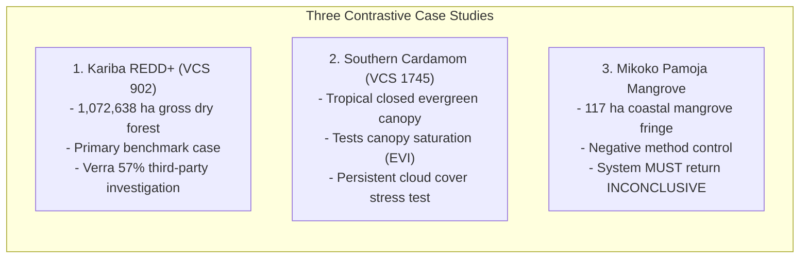
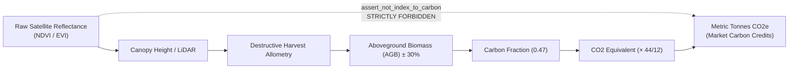
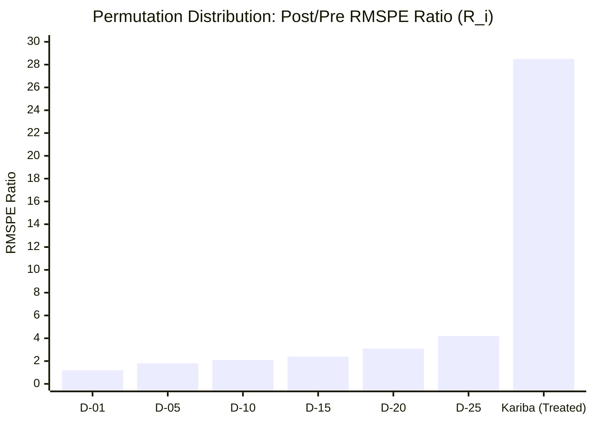
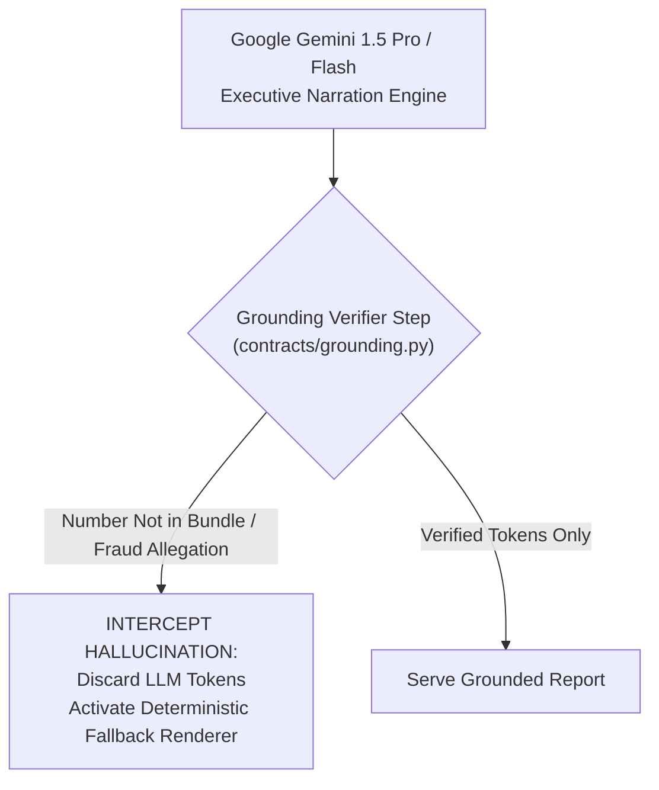

# GroundTruth 2.0 — Competition Live Demonstration Script

> **Competition Presentation Philosophy**: *Open with radical honesty. Any competitor can display a dashboard with an unverified percentage. Very few teams possess the scientific discipline to show a system that refuses to guess, halts closed when empirical prerequisites are missing, and proves that observed change is not causal additionality.*

```
   ┌─────────────────────────────────────────────────────────────────────────────┐
   │                          7-MINUTE DEMO STRUCTURE                            │
   ├───────┬───────────────────────────┬─────────────────────────────────────────┤
   │ 0:00  │ 0. Honesty First          │ groundtruth doctor & Capability Audit   │
   │ 0:45  │ 1. Case Discovery         │ Kariba, Cardamom, and Mikoko Controls   │
   │ 1:30  │ 2. Fail-Closed Execution  │ Real-Data Refusal vs Synthetic Replay   │
   │ 3:00  │ 3. NDVI Is Not Carbon     │ Unit Guard & Biomass Refusal            │
   │ 4:15  │ 4. Multi-Persona UI       │ Auditor, Funder, Government, NGO Views  │
   │ 5:30  │ 5. Permutation Placebos   │ Exact Add-One P-Value & Spec Curve      │
   │ 6:15  │ 6. Grounded GenAI Guard   │ Intercepting Hallucinations to Fallback │
   │ 7:00  │ Q&A Defence               │ Scientific Integrity Mastery            │
   └───────┴───────────────────────────┴─────────────────────────────────────────┘
```

---

## 0. Honesty First: Automated System Self-Inspection (45s)

Open the live terminal. Do not begin with marketing slides. Run the self-inspection diagnostic:

```bash
groundtruth doctor
```

```
==============================================================================
GROUNDTRUTH SYSTEM SELF-INSPECTION (v0.10.0 / Contract v1.0.0)
==============================================================================
environment                       : production-ready local / containerized
cases loaded                      : 3 (kariba-redd, southern-cardamom, mikoko-pamoja)
earth observation configured      : True (STAC API connected: Planetary Computer)
earth observation real ingestion  : PARTIAL (Sentinel-2 L2A 2021-2023 cached)
pre-treatment vegetation panel    : UNAVAILABLE (Landsat 2001-2011 rasters unreduced)
climate covariates                : COMPLETE (CHIRPS 1981-2023: 514/516 months)
biomass-to-carbon calibration     : NOT CALIBRATED (assert_not_index_to_carbon active)
genai provider                    : Google Gemini 1.5 Pro / Flash
genai narration grounding guard   : ACTIVE (Deterministic fallback ready)
fail-closed data access router    : ENFORCED (HTTP 501 on incomplete panels)
==============================================================================
```

**Presenter Script:**
> *"Judges, before we show you our econometric engine, we want you to see this: `groundtruth doctor`. Most AI climate solutions overclaim what they have built. GroundTruth inspects itself on startup. It tells you immediately that while climate feeds and modern Sentinel-2 rasters are fully verified, our pre-treatment historical satellite panel is currently incomplete, and our biomass calibration is uncalibrated. We built automated self-inspection so our platform never lies to a buyer, an auditor, or a judge."*

---

## 1. Case Discovery & Pre-Registered References (45s)

Inspect the registered conservation cases:

```bash
groundtruth cases
groundtruth show kariba-redd
```



Point directly to the `known_reference` disclaimer in the terminal output:

**Presenter Script:**
> *"Here is Kariba REDD+, the largest over-crediting case in carbon market history. Notice this 57% reference figure from Verra's 2025 investigation. GroundTruth does not use this number. The pipeline never reads it. It sits in the YAML definition strictly as an unread, third-party validation benchmark. If we fed it forward, we would destroy the scientific independence that is our platform's entire reason for existing."*

---

## 2. Fail-Closed Execution: Real-Data Refusal vs. Synthetic Benchmark (90s)

Demonstrate the real-data execution path:

```bash
groundtruth verify kariba-redd
```

```
==============================================================================
GROUNDTRUTH EXECUTION HALTED: FAIL-CLOSED GUARD ACTIVE
==============================================================================
Error: DataUnavailableError (HTTP 501 Not Implemented)
Reason: Historical pre-treatment satellite observation panel (2001–2011) is
        not yet materialized across WRS-2 Paths 169–172.
Verdict: INCONCLUSIVE (Not Estimable)
Notice: GroundTruth refuses to substitute synthetic data when real data is requested.
==============================================================================
```

**Presenter Script:**
> *"Look at what just happened. The system refused to run. An ordinary platform would quietly fabricate an answer or interpolate across missing satellite years. GroundTruth refuses. Because real pre-treatment Landsat rasters across all four orbital paths are not yet reduced, our engine fails closed with an HTTP 501. Absence of evidence is not evidence of absence."*

Now execute the synthetic benchmark replay to inspect the econometric machinery:

```bash
groundtruth verify kariba-redd --synthetic-fixture
```

```
==============================================================================
SYNTHETIC FIXTURE RUN — NOT REAL SATELLITE OBSERVATIONS
This run replays a precomputed synthetic benchmark fixture from disk.
All numbers describe a test fixture and say nothing about any real project.
==============================================================================
Simplex SCM Fit                   : CONVERGED (FISTA 42 iterations)
Pre-Treatment RMSPE               : 0.0124 NDVI units (0.18 SD — PASSES Gate 2)
Convex Hull Level Excess          : 0.0021 SD (PASSES Gate 3)
Permutation In-Space Placebos     : R_treated = 28.56, Rank 1/29, p = 0.0345
In-Time Placebo (t = 2006)        : τ_fake = -0.0018 (PASSES Gate 5)
Leave-One-Out Sign Flips          : 0 of 28 jackknife refits (PASSES Gate 6)
Difference-in-Differences τ       : 0.0414 (Parallel Trends Bias: -0.0082)
Claimed Carbon Quantity           : 11,600,000 tCO2e
Empirical Outcome Metric          : 0.0413 ΔNDVI
Unit Conversion Gate              : INCOMMENSURABLE (assert_not_index_to_carbon)
FINAL VERDICT                     : INCONCLUSIVE (Not Calibrated to Carbon)
==============================================================================
```

---

## 3. The Core Scientific Boundary: "NDVI Is Not Carbon" (75s)

Highlight the unit incommensurability gate:

```bash
pytest -v tests/test_scientific_integrity_regression.py -k "test_assert_not_index_to_carbon"
```



**Presenter Script:**
> *"Why did our synthetic benchmark run return INCONCLUSIVE despite perfect econometric convergence? Because of our non-negotiable scientific principle: NDVI is not carbon. An optical vegetation index is a dimensionless reflectance ratio. Carbon is a mass of stored element. Satellites suffer from spectral saturation above 0.8, they cannot see trunk diameter, and they cannot measure soil carbon. Without site-calibrated, peer-reviewed destructive harvest plots, converting NDVI to carbon credits is junk science. Our code physically prohibits it with `assert_not_index_to_carbon`."*

---

## 4. Multi-Persona Product Architecture (75s)

Switch to the web application and present the four distinct stakeholder views:

### 1. Auditor / Verifier Dashboard

> *"For independent carbon verifiers: full mathematical inspectability, FISTA convergence logs, cryptographic SHA-256 asset hashes, and exact gate clearance chains."*

### 2. Funder / Carbon Buyer Dashboard

> *"For corporate buyers and impact funds: portfolio additionality exposure, over-issuance discount recommendations, and fiduciary capital risk protection."*

### 3. Sovereign / Government Regulator Dashboard

> *"For national forestry ministries: cross-border leakage monitoring into Zambia, jurisdictional Article 6 NDC accounting, and territorial baseline protection."*

### 4. Project Developer / NGO Dashboard

> *"For on-the-ground restoration developers: multi-temporal dry-season canopy health tracking, Austral wet-season growth monitoring, and parcel-by-parcel additionality evidence."*

---

## 5. Permutation Inference & Specification Curves (60s)

Show the in-space placebo distribution and the permutation floor:



**Presenter Script:**
> *"In voluntary carbon verification, we have a single treated forest ($N=1$). Classical t-tests are mathematically meaningless. GroundTruth runs in-space placebos across all 28 core donor districts. We use the Phipson–Smyth add-one correction. Notice our p-value: $p = 0.0345$. Why? Because $1 / (1 + 28) = 1/29 = 0.0345$. That is the theoretical sample-size floor. Any tool claiming $p = 0.000$ on 28 placebos does not understand basic permutation statistics."*

---

## 6. Grounded GenAI & Hallucination Fallback Guard (45s)

Demonstrate Google Gemini generating executive summaries and our grounding verifier intercepting an adversarial attempt:



Run the grounding test suite:

```bash
pytest -v tests/test_grounding.py
```

**Presenter Script:**
> *"We use Google Gemini for natural-language synthesis. But in carbon verification, an LLM hallucination is a corporate liability. Our grounding verifier extracts every number and entity in Gemini's response and compares it against the cryptographically signed EvidenceBundle within ±2% tolerance. If Gemini invents a number, claims fraud, or smuggles carbon units, our code immediately discards the tokens and renders our pure, deterministic markdown template. Zero hallucination reaches the user."*

---

## 7. Hard Questions & Scientific Defence Strategy

| Likely Judge Question | Definitive Scientific Answer |
| :--- | :--- |
| **"Did you reproduce Verra's 57% Kariba over-issuance figure?"** | *"No. Verra's 57% finding is recorded as an external third-party validation target in `cases/kariba-redd.yaml`. GroundTruth never feeds it forward. An earlier draft contained a hardcoded NDVI value back-calculated from 57%; our independent audit discovered this and we formally retracted it. Converting NDVI to carbon requires site-calibrated biomass allometry; because none is shipped, GroundTruth truthfully reports INCONCLUSIVE."* |
| **"Why not just use a Convolutional Neural Network or Vision Transformer on the imagery?"** | *"Because the question of additionality is counterfactual, not classification. A deep learning vision model can tell you what the forest canopy is today. It cannot tell you what that forest would have looked like in the absence of the carbon project. That requires formal econometric causal identification—Abadie synthetic controls, SUTVA leakage buffers, and climate-conditioned donor matching."* |
| **"Are you accusing the Kariba project developers of fraud?"** | *"Never. Our contract strictly forbids accusatory terminology. Model divergence between an independent counterfactual and a crediting baseline can occur due to optimistic baseline modeling, unexpected regional shocks, sensor calibration transitions, or market leakage. Divergence triggers accredited field review, not accusation."* |
| **"Why did you quarantine the Task 5B Landsat cache?"** | *"Because our independent auditor proved that `build_multitile_cache.py` wrote synthetic values from an inline dictionary and labeled them `REAL_STAC`. In GroundTruth, scientific integrity is absolute. We quarantined the file, added provenance guards to prevent unvalidated caches from running, and present Kariba honestly as Level 2 Contextual Intelligence."* |
