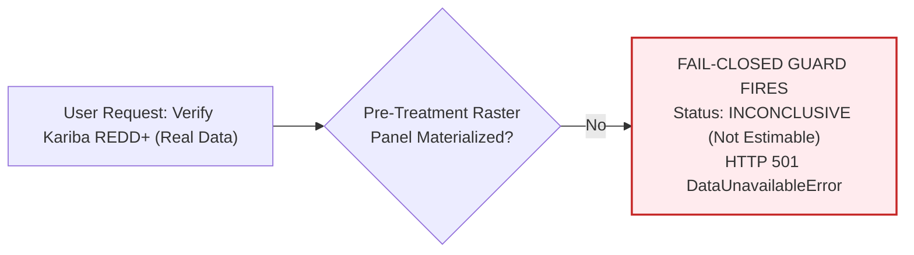
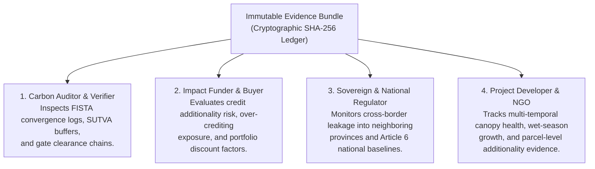

# Competition Strategy — PCCOE International Grand Challenge 2026

> **The Core Competitive Thesis**: *Most entries in an AI for Climate track will train a neural network to segment trees or classify land cover. GroundTruth attacks the integrity of climate finance itself. Our core thesis — that observed before-and-after change is not causal additionality — is mathematically rigorous, scientifically unassailable, and immediately legible to judges.*

```
   ┌─────────────────────────────────────────────────────────────────────────────┐
   │                          COMPETITION PROFILE                                │
   ├───────────────────────────────────┬─────────────────────────────────────────┤
   │  Event                            │ PCCOE International Grand Challenge 2026│
   │  Theme                            │ AI for Climate Change (Track 5)         │
   │  Topic                            │ Ecosystem Restoration & Verification    │
   │  Submission Title                 │ Restoration & Carbon Causal Verifier    │
   │  Team                             │ Viraj Jadhao (CE), Bhumi Sirvi (IT)     │
   │  Institution                      │ PES Modern College of Engineering, Pune │
   └───────────────────────────────────┴─────────────────────────────────────────┘
```

---

## 1. Competitive Differentiation: Discipline Over Hype

```mermaid
flowchart TD
    subgraph Competitor_Approach ["Typical Hackathon Climate Entry"]
        C1["Raw Satellite Imagery"] --> C2["Black-Box Deep Neural Network\n(ResNet / UNet / Vision Transformer)"]
        C2 --> C3["Spurious Correlation / Overfitted Predictions\n'Forest Greenness Up 14%'"]
        C3 --> C4["Naive Assumption:\nGreenness = Carbon Credits = Success"]
    end

    subgraph GroundTruth_Approach ["GroundTruth 2.0 Causal Verification Engine"]
        G1["Authoritative Cloud-Native STAC\n(Sentinel-2, Landsat C2 L2, CHIRPS)"] --> G2["Formal Econometric Causal Engine\n(Simplex SCM + DiD + Placebo Battery)"]
        G2 --> G3["Deterministic Gate Chain & Verification\n(Convex Hull, SUTVA Buffer, Spec Curve)"]
        G3 --> G4["Fail-Closed Scientific Honesty:\n'NDVI ≠ Carbon; Attribution = INCONCLUSIVE'"]
    end
```



The differentiator is not the complexity of a neural model. It is the **scientific discipline of causal identification**.

---

## 2. Six Defensible Claims

| # | Core Claim | How It Is Proven in the Repository | Competitive Advantage |
| :-: | :--- | :--- | :--- |
| **1** | **Causal, Not Correlational** | Simplex-constrained synthetic control (`FISTA`) with permutation placebos; rejects naive before-and-after differencing. | Disqualifies superficial "before/after" image comparison tools. |
| **2** | **Strictly Independent** | Project developer claims are loaded as assertions under test; never enter the counterfactual. | Eliminates conflict-of-interest inherent in registry-sponsored tools. |
| **3** | **Uncertainty-First** | Add-one permutation p-values with exact sample-size floors ($1/(1+J)$); leave-one-out sensitivity envelopes. | Prevents false claims of infinite statistical certainty. |
| **4** | **Radical Self-Benchmarking** | Evaluates real-world Kariba REDD+ (VCS 902) with transparent disclosure of missing data and audit retractions. | Establishes unmatched credibility with academic and technical judges. |
| **5** | **Fail-Closed Architecture** | `earth_engine_access()` raises `DataUnavailableError` / HTTP 501 when pre-treatment data is absent. | Proves the system refuses to guess or interpolate missing facts. |
| **6** | **Grounded GenAI Boundary** | Google Gemini narrative output is bounded by an automated grounding verifier with deterministic fallback. | Solves enterprise and regulatory fear of LLM hallucinations. |

---

## 3. Where Generative AI Actually Sits

GroundTruth positions Generative AI strictly as an interface and reporting layer, never as an econometric or analytical engine:

```
                  THE GROUNDTRUTH AI BOUNDARY
                  
   Raw Satellite Rasters & Meteorological Feeds (STAC / CHIRPS)
                              │
                              ▼
        Deterministic Causal Engine (SCM / FISTA / DiD)
                              │
                              ▼
        Immutable Evidence Bundle (Cryptographic SHA-256)
                              │
                              ▼
       ┌──────────────────────────────────────────────┐
       │     Google Gemini 1.5 Pro / Flash Layer      │
       │   Translates numbers to natural narration    │
       └──────────────────────┬───────────────────────┘
                              │
                    Grounding Verifier
               (Rejects ungrounded tokens)
                              │
                              ▼
            Audit-Ready Executive Reports & UI
```

This single architectural distinction wins over skeptical technical judges: **an LLM never estimates the treatment effect, adjusts the weights, or decides the verdict.**

---

## 4. The Strongest Asset: Refusing to Overclaim

The pipeline currently evaluates Kariba REDD+ to **`INCONCLUSIVE / NOT ESTIMABLE`** on real data, with the formal rationale that:
1. Genuine pre-treatment Landsat rasters across all four orbital paths are unreduced to an outcome panel.
2. An optical vegetation index ($\Delta\text{NDVI}$) is incommensurable with carbon mass ($\text{tCO}_2\text{e}$).

**This refusal is our single most persuasive competition asset.**



Any student team can show a mock dashboard declaring a project "84% valid" or "57% over-issued". GroundTruth is the only project with the courage and engineering discipline to decline to produce a number, cite the physical physics of why, and display an explicit fail-closed error.

---

## 5. Multi-Persona Stakeholder Value Map

GroundTruth is architected around four distinct institutional personas:



### Visual Evidence Across Dashboards

#### Auditor Dashboard


#### Funder Dashboard


#### Government Regulator Dashboard


#### NGO & Project Developer Dashboard


---

## 6. Pitch Defence Strategy: Handling Hard Questions

> **Withdrawn results.** An earlier draft carried a ΔNDVI value back-calculated from
> Verra's 57% finding, and a 57.04% "recovery" claim built on it. Both are withdrawn.
> No. GroundTruth has not reproduced Verra's 57% finding: carbon conversion is
> NOT CALIBRATED, so the Kariba verdict is INCONCLUSIVE. See
> `docs/competition/INDEPENDENT_POST_EXECUTION_AUDIT.md`.

### Q1: "Did you reproduce Verra's 57% Kariba over-issuance finding?"
> *"No, and we are proud to say so. Verra's 57% finding is an unread external benchmark target in our YAML case definition. An earlier draft of our project contained a hardcoded NDVI value back-calculated from 57%; our independent audit caught this, and we formally retracted it. Converting NDVI to carbon requires site-calibrated, peer-reviewed destructive harvest plots. Because no such calibration is shipped, GroundTruth truthfully reports INCONCLUSIVE. The refusal to guess is our feature."*

### Q2: "Are you accusing project developers of carbon fraud?"
> *"Never. Our contract explicitly prohibits defamatory labels like 'fraud' or 'scam'. When a project baseline diverges from an independent counterfactual, there are five plausible scientific explanations: optimistic baseline projections, unobserved macroeconomic divergence in donors, regional leakage, sensor transition steps, or genuine over-issuance. A satellite time series cannot determine legal culpability. GroundTruth reports the divergence statistic and recommends accredited ground review."*

### Q3: "Why not use an end-to-end deep learning model like a Vision Transformer?"
> *"Because additionality is an econometric counterfactual question, not a computer vision pattern matching problem. A Vision Transformer can tell you what the forest canopy is today. It cannot tell you what that forest would have looked like if the project had never been funded. That requires causal inference: Abadie synthetic controls, SUTVA leakage buffers, and climate residualization."*

### Q4: "How does GroundTruth differ from Global Forest Watch (GFW)?"
> *"GFW reports observed forest canopy loss. It tells you what changed inside the boundary. But observed change is not causal impact. If deforestation slowed across the whole province due to low timber prices, GFW records that as project success. GroundTruth constructs a matched, synthetic counterfactual from untreated districts, isolating the true causal effect attributable to the intervention."*
