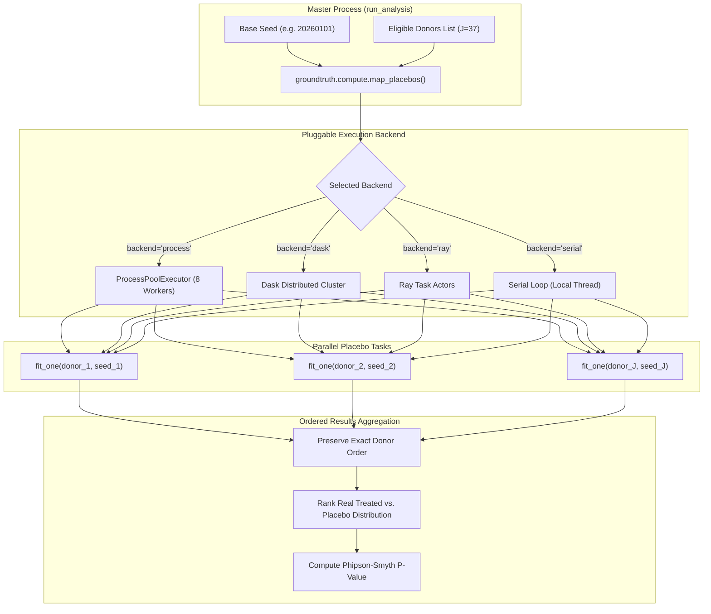

# Compute Backends & Parallel Permutation Execution

**Package**: `packages/groundtruth/src/groundtruth/compute/`  
**Supported Execution Backends**: `serial`, `process` (ProcessPoolExecutor), `dask` (Dask Distributed), `ray`.  
**Determinism**: Guaranteed across all backends via indexed PRNG derivation.

GroundTruth 2.0 provides an agnostic compute abstraction for parallelizing expensive permutation inference suites (such as fitting dozens of synthetic control models across candidate donor pools).




---

## 1. Unified Dispatch: `map_placebos`

The core function `groundtruth.compute.map_placebos(fn, items, backend, seed)` coordinates parallel execution:

```python
from groundtruth.compute import map_placebos

def fit_one_placebo(donor_id: str, item_seed: int) -> float:
    # Build donor pool excluding target, solve simplex SCM, return post/pre RMSPE ratio
    ...

# Executes across 8 concurrent workers with deterministic per-item seeds
ratios = map_placebos(
    fit_one_placebo,
    eligible_donor_ids,
    backend="process",
    seed=request.seed,
)
```

### 1.1 Invariant: Seed Independence from Concurrency
The random seed passed to each task depends strictly on `(base_seed, item_index)`:
$$\text{seed}_i = \text{hash}(\text{base\_seed}, i) \pmod{2^{31} - 1}$$

Because task seeds are tied to donor indices rather than worker process IDs or arrival order, the permutation distribution and resulting p-value are **bit-for-bit identical whether executed on a single laptop thread, an 8-core workstation, or a 100-node Ray cluster**.

---

## 2. Supported Compute Backends

| Backend | Flag | Requirements | Best Used For |
| :--- | :--- | :--- | :--- |
| **Serial** | `serial` | Standard Python library | Fast unit tests, CI debugging, low-memory environments |
| **Process Pool** | `process` | Standard Python `concurrent.futures` | Local developer workstations (empirically tuned to 8 workers) |
| **Dask** | `dask` | `pip install "dask[distributed]"` | Multi-node scientific HPC clusters |
| **Ray** | `ray` | `pip install ray` | Production cloud scale-out with dynamic actor scheduling |

If a distributed backend is selected but the corresponding library is not installed, GroundTruth 2.0 raises an explicit `ImportError` detailing the required `pip install` command, rather than silently falling back to serial execution.
