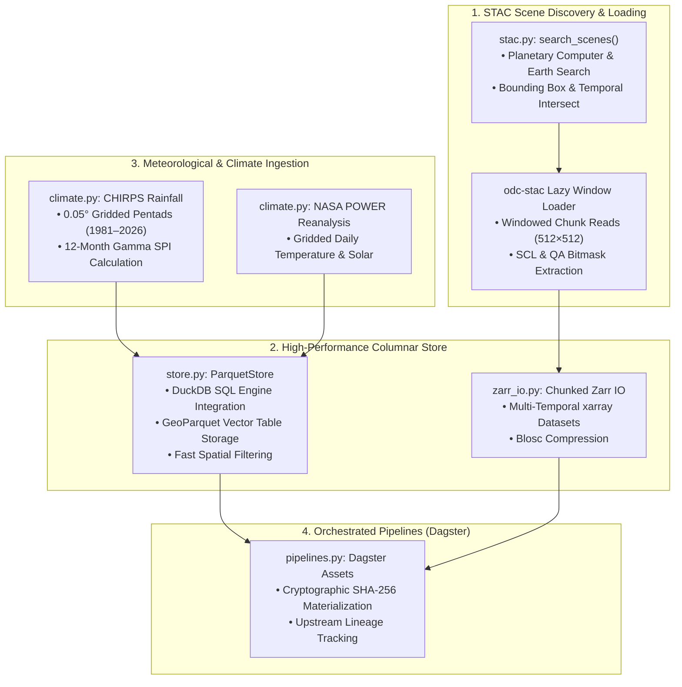

# Data Access Architecture & Ingestion Protocols

**Package**: `packages/groundtruth/src/groundtruth/data_access/`  
**Supported Storage Formats**: STAC Cloud-Optimized GeoTIFFs (COGs), GeoParquet (via DuckDB), Zarr Multi-Dimensional Grids, NetCDF.

The `data_access` package manages raw geospatial data discovery, atmospheric cache management, and multi-sensor dataset virtualization.

---

## 1. Modules & Components

| Module | Core Functionality | Primary Dependencies |
| :--- | :--- | :--- |
| `stac.py` | Spatio-temporal STAC querying (`search_scenes`) and lazy raster loading (`load_scenes`) | `pystac-client`, `odc-stac` |
| `store.py` | Embedded analytical query engine (`ParquetStore`) with SQL querying over local tables | `duckdb`, `pyarrow`, `geopandas` |
| `zarr_io.py` | Multi-dimensional chunked raster grid read/write operations (`write_zarr`, `read_zarr`) | `zarr`, `xarray` |
| `climate.py` | Long-term precipitation and drought index computation (CHIRPS SPI-12 gamma distribution) | `scipy`, `numpy` |
| `aoi_pipeline.py` | Whole-AOI multi-tile reduction, QA bitmasking, and annual compositing | `rasterio`, `shapely` |
| `pipelines.py` | Declarative Dagster data assets with automatic SHA-256 asset materialization | `dagster` |

---

## 2. Invariant: Fail-Closed on Data Unavailability

In `REAL_OBSERVATIONS` mode, the data access layer strictly enforces **fail-closed data boundaries**:
- If a STAC query returns zero scenes for an analysis year, the query **raises `DataUnavailableError`**.
- If a local cache file is corrupt or missing, the loader **raises `DataUnavailableError`**.
- It is strictly forbidden to silently impute missing satellite observations using linear interpolation, temporal splines, or synthetic fallback fixtures.
