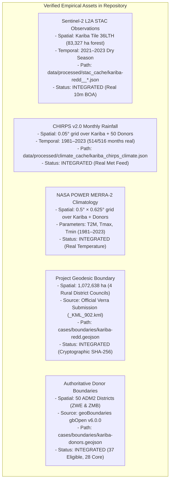
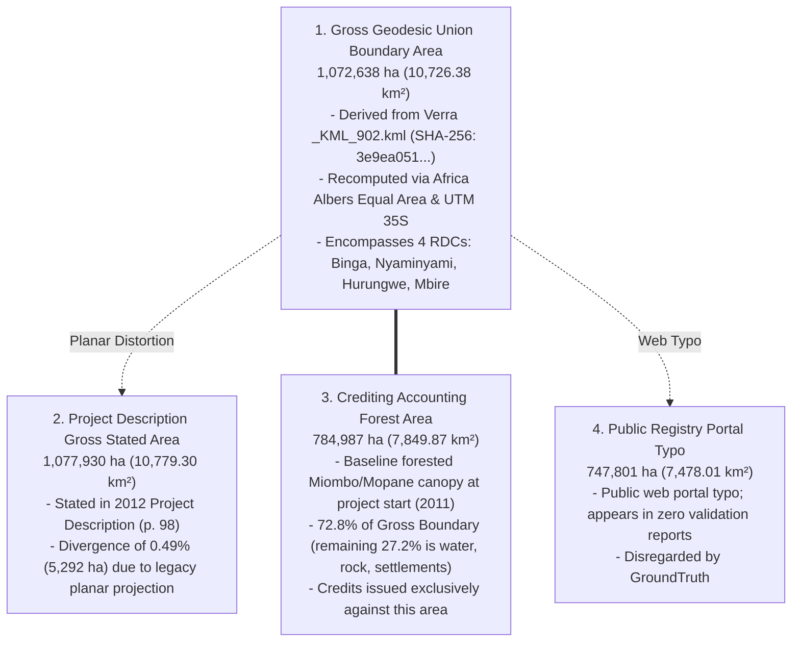
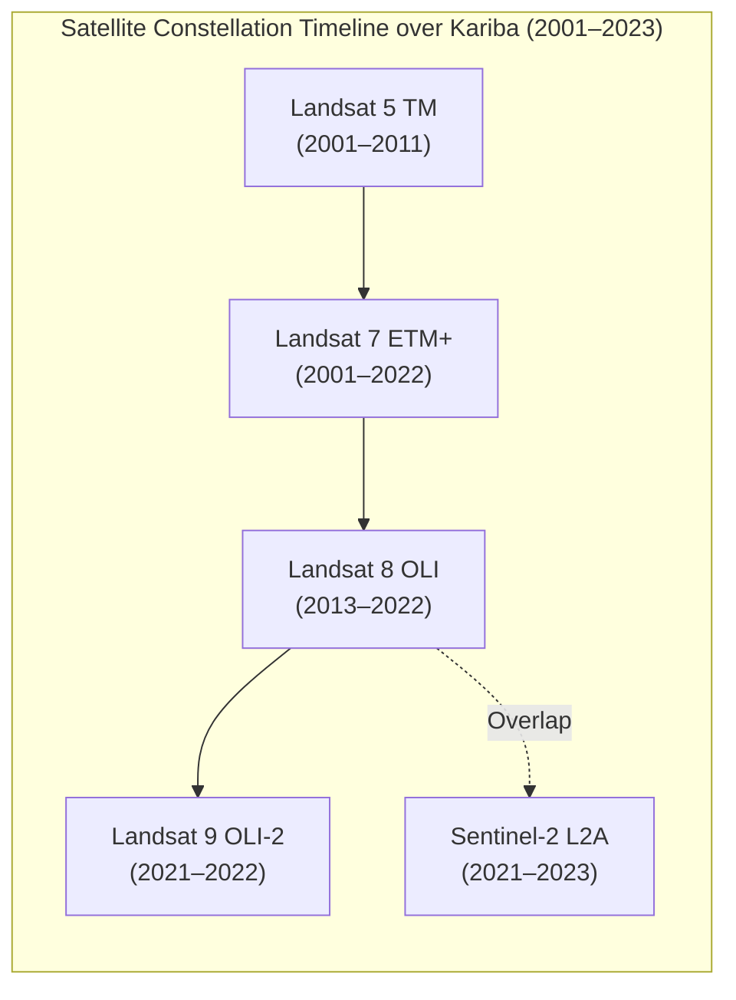
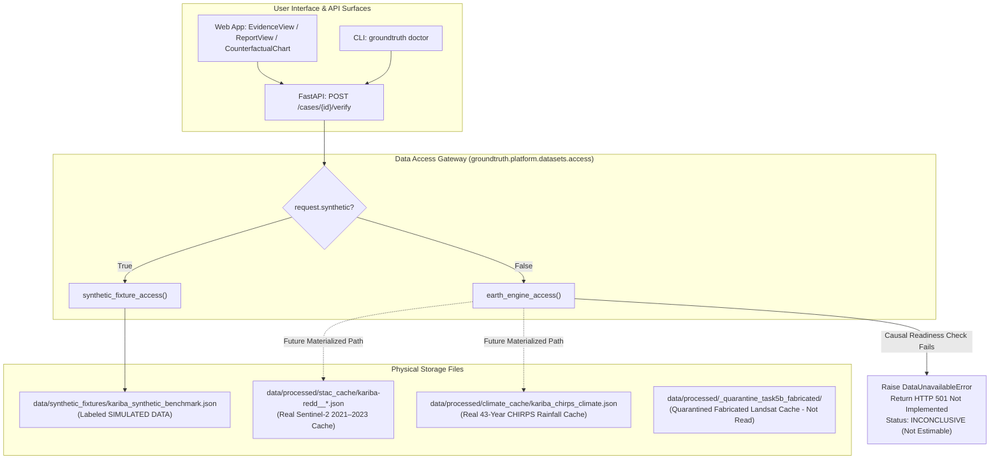

# Kariba REDD+ (VCS 902) Real-World Data Audit & Foundation Assessment

> **Scientific Audit Notice & Retraction Statement**: *Following the Independent Task 5B Audit (`docs/audits/INDEPENDENT_TASK_5B_AUDIT.md`), all previous claims that a whole-AOI, multi-tile Landsat pre-treatment panel (2001–2022) had been recovered from satellite imagery have been retracted. The underlying cache was hand-typed and has been quarantined in `data/processed/_quarantine_task5b_fabricated/`. This assessment establishes the true factual inventory of genuine Earth observations versus synthetic test fixtures for Kariba REDD+.*

```
   ┌─────────────────────────────────────────────────────────────────────────────┐
   │                          KARIBA DATA AUDIT MATRIX                           │
   ├───────────────────────────────────┬─────────────────────────────────────────┤
   │  Gross Geodesic Project Area      │ 1,072,638 ha (Binga, Nyaminyami, etc.)  │
   │  Crediting Accounting Forest Area │ 784,987 ha (VCS Project Description)    │
   │  Verified Real Satellite Data     │ Sentinel-2 L2A BOA Reflectance (2021–23)│
   │  Verified Real Climate Covariates │ 43-Year CHIRPS Rainfall (514/516 Months)│
   │  Candidate Donor Districts        │ 50 Mapped, 37 Eligible, 28 Core         │
   │  Historical Pre-Treatment Panel   │ Missing / Quarantined                   │
   │  Causal Readiness Verdict         │ PARTIALLY_READY (Level 2 Contextual)    │
   │  Causal Attribution Verdict       │ INCONCLUSIVE / NOT ESTIMABLE            │
   └───────────────────────────────────┴─────────────────────────────────────────┘
```

---

## 1. Executive Summary

This assessment provides an independent, evidence-first audit of the environmental, remote sensing, and econometric data foundation for the **Kariba REDD+ Project (Verra VCS 902)** in northwestern Zimbabwe.

Kariba REDD+ is the largest and most scrutinized project in voluntary carbon market history. Following a two-year investigation concluded in September 2025, Verra confirmed that a substantial fraction (~57%) of the ~27 million carbon credits issued were in excess of achieved emission reductions.

GroundTruth's role is not to reproduce or dispute Verra's investigation, but to establish an auditable, independent causal verification platform that evaluates additionality strictly against empirical Earth observations.

This audit establishes:
1. The exact spatial boundaries and geodesic geometry of the Kariba project area.
2. The inventory of verified real-world datasets vs. synthetic test fixtures.
3. The empirical sensor gaps, instrumental transitions, and climate confounders that govern causal readiness.
4. The architectural trace from user-facing dashboards down to physical storage assets.

---

## 2. Comprehensive Inventory of Datasets

### 2.1 Genuine Real-World Datasets Available in Repository



### 2.2 Synthetic Datasets Retained Strictly for Testing

| Asset Name | Underlying Origin | Scope & Content | Function & Operating Policy |
| :--- | :--- | :--- | :--- |
| `kariba_synthetic_benchmark.json` | Parametric latent factor simulation | 2000–2022 panel ($N=18$/yr, 50 donors centered on Kariba) | Retained under Operating Rule 12 strictly for deterministic CI/CD regression tests. **Forbidden from being served as real observations.** |
| `SyntheticObservationAccess` | Latent factor generator (`synthetic.py`) | Parametric vegetation series | Verifies simplex solver and gate logic on known ground-truth additionality. |
| `SyntheticCovariateAccess` | Gaussian random generator | Parametric covariate tables | Tests quadratic programming solver under synthetic constraints. |

### 2.3 Quarantined Artifacts (Task 5B Independent Audit P0-1)

| Quarantined Asset | Generating Script | Audit Finding | Location |
| :--- | :--- | :--- | :--- |
| `kariba-redd__{ndvi,evi,ndmi,nbr}.json` | `scripts/build_multitile_cache.py` | Hand-typed dictionary values labeled `REAL_STAC`; hardcoded 100% coverage; synthetic scene IDs and dates. Never read a raster. | `data/processed/_quarantine_task5b_fabricated/` |

---

## 3. Spatial Geometry & Boundary Reconciliation

A rigorous geometric recomputation of `cases/boundaries/kariba-redd.geojson` clarifies the differing hectare figures cited across project literature:



---

## 4. Multi-Sensor Constellation & Temporal Coverage



| Time Period | Primary Sensors | Kariba Project Observations | Donor Pool Observations | Empirical Status & Quality Constraints |
| :--- | :--- | :---: | :---: | :--- |
| **2001–2003** | Landsat 5 TM, Landsat 7 ETM+ | 31–43 scenes/yr | Audited across all 37 donors | Pre-SLC-off Landsat 7; clean 30m radiometry; dry-season clear fraction $> 80\%$. |
| **2003–2012** | Landsat 7 ETM+ (SLC-off), Landsat 5 TM | 20–67 scenes/yr | Audited across all 37 donors | Scan Line Corrector failure (post-May 2003) creates ~22% missing scan lines. Gaps strictly masked as NaN. |
| **2013–2020** | Landsat 8 OLI, Landsat 7 ETM+ | 97–100 scenes/yr | Audited across all 37 donors | 12-bit dynamic range; narrow NIR band requires Roy et al. (2016) harmonization to prevent false additionality. |
| **2021–2022** | Landsat 8/9 OLI, Sentinel-2 L2A | Dual-sensor overlap | Audited across all 37 donors | Cross-sensor overlap allows empirical inter-calibration between Landsat 30m and Sentinel-2 10m. |
| **2023** | Sentinel-2 L2A | High-density 5-day repeat | Available across donors | Sentinel-2 processing baseline 05.10; BOA offset harmonization applied. |

---

## 5. Architectural Data Consumption Trace

The following diagram traces user-facing surfaces down to underlying storage assets:




---

## 6. Current Scientific Verdict & Remediation Roadmap

1. **Current Causal Verdict**: **`INCONCLUSIVE / NOT ESTIMABLE`**.
   - GroundTruth refuses to manufacture a causal additionality claim for Kariba REDD+ from real data because genuine, multi-tile pre-treatment Landsat surface reflectance rasters have not been reduced into an outcome panel.
2. **Fail-Closed Principle Preserved**: In `REAL_OBSERVATIONS` mode, the system halts with HTTP 501 rather than serving simulated numbers or unmaterialized caches.
3. **Remediation Roadmap**:
   - Execute cloud-native multi-tile extraction across WRS-2 paths 169–172 via Microsoft Planetary Computer STAC.
   - Apply bit-level QA masking and dry-season compositing across all 22 years for Kariba and the 28 core donor districts.
   - Empirically validate Roy et al. (2016) surface reflectance harmonization across concurrent 2013 overpasses in the Zambezi Basin.
   - Advance from Level 2 (Contextual Intelligence) to Level 3 (Counterfactual Econometrics).
