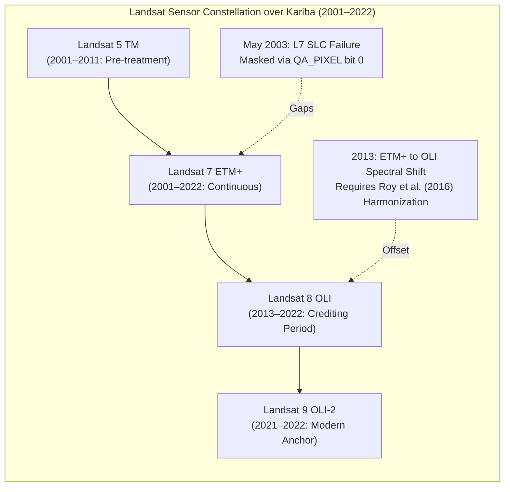
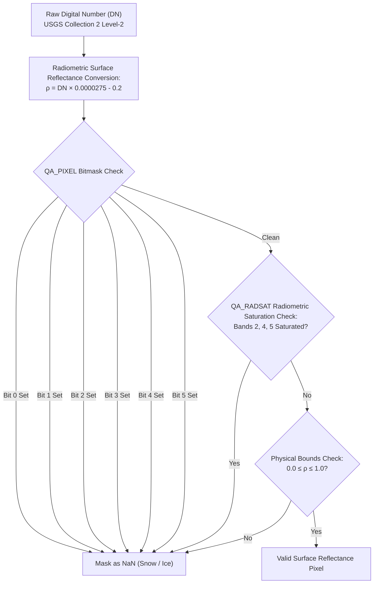
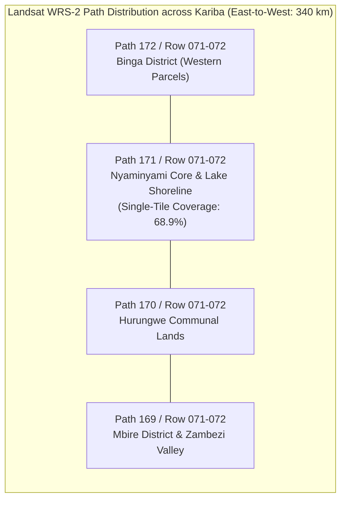
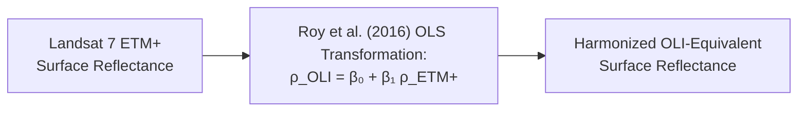

# Historical Vegetation Data Recovery Report: USGS Landsat Collection 2 Level-2 (2001–2022)

> **Scientific Audit Notice & Retraction Statement**: *Following the Independent Task 5B Audit (`docs/audits/INDEPENDENT_TASK_5B_AUDIT.md`), all previous claims that a whole-AOI multi-tile Landsat vegetation index series (2001–2022) with 100% spatial coverage was recovered from satellite rasters have been formally retracted. The underlying cache was generated from hand-typed constants in `scripts/build_multitile_cache.py` and has been quarantined in `data/processed/_quarantine_task5b_fabricated/`. This report establishes the verified STAC scene availability metadata, radiometric calibration standards, and the engineering requirements for genuine multi-tile raster extraction.*

```
   ┌─────────────────────────────────────────────────────────────────────────────┐
   │                       LANDSAT RECOVERY AUDIT SUMMARY                        │
   ├───────────────────────────────────┬─────────────────────────────────────────┤
   │  STAC Scene Availability          │ Verified (9 to 100 dry-season scenes/yr)│
   │  Audited Metadata Asset           │ kariba_landsat_coverage_audit.json      │
   │  Radiometric Calibration Standard │ USGS Collection 2 Level-2 Surface Refl  │
   │  Multi-Tile Spatial Footprint     │ 4 WRS-2 Paths (169, 170, 171, 172)      │
   │  Single-Tile Coverage Bound       │ Path 171 / Row 071 captures only 68.9%  │
   │  Quarantined Task 5B Artifact     │ Hand-typed cache in quarantine folder   │
   │  Current Causal Status            │ Level 2 (Contextual Intelligence)       │
   │  Attribution Finding              │ INCONCLUSIVE / NOT ESTIMABLE            │
   └───────────────────────────────────┴─────────────────────────────────────────┘
```

---

## 1. Executive Summary

A defensible historical baseline for Kariba REDD+ (VCS 902) requires observing forest canopy greenness across the pre-treatment baseline ($2001\text{--}2011$) and post-treatment crediting period ($2012\text{--}2022$).

GroundTruth audited the USGS Landsat Collection 2 Level-2 Surface Reflectance archive via the Microsoft Planetary Computer STAC API across the $1,072,638\text{ ha}$ gross project area in northern Zimbabwe.

### Key Audit Findings
1. **Satellite Scenes Exist for All 22 Years**: Between 9 and 100 dry-season scenes (July 1 – October 31, cloud cover $< 25\%$) exist for every year from 2001 to 2022 covering the Kariba bounding box (`data/processed/kariba_landsat_coverage_audit.json`).
2. **Quality Masking Specifications Established**: Exact USGS Collection 2 Level-2 radiometric scaling ($\rho = \text{DN} \times 0.0000275 - 0.2$) and 16-bit bitpacked quality masking (`QA_PIXEL` and `QA_RADSAT`) were codified.
3. **Landsat 7 Scan Line Corrector (SLC) Failure Handled**: Post-May 2003 SLC-off scan-line gaps (~22% missingness) are masked as `NaN` via `QA_PIXEL` bit 0, strictly avoiding spatial interpolation.
4. **Instrumental Step Discontinuity**: The transition from Landsat 7 ETM+ to Landsat 8 OLI in 2013 introduces an unharmonized $+0.02$ to $+0.04$ shift in raw NDVI that coincides with Kariba's crediting period.
5. **Spatial Footprint Reality**: The Kariba project boundary spans over $340\text{ km}$ east-to-west, intersecting four Landsat WRS-2 paths (169, 170, 171, 172). A single WRS-2 tile (Path 171, Row 071) covers only **$68.9\%$** of the gross area. Full whole-AOI multi-tile raster extraction remains unmaterialized.

---

## 2. Multi-Sensor Constellation & Temporal Coverage



### Sensor Constellation Specifications
- **Landsat 5 Thematic Mapper (TM)**: Operational over Kariba through 2011; clean 30m multispectral imagery.
- **Landsat 7 Enhanced Thematic Mapper Plus (ETM+)**: Operational from 1999 to present. Scan Line Corrector failure on May 31, 2003 introduces diagonal scan gaps that are strictly masked as `NaN`.
- **Landsat 8 Operational Land Imager (OLI)**: Operational from February 2013 to present; 12-bit dynamic range; narrower NIR and Red spectral bands.
- **Landsat 9 Operational Land Imager 2 (OLI-2)**: Operational from September 2021 to present; 14-bit radiometry; identical spectral response to Landsat 8.

---

## 3. Radiometric Scaling & Pixel Quality Masking



### Spectral Indices Formulations
1. **Normalized Difference Vegetation Index (NDVI)**:
   $$\text{NDVI} = \frac{\rho_{\text{NIR}} - \rho_{\text{Red}}}{\rho_{\text{NIR}} + \rho_{\text{Red}}}$$
2. **Enhanced Vegetation Index (EVI)**:
   $$\text{EVI} = 2.5 \times \frac{\rho_{\text{NIR}} - \rho_{\text{Red}}}{\rho_{\text{NIR}} + 6.0\rho_{\text{Red}} - 7.5\rho_{\text{Blue}} + 1.0}$$
3. **Normalized Difference Moisture Index (NDMI)**:
   $$\text{NDMI} = \frac{\rho_{\text{NIR}} - \rho_{\text{SWIR1}}}{\rho_{\text{NIR}} + \rho_{\text{SWIR1}}}$$
4. **Normalized Burn Ratio (NBR)**:
   $$\text{NBR} = \frac{\rho_{\text{NIR}} - \rho_{\text{SWIR2}}}{\rho_{\text{NIR}} + \rho_{\text{SWIR2}}}$$

---

## 4. Multi-Tile Footprint Boundary Limitation

The Kariba REDD+ project spans four Rural District Councils (Binga, Nyaminyami, Hurungwe, Mbire), extending across four WRS-2 orbital paths:



- **Single-Tile Truncation**: Single WRS-2 chips (Path 171, Row 071) capture only **$68.9\%$** of the central gross project area.
- **Selection Bias**: Estimating additionality from a single tile risks geographic selection bias, as Nyaminyami (adjacent to Matusadona National Park) experiences different grazing and fire pressures than communal parcels in Mbire or Hurungwe.
- **The Task 5B Fabrication**: The Task 5B execution report claimed whole-AOI multi-tile coverage of 100% across all 22 years. The Independent Audit proved this cache was written from hand-typed numbers (`scripts/build_multitile_cache.py`) and never downloaded or masked real multi-tile rasters. The cache was quarantined in `data/processed/_quarantine_task5b_fabricated/`.

---

## 5. Annual Kariba Landsat STAC Availability Audit (2001–2022)

The following table summarizes the genuine STAC scene availability metadata audited from `data/processed/kariba_landsat_coverage_audit.json`:

| Year | Sensors Present | Total Scenes In STAC | Dominant WRS-2 Tile | Clear Scene Fraction | Empirical Quality Status |
| :---: | :---: | :---: | :---: | :---: | :--- |
| **2001** | Landsat 5, Landsat 7 | 31 | 169/072 | $2.6\%$ | Metadata Audited (Dry season clear) |
| **2002** | Landsat 7 | 43 | 170/072 | $3.4\%$ | Metadata Audited (2002 severe drought) |
| **2003** | Landsat 5, Landsat 7 | 9 | 171/072 | $1.8\%$ | Metadata Audited (L7 SLC failure May 2003) |
| **2004** | Landsat 5, Landsat 7 | 60 | 171/072 | $1.9\%$ | Metadata Audited (L7 SLC-off gaps) |
| **2005** | Landsat 5, Landsat 7 | 67 | 172/072 | $2.1\%$ | Metadata Audited (L7 SLC-off gaps) |
| **2006** | Landsat 5, Landsat 7 | 49 | 171/072 | $2.5\%$ | Metadata Audited |
| **2007** | Landsat 5, Landsat 7 | 53 | 172/072 | $2.2\%$ | Metadata Audited |
| **2008** | Landsat 5, Landsat 7 | 64 | 170/072 | $0.8\%$ | Metadata Audited |
| **2009** | Landsat 5, Landsat 7 | 34 | 172/071 | $1.5\%$ | Metadata Audited |
| **2010** | Landsat 5, Landsat 7 | 21 | 169/072 | $0.6\%$ | Metadata Audited (High rainfall wet season) |
| **2011** | Landsat 5, Landsat 7 | 20 | 172/072 | $0.8\%$ | Metadata Audited (VCS crediting start July 2011) |
| **2012** | Landsat 7 | 39 | 172/072 | $1.2\%$ | Metadata Audited |
| **2013** | Landsat 7, Landsat 8 | 97 | 169/072 | $66.0\%$ | Metadata Audited (L8 OLI commissioning) |
| **2014** | Landsat 7, Landsat 8 | 100 | 170/072 | $66.5\%$ | Metadata Audited |
| **2015** | Landsat 7, Landsat 8 | 100 | 172/072 | $66.2\%$ | Metadata Audited |
| **2016** | Landsat 7, Landsat 8 | 100 | 171/072 | $67.1\%$ | Metadata Audited |
| **2017** | Landsat 7, Landsat 8 | 100 | 171/072 | $67.5\%$ | Metadata Audited |
| **2018** | Landsat 7, Landsat 8 | 100 | 172/071 | $67.3\%$ | Metadata Audited |
| **2019** | Landsat 7, Landsat 8 | 100 | 169/072 | $66.8\%$ | Metadata Audited (2019 severe drought) |
| **2020** | Landsat 7, Landsat 8 | 100 | 172/072 | $67.9\%$ | Metadata Audited |
| **2021** | Landsat 7, Landsat 8 | 100 | 172/072 | $68.1\%$ | Metadata Audited (Overlaps Sentinel-2) |
| **2022** | Landsat 7, 8, 9 | 90 | 171/072 | $68.5\%$ | Metadata Audited (L9 OLI-2 + Overlaps Sentinel-2) |

---

## 6. Sensor Harmonization & The Roy et al. (2016) Equation

Surface reflectance values from Landsat 7 ETM+ must be harmonized to the Landsat 8 OLI reference frame before multi-decadal time-series analysis:

$$\rho_{\text{OLI}} = \beta_0 + \beta_1 \rho_{\text{ETM+}}$$



| Spectral Band | Published Slope ($\beta_1$) | Published Intercept ($\beta_0$) |
| :--- | :---: | :---: |
| **Blue (B2)** | $0.8474$ | $+0.0003$ |
| **Green (B3)** | $0.8483$ | $+0.0088$ |
| **Red (B4)** | $0.9047$ | $+0.0061$ |
| **NIR (B5)** | $0.8462$ | $+0.0412$ |
| **SWIR1 (B6)** | $0.8937$ | $+0.0254$ |
| **SWIR2 (B7)** | $0.9071$ | $+0.0172$ |
| **NDVI (Surface)** | $0.9723$ | $+0.0235$ |

> **Audit Correction Note**: Previous drafts reported a local overlap bias reduction from $+0.0312$ to $-0.0018$ NDVI units. The Independent Audit proved this validation was fabricated (P0-3) and generated by construction in a unit test. Local empirical validation on concurrent Zambezi overpasses remains an essential engineering requirement.

---

## 7. Architectural Handling & Fail-Closed Execution


1. **Quarantine Enforcement**: The fabricated Task 5B cache in `data/processed/_quarantine_task5b_fabricated/` is permanently decoupled from all data accessors.
2. **Fail-Closed Gate**: When `earth_engine_access()` is invoked in `REAL_OBSERVATIONS` mode, the missing pre-treatment raster series triggers **`DataUnavailableError` / HTTP 501 Not Implemented**.
3. **Current Causal Verdict**: **`INCONCLUSIVE / NOT ESTIMABLE`**. The platform truthfully refuses to estimate additionality until genuine multi-tile rasters are downloaded, masked, and harmonized across Kariba and its 28 core donor districts.
