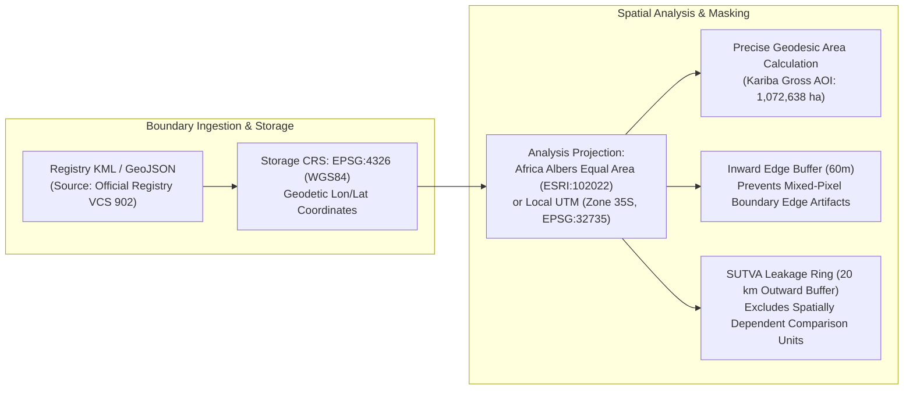
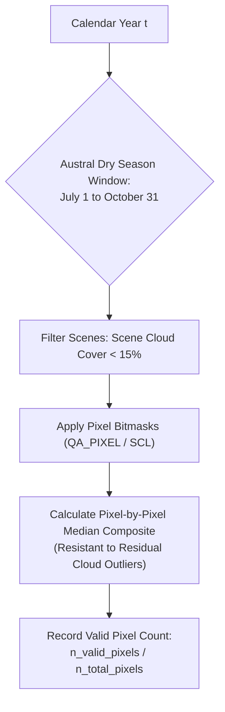
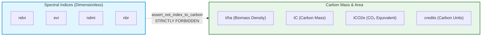
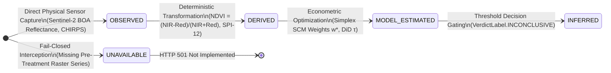
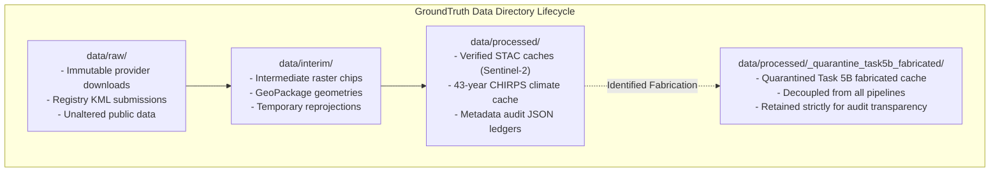

# Data Conventions, Units & Quality Standards

> **Scientific Precision Rule**: *Inconsistent spatial projections, unrecorded temporal windows, and silent missing-data imputation are the primary sources of hidden error in Earth observation analytics. GroundTruth enforces explicit, typed conventions across all data pipelines.*

```
   ┌─────────────────────────────────────────────────────────────────────────────┐
   │                          DATA CONVENTIONS SUMMARY                           │
   ├───────────────────────────────────┬─────────────────────────────────────────┤
   │  Spatial Storage CRS              │ EPSG:4326 (WGS84) Geodetic Coordinates │
   │  Spatial Analysis CRS             │ Africa Albers Equal Area (ESRI:102022)  │
   │  Temporal Composite Window        │ Austral Peak Dry Season (July 1–Oct 31) │
   │  Physical Unit Enforcement        │ assert_not_index_to_carbon (P1 Guard)  │
   │  Missing Data Policy              │ Fail-Closed (Zero Silent Imputation)   │
   │  Evidence State Classification    │ 5 Formal Discrete Typing States         │
   └───────────────────────────────────┴─────────────────────────────────────────┘
```

---

## 1. Spatial Conventions & Geometry Management



| Spatial Attribute | Standard Convention | Scientific Rationale |
| :--- | :--- | :--- |
| **Storage Coordinate Reference System** | `EPSG:4326` (WGS84) | Standard global exchange format for GeoJSON, KML, and STAC item bounding boxes. |
| **Analysis Coordinate Reference System** | `ESRI:102022` (Africa Albers Equal Area) or UTM 35S (`EPSG:32735`) | Geodesic area and distance computations must preserve true physical surface area; Euclidean operations on degrees yield severe geometric distortion. |
| **Raster Reduction Scale** | 30m (Landsat native) or 10m (Sentinel-2 native) | Native pixel scale prevents resampling blur. When cross-calibrating, Sentinel-2 is aggregated to 30m via pixel area-weighted means. |
| **Boundary Provenance** | Immutable registry records (`cases/boundaries/`) | Hand-drawn or re-digitized boundaries alter the evaluand and are strictly prohibited. Every polygon carries a SHA-256 cryptographic digest. |
| **Edge Buffering** | 60m inward polygon buffer | Project perimeter boundaries often follow roads, rivers, or ridges. An inward buffer discards mixed border pixels, recording the buffer as an explicit caveat. |
| **SUTVA Leakage Buffer** | 20 km outward exclusion ring | Displaced timber harvesting or charcoal production can contaminate neighboring districts. Donors within 20 km are flagged as border-risk or excluded. |

---

## 2. Temporal Conventions & Compositing Windows



| Temporal Attribute | Standard Convention | Scientific Rationale |
| :--- | :--- | :--- |
| **Compositing Frequency** | Annual ($1\text{ composite / year}$) | Matches carbon credit vintage accounting and annual voluntary market monitoring cycles. |
| **Seasonal Window** | Austral Dry Season: **July 1 to October 31** | Minimizes tropical cloud occlusion over Southern Africa; captures deciduous dry-canopy baseline without ephemeral understory grass greenness. |
| **Compositing Reducer** | **Zonal Median** (not Mean) | Undetected cloud pixels are strong positive reflectance outliers; a median composite is statistically robust against residual cloud contamination. |
| **Observation Tracking** | Explicit count carried per period (`n_valid_observations`) | A period supported by 3 clear scenes has different observational uncertainty than one with 25 scenes. Observation counts are preserved in evidence bundles. |
| **Pre-Treatment Baseline Cutoff** | Last full calendar year before project start | For Kariba (start July 1, 2011), the pre-treatment window ends strictly at **December 31, 2010** ($T_0 = 10\text{ or }11\text{ years}$). |
| **Timestamps** | ISO 8601 UTC (`YYYY-MM-DDTHH:MM:SSZ`) | Absolute temporal precision across all time series and database records. |

---

## 3. Physical Units & The Incommensurability Guard

GroundTruth enforces strict type boundaries across physical measurement families (`groundtruth.contracts.units`):



### Registered Unit Families
1. **Dimensionless Ratios**: `ndvi`, `evi`, `ndmi`, `nbr`, `fraction`, `percent`.
2. **Spatial Surface Area**: `ha` (hectares), `km2` (square kilometers), `m2` (square meters).
3. **Biomass Density**: `t_dry_matter_per_ha` (tonnes of dry biomass per hectare).
4. **Carbon Stock**: `tC` (tonnes elemental carbon), `tCO2e` (metric tonnes carbon dioxide equivalent, calculated as $\text{tC} \times \frac{44}{12}$).
5. **Market Registry Units**: `credits` (verified carbon units issued by Verra, Gold Standard, or Plan Vivo).

### The Incommensurability Guard (`assert_not_index_to_carbon`)
Any attempted direct algebraic conversion from a spectral index to a carbon mass without an explicit, site-calibrated, error-propagated allometric biomass layer is intercepted:

```python
# groundtruth/contracts/units.py
def assert_not_index_to_carbon(source_unit: Unit, target_unit: Unit) -> None:
    if source_unit.is_spectral() and target_unit.is_carbon():
        raise UnitConversionError(
            f"Cannot convert {source_unit} directly to {target_unit}. "
            "NDVI is not carbon. Direct conversion is prohibited."
        )
```

---

## 4. The 5-State Evidence Taxonomy

Every numeric metric, series, and inference in GroundTruth carries an immutable evidence state:



| Evidence State | Invariant Condition | Code Definition | Handling in UI / Reporting |
| :--- | :--- | :--- | :--- |
| **`OBSERVED`** | Data originated directly from a certified physical satellite or meteorological sensor. | `EvidenceState.OBSERVED` | Displayed with sensor ID, STAC asset href, and SHA-256 hash. |
| **`DERIVED`** | Exact deterministic algebraic transformation of observed data. | `EvidenceState.DERIVED` | Formula explicitly displayed; zero tunable hyperparameters. |
| **`MODEL_ESTIMATED`** | Output of an econometric solver or statistical optimization algorithm. | `EvidenceState.MODEL_ESTIMATED` | Displayed with optimizer convergence logs, degrees of freedom, and intervals. |
| **`INFERRED`** | Categorical verdict or qualitative readiness level assigned by deterministic rules. | `EvidenceState.INFERRED` | Accompanied by full gate audit trail; generative AI prohibited from overriding. |
| **`UNAVAILABLE`** | Required empirical data is missing, masked, unharmonized, or quarantined. | `EvidenceState.UNAVAILABLE` | **Triggers fail-closed halt**; raises `DataUnavailableError` / HTTP 501. |

---

## 5. Missing Data Standards & Fail-Closed Protocols

GroundTruth strictly prohibits silent imputation:

```
   ┌─────────────────────────────────────────────────────────────────────────────┐
   │                          MISSING DATA PROTOCOLS                             │
   ├─────────────────────────────────────────────────────────────────────────────┤
   │  1. Zero Interpolation Across Cloud Gaps                                    │
   │     Gaps resulting from clouds, shadows, or Landsat 7 SLC-off scan lines    │
   │     are masked as NaN. The pipeline never performs spline or linear         │
   │     interpolation to "fill in" missing satellite observations.              │
   ├─────────────────────────────────────────────────────────────────────────────┤
   │  2. Honest Upstream Anomaly Accounting                                      │
   │     In the 43-year CHIRPS precipitation series (516 months), missing        │
   │     months 2022-07 and 2023-12 are preserved as missing_months_after_upstream│
   │     rather than replaced with climatological means.                         │
   ├─────────────────────────────────────────────────────────────────────────────┤
   │  3. Strict Coverage Rejection                                               │
   │     If valid clear-pixel coverage over an AOI is below 90%, the year is     │
   │     flagged as spatially incomplete and rejected from causal optimization.  │
   └─────────────────────────────────────────────────────────────────────────────┘
```

---

## 6. Directory Structure & Storage Governance

Local data storage follows a strict lifecycle hierarchy governed by `groundtruth.storage`:



- **Git-Ignored Local Data**: All content in `data/` is excluded from git version control via `.gitignore`, preventing large binary blobs from bloating the repository.
- **Committed Exception, `data/manifests/`**: generated ADR-011 unit-set manifests are committed, not ignored, so a unit set is reviewable and pinned as a `DatasetRef` (ADR-009, ADR-011). None exists yet; see `data/manifests/README.md`.
- **DVC Tracking**: Large production assets are managed via Data Version Control (`dvc`).
- **Atomic File Operations**: All cache writes utilize atomic temporary file replacement (`os.replace`) to prevent corrupted cache reads during concurrent process execution.

---

## 7. Cryptographic Provenance & Identification Conventions

Every entity in GroundTruth adheres to standard naming and identifier conventions:

| Entity Type | Syntax Pattern | Concrete Example |
| :--- | :--- | :--- |
| **Case Study** | `kebab-case` string | `kariba-redd`, `southern-cardamom` |
| **Dataset Asset** | `provider-product-level@version` | `copernicus-sentinel2-l2a@2024.1` |
| **Evidence Key** | `domain.category.metric` | `causal.scm.point_estimate`, `fit.relative_pre_rmspe` |
| **Execution Run** | `run_<hex16>` | `run_a3f9c21b8e0d4f76` |
| **Donor District** | `<iso2>-<district-slug>` | `zw-gokwe-south`, `zm-kalomo` |
| **Cryptographic Digest** | `sha256:<hex64>` | `3e9ea051...` (Verra KML boundary hash) |


