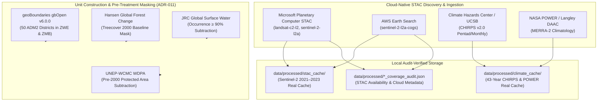
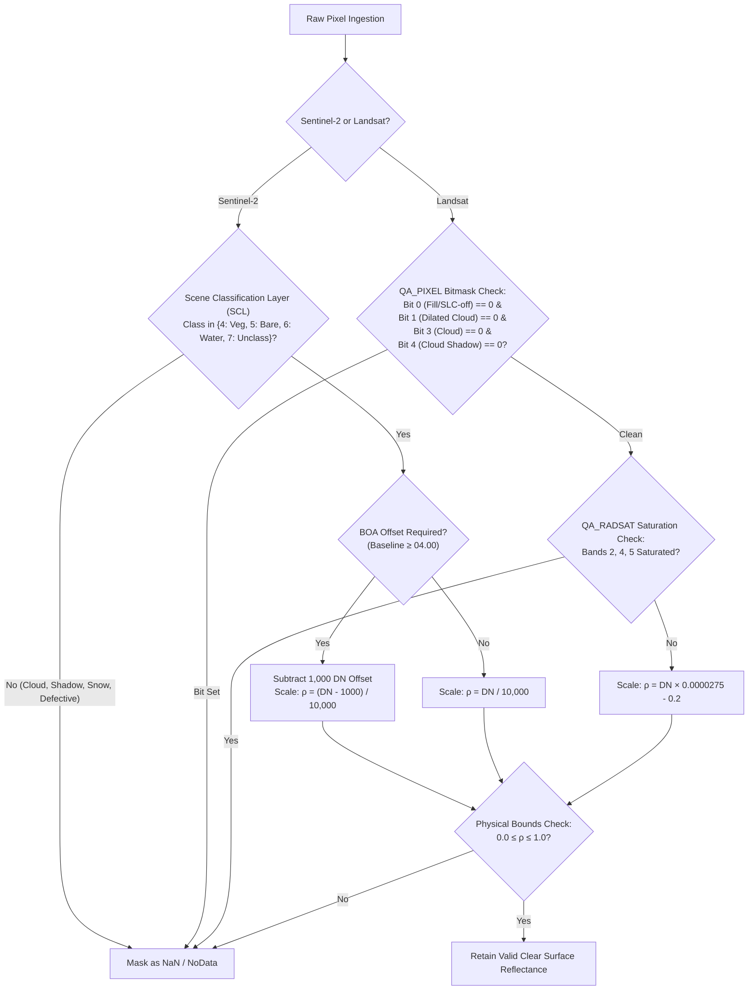
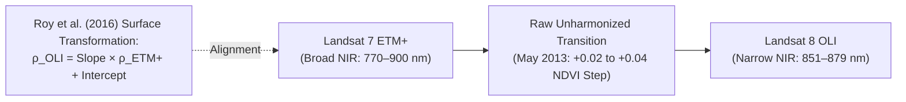
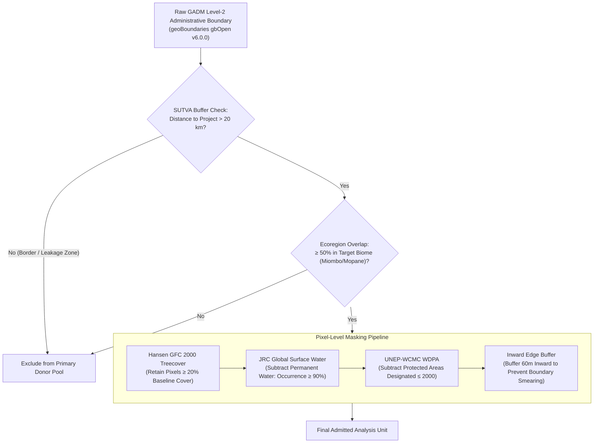

# Authoritative Data Sources & Acquisition Protocols

> **Scientific Provenance Rule**: *Every ecological indicator, climate covariate, and geographic boundary in GroundTruth must be backed by an immutable, authoritative, and reproducible public data asset with cryptographic SHA-256 provenance.*

```
   ┌─────────────────────────────────────────────────────────────────────────────┐
   │                          DATA SOURCE TAXONOMY                               │
   ├───────────────────────────────────┬─────────────────────────────────────────┤
   │  Remote Sensing Imagery           │ Sentinel-2 L2A, Landsat 5/7/8/9 C2 L2   │
   │  Climate Covariates               │ CHIRPS v2.0 Pentad, NASA POWER MERRA-2  │
   │  Terrain & Geophysical            │ NASA SRTMGL1 v003 (30m)                 │
   │  Administrative Boundaries        │ geoBoundaries gbOpen v6.0.0 (ADM2)      │
   │  Baseline Masking Layers          │ Hansen GFC 2000, JRC GSW, WDPA Pre-2000 │
   │  Anthropogenic Pressure           │ OpenStreetMap Road Network, WorldPop    │
   └───────────────────────────────────┴─────────────────────────────────────────┘
```

---

## 1. Multi-Source Ingestion Architecture

GroundTruth acquires Earth observations and environmental covariates through cloud-native SpatioTemporal Asset Catalog (STAC) endpoints and authoritative scientific repositories:



---

## 2. Satellite Remote Sensing Imagery

### 2.1 Sensor Constellation Characteristics

| Platform | Sensor | Processing Level | Spectral Bands (Primary) | Spatial Resolution | Repeat Cycle | Operating Era | GroundTruth Role |
| :--- | :--- | :--- | :--- | :---: | :---: | :---: | :--- |
| **Sentinel-2A/B** | MSI | Level-2A BOA Reflectance | B2, B3, B4, B8, B11, B12, SCL | 10m / 20m | 5 days | 2015–present | High-resolution post-treatment anchor (2021–2023 integrated) |
| **Landsat 9** | OLI-2 | Collection 2 Level-2 SR | B2, B3, B4, B5, B6, B7, QA | 30m | 16 days | 2021–present | Modern 14-bit radiometry cross-calibration |
| **Landsat 8** | OLI | Collection 2 Level-2 SR | B2, B3, B4, B5, B6, B7, QA | 30m | 16 days | 2013–present | Post-treatment crediting verification |
| **Landsat 7** | ETM+ | Collection 2 Level-2 SR | B1, B2, B3, B4, B5, B7, QA | 30m | 16 days | 1999–present | Historical baseline (SLC-off post May 2003) |
| **Landsat 5** | TM | Collection 2 Level-2 SR | B1, B2, B3, B4, B5, B7, QA | 30m | 16 days | 1984–2012 | Deep historical baseline reconstruction |

### 2.2 Quality Masking & Cloud Screening Invariants

Every optical pixel processed by GroundTruth must clear rigorous quality bitmasks before contributing to annual composites:



---

## 3. Sensor Harmonization Requirements (Roy et al. 2016)

The transition between sensor generations introduces systematic instrumental shifts in spectral response functions (SRFs). The narrower near-infrared (NIR) band of Landsat 8 OLI relative to Landsat 7 ETM+ produces an unharmonized raw NDVI increase of $+0.02$ to $+0.04$ over identical vegetation canopies.



### Published Roy et al. (2016) Surface Reflectance Coefficients

Surface reflectance transformation equations from Landsat 7 ETM+ to Landsat 8 OLI (Roy et al. 2016, Table 2, OLS Surface Reflectance):

$$\rho_{\text{OLI}} = \beta_0 + \beta_1 \rho_{\text{ETM+}}$$

| Band | Published OLS Slope ($\beta_1$) | Published OLS Intercept ($\beta_0$) | Published RMA Slope | Published RMA Intercept |
| :--- | :---: | :---: | :---: | :---: |
| **Blue (B2)** | $0.8474$ | $+0.0003$ | $0.8805$ | $-0.0016$ |
| **Green (B3)** | $0.8483$ | $+0.0088$ | $0.8718$ | $+0.0069$ |
| **Red (B4)** | $0.9047$ | $+0.0061$ | $0.9197$ | $+0.0049$ |
| **NIR (B5)** | $0.8462$ | $+0.0412$ | $0.8935$ | $+0.0251$ |
| **SWIR1 (B6)** | $0.8937$ | $+0.0254$ | $0.9254$ | $+0.0163$ |
| **SWIR2 (B7)** | $0.9071$ | $+0.0172$ | $0.9288$ | $+0.0122$ |
| **NDVI (Surface)** | $0.9723$ | $+0.0235$ | $0.9856$ | $+0.0182$ |

> **Audit Correction Note**: Previous drafts contained mis-transcribed coefficients for green, red, and NIR bands, and improperly attempted to apply OLS equations to EVI, NDMI, and NBR (indices not characterized in Roy et al. 2016). GroundTruth strictly enforces band-level transformation using published surface reflectance coefficients.

---

## 4. Climate Covariates & Hydrological Data

### 4.1 CHIRPS Pentad & Monthly Precipitation (UCSB / CHC)
- **Product**: Climate Hazards Center InfraRed Precipitation with Station data (CHIRPS) v2.0.
- **Coverage**: Global quasi-global land ($50^\circ\text{S} - 50^\circ\text{N}$), $0.05^\circ$ resolution (~5.3 km).
- **Temporal Horizon**: 1981–present (516 calendar months through 2023).
- **Kariba Cache Status**: **`INTEGRATED`** in `data/processed/climate_cache/kariba_chirps_climate.json`.
- **Integrity Accounting**: 514 of 516 months present. Months `2022-07` and `2023-12` are missing from upstream feeds and are **honestly flagged as missing**, strictly avoiding silent linear imputation.

### 4.2 NASA POWER Temperature & Radiation (MERRA-2)
- **Product**: NASA Prediction Of Worldwide Energy Resources (POWER) Daily / Monthly.
- **Source**: MERRA-2 assimilation reanalysis on a $0.5^\circ \times 0.625^\circ$ grid.
- **Parameters**: 2-meter air temperature (`T2M`), daily maximum temperature (`T2M_MAX`), daily minimum temperature (`T2M_MIN`).
- **Role**: Essential for controlling extreme heatwave stress during Southern African droughts (e.g., 2002 and 2019).

---

## 5. Unit Construction & Pre-Treatment Eligibility Mask (ADR-011)

GroundTruth defines comparable spatial units by applying an identical, pre-registered geographic mask to both the project area and candidate donor districts:



### The Invariant Against Conditioning on Post-Treatment Outcomes
The pre-treatment mask must never condition on post-intervention data:
- Using a present-day land-cover layer (e.g., ESA WorldCover 2020) would remove pixels cleared during the study period, artificially manufacturing a positive conservation effect.
- Protected area exclusions are strictly filtered to designations dated **prior to 2000** (`STATUS_YR <= 2000`).

---

## 6. Real Data Inventory for Kariba REDD+ (VCS 902)


| Asset Name | Exact Storage Path | Provider / Sensor | Temporal Range | Verification Status |
| :--- | :--- | :--- | :---: | :---: |
| **Sentinel-2 Vegetation Indices** | `data/processed/stac_cache/kariba-redd__*.json` | ESA / Copernicus Sentinel-2 L2A | 2021–2023 | **`INTEGRATED`** (Real 10m BOA) |
| **CHIRPS Precipitation & POWER** | `data/processed/climate_cache/kariba_chirps_climate.json` | UCSB CHIRPS v2.0 + NASA POWER | 1981–2023 | **`INTEGRATED`** (514/516 Months Real) |
| **Kariba Geodesic Boundary** | `cases/boundaries/kariba-redd.geojson` | Verra VCS 902 Registry (`_KML_902.kml`) | Permanent | **`INTEGRATED`** (1,072,638 ha) |
| **Donor District Geometries** | `cases/boundaries/kariba-donors.geojson` | geoBoundaries gbOpen v6.0.0 | 2020 Snapshot | **`INTEGRATED`** (50 ADM2 Units) |
| **Landsat Scene Metadata Audit** | `data/processed/kariba_landsat_coverage_audit.json` | USGS Landsat Collection 2 L2 | 2001–2022 | **`AUDITED`** (STAC Metadata Only) |
| **Donor Landsat Metadata Audit** | `data/processed/donor_landsat_coverage_audit.json` | USGS Landsat Collection 2 L2 | 2001–2022 | **`AUDITED`** (STAC Metadata Only) |
| **Quarantined Fabricated Cache** | `data/processed/_quarantine_task5b_fabricated/` | Fabricated Python Script (`build_multitile_cache.py`) | 2001–2022 | **`QUARANTINED`** (Do Not Use) |

---

## 7. Earth Engine Path (#22, #23)

A second real-data path, separate from the STAC caches above and not used by
`get_data_access()`. It is tested offline and has never been run on real data.

- **Observations (#22):** `platform/datasets/observation.py`, Landsat 7 for 2001-2022 (agreed
  with Viraj, C3), pinned to a 2026-11-01 snapshot. See `docs/architecture/earth-observation.md`.
- **Covariates (#23):** `platform/datasets/covariates.py`. Rainfall is the CHIRPS mean annual
  total over 2001-2010 at native scale; elevation and per-pixel slope come from SRTM; road
  distance comes from gROADS v1 as our own uploaded asset ([upload steps](groads-upload.md));
  population is WorldPop 2000 summed over the eligible area (V1-V4, agreed with Viraj, C4,
  2026-11-05). Each `DatasetRef.version` carries the release and the reference year as
  `<release>;ref=<epoch>`.
- **Unit construction (#23):** `platform/units/provider.py`, the ADR-011 mask as a raster
  ([amendment 1](../decisions/ADR-011-amendment-1-raster-units.md)). The open settings live in
  `cases/run_parameters/kariba-redd.yaml`, and generation refuses while any is undecided. The
  registered-projects snapshot it needs is described in `cases/carbon_projects/README.md`.
