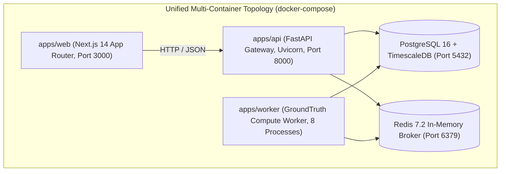

# ADR-010: Containerized Deployment, Worker Topology & Tiered Storage

**Status:** Accepted  
**Date:** 2026-09-19 (Updated: November 2026 for GroundTruth 2.0)  
**Deciders:** Viraj, Bhumi  

## Context

GroundTruth 2.0 must be reachable for enterprise due-diligence audits, automated continuous monitoring, and external demonstrations. It has three deployable surfaces: an HTTP API, a background worker, and a Next.js web application.

An environmental verification workload is an asynchronous, CPU-bound numerical task requiring seconds to minutes of matrix algebra, permutation placebos, and multi-temporal satellite raster processing. This rules out serverless function architectures with short execution limits.

## Decision

**1. Unified Python Container Base Image**
`apps/api` and `apps/worker` deploy from the exact same Docker base image, executing different entrypoint commands:
- `apps/api`: `uvicorn apps.api.main:app --host 0.0.0.0 --port 8000`
- `apps/worker`: `python -m apps.worker.main`
Using one image eliminates dependency divergence between the API gateway and the compute worker.

**2. Asynchronous Queue Backends**
Work is scheduled off the HTTP thread using a dual-queue architecture:
- Default: PostgreSQL table row leases (`platform.jobs.queue`) with `SELECT FOR UPDATE SKIP LOCKED`.
- Production Distributed: Redis + Celery / Arq (`platform.jobs.redis_queue`).

**3. Four-Tier Storage Hierarchy (`blob_store.py`)**
Artifacts are partitioned into four isolated tiers:
- `RAW_SOURCE`: Upstream STAC COGs and raw NetCDFs (cold, immutable).
- `INTERMEDIATE_ARTIFACT`: Intermediate chips and cloud masks (TTL auto-purged).
- `FINAL_EVIDENCE`: Verified `EvidenceBundle` instances and audit packages.
- `APPLICATION_METADATA`: Cryptographic SHA-256 sidecars and Sigstore manifests.

**4. Independent Frontend Deployment**
The Next.js 14 App Router application deploys as an independent container/SSR node, communicating with the API strictly over HTTPS using types generated from the backend OpenAPI 3.1 specification.

## Consequences

- **Easier**: Zero drift between worker and API dependencies; horizontal compute autoscaling independent of web traffic; local reproduction via `docker compose up`.
- **Harder**: Requires maintaining database migrations (`alembic`) and queue leasing heartbeats.
