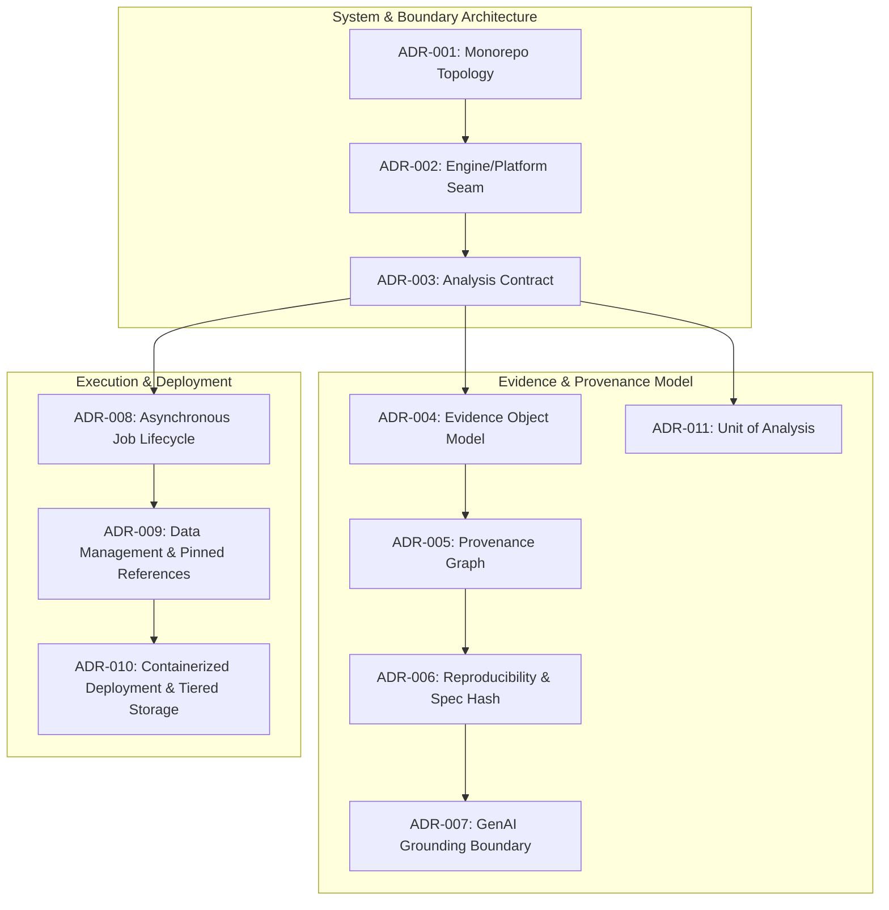

# Architecture Decision Records (ADRs)

An Architecture Decision Record (ADR) captures a critical architectural choice that constrains the design and would be expensive to reverse. It documents context, tradeoffs, alternatives considered, and binding consequences.

---

## Complete ADR Registry

| ADR | Title | Status | Deciders | Summary |
| :--- | :--- | :--- | :--- | :--- |
| [001](ADR-001-monorepo-structure.md) | Monorepo with One Python Distribution | **Accepted** | Viraj, Bhumi | Unified repository with `apps/` and `packages/groundtruth` for atomic commits and shared CI. |
| [002](ADR-002-engine-platform-boundary.md) | Split Engine and Platform by Enforced Contract | **Accepted** | Viraj, Bhumi | Absolute unidirectional dependency seam guarded by AST import parsing (`test_contract_boundary.py`). |
| [003](ADR-003-analysis-contract.md) | `AnalysisRequest` / `AnalysisResult` as Interface | **Accepted** | Viraj, Bhumi | Self-contained Pydantic v2 schemas; engine reads zero configuration or environment. |
| [004](ADR-004-evidence-object.md) | Evidence Bundle as the Unit of Scientific Output | **Accepted** | Viraj, Bhumi | Immutable, serializable `EvidenceBundle` as the sole currency of the reporting tier. |
| [005](ADR-005-provenance-model.md) | Mandatory Provenance on Every Value | **Accepted** | Viraj, Bhumi | SHA-256 derivation DAG on every metric, enabling "two-click provenance drill-down". |
| [006](ADR-006-reproducibility.md) | Reproducibility via `spec_hash` and Declared Seeds | **Accepted** | Viraj, Bhumi | Deterministic PRNG seeds and canonical request hashing ensure bit-level reproducibility. |
| [007](ADR-007-genai-boundary.md) | GenAI Strictly Downstream, Grounding in Code | **Accepted** | Viraj, Bhumi | LLMs only narrate verified bundles; 2% numeric check and prohibited accusation filtering. |
| [008](ADR-008-analysis-jobs.md) | Analyses as Asynchronous Jobs, Typed Refusals | **Accepted** | Viraj, Bhumi | Compute executed off HTTP loops; scientific refusals treated as succeeded jobs with error payloads. |
| [009](ADR-009-data-management.md) | Pinned Dataset References, Data Out of Git | **Accepted** | Viraj, Bhumi | Large rasters managed outside git via tiered blob storage; pinned `DatasetRef` in every run. |
| [010](ADR-010-deployment.md) | Containerized API, Worker, and Tiered Storage | **Accepted** | Viraj, Bhumi | Dual-container deployment from unified image; 8-process worker tuning, 4-tier storage hierarchy. |
| [011](ADR-011-unit-of-analysis.md) | Unit of Analysis is a Masked Administrative District | **Accepted** | Viraj, Bhumi | Standardized ADM2 districts with 10 km leakage buffers and pre-treatment baseline forest masks. |
