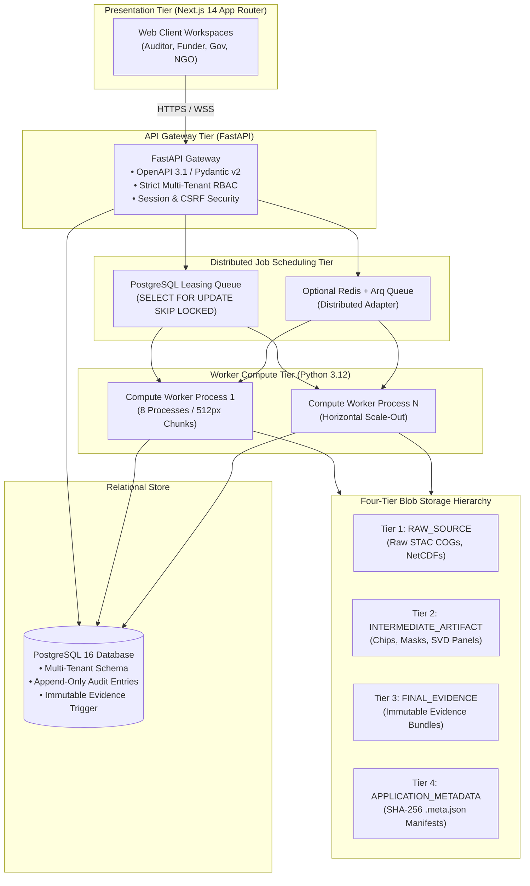
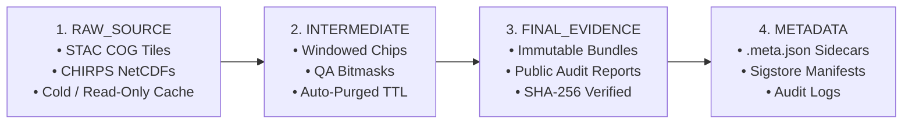

# Deployment Compute Architecture & Storage Hierarchy

**Project**: GroundTruth 2.0 — Enterprise Impact Verification Platform  
**Architecture Spec**: Task 5B Deployment-Aware Architecture  
**Status**: APPROVED & CODIFIED  
**Implementation**: `groundtruth.platform.storage.blob_store`, `groundtruth.platform.jobs`, `apps/api/`, `apps/worker/`

GroundTruth 2.0 is architected for dual-environment deployment:
1. **Local Developer Workstation**: Zero-external-dependency execution using local NVMe storage, multi-process CPU concurrency, and direct SQLite/PostgreSQL storage.
2. **Production Cloud Deployment**: Horizontally scalable container topology (Docker Compose / Kubernetes / Helm), SQL row-lease workers (with optional Redis/arq and Temporal adapters), managed PostgreSQL 16, and cloud object storage (AWS S3, Cloudflare R2, MinIO).

---

## 1. Four-Tier Storage Architecture (`blob_store.py`)

To prevent intermediate mathematical steps from contaminating public evidence packages, GroundTruth 2.0 partitions all data into four strictly isolated storage tiers:

### Tier 1: `RAW_SOURCE`
- **Contents**: Unprocessed satellite rasters retrieved directly from upstream cloud STAC providers (e.g., USGS Landsat Collection 2 COGs, Copernicus Sentinel-2 L2A tiles, CHIRPS gridded pentads).
- **Access**: Read-only cache; immutable upon ingestion.

### Tier 2: `INTERMEDIATE_ARTIFACT`
- **Contents**: Intermediate pixel arrays, cloud-masked rasters, unharmonized zonal reductions, and SVD decomposition matrices.
- **Access**: Internal compute workers only. Automatically purged via TTL policies after verification completion.

### Tier 3: `FINAL_EVIDENCE`
- **Contents**: Auditable evidence packages (`EvidenceBundle`, `CausalReadinessAssessment`, `VerificationReport`).
- **Standard**: Every object carries complete `Provenance`, `EvidenceState`, and cryptographic SHA-256 fingerprints.

### Tier 4: `APPLICATION_METADATA`
- **Contents**: Cryptographic sidecars (`.meta.json`), Sigstore Cosign signature bundles, OpenAPI schemas, and append-only audit records.

---

## 2. Storage Backend Driver Abstraction

The factory function `get_storage_backend(profile)` returns the appropriate driver:

### 2.1 `LocalStorageBackend` (Workstation & CI)
- Writes objects to disk hierarchies (`./data/storage/<tier>/...`).
- Implements atomic writes via unique temporary files and POSIX `os.replace` to prevent corrupted reads during process interruption.
- Automatically generates companion `.meta.json` sidecars containing SHA-256 hashes and acquisition timestamps.

### 2.2 `S3StorageBackend` (Production)
- Compatible with AWS S3, MinIO, Cloudflare R2, and Google Cloud Storage (via S3 compatibility API).
- Enforces Server-Side Encryption (SSE-S3), bucket versioning, and pre-signed URL generation for direct client visualization.

---

## 3. Workstation vs. Production Deployment Profile

| Dimension | Workstation Development Profile | Cloud Production Profile |
| :--- | :--- | :--- |
| **Worker Concurrency** | Worker process (`apps/worker`) + `ProcessPoolExecutor` helpers | Scale-out worker replicas against shared DB / optional Redis+Arq |
| **Memory Allocation** | Bounded stream / chunked raster windows | Container memory limits; horizontal worker scaling |
| **Relational DB** | SQLite / Local PostgreSQL 16 container | High-availability managed PostgreSQL 16 (RDS) |
| **Blob Persistence** | `LocalStorageBackend` (`STORAGE_BACKEND=local`) | `S3StorageBackend` (AWS S3 / Cloudflare R2 / MinIO) |
| **Queue Backend** | SQL table row leases (`JobQueue`) | SQL row leases (default) or optional Redis/Arq & Temporal |
| **Telemetry** | Local logging (stdout / stderr) | OpenTelemetry Collector → Prometheus / Grafana |

