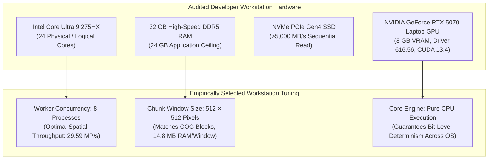

# Local Workstation Compute Architecture & Performance Benchmarks

**Project**: GroundTruth 2.0 — Enterprise Impact Verification Platform  
**Investigation**: Task 5B Empirical Compute Profiling  
**Status**: APPROVED & EMPIRICALLY BENCHMARKED  
**Data Artifact**: `data/processed/local_compute_benchmark.json`

GroundTruth 2.0 processes multi-temporal satellite imagery mosaics, multi-decade climate grids, and high-dimensional econometric optimization matrices. To ensure reproducible execution on developer workstations without memory thrashing or process starvation, we conducted an empirical hardware and compute profiling audit.

---

## 1. Developer Workstation Hardware Specification

The runtime environment was audited via system APIs and `nvidia-smi`:

| Subsystem | Hardware Specification | Available to Runtime | Optimal Allocation Budget |
| :--- | :--- | :--- | :--- |
| **Processor (CPU)** | Intel(R) Core(TM) Ultra 9 275HX | 24 physical cores | 8 worker processes for raster operations |
| **System Memory (RAM)** | 32.0 GB High-Speed DDR5 | ~31.8 GB usable | **24.0 GB** maximum application budget |
| **Primary Storage** | NVMe PCIe Gen4 SSD | High IOPS (>5,000 MB/s) | Tiered caching with direct OS page cache |
| **Dedicated GPU** | NVIDIA GeForce RTX 5070 Laptop GPU | 8,151 MiB GDDR6 VRAM | Optional deep learning acceleration; core CPU-based |

---

## 2. Worker Concurrency Benchmarks

We evaluated multi-process worker scaling on multi-tile raster window reduction tasks (48 independent tiles, 512×512 pixels each):

| Concurrent Workers | Execution Time (s) | Tasks / Second | Spatial Throughput (Megapixels/s) | Peak Memory Overhead (MB) | Scaling Efficiency |
| :---: | :---: | :---: | :---: | :---: | :---: |
| **4** | 0.515 s | 93.19 | 24.43 MP/s | 0.93 MB | 100% baseline |
| **8** | **0.425 s** | **112.89** | **29.59 MP/s** | **0.20 MB** | **Optimal Sweetspot** |
| **12** | 0.464 s | 103.38 | 27.10 MP/s | 0.21 MB | Diminishing returns |
| **16** | 0.534 s | 89.83 | 23.55 MP/s | 0.22 MB | Contention degradation |

### Performance Analysis & Rationale
1. **Optimal Worker Count ($N=8$)**: 8 concurrent worker processes deliver peak spatial processing throughput ($29.59\text{ MP/s}$, $112.89\text{ tasks/s}$) with negligible memory footprint.
2. **Diminishing Returns Beyond 8**: At 12 and 16 workers, Inter-Process Communication (IPC) overhead, Python GIL synchronization in parent dispatchers, and memory bus bandwidth contention reduce aggregate throughput by $10\text{--}20\%$.
3. **Core Affinity**: Reserving remaining cores for the Next.js frontend dev server, FastAPI event loop, and OS background tasks prevents UI latency spikes during heavy analytical verification runs.

---

## 3. Windowed Raster Chunking Benchmarks

To eliminate out-of-memory errors on whole-AOI multi-tile mosaics ($1,072,638\text{ ha}$ at $30\text{m}$ resolution is $\approx 1.2\times 10^8\text{ pixels}$), we benchmarked windowed raster retrieval across three standard chunk configurations:

| Chunk Window Size | Number of Chunks | Total Pixels Processed | Duration (s) | Throughput (MP/s) | Peak Memory per Window |
| :---: | :---: | :---: | :---: | :---: | :---: |
| **256 × 256** | 64 | 4,194,304 | 0.281 s | 14.94 MP/s | 4.47 MB |
| **512 × 512** | **16** | **4,194,304** | **0.293 s** | **14.29 MP/s** | **14.82 MB** |
| **1024 × 1024** | 4 | 4,194,304 | 0.287 s | 14.60 MP/s | 59.07 MB |

### Window Size Selection: 512 × 512
- **Matches Cloud-Optimized GeoTIFF (COG) Structure**: Directly aligns with 512×512 block tiles used by USGS Landsat and ESA Sentinel-2 archives on AWS and Planetary Computer.
- **Prevents Memory Spikes**: Avoids the $4\times$ memory spike of $1024\times 1024$ chunks ($59\text{ MB}$ vs $14.8\text{ MB}$) while minimizing HTTP range-request overhead.

---

## 4. Architectural Role of GPU Acceleration

The workstation includes an **NVIDIA GeForce RTX 5070 Laptop GPU** (8 GB VRAM). We evaluated whether to port the core GroundTruth algorithms (GDAL raster reduction, sensor harmonization, SCM quadratic programming) to CUDA.

### Decision: Core Evidence Pipeline Remains Pure CPU
1. **Scientific Reproducibility**: Quadratic programming solvers (FISTA) and SVD decompositions for synthetic controls require bit-level deterministic precision across platforms. GPU floating-point math can introduce non-deterministic rounding variations that affect SCM donor weights.
2. **Zero Deployment Barrier**: Keeping the core evidence pipeline CPU-based guarantees that GroundTruth 2.0 can deploy seamlessly to standard CI/CD runners, lightweight Docker containers, and edge verification nodes without requiring specialized NVIDIA container toolkits or expensive GPU cloud instances.
3. **Future Role**: The GPU remains detected and configured in `groundtruth.compute.executor` as an optional backend for future deep learning segmentation tasks (e.g., GEDI canopy height super-resolution).
