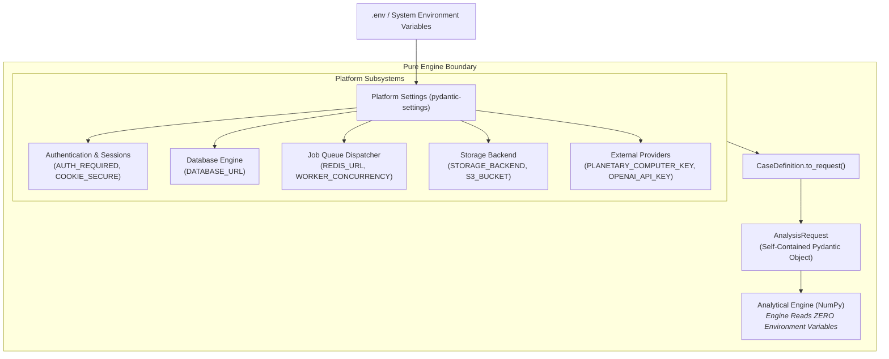

# Configuration Specification

**Module**: `groundtruth.platform.config.Settings` (pydantic-settings)  
**Philosophy**: 12-Factor App Environment Configuration with Zero Engine Bleed.

All runtime configuration in GroundTruth 2.0 is driven by environment variables read once through a strongly typed Pydantic v2 `Settings` class. No secrets are baked into container images, and no credentials live in git.




---

## 1. Core Configuration Invariants

1. **The Engine Reads No Configuration**: The analytical engine reads zero environment variables. Every parameter needed for analysis arrives explicitly via `AnalysisRequest`. This guarantees that an analysis can be replayed years later with guaranteed reproducibility.
2. **Secrets are Strongly Typed**: Sensitive values use Pydantic's `SecretStr`. They cannot be printed, serialized to JSON, or dumped in logs. `groundtruth doctor` checks for credential presence without leaking string content.
3. **No Silent Fallback**: If an external provider is explicitly requested (e.g., Earth Engine or Planetary Computer) but credentials are missing, the system raises an explicit configuration error rather than silently substituting simulated data.

---

## 2. Configuration Parameters Matrix

### 2.1 Multi-Tenancy & Authentication

| Variable | Type | Default | Description |
| :--- | :--- | :--- | :--- |
| `AUTH_REQUIRED` | `bool` | `false` (every shipped profile sets `true`) | Enforces sign-in on the role-gated endpoints. The API refuses to start with `APP_ENV=production` and this `false` (#51). `POST /cases`, analysis runs and project routes require sign-in regardless. |
| `AUTH_ALLOW_REGISTRATION` | `bool` | `false` | When `false`, only signed-in administrators can register new tenant accounts. |
| `AUTH_COOKIE_SECURE` | `bool` | `true` | Enforces `Secure` flag on session cookies (must be `true` in production HTTPS). |
| `AUTH_SESSION_DAYS` | `int` | `7` | Active session and cookie lifetime in days. |
| `CORS_ALLOWED_ORIGINS` | `str` | `http://localhost:3000` | Comma-separated list of exact allowed browser origins (scheme, host, port). |
| `ANALYSIS_RATE_LIMIT` | `int` | `20` | Analysis submissions one user may make per window, `POST /jobs` and `/verify` together (#51). |
| `ANALYSIS_RATE_WINDOW_SECONDS` | `int` | `600` | The window for `ANALYSIS_RATE_LIMIT`. |
| `API_METRICS_PORT` | `int` | `9464` | Internal port for the API's Prometheus metrics; `0` turns them off (#50). |
| `WORKER_METRICS_PORT` | `int` | `9465` | Internal port for a worker's Prometheus metrics; `0` turns them off. |
| `METRICS_BIND_ADDRESS` | `str` | `127.0.0.1` | Address the metrics servers listen on; containers set `0.0.0.0` and never publish the port. |

### 2.2 Storage, Security & Persistence

| Variable | Type | Default | Description |
| :--- | :--- | :--- | :--- |
| `DATABASE_URL` | `str \| None` | `None` | PostgreSQL or SQLite connection string (`postgresql+psycopg://...`). Required by API/worker when persistence is enabled. |
| `PROJECT_DOCUMENTS_DIR` | `Path` | `data/project_documents` | Local blob-store root for uploaded project documents when `STORAGE_BACKEND` is local. |
| `PROJECT_DOCUMENT_MAX_BYTES` | `int` | `10485760` (10 MB) | Largest accepted project document upload in bytes. |
| `STORAGE_BACKEND` | `str` | `local` | Blob storage driver selector (`local` via `LocalStorageBackend`, or `s3` via `S3StorageBackend`). |
| `S3_BUCKET` | `str \| None` | `None` | Target S3/R2/MinIO bucket name when `STORAGE_BACKEND=s3`. |
| `TRUST_PROXY_HEADERS` | `bool` | `false` | Trust `X-Forwarded-For` for rate-limiting client identification only behind a trusted reverse proxy. |

### 2.3 Ingestion, GenAI & Optional Redis

| Variable | Type | Default | Description |
| :--- | :--- | :--- | :--- |
| `OBSERVATION_INGESTION_ENABLED` | `bool` | `true` | Enable background Sentinel-2 observation ingestion polling in the worker process. |
| `INGESTION_POLL_SECONDS` | `float` | `10.0` | Poll interval for queued observation ingestion jobs. |
| `REDIS_URL` | `str \| None` | `None` | Optional Redis connection URL for shared `RedisRateLimitBackend` or optional `redis_queue` adapter. |
| `GENAI_PROVIDER` | `str` | `none` | Narration backend (`none`, `nugen`, `openai`, `anthropic`, `gemini`). Defaults to deterministic rendering. |
| `GEMINI_API_KEY` / `OPENAI_API_KEY` / `ANTHROPIC_API_KEY` / `NUGEN_API_KEY` | `SecretStr \| None` | `None` | Downstream narration keys (masked via `SecretStr`). |
| `GROQ_API_KEY` | `SecretStr \| None` | `None` | Opt-in Groq inference key for qualitative `ProjectContext` narration (`status: "unavailable"` when unset). |

---

## 3. The `groundtruth doctor` Diagnostic Tool

Developers and deployment operators verify runtime environment configuration and scientific capabilities honestly using the CLI (`groundtruth.cli:main`):

```bash
groundtruth doctor
```

`groundtruth doctor` reports package/engine versions, whether optional extras (`fastapi`, `geopandas`, `httpx`) and credentials are present, explicitly flags `"earth observation ingestion implemented : no"` when no validated cloud ingestion registry entry is active, and reports biomass carbon conversion as `"NOT CALIBRATED"`.
