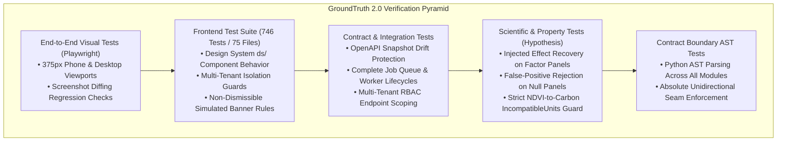

# Testing Strategy & Verification Architecture

**Backend Suite**: 2,130+ automated offline Python tests (`pytest`, `hypothesis`)  
**Frontend Suite**: 746 automated TypeScript tests across 75 files (`vitest`, React Testing Library, Playwright)  
**Philosophy**: Defending against plausible scientific falsehoods, mathematical drift, and cross-boundary coupling.

In environmental verification software, the most dangerous defect is not an uncaught exception or crash. The fatal failure mode is a **scientifically invalid result that appears mathematically plausible**—a figure that renders cleanly, passes visual inspection, and presents an ungrounded carbon additionality claim.




---

## 1. What GroundTruth 2.0 Defends Against

| Scientific Vulnerability | Automated Defense Mechanism | Test Suite |
| :--- | :--- | :--- |
| **Estimator Error** | Injected effect recovery test on synthetic factor panel | `tests/test_causal.py` |
| **False Positive Detection** | Null-panel permutation test asserting no additionality found | `tests/test_causal.py` |
| **Silent Imputation** | Asserts pipeline raises `DataUnavailableError` on missing rasters | `tests/test_real_observations.py` |
| **Index-to-Carbon Conflation** | Parametrized test asserting `IncompatibleUnitsError` on NDVI vs. tCO2e | `tests/test_units.py` |
| **GenAI Hallucination** | Adversarial grounding test checking 2% numeric tolerance and fallback | `tests/test_grounding.py` |
| **Boundary Erosion** | AST parser failing build if engine imports platform or I/O | `tests/test_contract_boundary.py` |
| **Frontend/Backend Drift** | OpenAPI snapshot generator failing CI if TypeScript types are stale | `tests/test_openapi_snapshot.py` |
| **Data Immutability** | Database trigger test verifying `UPDATE` fails on `evidence_bundles` | `tests/test_evidence_store.py` |

---

## 2. The Core Scientific Verification Tests

### 2.1 Injected Effect Recovery
The test generates a synthetic panel from the exact data-generating process assumed by the synthetic control model, injects a known additionality step ($+0.060\text{ NDVI}$), and asserts that the estimator recovers the effect within an empirical tolerance ($\pm 0.005$):

```python
def test_recovers_a_known_injected_effect(factor_panel):
    result = run_analysis(factor_panel.request_with_effect(0.060), factor_panel.data_access)
    estimate = result.bundle.get("effect.point_estimate").value
    assert abs(estimate - 0.060) < 0.005
```

### 2.2 Null Panel Rejection
The model must not find additionality where none exists. A synthetic panel with zero injected intervention must return a statistically insignificant p-value ($p > 0.10$) and an attribution verdict of `INCONCLUSIVE` or `NO_EVIDENCE_OF_ADDITIONALITY`.

### 2.3 The GenAI Grounding Gate
A test submits an adversarial LLM narrative containing an invented carbon figure (`"avoided 42,000 tonnes of emissions"`) and accusatory fraud language. The test asserts that `contracts/grounding.py` unconditionally rejects the narrative, blocks publication, and seamlessly falls back to the deterministic report renderer.

---

## 3. Running the Verification Suites

### 3.1 Backend Test Execution (2,130+ Offline Tests)

```bash
# Run full offline backend suite (live network tests require --run-network)
pytest

# Run with coverage report
pytest --cov=groundtruth --cov-report=term-missing
```

### 3.2 Frontend Test Execution (746 Tests / 75 Files)

```bash
cd apps/web

# Run all 746 unit and component tests
npm test -- --run

# Run TypeScript typecheck
npm run typecheck

# Check OpenAPI snapshot synchronization
npm run check:api-types

# Run Playwright End-to-End visual specs
npm run test:e2e
```
