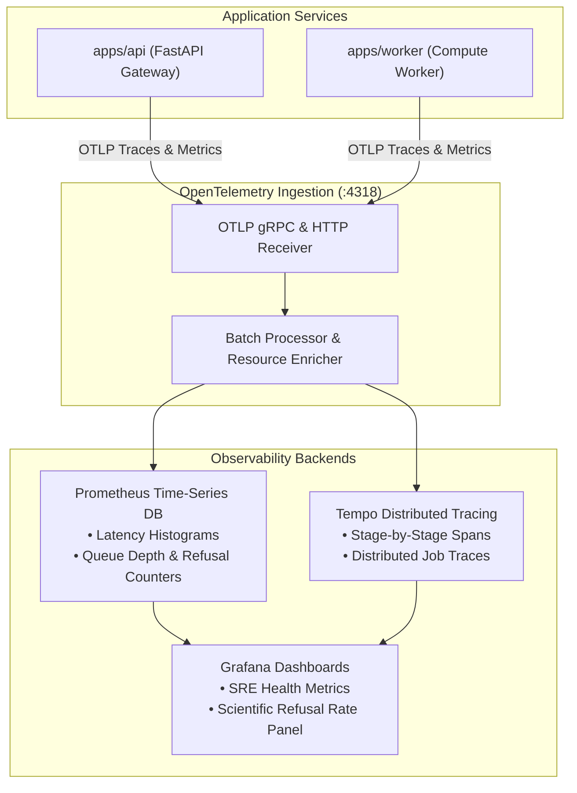
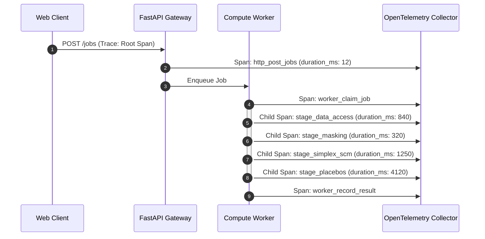

# Observability & Distributed Telemetry

**Package**: `packages/groundtruth/src/groundtruth/observability/`  
**Telemetry Standard**: OpenTelemetry (OTLP traces, metrics, structured JSON logs).  
**Collector Targets**: Prometheus (:9090), Grafana (:3001), Tempo (:3200), OpenTelemetry Collector (:4318).

GroundTruth 2.0 provides native observability across HTTP request lifecycles, background worker queues, and analytical engine execution stages.




---

## 1. Application Wiring & Stage Spans

Telemetry is initialized in `platform/api/app.py` and `apps/worker/main.py` using `setup_telemetry(app)`:

```python
from groundtruth.observability import setup_telemetry, stage_span

# 1. Initialize global OpenTelemetry tracing and metrics
setup_telemetry(app)

# 2. Instrument internal analytical computation stages
with stage_span("causal_estimation", case_id=request.case_id, run_id=run_id):
    # FISTA quadratic programming solver runs here
    result = fit_synthetic_control(...)
```



---

## 2. Standardized Metrics Registry

| Metric Name | Type | Labels | Description |
| :--- | :--- | :--- | :--- |
| `gt_jobs_submitted_total` | Counter | `case_id`, `data_mode` | Total verification jobs submitted |
| `gt_queue_latency_seconds` | Histogram | `queue_backend` | Delay between job submission and worker claim |
| `gt_engine_stage_duration_seconds`| Histogram | `stage`, `data_mode` | Execution duration per analytical stage (`matching`, `causal`, `placebo`) |
| `gt_verdict_total` | Counter | `status`, `verdict_label`| Breakdown of completed runs (`measured`, `refused`, `failed`) |
| `gt_refusal_rate` | Gauge | `case_id` | Rolling percentage of jobs ending in scientific refusal |

---

## 3. Local Observability Stack

Launch the complete local telemetry monitoring stack via Docker Compose:

```bash
docker compose -f docker-compose.yml -f infrastructure/observability/docker-compose.observability.yml up -d
```

- **Grafana**: `http://localhost:3001` (Anonymous viewer enabled)
- **Prometheus**: `http://localhost:9090`
- **Tempo**: `http://localhost:3200`
- **OTel Collector**: `http://localhost:4318`
