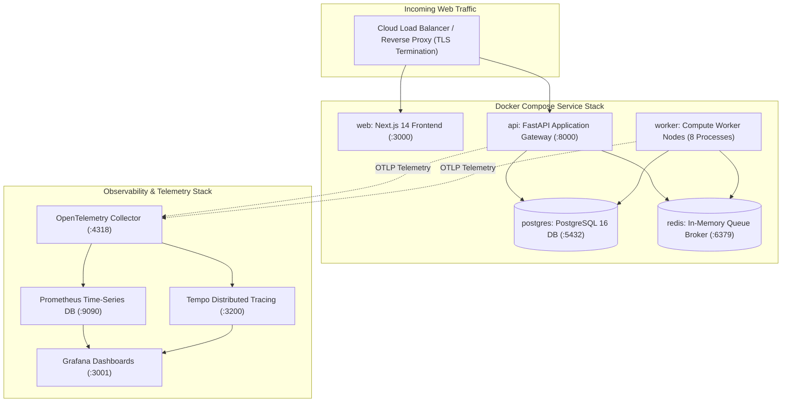
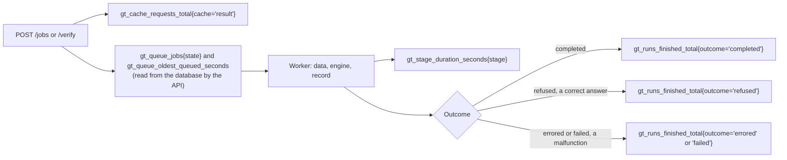

# Operations Manual

**Subsystems**: Deployment, Container Orchestration, Observability, Failure Runbooks  
**Stack**: Docker Compose, PostgreSQL 16, Redis 7.2, OpenTelemetry, Prometheus, Grafana.

This manual provides operational runbooks and monitoring guidelines for running GroundTruth 2.0 in production environments.




---

## 1. Containerized Stack Deployment

GroundTruth 2.0 is deployed locally and in production via unified Docker Compose manifests:

```bash
# 1. Run database migrations to bring schema to head
docker compose run --rm api alembic upgrade head

# 2. Launch production stack in background
docker compose up -d

# 3. Verify health probes
curl -f http://localhost:8000/health
curl -f http://localhost:3000/api/health
```

### 1.1 Container Health Probes
- **Liveness Probe** (`GET /health/liveness`): Confirms the ASGI event loop is active and accepting socket connections.
- **Readiness Probe** (`GET /health`): Validates database connectivity, Redis broker availability, and external provider authentication tokens.

---

## 2. Observability & Key Metrics

The API and every worker serve Prometheus metrics on **internal ports** (#50): the API on
`9464`, a worker on `9465` (`API_METRICS_PORT`, `WORKER_METRICS_PORT`). They are never the
public API port and are never published outside the deployment's network: Compose only
`expose`s them, and no Helm Service or Ingress routes to them. `infrastructure/observability`
scrapes both (start the main stack first: Prometheus joins its `groundtruth` network).



| Question | Metric | Labels (fixed lists only) |
|---|---|---|
| How long does each stage take? | `gt_stage_duration_seconds` (histogram) | `stage`: data, engine, record |
| How much work is waiting? | `gt_queue_jobs`, `gt_queue_oldest_queued_seconds`, `gt_queue_metrics_up` | `state`: queued, running |
| How often does the engine refuse? | `gt_runs_finished_total`; the rate is `refused / (completed + refused)` | `outcome`: completed, refused, errored, failed, retried, cancelled; `path`: job, verify |
| Is the cache doing its job? | `gt_cache_requests_total` | `cache`: result, reduction; `result`: hit, miss |
| Is anyone over the submission budget? | `gt_submissions_rate_limited_total` | `path` |

**No label carries a case, run, user, email or organization**: they would leak tenant data to
anyone who can read the metrics. A value outside a label's list is recorded as `other`.

### 2.1 The Most Critical Metric: Refusal Rate
> [!IMPORTANT]
> **A Scientific Refusal is NOT an Operational Incident**:
> A refusal occurs when the causal engine correctly declines to estimate an effect due to poor cloud cover, missing donors, or unverified sensor calibration.
> 
> A sudden spike in the refusal rate indicates that upstream satellite imagery archives have degraded or that the project boundary has changed. **Do not page on-call engineers for refusals, and never tune causal gates to artificially lower the refusal rate.**
>
> A refusal rate of **zero** is more suspicious than a high one: it can mean the refusal gates
> stopped running.

### 2.2 Alerts and what to do

Rules: `infrastructure/observability/alerts.yml`, loaded by Prometheus and unit-tested in CI by
`promtool test rules alerts.test.yml`. **Page** means look now; **warning** means look during
working hours. No refusal alert pages, and refusals never count towards the failure rate.

| Alert | Fires when | Severity | What to do |
|---|---|---|---|
| `GroundTruthJobFailureRateHigh` | More than 10% of finished runs errored or failed over 15 minutes, on at least 5 runs, for 10 minutes | page | Read the worker logs for those runs (`run_id`, `stage`); check the database and data providers (3.1, 3.2). |
| `GroundTruthQueueBacklog` | More than 50 runs queued for 15 minutes | page | Check that workers are running and claiming (`stage: claim` lines); add workers. |
| `GroundTruthQueueStale` | The oldest queued run has waited over 30 minutes | page | As above: nothing is claiming work, even if the queue is short. |
| `GroundTruthQueueMetricsMissing` | The queue depth cannot be read for 10 minutes | warning | The two alerts above are blind: check the API's metrics port and its database connection. |
| `GroundTruthRefusalRateShift` | The last hour's refusal rate is 25 points from the last 7 days', on at least 20 runs, for 30 minutes | warning | Look for a change in input data or method. **Never** tune a gate to move the rate. |
| `GroundTruthRefusalRateZero` | No refusals in 24 hours despite at least 50 answered runs, for 1 hour | warning | Check that the refusal gates still run. |

Routing a page to a person (Alertmanager receivers) is deployment-specific and not part of
this repository.

### 2.3 Logs

Both processes write one JSON object per line. Every line has `run_id`, `case_id` and `stage`
(`null` outside an analysis, so queries can rely on the keys); API lines also carry
`request_id`, the same id the client sees in `X-Request-ID`. Configured secrets, database
passwords, bearer tokens and key material are removed from every part of a line before it is
written; a line that cannot be redacted is withheld, never written as it was. On the `/verify`
path the engine creates the run id, so lines logged inside the engine carry the case and stage,
and the run id joins on the next line.

---

## 3. Operational Runbooks

### 3.1 Scenario: Upstream STAC Provider Quota Exhaustion
- **Symptom**: Jobs fail with `DataUnavailableError` (HTTP 501); log messages report `429 Too Many Requests` from Planetary Computer or Earth Engine.
- **Action**:
  1. The pipeline automatically fails closed; zero partial bundles are persisted.
  2. Implement exponential backoff on the worker by setting `STAC_REQUEST_BACKOFF_SECONDS=10`.
  3. Rotate provider API credentials in `.env` and restart worker containers: `docker compose restart worker`.

### 3.2 Scenario: Worker Process Crash or Kernel OOM
- **Symptom**: A worker terminates abruptly during a massive raster mosaic reduction.
- **Action**:
  1. The PostgreSQL row lease expires after 300 seconds (`lease_expires_at < NOW()`).
  2. The next available worker automatically reaps the expired lease and retries the job.
  3. Because runs are strictly deterministic (ADR-006), the retry is completely safe and idempotent.

### 3.3 Scenario: Correction of a Published Result
- **Symptom**: An independent audit reveals that a published evidence bundle used an unvalidated sensor cross-calibration table.
- **Action**:
  1. **Never edit an existing bundle**: Evidence bundles are immutable (`UPDATE` is blocked by database triggers).
  2. Re-run the analysis under a corrected specification to generate a new `run_id`.
  3. Mark the prior run superseded in `analysis_runs` and publish a formal audit addendum.
