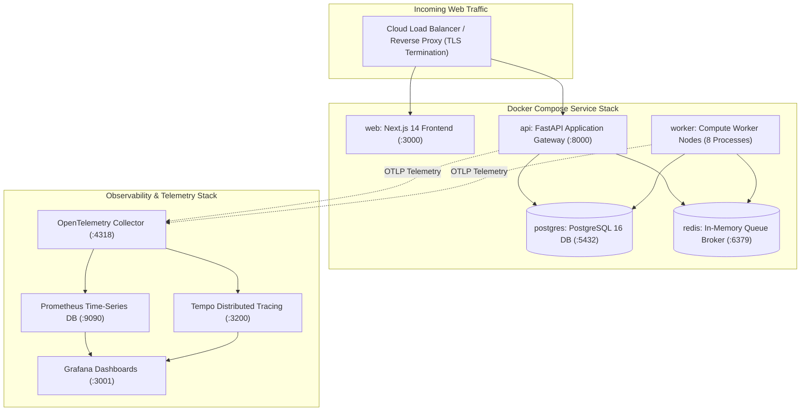
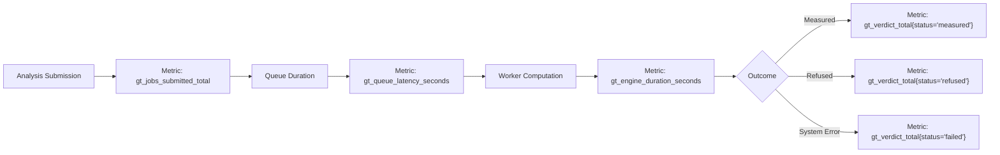

# Operations Manual

**Subsystems**: Deployment, Container Orchestration, Observability, Failure Runbooks  
**Stack**: Docker Compose, PostgreSQL 16, Redis 7.2, OpenTelemetry, Prometheus, Grafana.

This manual provides operational runbooks and monitoring guidelines for running GroundTruth 2.0 in production environments.




---

## 1. Containerized Stack Deployment

GroundTruth 2.0 is deployed locally and in production via unified Docker Compose manifests:

```bash
# 1. Run database migrations to bring schema to head
docker compose run --rm api alembic upgrade head

# 2. Launch production stack in background
docker compose up -d

# 3. Verify health probes
curl -f http://localhost:8000/health
curl -f http://localhost:3000/api/health
```

### 1.1 Container Health Probes
- **Liveness Probe** (`GET /health/liveness`): Confirms the ASGI event loop is active and accepting socket connections.
- **Readiness Probe** (`GET /health`): Validates database connectivity, Redis broker availability, and external provider authentication tokens.

---

## 2. Observability & Key Metrics

GroundTruth 2.0 emits structured OpenTelemetry traces and Prometheus metrics:



### 2.1 The Most Critical Metric: Refusal Rate
> [!IMPORTANT]
> **A Scientific Refusal is NOT an Operational Incident**:
> A refusal occurs when the causal engine correctly declines to estimate an effect due to poor cloud cover, missing donors, or unverified sensor calibration.
> 
> A sudden spike in the refusal rate indicates that upstream satellite imagery archives have degraded or that the project boundary has changed. **Do not page on-call engineers for refusals, and never tune causal gates to artificially lower the refusal rate.**

---

## 3. Operational Runbooks

### 3.1 Scenario: Upstream STAC Provider Quota Exhaustion
- **Symptom**: Jobs fail with `DataUnavailableError` (HTTP 501); log messages report `429 Too Many Requests` from Planetary Computer or Earth Engine.
- **Action**:
  1. The pipeline automatically fails closed; zero partial bundles are persisted.
  2. Implement exponential backoff on the worker by setting `STAC_REQUEST_BACKOFF_SECONDS=10`.
  3. Rotate provider API credentials in `.env` and restart worker containers: `docker compose restart worker`.

### 3.2 Scenario: Worker Process Crash or Kernel OOM
- **Symptom**: A worker terminates abruptly during a massive raster mosaic reduction.
- **Action**:
  1. The PostgreSQL row lease expires after 300 seconds (`lease_expires_at < NOW()`).
  2. The next available worker automatically reaps the expired lease and retries the job.
  3. Because runs are strictly deterministic (ADR-006), the retry is completely safe and idempotent.

### 3.3 Scenario: Correction of a Published Result
- **Symptom**: An independent audit reveals that a published evidence bundle used an unvalidated sensor cross-calibration table.
- **Action**:
  1. **Never edit an existing bundle**: Evidence bundles are immutable (`UPDATE` is blocked by database triggers).
  2. Re-run the analysis under a corrected specification to generate a new `run_id`.
  3. Mark the prior run superseded in `analysis_runs` and publish a formal audit addendum.
